# Microservices Design Patterns: Service Discovery Pattern

---

## 1. Executive Architectural Overview & Intent

In a traditional, monolithic enterprise architecture or static bare-metal deployment, services communicate over predictable, long-lived network paths. IP addresses and port numbers are statically allocated, recorded in configuration management repositories (Ansible, Puppet, Chef), or mapped via static DNS records (`db.internal.corp`, `auth-service.prod`).

Modern cloud-native and containerized ecosystems (Kubernetes, AWS ECS, Nomad) completely invalidate the assumption of static networking:
- **Ephemeral Lifecycles:** Containers and virtual machines are continuously scheduled, evicted, restarted, and replaced across heterogeneous physical nodes.
- **Dynamic Autoscaling:** Service fleets elastically scale from tens to thousands of instances in response to real-time traffic spikes, latency thresholds, or queue depths, then contract to save compute costs.
- **Dynamic Port Allocation:** Multiple instances of the same service collocated on a single container host or worker node cannot bind to the same host port, necessitating dynamic host-port bridging or virtual overlay networks (VXLAN, Geneve, Calico, Cilium).
- **Chaos & Infrastructure Volatility:** Cloud spot instances, rolling software deployments, canary rollouts, and hardware node degradations cause constant instance churn.

The **Service Discovery Pattern** provides an automated, distributed control plane and routing mechanism that dynamically locates, tracks, and routes traffic to available, healthy service instances without human intervention or static configuration updates.

```
+-----------------------------------------------------------------------------------------+
|                                SERVICE DISCOVERY LIFECYCLE                              |
|                                                                                         |
|   1. Startup & Register        2. Periodic Heartbeat           3. Deregister / Evict   |
|   +-------------------+       +-----------------------+       +---------------------+   |
|   | Provider Instance | ----> |   Service Registry    | <---- | Provider / Prober   |   |
|   | [IP, Port, Meta]  |       | [State Table / Cache] |       | Graceful / Timeout  |   |
|   +-------------------+       +-----------------------+       +---------------------+   |
|                                           |                                             |
|                                           | 4. Sync / Delta Watch / DNS Lookup          |
|                                           v                                             |
|                               +-----------------------+                                 |
|                               |  Consumer / Sidecar   |                                 |
|                               | [Local Routing Table] |                                 |
|                               +-----------------------+                                 |
|                                           |                                             |
|                                           | 5. Direct Call (Load Balanced)              |
|                                           v                                             |
|                               +-----------------------+                                 |
|                               |  Healthy Target Node  |                                 |
|                               +-----------------------+                                 |
+-----------------------------------------------------------------------------------------+
```

### Core Architectural Objectives
1. **Location Decoupling:** Consumer services invoke upstream dependencies using logical service identifiers (e.g., `payment-service`, `inventory.production`) rather than ephemeral IP:Port tuples.
2. **Real-Time Health Awareness:** Immediately isolate unready, degraded, or dead instances to prevent sending user traffic into black holes.
3. **Resilient Load Distribution:** Distribute network traffic across homogeneous or heterogeneous instances using sophisticated load-balancing strategies (Weighted Round Robin, Least Connections, Power-of-Two-Choices).
4. **Topology and Locality Awareness:** Bias routing toward instances in the same Availability Zone (AZ), rack, or region to minimize inter-AZ data transfer fees and network egress latency.

---

## 2. The CAP Theorem in Service Discovery: AP vs. CP Registries

The architectural design of any service registry is fundamentally bound by Eric Brewer's **CAP Theorem** (Consistency, Availability, Partition Tolerance). In a distributed network, network partitions ($P$) are inevitable. Therefore, an architect must choose between prioritizing immediate state **Consistency ($C$)** or uninterrupted operational **Availability ($A$)**.

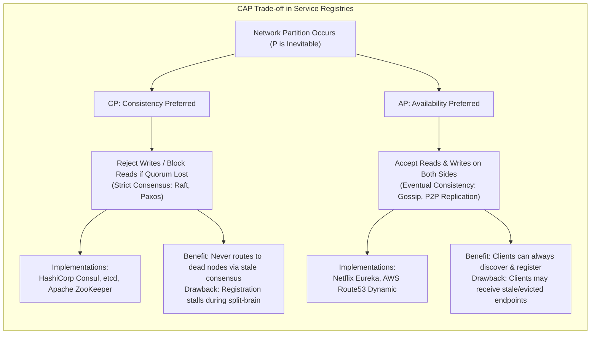

### 2.1 The AP Approach: Netflix Eureka ("Availability Over Freshness")
Netflix built Eureka on the core tenet that in microservice communication, **a stale route is often better than no route at all**. 
- If a client receives a registry snapshot containing an instance that recently crashed, client-side resilience mechanisms (timeouts, retries with backoff, circuit breakers like Hystrix/Resilience4j) will simply fail over to the next candidate instance.
- However, if the registry becomes unavailable because it cannot establish a consensus quorum during an AWS network split, *the entire system ceases to function*, preventing deployments, autoscaling, and dynamic routing.

#### Eureka Self-Preservation Mode
When network partitions or transient connectivity drops occur between Eureka nodes and microservice instances, Eureka servers may suddenly stop receiving heartbeats from a large percentage of instances.
- In a naive system, the registry would immediately evict all non-heartbeating instances, purging the entire service directory.
- Eureka implements **Self-Preservation Mode**: If the number of heartbeat renewals drops below a configurable threshold (typically $85\%$ of expected renewals over a 15-minute sliding window), Eureka halts automatic instance evictions.
$$\text{Threshold} = N \times \left(\frac{60}{\text{HeartbeatIntervalSec}}\right) \times \text{RenewalPercentThreshold}$$
- During self-preservation, the registry continues to serve whatever data it has, protecting the fleet from catastrophic mass-deregistration caused by transient network blips.

### 2.2 The CP Approach: HashiCorp Consul & etcd ("Strict Consensus")
Systems like **HashiCorp Consul** and **etcd** (the backbone of Kubernetes) implement the **Raft consensus algorithm**. 
- These registries mandate a strict mathematical quorum:
$$Q = \left\lfloor \frac{N}{2} \right\rfloor + 1$$
- If a 5-node cluster partitions into a 3-node partition and a 2-node partition, the 3-node majority continues accepting registrations and state mutations. The minority 2-node partition **refuses writes** and, depending on configuration, rejects or marks reads as stale.
- **Architectural Rationale:** Systems that utilize the registry not only for endpoint discovery but also for distributed locking, leader election, and dynamic configuration synchronization require absolute linearizability and sequential consistency. Routing tables must never diverge into split-brain states.

---

## 3. Detailed Architectural Approaches & Topologies

There are four primary architectural paradigms for implementing service discovery in distributed production systems.

```mermaid
flowchart TD
    subgraph ClientSide ["1. Client-Side Discovery (e.g., Eureka + Spring Cloud LB)"]
        C1["Client Service"] -->|"1. Fetch Endpoints"| R1[("Service Registry")]
        C1 -->|"2. Direct Request (Client LB)"| I1["Target Service Instance"]
    end

    subgraph ServerSide ["2. Server-Side Discovery (e.g., K8s CoreDNS + Kube-Proxy)"]
        C2["Client Service"] -->|"1. Request to Virtual IP"| LB["Load Balancer / Proxy"]
        LB -->|"Queries / Synced from"| R2[("Cluster State / etcd")]
        LB -->|"2. Forward"| I2["Target Service Instance"]
    end

    subgraph ServiceMesh ["3. Service Mesh Discovery (e.g., Istio + Envoy xDS)"]
        C3["Client App Container"] -->|"1. Localhost Intercept"| S1["Envoy Sidecar Proxy"]
        CP["Mesh Control Plane (Istiod)"] -->|"xDS gRPC Streaming Push"| S1
        S1 -->|"2. mTLS Direct Connection"| S2["Envoy Sidecar Proxy"]
        S2 -->|"3. Forward to Port"| I3["Target App Container"]
    end

    subgraph GossipRegistry ["4. Decentralized Consensus / Gossip (e.g., Consul Serf + Raft)"]
        C4["Client App"] -->|"Query Local Agent"| A1["Consul Client Agent"]
        A1 <-->|"Gossip Protocol (Serf)"| A2["Consul Server Cluster (Raft)"]
        A1 -->|"Direct Connect"| I4["Target Service Instance"]
    end
```

---

### Approach 1: Client-Side Discovery

In the **Client-Side Discovery** pattern, the service consumer assumes full responsibility for discovering available upstream instances, querying the service registry, maintaining a local in-memory routing cache, executing health evaluations, and executing load-balancing algorithms over target instances.

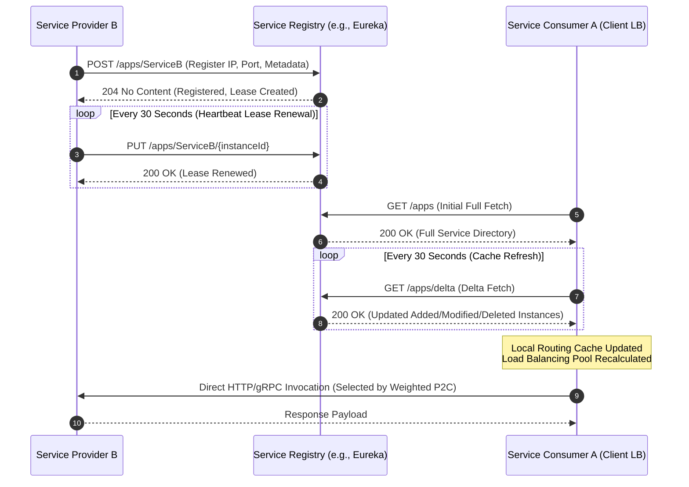

#### High-Level Design (HLD)
- **Zero Intermediary Hops:** Requests travel point-to-point directly from consumer to provider over the network. There is no centralized load balancer or proxy sitting in the data path.
- **Distributed Load Balancing Computation:** The CPU overhead of computing load-balancing weights, connection pools, and health metrics is distributed across thousands of client runtimes instead of bottlenecking on a central load balancer.
- **Resilience Against Registry Outages:** Because clients maintain a local in-memory cache of service endpoints, the entire service registry cluster can experience a catastrophic failure or network partition without immediately interrupting in-flight inter-service communication.

#### Low-Level Design (LLD)
1. **Cache Synchronization Pipeline:**
   - **Full Cache Fetch:** On application bootstrap, the client issues a blocking HTTP GET request to download the complete active instance registry.
   - **Delta Cache Fetch:** Every $T_{\text{refresh}}$ (typically 30 seconds), the client issues a delta request retrieving only records mutated within a rolling time window. A rolling hash or version sequence number validates delta integrity. If the hash mismatches, a full fetch is triggered automatically.
2. **Client-Side Load Balancing Algorithms:**
   - **Weighted Round Robin (WRR):** Instances are served sequentially according to predefined weight multipliers (e.g., based on CPU core count or canary status).
   - **Least Connections / Active Requests:** The client tracks open TCP/HTTP sockets per instance and directs new traffic to the instance with the fewest outstanding requests.
   - **Power of Two Choices (P2C) with EWMA:** The client randomly samples two candidate instances from the pool, inspects their Exponentially Weighted Moving Average (EWMA) latency and active in-flight requests, and picks the superior node. P2C avoids the "thundering herd" oscillations typical of pure Least Connections.
   - **Consistent Hashing (Ketama):** Endpoints and request keys (e.g., `user_id`) are mapped onto a 32-bit hash ring with virtual nodes. Guarantees deterministic routing for stateful caching workloads while minimizing remapping when nodes churn.

---

### Approach 2: Server-Side Discovery (Kubernetes Native)

In **Server-Side Discovery**, the consumer is decoupled from discovery logic. The consumer issues requests to a well-known, static virtual network address or DNS name. An intermediary router, load balancer, or kernel packet-filter rewires the request to an active, healthy backend instance.

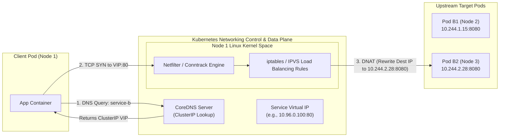

#### High-Level Design (HLD)
- **Language and Framework Agnostic:** The consuming application requires no proprietary discovery libraries (e.g., no Eureka jars, no Consul SDKs). A standard `curl`, HTTP client, or gRPC stub works transparently.
- **Centralized Routing Policies:** Security controls, network policies, and access controls are enforced at the network or infrastructure layer.
- **Architectural Simplicity for Developers:** Software engineers write code targeting standard URIs like `http://payment-service.prod.svc.cluster.local:8080`.

#### Low-Level Design (LLD): Kubernetes kube-proxy, CoreDNS & Kernel Routing
In Kubernetes, Server-Side Discovery operates via an orchestration of three distinct components:

1. **The Registry Backbone (`etcd` + API Server):**
   - Pods are created with ephemeral Pod IPs. The `Endpoints` or `EndpointSlice` controller watches Pod lifecycles and maintains a live list of ready Pod IPs associated with a `Service`.

2. **CoreDNS Resolution Pipeline:**
   - When Pod A queries `service-b.default.svc.cluster.local`, CoreDNS resolves the domain to a stable, non-routable **ClusterIP** (e.g., `10.96.0.100`).
   - The ClusterIP does not belong to any physical or virtual network interface card (NIC). It is an abstraction recognized solely by the host kernel's packet-filtering system.

3. **Kube-Proxy Data Plane: `iptables` vs `IPVS`:**
   - **`iptables` Mode:**
     - `kube-proxy` writes a deterministic chain of netfilter rules into the kernel.
     - For a service with $N$ endpoints, `kube-proxy` generates sequential rules using the `statistic` module with random matching probabilities:
       - First endpoint matched with probability $p = 1/N$.
       - Second endpoint matched with probability $p = 1/(N-1)$.
       - Last endpoint matched with probability $p = 1.0$.
     - **Performance Bottleneck:** Rule evaluation is $O(N)$ sequential packet inspection. In clusters with 5,000+ services and 50,000+ endpoints, rule traversal consumes significant kernel CPU and causes packet latency jitter.
   - **`IPVS` (IP Virtual Server) Mode:**
     - Operates in Linux kernel transport layer (Layer 4).
     - Uses **hash tables** ($O(1)$ lookups) instead of sequential chains.
     - Supports advanced kernel load-balancing algorithms: Least Connection (`lc`), Weighted Least Connection (`wlc`), Locality-Based Least Connection (`lblc`).

---

### Approach 3: Service Mesh Dynamic Discovery (Istio & Envoy xDS APIs)

Modern cloud-scale infrastructures increasingly delegate both discovery and load balancing to dedicated Layer 7 sidecar proxies (such as **Envoy Proxy**) coordinated by a centralized control plane (**Istio / Istiod**).

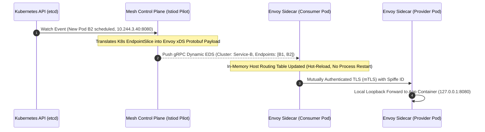

#### High-Level Design (HLD)
- **Decoupled Data Plane & Control Plane:** The control plane (`Istiod`) continuously watches underlying cloud platforms (Kubernetes API, Consul, VM registries). The data plane (Envoy instances running as sidecars or ambient node proxies) executes L7 routing, telemetry collection, and mutual TLS (mTLS).
- **Sub-Second Convergence:** Unlike polling-based discovery registries, Envoy establishes a persistent bidirectional HTTP/2 or HTTP/3 gRPC stream with the control plane, enabling sub-second dynamic endpoint push notifications.

#### Low-Level Design (LLD): The Envoy xDS Protocol Suite
Envoy dynamic discovery is driven by the modular **xDS v3 API**:

| API Acronym | Full Name | Operational Responsibility |
| :--- | :--- | :--- |
| **LDS** | Listener Discovery Service | Dynamically configures local network sockets, port bindings, and TLS termination parameters. |
| **RDS** | Route Discovery Service | Dynamically updates HTTP VirtualHost rules, path prefixes, header manipulations, and cluster matchings. |
| **CDS** | Cluster Discovery Service | Manages upstream service definitions, connection pools, circuit breaker thresholds, and health check configs. |
| **EDS** | Endpoint Discovery Service | Dynamically delivers the actual IP addresses, ports, weights, and locality zones (zone/sub-zone) of target pods. |
| **SDS** | Secret Discovery Service | Streams cryptographic certificates and private keys for zero-trust mTLS encryption without restarting proxies. |

- **State of the World (SotW) vs Incremental xDS:**
  - Standard SotW xDS sends the entire list of endpoints across the cluster upon any mutation, which can consume hundreds of megabytes of control-plane network bandwidth in large fleets.
  - **Incremental (Delta) xDS** delivers only discrete added, modified, or deleted endpoint diffs over the gRPC stream, cutting network overhead by over $90\%$.

---

### Approach 4: Decentralized Consensus & Gossip (HashiCorp Consul)

HashiCorp Consul utilizes a hybrid consensus and gossip architecture that eliminates the need for external load balancers while avoiding central-point bottlenecks.

```mermaid
flowchart TD
    subgraph WAN_Gossip ["WAN Gossip Pool (Serf WAN over UDP/TCP 8302)"]
        DC1_Servers["Datacenter 1 (US-East)<br/>Consul Server Leader + Followers"]
        DC2_Servers["Datacenter 2 (EU-West)<br/>Consul Server Leader + Followers"]
        DC1_Servers <-->|"Cross-WAN Gossip & Replication"| DC2_Servers
    end

    subgraph DC1_Local ["Datacenter 1 (LAN Architecture)"]
        subgraph Consul_Servers ["Raft Consensus Quorum (TCP 8300)"]
            S_Leader["Consul Server (Leader)"]
            S_Follower1["Consul Server (Follower)"]
            S_Follower2["Consul Server (Follower)"]
            S_Leader <--> S_Follower1
            S_Leader <--> S_Follower2
        end

        subgraph LAN_Gossip ["LAN Gossip Pool (Serf LAN over UDP 8301)"]
            ClientAgent1["Consul Agent (Node 1)"]
            ClientAgent2["Consul Agent (Node 2)"]
            App1["Microservice Instance A"]
            App2["Microservice Instance B"]
            
            App1 <-->|"Localhost HTTP/DNS (8500/8600)"| ClientAgent1
            App2 <-->|"Localhost HTTP/DNS (8500/8600)"| ClientAgent2
            ClientAgent1 <--> ClientAgent2
            ClientAgent1 <--> S_Leader
            ClientAgent2 <--> S_Leader
        end
    end
```

#### High-Level Design (HLD)
- **Two-Tier Architecture (Server Mode vs. Client Mode):**
  - **Consul Servers:** Maintain the authoritative cluster state via the **Raft consensus protocol**. A typical cluster deploys 3 or 5 server nodes.
  - **Consul Client Agents:** Run as lightweight local daemons on every single physical machine or virtual host. Applications communicate solely with their local agent over `localhost:8500` (HTTP) or `localhost:8600` (DNS).
- **Multi-Datacenter Native:** Consul supports multi-region topologies out of the box using independent Raft clusters per datacenter bridged together by an asynchronous **WAN Serf Gossip** pool.

#### Low-Level Design (LLD): SWIM Gossip & Raft Consensus
1. **Failure Detection via SWIM Gossip:**
   - Every node periodically sends a UDP ping to a randomly chosen peer.
   - If no ACK is received within a timeout, the node attempts an **indirect ping**: it asks $k$ other nodes to ping the target.
   - If all $k$ nodes fail to reach the target, the node enters the `Suspect` state.
   - The suspect state gives the node a grace period to refute the claim (preventing false evictions due to local packet drops) before broadcasting a `Dead` message across the cluster.
2. **Blocking Queries & Long Polling:**
   - Client applications or sidecars watch changes using HTTP long polling:
     `GET /v1/health/service/payment?index=142050&wait=60s`
   - The Consul agent blocks the connection until the Raft state machine's internal `ModifyIndex` exceeds `142050` or the 60-second timer expires, delivering immediate, event-driven updates with minimal CPU overhead.

---

## 4. Deep-Dive: Heartbeats, Leases, Eviction, and Internal Registry Structures

### 4.1 Registry Internal Data Structures
Service registries are read-heavy distributed databases optimized for extreme concurrent read throughput with low write latency.

#### Netflix Eureka: Concurrent Multi-Tier Cache Hierarchy
Eureka uses a three-tier layered caching model inside the JVM to prevent read lock contention from thousands of polling clients:

```
[ Incoming Read Request ]
          |
          v
+-----------------------+
|  readOnlyCacheMap     |  (ConcurrentHashMap, No Eviction Expiry, Updated every 30s)
+-----------------------+
          |  (Cache Miss)
          v
+-----------------------+
|  readWriteCacheMap    |  (Guava Cache / LoadingCache with 180s write-expiry)
+-----------------------+
          |  (Cache Miss)
          v
+-------------------------------------------------------------------+
|  Authoritative Instance Registry                                  |
|  ConcurrentHashMap<AppName, Map<InstanceId, Lease<InstanceInfo>>> |
+-------------------------------------------------------------------+
```

- When an instance registers or sends a heartbeat renewal, it updates the authoritative inner map and invalidates the `readWriteCacheMap`.
- A background eviction timer executes every 30 seconds to replicate state from `readWriteCacheMap` to `readOnlyCacheMap`.
- **Architectural Trade-off:** Eureka deliberately trades data freshness for throughput. A newly registered or crashed instance can take up to $30 \text{s (readOnly)} + 30 \text{s (client cache)} = 60 \text{ seconds}$ to propagate to all consumers.

#### HashiCorp Consul: In-Memory Radix Trees (MemDB)
Consul maintains its state machine entirely in-memory using an immutable, copy-on-write Radix tree library (`go-memdb`).
- Indexing is performed across namespaces, service names, tags, and health status.
- Every commit from the Raft log creates a new versioned snapshot of the tree. Read operations execute lock-free against immutable snapshot views, guaranteeing that reads never block consensus log replication.

---

### 4.2 The Heartbeat & Lease Renewal State Machine

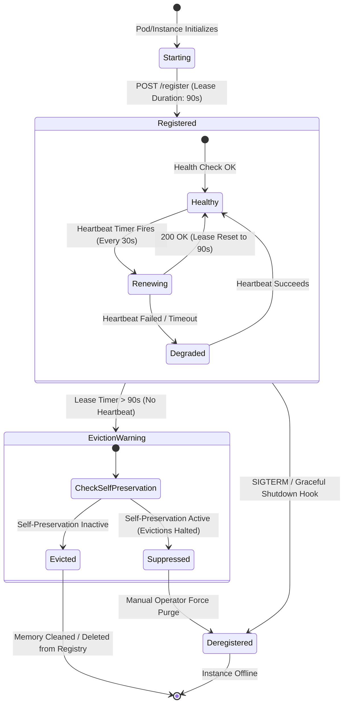

#### Lease Eviction Mathematical Models
A lease holds metadata for an instance alongside an expiration timestamp:
$$T_{\text{expiry}} = T_{\text{last\_heartbeat}} + \text{Duration}_{\text{lease}}$$
If $T_{\text{now}} > T_{\text{expiry}}$, the registry's background eviction sweeper thread (running every $T_{\text{eviction\_period}}$, default 60s) marks the lease for purge.

To avoid false positive evictions caused by **Garbage Collection (GC) pauses** in JVM microservices:
1. Heartbeat interval is typically configured to $30\text{s}$.
2. Lease expiration duration is set to $90\text{s}$ (tolerating 2 consecutively dropped heartbeats).
3. The eviction thread enforces rate limiting on total evictions per cycle to prevent cascading fleet destruction.

---

### 4.3 Health Checking Taxonomy: Active vs. Passive vs. Sub-System Probes

Routing decisions depend directly on accurate, multi-tiered health evaluation:

| Probe Type | Mechanism | Latency to Detect | Failure Detection Scope |
| :--- | :--- | :--- | :--- |
| **Liveness Probe** | Orchestrator (K8s/Nomad) HTTP/TCP/Exec check. | Medium ($10-30\text{s}$) | Catastrophic process deadlock, fatal crash, out-of-memory. |
| **Readiness Probe** | Registry or Orchestrator checks if instance is ready to receive traffic. | Low ($5-10\text{s}$) | Database connection pool exhaustion, warm-up caches uninitialized. |
| **Active Heartbeat** | Instance pushes HTTP/TCP keep-alive to Registry. | Configurable ($15-30\text{s}$) | Loss of instance network reachability, VM host termination. |
| **Passive Outlier Detection** | Client or Envoy proxy tracks actual 5xx return codes / TCP reset errors on user traffic. | Instantaneous ($<100\text{ms}$) | Broken software release, corrupted local state, transient network drops. |

---

## 5. Architectural Visualizations

### 5.1 End-to-End Client-Side vs Server-Side Topology

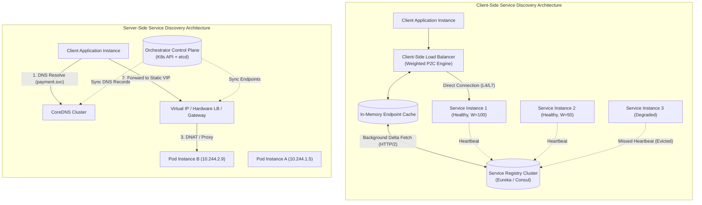

---

### 5.2 Kubernetes Kube-Proxy / IPVS / Netfilter Packet Flow

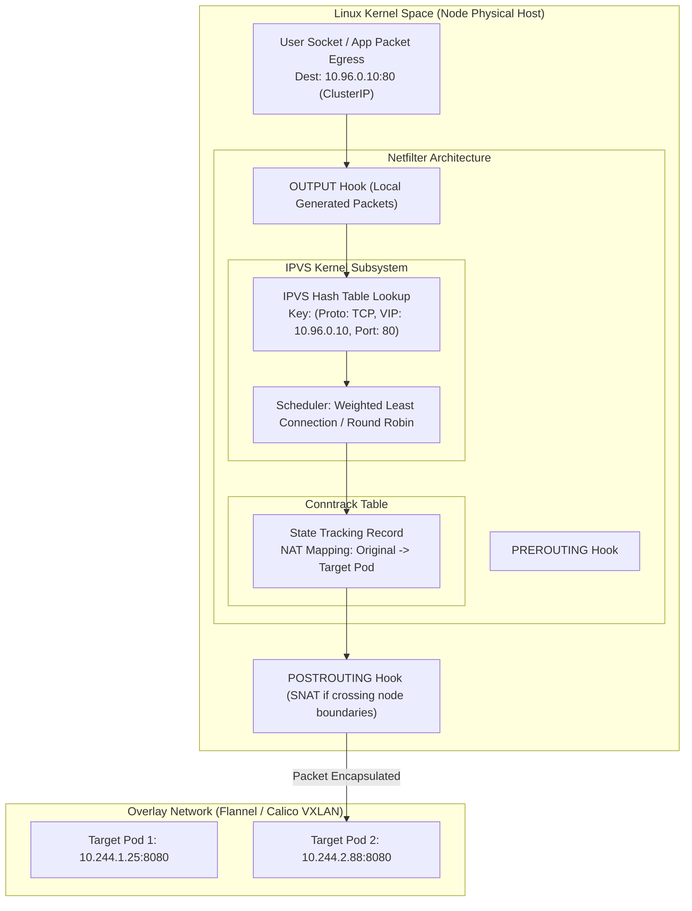

---

### 5.3 Service Mesh Dynamic Envoy xDS Pipeline

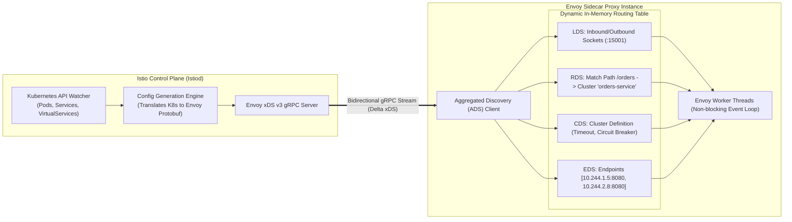

---

## 6. Concrete Production Code Implementations

### 6.1 Modern Java (Spring Boot 3 + Spring Cloud LoadBalancer)
The legacy `Netflix Ribbon` library is completely deprecated. Modern enterprise systems utilize `Spring Cloud LoadBalancer` with non-blocking, reactive abstractions.

#### Maven Configuration (`pom.xml`)
```xml
<dependencies>
    <!-- Modern Spring Cloud Discovery Client (Consul or Eureka) -->
    <dependency>
        <groupId>org.springframework.cloud</groupId>
        <artifactId>spring-cloud-starter-consul-discovery</artifactId>
    </dependency>
    <!-- Non-blocking Spring Cloud LoadBalancer -->
    <dependency>
        <groupId>org.springframework.cloud</groupId>
        <artifactId>spring-cloud-starter-loadbalancer</artifactId>
    </dependency>
    <!-- Spring Reactive WebFlux / WebClient -->
    <dependency>
        <groupId>org.springframework.boot</groupId>
        <artifactId>spring-boot-starter-webflux</artifactId>
    </dependency>
</dependencies>
```

#### Resilient Client Configuration with Custom Load Balancer
```java
package com.enterprise.routing;

import org.springframework.cloud.client.ServiceInstance;
import org.springframework.cloud.client.loadbalancer.LoadBalanced;
import org.springframework.cloud.loadbalancer.annotation.LoadBalancerClient;
import org.springframework.cloud.loadbalancer.core.ReactorServiceInstanceLoadBalancer;
import org.springframework.cloud.loadbalancer.core.RoundRobinLoadBalancer;
import org.springframework.cloud.loadbalancer.core.ServiceInstanceListSupplier;
import org.springframework.cloud.loadbalancer.support.LoadBalancerClientFactory;
import org.springframework.context.annotation.Bean;
import org.springframework.context.annotation.Configuration;
import org.springframework.core.env.Environment;
import org.springframework.web.reactive.function.client.WebClient;

@Configuration
@LoadBalancerClient(name = "order-processing-service", configuration = CustomLoadBalancerConfig.class)
public class WebClientDiscoveryConfig {

    @Bean
    @LoadBalanced
    public WebClient.Builder loadBalancedWebClientBuilder() {
        return WebClient.builder();
    }
}

class CustomLoadBalancerConfig {
    @Bean
    public ReactorServiceInstanceLoadBalancer customLoadBalancer(
            Environment environment,
            LoadBalancerClientFactory loadBalancerClientFactory) {
        String name = environment.getProperty(LoadBalancerClientFactory.PROPERTY_NAME);
        return new RoundRobinLoadBalancer(
                loadBalancerClientFactory.getLazyProvider(name, ServiceInstanceListSupplier.class),
                name
        );
    }
}
```

#### Production Consumer Service with Circuit Breaking & Fallback
```java
package com.enterprise.routing;

import org.slf4j.Logger;
import org.slf4j.LoggerFactory;
import org.springframework.stereotype.Service;
import org.springframework.web.reactive.function.client.WebClient;
import reactor.core.publisher.Mono;
import reactor.util.retry.Retry;

import java.time.Duration;

@Service
public class OrderServiceClient {

    private static final Logger log = LoggerFactory.getLogger(OrderServiceClient.class);
    private final WebClient.Builder webClientBuilder;

    public OrderServiceClient(WebClient.Builder webClientBuilder) {
        this.webClientBuilder = webClientBuilder;
    }

    public Mono<OrderResponse> submitOrder(OrderPayload payload) {
        return webClientBuilder.build()
                .post()
                // The service name "order-processing-service" is resolved dynamically
                // via Consul/Eureka through Spring Cloud LoadBalancer
                .uri("http://order-processing-service/api/v1/orders")
                .bodyValue(payload)
                .retrieve()
                .bodyToMono(OrderResponse.class)
                .timeout(Duration.ofMillis(800)) // Strict upstream SLA
                .retryWhen(Retry.backoff(2, Duration.ofMillis(100))
                        .filter(throwable -> isIdempotentRetryable(throwable))
                        .doBeforeRetry(signal -> log.warn("Retrying order service invocation due to: {}", signal.failure().getMessage())))
                .onErrorResume(e -> {
                    log.error("Fatal failure calling Order Processing Service: {}", e.getMessage());
                    return fallbackOrderHandling(payload, e);
                });
    }

    private boolean isIdempotentRetryable(Throwable ex) {
        return ex instanceof java.io.IOException || ex instanceof java.util.concurrent.TimeoutException;
    }

    private Mono<OrderResponse> fallbackOrderHandling(OrderPayload payload, Throwable ex) {
        // Circuit breaker degraded fallback logic
        return Mono.just(new OrderResponse("QUEUED_ASYNC", "Transaction queued for async processing due to degraded upstream."));
    }
}
```

---

### 6.2 Production Go Client: Consul Discovery, TTL Health Check & Power of Two Choices (P2C)

This production-grade Go engine handles service registration with continuous TTL lease renewals, watches the Consul catalog for endpoint mutations via HTTP long polling, and implements a concurrent **Power of Two Choices (P2C) with EWMA latency** load balancer.

```go
package main

import (
	"context"
	"fmt"
	"math/rand"
	"net/http"
	"os"
	"os/signal"
	"sync"
	"sync/atomic"
	"syscall"
	"time"

	consulapi "github.com/hashicorp/consul/api"
)

// Endpoint represents an active upstream service instance with tracking metrics
type Endpoint struct {
	ID        string
	Address   string
	Port      int
	InFlight  int64
	EWMALatency float64 // Exponentially Weighted Moving Average Latency
	mu        sync.Mutex
}

// P2CLoadBalancer implements Power of Two Choices load balancing
type P2CLoadBalancer struct {
	mu        sync.RWMutex
	endpoints []*Endpoint
}

func (lb *P2CLoadBalancer) UpdateEndpoints(instances []*consulapi.ServiceEntry) {
	lb.mu.Lock()
	defer lb.mu.Unlock()

	var updated []*Endpoint
	for _, inst := range instances {
		ep := &Endpoint{
			ID:          inst.Service.ID,
			Address:     inst.Service.Address,
			Port:        inst.Service.Port,
			EWMALatency: 10.0, // Initial seed latency (10ms)
		}
		updated = append(updated, ep)
	}
	lb.endpoints = updated
}

// Select picks the superior instance out of two randomly chosen candidates
func (lb *P2CLoadBalancer) Select() (*Endpoint, error) {
	lb.mu.RLock()
	defer lb.mu.RUnlock()

	n := len(lb.endpoints)
	if n == 0 {
		return nil, fmt.Errorf("no healthy service instances available in pool")
	}
	if n == 1 {
		return lb.endpoints[0], nil
	}

	// Pick two distinct random indices
	i1 := rand.Intn(n)
	i2 := rand.Intn(n)
	for i1 == i2 {
		i2 = rand.Intn(n)
	}

	ep1 := lb.endpoints[i1]
	ep2 := lb.endpoints[i2]

	// Score is evaluated based on in-flight requests and EWMA latency
	score1 := float64(atomic.LoadInt64(&ep1.InFlight)) * ep1.EWMALatency
	score2 := float64(atomic.LoadInt64(&ep2.InFlight)) * ep2.EWMALatency

	if score1 <= score2 {
		return ep1, nil
	}
	return ep2, nil
}

func (ep *Endpoint) Release(duration time.Duration) {
	atomic.AddInt64(&ep.InFlight, -1)
	ep.mu.Lock()
	defer ep.mu.Unlock()
	// Decay factor alpha = 0.2 for EWMA calculation
	const alpha = 0.2
	ms := float64(duration.Milliseconds())
	ep.EWMALatency = (alpha * ms) + ((1.0 - alpha) * ep.EWMALatency)
}

// ServiceRegistrar manages service registration and heartbeat TTL loops
type ServiceRegistrar struct {
	client    *consulapi.Client
	serviceID string
	checkID   string
	stopChan  chan struct{}
}

func NewServiceRegistrar(serviceName, host string, port int) (*ServiceRegistrar, error) {
	config := consulapi.DefaultConfig()
	client, err := consulapi.NewClient(config)
	if err != nil {
		return nil, err
	}

	serviceID := fmt.Sprintf("%s-%s-%d", serviceName, host, port)
	checkID := fmt.Sprintf("service:%s", serviceID)

	reg := &consulapi.AgentServiceRegistration{
		ID:      serviceID,
		Name:    serviceName,
		Address: host,
		Port:    port,
		Check: &consulapi.AgentServiceCheck{
			TTL:                            "15s",
			DeregisterCriticalServiceAfter: "60s",
		},
	}

	if err := client.Agent().ServiceRegister(reg); err != nil {
		return nil, fmt.Errorf("failed to register with consul: %w", err)
	}

	sr := &ServiceRegistrar{
		client:    client,
		serviceID: serviceID,
		checkID:   checkID,
		stopChan:  make(chan struct{}),
	}

	// Start TTL heartbeat renewal worker
	go sr.heartbeatWorker()

	return sr, nil
}

func (sr *ServiceRegistrar) heartbeatWorker() {
	ticker := time.NewTicker(5 * time.Second)
	defer ticker.Stop()

	for {
		select {
		case <-ticker.C:
			err := sr.client.Agent().UpdateTTL(sr.checkID, "Node online and healthy", consulapi.HealthPassing)
			if err != nil {
				fmt.Printf("[Discovery Error] Failed to renew TTL heartbeat: %v\n", err)
			}
		case <-sr.stopChan:
			return
		}
	}
}

func (sr *ServiceRegistrar) Deregister() {
	close(sr.stopChan)
	_ = sr.client.Agent().ServiceDeregister(sr.serviceID)
	fmt.Printf("[Discovery] Service %s successfully deregistered from Consul.\n", sr.serviceID)
}

func main() {
	// Register current microservice instance
	registrar, err := NewServiceRegistrar("inventory-service", "10.0.4.15", 8080)
	if err != nil {
		panic(err)
	}

	// Handle graceful OS signals
	sigChan := make(chan os.Signal, 1)
	signal.Notify(sigChan, syscall.SIGINT, syscall.SIGTERM)

	go func() {
		<-sigChan
		fmt.Println("[Shutdown] Terminating instance, draining connections...")
		registrar.Deregister()
		os.Exit(0)
	}()

	// Simulate Client Load Balancer watching upstream Payment Service
	lb := &P2CLoadBalancer{}
	go watchServiceCatalog(registrar.client, "payment-service", lb)

	// Keep application running
	select {}
}

func watchServiceCatalog(client *consulapi.Client, targetService string, lb *P2CLoadBalancer) {
	var lastIndex uint64 = 0
	for {
		opts := &consulapi.QueryOptions{
			WaitIndex: lastIndex,
			WaitTime:  30 * time.Second,
		}

		entries, meta, err := client.Health().Service(targetService, "", true, opts)
		if err != nil {
			fmt.Printf("[Watch Error] Consul watch failed: %v. Backing off...\n", err)
			time.Sleep(2 * time.Second)
			continue
		}

		lastIndex = meta.LastIndex
		lb.UpdateEndpoints(entries)
		fmt.Printf("[Discovery Sync] Updated %s endpoints. Total available: %d\n", targetService, len(entries))
	}
}
```

---

### 6.3 Envoy Dynamic Cluster Configuration (Endpoint Discovery Service - EDS)

Below is an Envoy v3 configuration declaring a dynamically discovered upstream cluster using **EDS** over an Aggregated Discovery Service (ADS) gRPC stream:

```yaml
static_resources:
  listeners:
  - name: outbound_egress_listener
    address:
      socket_address: { address: 0.0.0.0, port_value: 10000 }
    filter_chains:
    - filters:
      - name: envoy.filters.network.http_connection_manager
        typed_config:
          "@type": type.googleapis.com/envoy.extensions.filters.network.http_connection_manager.v3.HttpConnectionManager
          stat_prefix: egress_http
          route_config:
            name: local_route
            virtual_hosts:
            - name: backend_services
              domains: ["*"]
              routes:
              - match: { prefix: "/api/v1/payments" }
                route:
                  cluster: payment_dynamic_cluster
                  timeout: 1.5s
                  retry_policy:
                    retry_on: "5xx,connect-failure,reset"
                    num_retries: 3
                    retry_back_off:
                      base_interval: 25ms
                      max_interval: 250ms
          http_filters:
          - name: envoy.filters.http.router
            typed_config:
              "@type": type.googleapis.com/envoy.extensions.filters.http.router.v3.Router

  clusters:
  - name: payment_dynamic_cluster
    connect_timeout: 0.25s
    type: EDS # Dynamic Endpoint Discovery Service
    lb_policy: LEAST_REQUEST
    least_request_lb_config:
      choice_count: 2
    eds_cluster_config:
      eds_config:
        ads: {}
        resource_api_version: V3
      service_name: payment-service-production
    outlier_detection:
      consecutive_5xx: 3
      interval: 10s
      base_ejection_time: 30s
      max_ejection_percent: 50

dynamic_resources:
  ads_config:
    api_type: GRPC
    transport_api_version: V3
    grpc_services:
    - envoy_grpc:
        cluster_name: istio_control_plane

  clusters:
  - name: istio_control_plane
    type: STRICT_DNS
    connect_timeout: 0.5s
    http2_protocol_options: {}
    load_assignment:
      cluster_name: istio_control_plane
      endpoints:
      - lb_endpoints:
        - endpoint:
            address:
              socket_address:
                address: istiod.istio-system.svc.cluster.local
                port_value: 15012
```

---

## 7. Production Edge Cases, Failure Modes & Resiliency Engineering

### 7.1 Split-Brain & Asymmetric Network Partitions
In a multi-zone cloud deployment, a network partition may not cleanly cut all nodes; it is frequently **asymmetric**. Node A can reach Registry Node 1, but Registry Node 1 cannot reach Node A's heartbeat probe.

```
+---------------+           +---------------+
| Cluster Zone 1|           | Cluster Zone 2|
|               |           |               |
| +-----------+ |           | +-----------+ |
| | Service A | |           | | Service B | |
| +-----------+ |           | +-----------+ |
|       |       |           |       |       |
|       v       |  X-Drop   |       v       |
| +-----------+ |<--------->| +-----------+ |
| | Registry  | |  Traffic  | | Registry  | |
| |  Leader   | |           | | Follower  | |
| +-----------+ |           | +-----------+ |
+---------------+           +---------------+
```

- **Mitigation Strategies:**
  - **Quorum Leasing:** In CP registries (Consul/etcd), the Raft leader must verify its lease with a majority of followers every $T_{\text{lease}}$ before acknowledging read/write operations. If the leader fails to renew its lease across the quorum, it voluntarily steps down to prevent serving phantom registrations.
  - **Client Failover Hysteresis:** Client libraries must not instantly flush an endpoint from their routing table upon a single read failure from the registry; they must require $K$ consecutive failed refresh attempts before discarding known-good cached topologies.

---

### 7.2 The Registration Stampede & Thundering Herd
When a shared registry cluster restarts or an entire Kubernetes worker pool reboot-cycles following an underlying hypervisor patch, thousands of microservice instances attempt to register and query simultaneously.
- **The Failure Cascade:** The sudden flood of hundreds of thousands of registration requests and cache fetch HTTP calls saturates the registry's CPU, exhausts socket connection tables, and triggers catastrophic timeouts. The clients interpret these timeouts as network drops, backing off and immediately retrying together, creating a persistent **thundering herd**.
- **Architectural Defense:**
  1. **Full Jitter Exponential Backoff:** Every client registration and cache refresh query must add uniform cryptographic jitter:
     $$T_{\text{sleep}} = \text{random}(0, \min(M, T_{\text{base}} \times 2^{\text{attempt}}))$$
  2. **Staggered Cache Renewal:** Clients distribute their periodic refresh schedules across the full 30-second window rather than synchronizing on wall-clock minute boundaries.

---

### 7.3 Stale Cache Routing & Graceful Connection Draining
The most pervasive production outage during rolling deployments is **Premature Pod Eviction**:
1. Kubernetes sends `SIGTERM` to a Pod.
2. The Pod runtime immediately stops accepting connections.
3. Concurrently, the endpoint controller removes the Pod IP from the `EndpointSlice`.
4. However, `kube-proxy` rules, CoreDNS caches, and client-side discovery registries have a propagation delay ranging from 2 to 30 seconds.
5. In-flight consumer requests hit the terminating Pod, resulting in `502 Bad Gateway` or `Connection Refused` errors.

#### The Zero-Downtime Termination Lifecycle
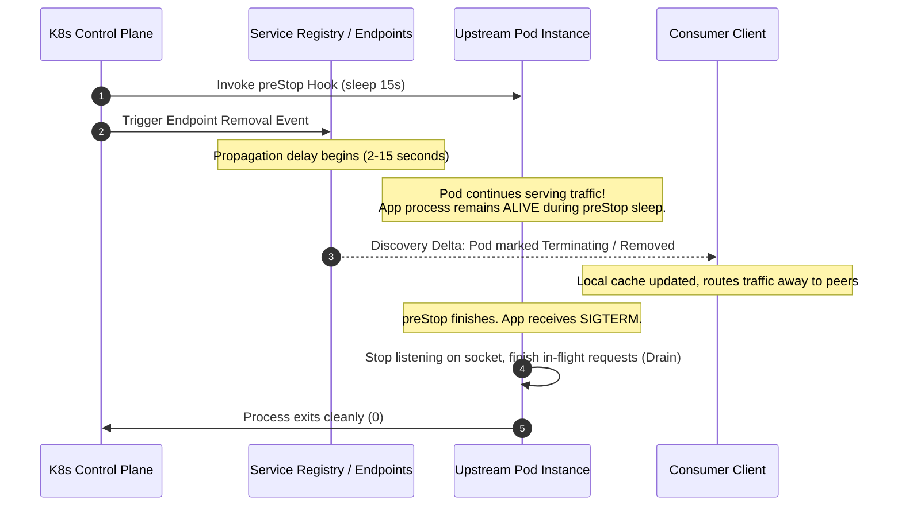

- **Production Best Practice:** Implement a `preStop` hook in your deployment manifest:
  ```yaml
  lifecycle:
    preStop:
      exec:
        command: ["/bin/sh", "-c", "sleep 15"]
  ```
  This guarantees that the application continues handling requests while the discovery registry propagates the endpoint removal to all downstream client caches.

---

### 7.4 DNS TTL Caching Pitfalls in Containerized Environments
Organizations often attempt to implement Service Discovery using simple DNS A-records or Kubernetes CoreDNS without tuning OS and runtime DNS caches:
1. **JVM Indefinite DNS Caching:** By default, older Java Virtual Machines cache DNS resolutions **forever** (`networkaddress.cache.ttl = -1`) unless configured. If an upstream pod dies and its IP is reassigned, the JVM continues directing traffic to the defunct IP until the JVM is restarted.
   - *Fix:* Explicitly set security properties in Java startup:
     ```properties
     networkaddress.cache.ttl=5
     networkaddress.cache.negative.ttl=2
     ```
2. **Alpine Linux (`musl libc`) vs `glibc` DNS Handling:**
   - Standard `glibc` issues parallel A and AAAA queries.
   - Alpine Linux's `musl libc` resolves queries sequentially and lacks built-in support for DNS search list traversal optimization.
3. **The `ndots:5` Latency Explosion:**
   - In standard Kubernetes `/etc/resolv.conf`, `ndots:5` is default.
   - When resolving `payment-service`, the resolver attempts:
     1. `payment-service.default.svc.cluster.local` (Hit!)
   - But if a service queries an external domain like `api.stripe.com` (which has 2 dots, less than 5), the OS first fires 4 failed lookups against CoreDNS:
     1. `api.stripe.com.default.svc.cluster.local` (NXDOMAIN)
     2. `api.stripe.com.svc.cluster.local` (NXDOMAIN)
     3. `api.stripe.com.cluster.local` (NXDOMAIN)
     4. `api.stripe.com.internal.net` (NXDOMAIN)
     5. `api.stripe.com` (Resolved!)
   - This causes massive CoreDNS packet amplification and connection-tracking table saturation.
   - *Remediation:* Deploy **NodeLocal DNSCache** daemonsets and append a trailing dot to external fully qualified domain names (`api.stripe.com.`).

---

## 8. Comprehensive Architectural Comparison & Trade-off Matrix

| Evaluation Dimension | Approach 1: Client-Side (Eureka / Spring Cloud LB) | Approach 2: Server-Side (Kubernetes CoreDNS + IPVS) | Approach 3: Service Mesh (Istio + Envoy xDS) | Approach 4: Decentralized Consensus (HashiCorp Consul) |
| :--- | :--- | :--- | :--- | :--- |
| **Data-Path Latency** | **Ultra-Low:** Direct point-to-point IP connection. Zero proxy hops. | **Low:** Single virtual hop via kernel packet rewrite (Netfilter/IPVS). | **Low-Medium:** +1 to 2ms per hop due to dual L7 proxy traversal (Envoy in/out). | **Ultra-Low:** Direct connection after local agent resolution. |
| **Architectural Complexity** | **Medium:** Client application code must import discovery SDKs and LB libs. | **Minimal for Devs:** Fully offloaded to Kubernetes networking. | **High:** Complex control plane (`Istiod`), Envoy sidecar lifecycle management. | **Medium-High:** Deploying and maintaining server quorums and host agents. |
| **Language Heterogeneity** | **Poor:** Requires SDK implementations in Java, Go, Python, Node, etc. | **Universal:** Works with any language supporting standard TCP/IP & DNS. | **Universal:** Intercepts traffic transparently at network layer. | **High:** Provides HTTP REST APIs, DNS interfaces, and native language SDKs. |
| **CAP Classification** | **AP:** Favors availability; self-preservation protects against splits. | **CP:** Backed by `etcd` Raft quorum for authoritative state. | **CP Control Plane / AP Data Plane:** Envoy caches persist if Istiod fails. | **CP (Raft for Catalog) + AP (Serf for Node Health).** |
| **Convergence Speed** | **Slow ($30-60\text{s}$):** Periodic client polling & tiered cache invalidation. | **Medium ($2-10\text{s}$):** Controller watch loop updates IPVS/iptables. | **Ultra-Fast ($<500\text{ms}$):** Push-based bidirectional gRPC streaming (EDS). | **Fast ($1-3\text{s}$):** HTTP long-polling blocking queries. |
| **Network Overhead** | **Low:** Periodic delta fetches between client and registry. | **Negligible:** In-kernel lookups; DNS amplification if misconfigured. | **High:** Control-plane memory & network consumption during fleet churn. | **Medium:** Gossip packet exchanges across LAN/WAN pools. |
| **Advanced L7 Routing** | **Limited:** Typically basic Round-Robin, P2C, or weighted Canary routing. | **None:** L4 (TCP/UDP) only at the Service level (requires Ingress/Gateway API). | **State of the Art:** Path rewrites, header injection, fault injection, mTLS. | **Medium-High:** Advanced routing via Consul Service Splitters & Resolvers. |
| **Blast Radius of Outage** | **Isolated:** Failure of registry does not sever existing cached routes. | **Broad:** CoreDNS or `kube-proxy` failure cripples all inter-pod traffic. | **Isolated:** Sidecars continue routing via cached xDS snapshot if control plane dies. | **Localized:** Node agent continues serving DNS/HTTP lookups from local cache. |

---

## 9. Real-World Enterprise Case Studies

### 9.1 Netflix: Operating Eureka at Planetary Scale
- **Context:** Netflix runs hundreds of microservices across tens of thousands of AWS EC2 instances spanning multiple AWS regions (us-east-1, us-west-2, eu-west-1).
- **The Challenge:** In early AWS cloud history, network connectivity between EC2 instances and availability zones frequently experienced transient degradation. A strict CP registry (like ZooKeeper) regularly locked up because cross-zone partitions prevented consensus quorums, stopping all deployments and causing traffic routing black holes.
- **The Solution:** Netflix developed **Eureka** as a purely AP, peer-to-peer replicated registry.
  - Each AWS Region runs an independent Eureka cluster.
  - Within each region, Eureka nodes cross-replicate registrations asynchronously across Availability Zones.
  - **Self-Preservation Mode:** During the infamous AWS network storms, Eureka saved Netflix's streaming availability: instances stopped renewing heartbeats, but Eureka refused to evict them. Despite transient control-plane partitions, consumers successfully routed traffic to healthy instances over the still-functioning data plane.
- **Evolution:** As Netflix migrated to containerized microservices and adopted Envoy, they phased out client-side Eureka libraries in favor of an Envoy-based service mesh model backed by an internal control plane.

---

### 9.2 Airbnb: SmartStack (Nerve & Synapse)
- **Context:** In 2013, before Kubernetes or service meshes existed, Airbnb ran a fast-growing monolithic Ruby on Rails application transitioning to dozens of backend Java and Go services.
- **The Architectural Breakthrough:** Airbnb invented **SmartStack**, consisting of two lightweight processes running alongside every service:
  - **Nerve:** A local health check worker that queries the local service instance (e.g., `localhost:8080/health`) and registers its IP/port into **Apache ZooKeeper**.
  - **Synapse:** A local watcher process that monitors ZooKeeper for changes to upstream services and dynamically rewrites a local **HAProxy** configuration file on `127.0.0.1`, triggering a zero-downtime HAProxy reload.
- **Impact:** Client applications simply issued HTTP requests to `http://localhost:3000` (the local HAProxy port), and HAProxy routed the traffic over persistent, health-checked TCP sockets to upstream backends. This pattern established the direct conceptual blueprint for the modern **Sidecar Pattern** and modern Service Meshes like Envoy and Istio.

---

### 9.3 Kubernetes at Hyper-Scale: The Migration from iptables to IPVS
- **Context:** Leading internet enterprises running Kubernetes clusters with over 5,000 nodes, 100,000 pods, and 10,000 services experienced severe cluster degradation using default `kube-proxy` configurations.
- **The Bottleneck:**
  - `kube-proxy` in `iptables` mode generated over 40,000 netfilter rules per worker node.
  - Netfilter evaluates rules sequentially ($O(N)$). Egress packet processing consumed up to $30\%$ of total host CPU simply traversing packet chains.
  - Modifying a single service definition forced the kernel to execute a complete `iptables-restore` lock, serializing packet processing and causing latency spikes exceeding 5 seconds.
- **The Remediation:**
  - Migrated `kube-proxy` to **IPVS (IP Virtual Server)** mode.
  - IPVS implements Netfilter hooks using **ipset kernel hash tables** ($O(1)$ lookup complexity).
  - Packet traversal overhead dropped from milliseconds to sub-microsecond levels, CPU utilization dropped by $80\%$, and service synchronization time shrank from minutes to sub-second convergence.
  - Supplemented with **NodeLocal DNSCache** daemonsets on every worker node to bypass conntrack table lock contention on UDP DNS lookups.

---

## 10. System Design Interview Masterclass: Advanced Questions & Answers

### Q1: How would you design a service discovery registry capable of supporting 1,000,000 microservice instances with sub-second health status convergence?
**Answer:**
A monolithic registry cluster backed by a single Raft consensus quorum cannot support $1,000,000$ active nodes due to the write throughput limits of sequential log replication (Raft maxes out around 10k-20k writes/sec). The architecture must employ a **hierarchical, partitioned federated design**:

```
+---------------------------------------------------------------------------------+
|                        GLOBAL FEDERATION / CONTROL PLANE                        |
|                     (Cross-Region Async Metadata Catalog)                       |
+---------------------------------------------------------------------------------+
               |                                                   |
               v                                                   v
+-------------------------------+               +-------------------------------+
|     REGIONAL CELL (US-EAST)   |               |     REGIONAL CELL (EU-WEST)   |
|   Partitioned Consistent Hash |               |   Partitioned Consistent Hash |
|   Raft Quorums (Sharded by    |               |   Raft Quorums (Sharded by    |
|   Service Namespace/Hash Ring)|               |   Service Namespace/Hash Ring)|
+-------------------------------+               +-------------------------------+
               |                                                   |
               v                                                   v
+-------------------------------+               +-------------------------------+
|    LOCAL HOST AGENTS / SWARM  |               |    LOCAL HOST AGENTS / SWARM  |
|  SWIM Gossip Sub-Clusters     |               |  SWIM Gossip Sub-Clusters     |
|  (Failure Detection Offloaded |               |  (Failure Detection Offloaded |
|   to Local Physical Racks)    |               |   to Local Physical Racks)    |
+-------------------------------+               +-------------------------------+
```

1. **Partitioning / Sharding:** Shard the registry state space across independent consensus groups using consistent hashing on `(Namespace, ServiceName)`. A 100-shard cluster reduces the write load per Raft group to 10,000 nodes.
2. **Offload Failure Detection to Edge Gossip:** Central servers must not process raw heartbeats. Use a **SWIM-based peer-to-peer gossip protocol** (like HashiCorp Serf) running at the local host or rack level. Nodes detect failures cooperatively. Only state transitions (`NodeHealthy -> NodeDead`) trigger an event to the registry, slashing continuous heartbeat traffic by $99\%$.
3. **Push-Based Incremental Streaming:** Implement HTTP/2 or gRPC bidirectional streaming (Delta xDS). Avoid polling. Clients subscribe to specific service dependencies and receive strictly delta updates (Protobuf-encoded endpoint deltas).
4. **Hierarchical Multi-Tier Caching:** Local host-level sidecar proxies (Envoy/NodeLocal agents) cache routing tables in shared memory. Application processes query local shared memory or Unix domain sockets ($<50\mu\text{s}$ latency), completely shielding the central registry shards from read amplification.

---

### Q2: Under a severe network partition separating 40% of microservice nodes from the service registry, compare how an AP registry (Eureka) vs a CP registry (Consul/etcd) behaves. What are the operational consequences?
**Answer:**
Assume an infrastructure split separates the network into Majority Partition $M$ ($60\%$ of nodes + Registry) and Minority Partition $P$ ($40\%$ of microservice instances isolated from the registry):

- **In an AP System (Eureka):**
  1. Instances in Partition $P$ attempt to send heartbeats to Eureka, which fail.
  2. Eureka sees total cluster renewal drop below the $85\%$ threshold and immediately triggers **Self-Preservation Mode**.
  3. **Consequences:** Eureka ceases evicting instances. Clients in Partition $M$ retain Partition $P$ instances in their routing tables. When consumers attempt to call those partitioned nodes, connections fail. However, robust client-side retry mechanisms with circuit breakers rapidly route around the unresponsive nodes to instances within Partition $M$. System availability is maintained at maximum feasible capacity.
- **In a CP System (Consul / etcd):**
  1. The isolated instances in Partition $P$ cannot contact the Raft quorum.
  2. Because the Raft leader in Partition $M$ stops receiving heartbeats from Partition $P$ nodes, it updates the consensus state machine and marks all $40\%$ of instances as **Critical/Dead**.
  3. **Consequences:** The registry actively purges $40\%$ of the infrastructure from all consumer routing tables. If Partition $M$ cannot handle the sudden $100\%$ influx of global traffic, the remaining instances suffer severe resource exhaustion (CPU/memory), triggering a **cascading collapse** across the entire platform.
- **Architectural Conclusion:** For pure L7 stateless request routing, AP semantics provide superior operational survivability. CP semantics should be reserved for stateful components (databases, distributed locks, coordinator nodes) where communicating with a partitioned node causes data corruption.

---

### Q3: In a high-traffic Kubernetes cluster, why does DNS query latency intermittently spike to 5 seconds? Explain the netfilter conntrack race condition and how to eliminate it.
**Answer:**
The infamous "Kubernetes 5-second DNS delay" is caused by a race condition inside the **Linux kernel Netfilter connection tracking (`nf_conntrack`) module** when handling parallel UDP requests:

```
[ Application Pod ]
   |
   |-- (Thread 1: UDP A Query to CoreDNS)    -----> [ Socket Egress ]
   |-- (Thread 2: UDP AAAA Query to CoreDNS) -----> [ Socket Egress ]
                                                           |
                                                           v
                                            [ Netfilter Hook: __ip_conntrack_confirm ]
                                                           |
                                 +-------------------------+-------------------------+
                                 |                                                   |
                     (Packet 1 Inserts Tuple)                            (Packet 2 Confirms Same Tuple)
                     Status: SUCCESS                                     Status: RACE DETECTED!
                                                                         Kernel Action: NF_DROP
                                                                         Result: Packet Silently Discarded
                                                                         Client Action: UDP 5-Second Timeout Retransmit
```

1. Standard `glibc` issues parallel UDP queries for `A` and `AAAA` records over distinct sockets concurrently.
2. Both UDP packets traverse the host's Netfilter hooks simultaneously. Because Kubernetes uses a virtual ClusterIP for CoreDNS, both packets must undergo Destination NAT (DNAT).
3. When both packets attempt to insert their conntrack state records via the kernel function `__ip_conntrack_confirm`, they compete for the same unconfirmed tuple entry.
4. The kernel detects a race condition hash collision and drops one of the UDP packets.
5. Because UDP does not have TCP's fast retransmission mechanisms, the DNS client resolver waits for its internal timeout—which defaults to exactly **5.000 seconds** in standard Linux distributions—before retransmitting.
- **Remediations:**
  1. **Deploy NodeLocal DNSCache:** Runs a local DNS caching agent on every Kubernetes node as a DaemonSet listening on a link-local IP (e.g., `169.254.20.10`). Pods query the local agent via standard TCP instead of UDP, completely bypassing conntrack UDP NAT race conditions.
  2. **Enable TCP for DNS Lookups:** Force the application runtime to resolve DNS over TCP (`options use-vc` in `/etc/resolv.conf`).
  3. **CoreDNS Autopath Plugin:** Enables server-side DNS search path concatenation, answering fully qualified queries in a single lookup and cutting total query volume by up to $75\%$.

---

### Q4: Explain the Power of Two Random Choices (P2C) algorithm with EWMA latency scoring. Why does it mathematically outperform Weighted Round-Robin in dynamic microservice fleets?
**Answer:**
In a large microservice fleet with heterogeneous instance performance (e.g., cold JVMs, noisy neighbors on cloud VMs, varying memory garbage collection pauses), traditional **Weighted Round-Robin (WRR)** and **Least Connections (LC)** suffer from severe systemic pathologies:
- **The Problem with Weighted Round-Robin:** WRR assumes all instances with identical assigned weights perform identically. If an instance experiences a 2-second GC pause or a degraded disk, WRR continues shoveling an identical share of requests into the degraded instance, causing request queues to back up and user latency to skyrocket.
- **The Problem with Pure Least Connections:** If an instance crashes and starts immediately returning fast `500 Internal Server Error` responses in 1 millisecond, its active connection count drops to zero. A Least Connections algorithm will aggressively route *all* cluster traffic to the failing instance, turning a single degraded node into a cluster-wide blackout.

#### The P2C with EWMA Solution
The algorithm combines Michael Mitzenmacher's **"Power of Two Random Choices"** theorem with an **Exponentially Weighted Moving Average (EWMA)** latency tracker:
1. **Selection Phase:** When a request arrives, the client does not inspect all $N$ instances ($O(N)$ overhead). Instead, it randomly selects two candidate instances: $Node_A$ and $Node_B$.
2. **Scoring Function:** For each candidate, compute an instantaneous load score:
   $$\text{Score} = (\text{InFlightRequests} + 1)^k \times \text{EWMALatency}$$
   Where $\text{EWMALatency}$ is updated after every completed request:
   $$\text{EWMA}_t = (\alpha \times \text{Latency}_{\text{observed}}) + ((1 - \alpha) \times \text{EWMA}_{t-1})$$
3. **Routing Decision:** The client dispatches the request to whichever node yields the lower score.
- **Mathematical Superiority:**
  - Mitzenmacher proved that picking the best of two randomly selected queues reduces maximum queue length exponentially from $O(\frac{\log n}{\log \log n})$ to $O(\log \log n)$, achieving virtually identical load balance to a global $O(N)$ scan at $O(1)$ algorithmic complexity.
  - The EWMA factor penalizes degraded or slow nodes immediately without global locking.
  - If a node fails fast with 500s, its latency drops, but its in-flight queue counter or circuit breaker rapidly isolates it before catastrophic traffic diversion occurs.

---

### Q5: How does Envoy's xDS protocol solve the "Thundering Herd" problem when 50,000 sidecars receive an Endpoint Discovery Service (EDS) update simultaneously?
**Answer:**
When a large backend deployment with 1,000 pods executes a rolling update in a mesh with 50,000 Envoy sidecars, broadcasting full routing tables across 50,000 active gRPC connections simultaneously can overwhelm the control plane and saturate network links.

Envoy and Istio remediate this through five architectural mechanisms:
1. **Aggregated Discovery Service (ADS) with Incremental (Delta) xDS:**
   - Instead of transmitting the complete state of all endpoints across the mesh (State of the World), the control plane transmits an `IncrementalDiscoveryResponse` containing strictly added, modified, or removed IP tuples.
2. **Debouncing & Merging:**
   - In `Istiod`, endpoint change notifications are passed into a debouncing queue with a sliding window (e.g., 100ms). If 50 pods terminate in rapid succession, the control plane coalesces them into a single consolidated EDS push rather than triggering 50 separate broadcasts.
3. **Locality-Prioritized Scoping (Sidecar Resource Filtering):**
   - By default, an Envoy sidecar does not need to know the endpoint addresses of microservices it never communicates with. Using Istio's `Sidecar` custom resource definition (CRD), operators explicitly restrict the egress namespace scope of proxies:
     ```yaml
     apiVersion: networking.istio.io/v1alpha3
     kind: Sidecar
     metadata:
       name: default
       namespace: payments
     spec:
       egress:
       - hosts:
         - "./*"
         - "orders/*"
     ```
     This confines EDS broadcast graphs strictly to verified dependency consumers, cutting total xDS distribution traffic by up to $95\%$.
4. **Control-Plane Connection Spreading & Flow Control:**
   - `Istiod` applies HTTP/2 window flow control and staggers response pushes across sidecar connections using randomized spreading jitter, eliminating synchronized packet waves across the underlying network fabric.

---

### Q6: Walk through the exact step-by-step lifecycle of a zero-downtime rolling deployment from the perspective of service discovery, kernel socket tables, and client caches. Where do dropped packets happen and how do you achieve zero dropped packets?
**Answer:**
During a rolling update, an old Pod ($P_{\text{old}}$) is terminated while a new Pod ($P_{\text{new}}$) is initialized. The sequence of physical network events is as follows:

```
Timeline (T)
---------------------------------------------------------------------------------------------------------
T0: Deployment starts. K8s schedules P_new.
T1: P_new passes ReadinessProbe. K8s updates EndpointSlice (adds P_new, marks P_old terminating).
T2: K8s sends SIGTERM to P_old.
    [CRITICAL FAILURE POINT]: If P_old terminates instantly:
    - CoreDNS still holds P_old in cache.
    - Kube-proxy on other worker nodes hasn't processed the iptables/IPVS rule update yet.
    - Client in-memory caches still route requests to P_old.
    -> RESULT: Connection Refused (TCP RST) / 502 Bad Gateway!
---------------------------------------------------------------------------------------------------------
THE ZERO-DOWNTIME SOLUTION PIPELINE:
---------------------------------------------------------------------------------------------------------
T0: P_new begins container startup.
T1: P_new passes StartupProbe and ReadinessProbe.
T2: K8s API server concurrently:
    a) Updates EndpointSlice object.
    b) Executes preStop hook on P_old: `sleep 15`
T3: P_old's preStop hook is executing. P_old's process DOES NOT receive SIGTERM yet!
    P_old continues accepting and processing requests normally on its active TCP listening socket.
T4: While P_old is sleeping, the EndpointSlice update propagates:
    - Kube-proxy rewrites IPVS/iptables rules on all nodes.
    - Envoy sidecars receive EDS push and transition P_old to DRAINING state.
    - Client-side discovery background delta fetchers update local caches.
T5: New incoming traffic shifts 100% to P_new. Zero new traffic reaches P_old.
T6: preStop finishes (15s elapsed). K8s sends SIGTERM to P_old.
T7: P_old runtime closes its listening socket (rejecting no valid traffic since no clients call it)
    and drains existing, long-lived in-flight connections within `terminationGracePeriodSeconds`.
T8: P_old flushes buffers, closes DB connections, and exits with code 0.
T9: Zero dropped packets achieved.
```

---

### Q7: Contrast active probing vs passive outlier detection in microservice discovery. Why is active probing alone insufficient in production?
**Answer:**
Active probing and passive outlier detection operate at fundamentally different architectural boundaries:

```
[ Active Health Probing ]                            [ Passive Outlier Detection ]
Prober (CoreDNS / Registry / Orchestrator)           Proxy / Client LB (Envoy / Client App)
       |                                                    |
       |-- Synthetic GET /health --> [ App ]                |-- Real User Request (POST /checkout) --> [ App ]
       |<-- 200 OK (Thread Pool OK) -                       |<-- 503 Internal Error / TCP Reset ------
```

1. **Active Probing:**
   - The infrastructure or orchestrator periodically executes synthetic requests (e.g., HTTP `GET /healthz` or TCP socket handshake every 10 seconds).
   - **Why It Fails in Production Isolation:**
     - **Synthetic Path Fallacy:** The `/healthz` endpoint usually verifies shallow metrics (e.g., "Is JVM process running? Can we read DB connection pool?"). It does not test complex, real-world execution code paths. An upstream service can report $100\%$ healthy on `/healthz` while returning `500 NullPointerException` on every real incoming `POST /checkout` transaction due to a corrupted dependency or downstream schema mismatch.
     - **Detection Latency:** If a probe interval is 10 seconds with a failure threshold of 3 consecutive drops, a totally dead instance continues receiving live production user traffic for up to **30 seconds**.
     - **Probing Storm Overhead:** In a mesh of 1,000 services, cross-probing creates $O(N^2)$ background synthetic traffic, consuming significant CPU and bandwidth just asking "are you alive?".
2. **Passive Outlier Detection (Circuit Breaking / Ejection):**
   - The proxy or client library observes **actual production user traffic** passing through the connection pool in real-time.
   - If an instance returns 3 consecutive `5xx` errors or TCP resets on live user requests, the proxy **immediately ejects** the instance from the healthy load-balancing pool for a base ejection duration (e.g., 30 seconds), without waiting for any central registry or health check poll.
   - **Conclusion:** A robust production architecture must employ **both**: active probing to govern lifecycle registration and startup readiness, and passive outlier detection to provide sub-millisecond automated self-healing against real-world runtime anomalies.

---

*(This concludes the exhaustive architectural guide to the Service Discovery Pattern.)*
