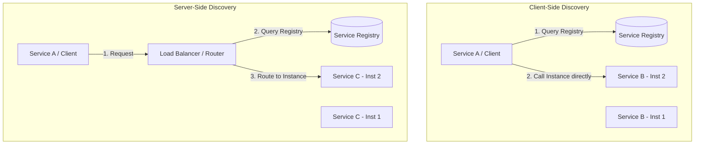

# Microservices Design Patterns: Service Discovery Pattern

## 1. Pattern Overview and Intent

In a monolithic application, services invoke one another through language-level method calls. In a traditional distributed system, services run at fixed, well-known locations (IP addresses and ports). 

However, in a modern microservices architecture running in containerized or cloud environments, network locations are dynamic. Instances of a service are constantly starting, stopping, scaling up, or crashing. Their IP addresses change dynamically.

The **Service Discovery Pattern** provides a mechanism for services to find each other dynamically without hardcoding IP addresses. The intent is to maintain a registry of available service instances and route traffic to healthy ones seamlessly.

## 2. Detailed Explanation of How It Works

There are two main components in Service Discovery:
1. **Service Registry**: A highly available database containing the network locations of service instances. (e.g., Consul, Netflix Eureka, etcd, Apache Zookeeper).
2. **Service Discovery Mechanism**: The way services find instances from the registry.

There are two main patterns for discovery:

### Client-Side Discovery
The client queries the Service Registry directly to get a list of available service instances, uses a load-balancing algorithm (like Round Robin) to select one, and makes the request directly.
* **Example**: Netflix OSS (Eureka + Ribbon).

### Server-Side Discovery
The client makes a request to a Load Balancer or API Gateway. The Load Balancer queries the Service Registry and routes the request to an available instance.
* **Example**: Kubernetes Services, AWS ELB.

### Architecture Diagram (Client-Side vs Server-Side)



### Health Checks
A critical part of service discovery is ensuring traffic is only sent to healthy instances. Service registries typically require instances to send periodic "heartbeats" or the registry actively polls a `/health` endpoint on the instances. If an instance fails the health check, it is deregistered.

## 3. Real-World Example: Ride-Sharing System

Consider a Ride-Sharing system where a `DriverService` needs to update the `LocationService` with the driver's GPS coordinates every 5 seconds. 

The `LocationService` might be scaled to 50 instances during rush hour and 10 during the night.

Using **Consul** as a Service Registry:
1. When a `LocationService` container starts, it registers itself with Consul (`IP: 10.0.1.55, Port: 8080, Service: Location`).
2. The `DriverService` wants to send an update.
3. `DriverService` asks Consul: "Give me an IP for `LocationService`".
4. Consul returns a healthy instance.
5. `DriverService` sends the request.

### Code Snippet (Spring Boot & Eureka Pseudocode)

**Service Registry (Eureka Server):**
```java
@SpringBootApplication
@EnableEurekaServer // Acts as the registry
public class EurekaServerApplication {
    public static void main(String[] args) {
        SpringApplication.run(EurekaServerApplication.class, args);
    }
}
```

**Service Instance (Location Service):**
```java
@SpringBootApplication
@EnableDiscoveryClient // Registers itself with Eureka
@RestController
public class LocationServiceApplication {
    @PostMapping("/locations")
    public void updateLocation(...) { ... }
}
```

**Client (Driver Service) using RestTemplate with Ribbon (Client-side LB):**
```java
@Configuration
public class Config {
    @Bean
    @LoadBalanced // Automatically resolves service name to IP using Eureka
    public RestTemplate restTemplate() {
        return new RestTemplate();
    }
}

@Service
public class DriverService {
    @Autowired
    private RestTemplate restTemplate;

    public void sendUpdate(LocationData data) {
        // "location-service" is resolved by Eureka dynamically
        restTemplate.postForObject("http://location-service/locations", data, String.class);
    }
}
```

## 4. Pros and Cons

### Pros
* **Resilience**: Services can fail, and traffic is automatically routed to healthy instances.
* **Elasticity**: Services can scale up and down dynamically without manual configuration.
* **Decoupling**: Services do not need to know the physical topology of the network.

### Cons
* **Complexity**: Adds a critical infrastructure component (the registry) that must be highly available.
* **Eventual Consistency**: There might be a slight delay between a service crashing and the registry updating, leading to brief routing errors.
* **Client complexity (Client-side)**: Clients must implement discovery and load-balancing logic.

## 5. When to Use / When NOT to Use

**When to Use:**
* In cloud-native or containerized environments (Kubernetes, AWS ECS) where IPs change frequently.
* When you have autoscaling enabled for your microservices.
* When you have a large number of microservices.

**When NOT to Use:**
* Static, on-premise deployments where IPs are fixed and known.
* Simple architectures with a handful of services.

## 6. Common Interview Questions

1. **What is the difference between Client-Side and Server-Side Discovery?**
   * *Answer:* In Client-Side, the client queries the registry and load-balances requests itself. In Server-Side, a dedicated router/LB queries the registry and forwards the request, simplifying the client.
2. **How does DNS-based discovery work compared to a Service Registry?**
   * *Answer:* DNS can map a domain (e.g., `service-a.internal`) to multiple IPs. However, DNS caching by clients and OSes can make it slow to respond to dynamic changes (like a node crashing), whereas Service Registries offer near real-time updates and health checking. Kubernetes utilizes a hybrid approach (CoreDNS + etcd registry).
3. **What happens if the Service Registry goes down?**
   * *Answer:* The Service Registry is a Single Point of Failure (SPOF). To mitigate this, registries like Consul/Eureka are run in a cluster. Additionally, clients usually cache the registry data locally, so they can continue communicating with known instances even if the registry is temporarily unreachable.
4. **Name some common Service Registries.**
   * *Answer:* HashiCorp Consul, Netflix Eureka, Apache Zookeeper, etcd (used by Kubernetes).

*(This concludes the deep dive into the Service Discovery Pattern.)*
