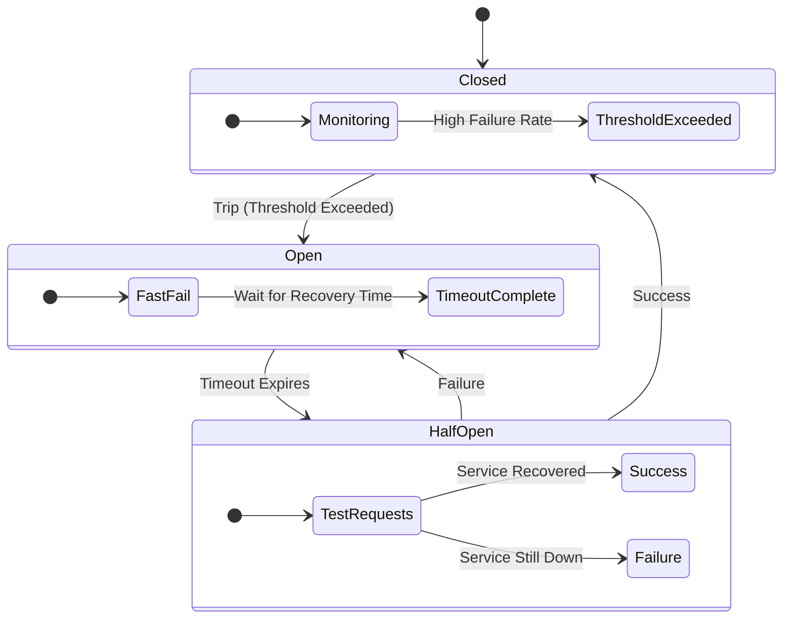

# Microservices Design Patterns: Circuit Breaker Pattern

## 1. Pattern Overview and Intent

In a distributed microservices architecture, services frequently call other services over the network. These network calls can fail due to various reasons: network latency, the remote service being overloaded, or the remote service crashing. 

If Service A calls Service B, and Service B is unresponsive, Service A will likely block a thread waiting for a timeout. If a high volume of requests hits Service A, it might exhaust its thread pool, causing Service A to also crash. This leads to **cascading failures** across the entire system.

The **Circuit Breaker Pattern** prevents a system from repeatedly trying to execute an operation that is likely to fail. It wraps a fragile remote network call in a proxy object that monitors for failures. Once the failures reach a certain threshold, the circuit breaker trips, and all further calls return an error immediately (or a fallback response) without making the network call, giving the failing service time to recover.

## 2. Detailed Explanation of How It Works

The Circuit Breaker operates as a state machine with three primary states:

1. **CLOSED**: The circuit is closed, and requests flow through to the remote service normally. The breaker maintains a count of recent failures. If the failure rate exceeds a predefined threshold (e.g., 50% failure over 10 seconds), it trips to the OPEN state.
2. **OPEN**: The circuit is open. Any request sent to the breaker fails immediately, and an exception is returned (or a fallback method is invoked). The remote service is not called. A timeout clock is started.
3. **HALF-OPEN**: After the timeout expires, the breaker allows a limited number of test requests to pass through to the remote service. 
   - If these requests succeed, the breaker assumes the service has recovered and transitions back to **CLOSED**.
   - If these requests fail, it assumes the service is still down and reverts to the **OPEN** state, resetting the timeout clock.

### Architecture Diagram



## 3. Real-World Example: Content Streaming Platform

Imagine a streaming platform like Netflix where the `MoviePlaybackService` calls the `RecommendationService` to display "Users also watched" after a movie ends.

If the `RecommendationService` goes down, we don't want the `MoviePlaybackService` to crash or hang, which would stop users from watching movies entirely.

By wrapping the call in a Circuit Breaker:
1. When `RecommendationService` fails, the circuit opens.
2. The Circuit Breaker invokes a **Fallback mechanism**.
3. Instead of waiting for a timeout, the fallback immediately returns a statically cached list of "Top 10 Global Movies" or just an empty list.
4. The user experience degrades gracefully (no personalized recommendations), but the core functionality (watching movies) remains intact.

### Code Snippet (Java with Resilience4j)

```java
import io.github.resilience4j.circuitbreaker.annotation.CircuitBreaker;
import org.springframework.stereotype.Service;

@Service
public class RecommendationClient {

    // Wrapping the method with a Circuit Breaker
    @CircuitBreaker(name = "recommendationService", fallbackMethod = "fallbackRecommendations")
    public List<Movie> getRecommendations(String userId) {
        // Network call to Recommendation microservice
        return restTemplate.getForObject("http://recommendation-service/api/recs/" + userId, List.class);
    }

    // Fallback method executed when the circuit is OPEN or call fails
    public List<Movie> fallbackRecommendations(String userId, Throwable t) {
        // Return a static list instead of failing
        return Arrays.asList(new Movie("Top Movie 1"), new Movie("Top Movie 2"));
    }
}
```
*Note: Netflix Hystrix was the industry standard for circuit breaking, but it is now in maintenance mode. Resilience4j is the recommended modern alternative.*

## 4. Pros and Cons

### Pros
* **Prevents Cascading Failures**: Isolates failures to a single service rather than taking down the whole system.
* **Fails Fast**: Immediately rejects requests when the remote service is down, freeing up threads and resources.
* **Graceful Degradation**: Allows providing fallback behaviors when a service is unavailable.
* **Self-Healing**: The Half-Open state automatically detects when a service recovers without manual intervention.

### Cons
* **Complexity**: Adds complexity to testing and configuration (tuning thresholds, timeouts, and sliding windows).
* **Stale Data**: Fallback mechanisms often return cached or stale data, which might not be acceptable for all business cases.
* **Debugging Difficulty**: It can sometimes be difficult to trace whether a failure is due to a tripped breaker or an actual network issue if logging is insufficient.

## 5. When to Use / When NOT to Use

**When to Use:**
* Whenever your service makes synchronous calls over the network to another service or third-party API.
* When you want to protect your system from resource exhaustion caused by slow or unresponsive dependencies.

**When NOT to Use:**
* For in-memory local method calls.
* When interacting with asynchronous message brokers (e.g., Kafka, RabbitMQ) where the message queue already acts as a buffer and decouples the sender from the receiver.

## 6. Common Interview Questions

1. **How does a Circuit Breaker differ from a Retry Pattern?**
   * *Answer:* The Retry pattern implies trying an operation again hoping it succeeds (useful for transient network glitches). The Circuit Breaker prevents the operation from being executed at all when a system is known to be failing (useful for prolonged outages). They are often combined: you retry a few times, and if failures persist, the circuit breaker trips.
2. **What is the difference between Circuit Breaker and Bulkhead pattern?**
   * *Answer:* A Circuit Breaker stops calls to a failing service. The **Bulkhead pattern** isolates resources (like thread pools) for different services. If Service A fails and exhausts its allocated thread pool, the Bulkhead ensures Service B's thread pool is untouched, isolating the failure. They are complementary patterns.
3. **What is a "Fallback" in the context of a Circuit Breaker?**
   * *Answer:* It's a default response or alternative action taken when the circuit is Open. Examples include returning cached data, returning an empty list, or serving a static default page.
4. **How do you determine the thresholds for opening a circuit?**
   * *Answer:* Through load testing, monitoring, and analyzing the acceptable SLAs. You typically configure a sliding window (time-based or count-based) and a failure rate percentage (e.g., 50% failure rate over the last 100 requests).

*(This concludes the deep dive into the Circuit Breaker Pattern.)*
