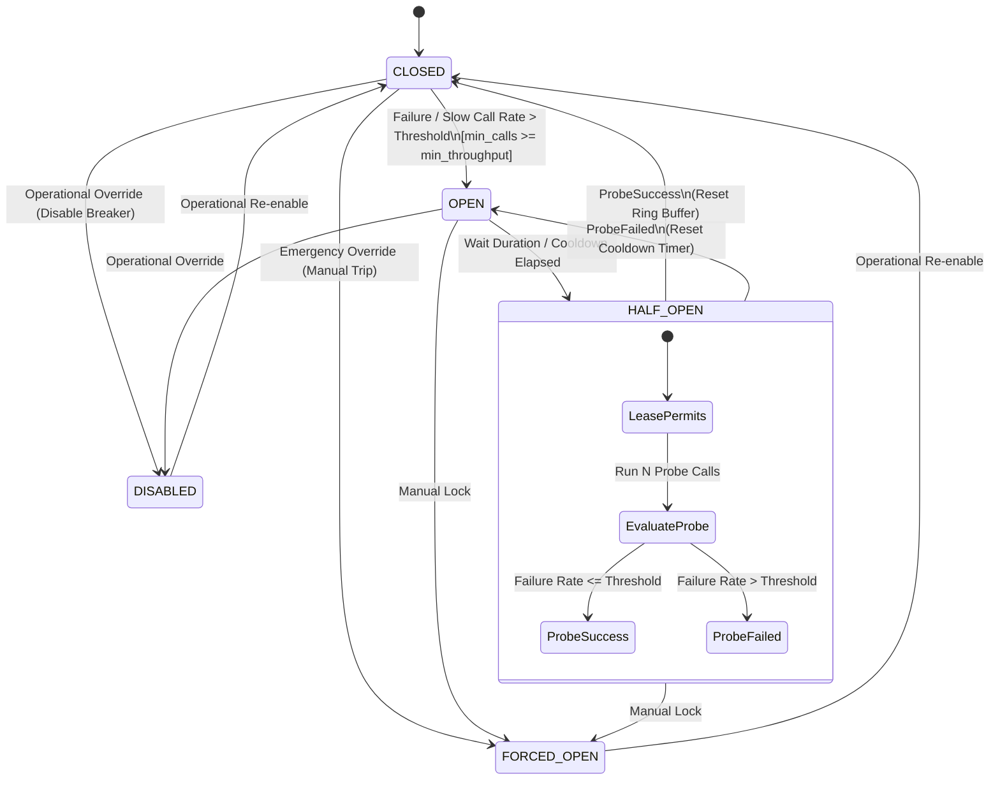
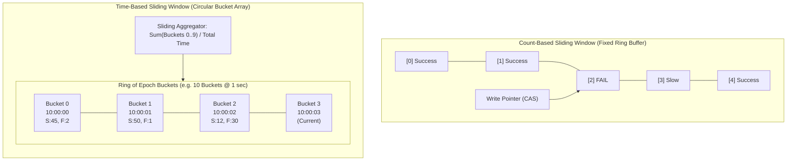
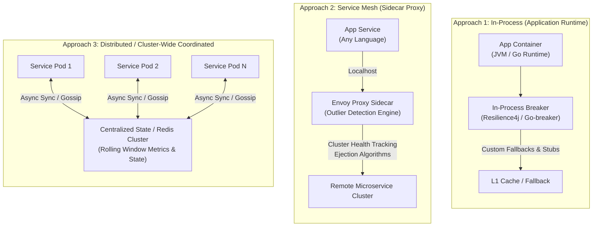
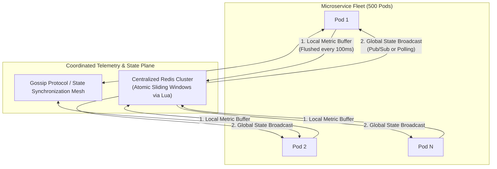
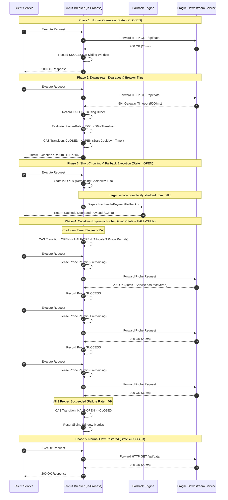

# Microservices Design Patterns: Circuit Breaker Pattern

## 1. Pattern Overview and Distributed Systems Intent

In a distributed microservices architecture, network communication between independent services is inherently unreliable. Remote calls traverse physical networks, virtual switches, load balancers, and container runtimes. Unlike in-process function execution—which is deterministic and bounded by CPU and memory constraints—remote procedure calls (RPCs) over HTTP/REST, gRPC, or messaging protocols are subject to non-deterministic latency, transient packet loss, CPU starvation on downstream instances, deadlocks, and catastrophic service outages.

### The Problem: Cascading Failures and Resource Exhaustion

When a downstream dependency degrades (e.g., response latencies balloon from 20ms to 15 seconds due to a database lock), calling services do not fail immediately. Instead, incoming client requests block worker threads waiting for the downstream socket read timeout.

According to **Little’s Law** ($L = \lambda W$):
* $L$ is the average number of requests concurrently residing within the system (in-flight concurrency).
* $\lambda$ is the long-term average arrival rate of incoming requests.
* $W$ is the average time a request spends in the system (latency).

If arrival rate ($\lambda$) remains constant at 1,000 requests/second and downstream latency ($W$) jumps from $50\text{ms}$ ($0.05\text{s}$) to $10\text{s}$, the concurrent in-flight requests ($L$) jump from $50$ to $10,000$.

```
Normal Operation:   L = 1,000 req/sec * 0.05 sec = 50 concurrent threads
Degraded Dependency: L = 1,000 req/sec * 10.00 sec = 10,000 concurrent threads
```

No typical application server thread pool (e.g., Tomcat's default of 200 threads, or Go's memory-bounded goroutines under socket backpressure) can absorb a 200x surge in concurrent in-flight requests. The thread pool exhausts completely in seconds. Once worker threads are pinned waiting on downstream sockets:
1. Health-check endpoints (`/healthz`, `/ready`) stop responding because no threads are available to service HTTP requests.
2. Upstream load balancers (ALB, NGINX) mark the service instance as dead and terminate traffic or restart the container.
3. Traffic is rerouted to remaining healthy instances, which instantly exhaust their thread pools under the concentrated load.
4. The failure propagates backwards through every upstream tier until the entire platform experiences a total blackout (**cascading failure**).

```
[User Request]
       │
       ▼
┌──────────────┐     Exhausts Thread Pool     ┌──────────────┐
│  API Gateway │ ───────────────────────────► │ Auth Service │ (Degraded DB Lock)
└──────────────┘                              └──────────────┘
       │                                             ▲
       ▼                                             │
┌──────────────┐      Blocked Sockets                │
│ Order Service│ ────────────────────────────────────┘
└──────────────┘
       │
       ▼ (Cascades upstream: all worker threads pinned)
[COMPLETE PLATFORM BLACKOUT]
```

### The Solution: The Circuit Breaker Pattern

The **Circuit Breaker Pattern** wraps fragile remote network invocations in a stateful proxy that continuously calculates failure rates and latency percentiles. When failures or slow executions breach a mathematically defined threshold, the circuit **trips open**.

When tripped open:
1. **Fails Fast**: All subsequent invocations immediately return an error or invoke an alternate fallback code path without dispatching a network call.
2. **Preserves Caller Resources**: No worker threads or socket connections are held open, keeping memory and CPU utilization stable.
3. **Protects Downstream Systems**: The failing downstream service is granted an isolated recovery window free of inbound traffic surges.
4. **Self-Heals**: After a configurable cooldown interval, the breaker transitions to a testing state (`HALF-OPEN`), admitting a metered trickle of probe traffic to detect when the remote system has returned to operational health.

---

## 2. Theoretical Foundations & Core Mechanics

### 2.1 The Extended Finite State Machine (FSM)

While basic textbooks describe a 3-state machine (`CLOSED`, `OPEN`, `HALF-OPEN`), production-grade distributed implementations (such as Resilience4j, Envoy, and Hystrix) implement a 5-to-6 state lifecycle to accommodate manual operations, emergency maintenance, and canary testing.



#### Detailed State Definitions

1. **`CLOSED`**:
   * Requests flow transparently to the target dependency.
   * Telemetry (execution outcomes, latencies, exceptions) is recorded into an internal sliding window.
   * State transitions to `OPEN` if:
     $$\text{Total Recorded Calls} \ge \text{Minimum Call Threshold}$$
     $$\text{AND} \quad \left( \frac{\text{Failed Calls}}{\text{Total Recorded Calls}} \ge \text{Failure Rate Threshold} \quad \text{OR} \quad \frac{\text{Slow Calls}}{\text{Total Recorded Calls}} \ge \text{Slow Call Rate Threshold} \right)$$

2. **`OPEN`**:
   * Requests are immediately short-circuited with a `CallNotPermittedException` (fail-fast) or redirected to a local fallback method.
   * Zero network I/O is dispatched to the downstream service.
   * A monotonic non-decreasing timer tracks the elapsed duration in `OPEN` state.
   * Once $\Delta t \ge \text{Wait Duration in Open State}$, the circuit transitions automatically to `HALF-OPEN`.

3. **`HALF-OPEN`**:
   * A restricted, deterministic number of probe requests (e.g., $N = 10$) are permitted to execute against the target service.
   * In-flight concurrency is strictly throttled: requests beyond the probe limit are rejected or directed to fallbacks.
   * If the probe batch failure rate is within acceptable limits, the circuit transitions to `CLOSED`, and the sliding window metrics are reset.
   * If a single probe failure causes the failure rate to exceed the threshold, the circuit immediately returns to `OPEN`, and the cooldown timer is restarted (often with exponential backoff).

4. **`FORCED_OPEN`**:
   * An administrative override state used during disaster recovery or downstream maintenance.
   * All requests fail fast regardless of metrics or elapsed time.
   * Requires explicit operator intervention or an automated runbook signal to transition out.

5. **`DISABLED`**:
   * An operational bypass state where circuit breaking logic is deactivated.
   * Requests are dispatched unhindered without recording metrics or evaluating thresholds.
   * Used to isolate whether unexpected errors stem from the circuit breaker machinery itself.

6. **`METRICS_ONLY` (Shadow Mode)**:
   * State transitions and metrics are computed internally, but the circuit never blocks requests.
   * Essential for safe production canary tuning to validate threshold configurations before enabling hard trips.

---

### 2.2 Sliding Window Implementations

Accurate failure rate calculation requires measuring service health over a bounded, rolling temporal window. Production engines employ two primary window architectures:



#### 1. Count-Based Sliding Window (Fixed-Size Ring Buffer)

The count-based sliding window records the outcomes of the last $N$ calls (e.g., $N = 100$) in a fixed-size circular array (Ring Buffer).
* **Storage Structure**: An array of size $N$ storing 2-bit or integer representations of execution states (`SUCCESS`, `FAILURE`, `SLOW_SUCCESS`).
* **Memory Complexity**: $O(N)$ space where $N$ is typically between 50 and 1,000.
* **Algorithm Mechanics**:
  * An atomic index pointer tracks the current write position: $\text{slot} = \text{cursor} \pmod N$.
  * When a call completes, its result overwrites the oldest measurement in the target slot.
  * Running totals of successful, failed, and slow calls are maintained using atomic increment/decrement or lock-free bitmask accumulation.
* **Trade-offs**:
  * **Pro**: Memory footprint is bounded and strictly deterministic.
  * **Con**: Under low traffic, stale failures remain in the buffer indefinitely, potentially tripping or holding the breaker open hours after an outage ended.

#### 2. Time-Based Sliding Window (Circular Epoch Bucket Array)

The time-based sliding window aggregates outcomes over a continuous temporal interval (e.g., the last 60 seconds), partitioned into $M$ discrete discrete time buckets (e.g., 60 buckets of 1 second each).
* **Storage Structure**: A circular array of bucket structs:
  ```go
  type Bucket struct {
      EpochSecond int64
      Successes   uint32
      Failures    uint32
      SlowCalls   uint32
      TotalTimeMs uint64
  }
  ```
* **Algorithm Mechanics**:
  * The current time $t$ maps to an array index: $\text{index} = \lfloor t / \text{bucket\_duration} \rfloor \pmod M$.
  * If the bucket at $\text{index}$ holds an outdated epoch ($\text{bucket.Epoch} < \text{current\_epoch}$), it is atomically cleared and re-initialized with the current epoch.
  * New request outcomes are atomically added to the current bucket.
  * Total failure rate is calculated across all buckets whose epochs fall within $[t - \text{window\_duration}, t]$.
* **Trade-offs**:
  * **Pro**: Automatically discards stale errors during periods of inactivity.
  * **Con**: Requires periodic background eviction or continuous time-checks during call dispatch; susceptible to system clock adjustments (NTP steps).

---

### 2.3 Failure & Slow Call Rate Calculation Algorithms

A production circuit breaker evaluates two orthogonal degradation vectors: hard errors and latency degradation.

```
Total Calls in Window = N_success + N_failure + N_slow
```

#### Failure Rate Formula
$$\text{Failure Rate} = \left( \frac{N_{\text{failure}}}{N_{\text{total}}} \right) \times 100\%$$

Where $N_{\text{failure}}$ represents calls throwing retryable exceptions (e.g., HTTP 500, 502, 503, 504, `SocketTimeoutException`, `ConnectException`), excluding business exceptions (e.g., HTTP 400 Bad Request, 404 Not Found, 422 Unprocessable Entity).

#### Slow Call Rate Formula
$$\text{Slow Call Rate} = \left( \frac{N_{\text{slow}}}{N_{\text{total}}} \right) \times 100\%$$

Where a call is designated as slow if:
$$\text{Execution Duration} \ge \text{Slow Call Duration Threshold}$$

A circuit breaker trips to `OPEN` if:
$$N_{\text{total}} \ge \text{Minimum Number of Calls}$$
$$\text{AND} \quad (\text{Failure Rate} \ge \text{Failure Rate Threshold} \quad \text{OR} \quad \text{Slow Call Rate} \ge \text{Slow Call Rate Threshold})$$

> **Why Slow Call Rate is Crucial**: A service that takes 8 seconds to respond with HTTP 200 OK causes equal or greater thread pool starvation than an outright HTTP 500 error. Tripping on slow calls stops latency amplification before thread exhaustion occurs.

---

### 2.4 Atomic State Transitions Using Lock-Free CAS

To handle high-throughput microservices processing hundreds of thousands of concurrent requests, state transitions must execute without coarse-grained mutex locks. Circuit breaker state management uses lock-free **Compare-And-Swap (CAS)** operations over an `AtomicReference`.

```mermaid
sequenceDiagram
    autonumber
    participant AppThread1 as Thread 1 (Call Complete)
    participant AppThread2 as Thread 2 (In-Flight)
    participant BreakerState as AtomicReference[State]
    participant RingBuf as Atomic Sliding Window

    AppThread1->>RingBuf: Record Failure(SocketTimeout)
    AppThread1->>RingBuf: Evaluate Metrics: FailureRate = 65% (Threshold = 50%)
    Note over AppThread1: Metric threshold breached! Needs transition to OPEN.

    AppThread1->>BreakerState: CAS(Expected: CLOSED, New: OPEN)
    alt CAS Succeeds
        BreakerState-->>AppThread1: Success (State updated to OPEN)
        AppThread1->>BreakerState: Set OpenStateEpoch = CurrentMonotonicTime()
    else CAS Fails (Another thread already tripped breaker)
        BreakerState-->>AppThread1: Failed (Current state is already OPEN)
        Note over AppThread1: No-op; gracefully proceed
    end

    AppThread2->>BreakerState: Check CanExecute()
    BreakerState-->>AppThread2: State == OPEN -> Reject Call
    AppThread2->>AppThread2: Invoke Fallback Method
```

#### Probe Permit Leasing in `HALF-OPEN` State

In `HALF-OPEN`, letting all threads probe downstream would induce a secondary thundering herd. Concurrency is constrained using an atomic permit counter (`AtomicInteger` or semaphore):

```
probe_permits_remaining = AtomicInteger(configured_permitted_calls)

on_request():
    if state == HALF_OPEN:
        if probe_permits_remaining.decrementAndGet() >= 0:
            allow_execution()
        else:
            execute_fallback() // Do not hit network
```

---

### 2.5 Fallback Execution Strategies

When a circuit breaker is in `OPEN` state, or when an individual execution fails, the system executes an alternate fallback strategy. Selection of the appropriate fallback depends on idempotency, business domain tolerances, and data freshness requirements:

| Fallback Strategy | Architectural Mechanics | Domain Use Case | Pitfalls & Mitigations |
| :--- | :--- | :--- | :--- |
| **1. Static Stub / Default Object** | Returns hardcoded, immutable default data structures directly from memory. | Product catalog showing "Standard Shipping" when logistics estimation API fails. | Zero latency impact. May confuse users if data appears out-of-context. |
| **2. Cache-Aside Fallback** | Queries local in-memory L1 cache (Caffeine/Ristretto) or secondary L2 Redis cluster for last-known-good state. | User profile data, homepage recommendation rails, currency conversion rates. | Risk of serving stale data past TTL. Must mark payload with `stale: true` metadata. |
| **3. Degraded Capability (Graceful Degradation)** | Omits optional fields or bypasses non-critical enrichment microservices. | Rendering a video playback stream without comments, subtitles, or recommendations. | Requires frontend clients to handle null or partial JSON response bodies gracefully. |
| **4. Asynchronous Outbox / Dead-Letter Queue (DLQ)** | Encapsulates the intent of the failed operation into a message written to disk or durable broker (Kafka/RabbitMQ). | Analytics event ingestion, order confirmation email dispatch, inventory ledger sync. | Only suitable for **asynchronous, eventually consistent** write paths; invalid for synchronous reads. |
| **5. Cascading / Tiered Fallback** | Multi-tiered fallback chain: L1 In-Memory Cache $\to$ L2 Distributed Cache $\to$ Static Stub. | Search autocomplete services; dynamic pricing engines. | Fallbacks themselves can fail or block. Fallback logic must execute with strict sub-millisecond timeouts. |

---

## 3. Deep Dive into Implementation Approaches

Resilience architectures are implemented across three distinct tiers in the modern distributed stack:
1. **In-Process / Application-Level** (Library-based: Resilience4j, Hystrix)
2. **Out-of-Process / Service Mesh Tier** (Sidecar-based: Envoy Proxy, Istio)
3. **Distributed / Cluster-Wide Coordinated** (Centralized state-based: Redis/Consul)



---

### Approach 1: Application-Level / In-Process Circuit Breakers

In-process circuit breakers execute within the runtime of the microservice application (e.g., JVM, Go runtime, Node.js). They intercept calls at the function or HTTP-client level via Aspect-Oriented Programming (AOP), function decorators, or middleware pipelines.

#### High-Level Design (HLD)

```
┌─────────────────────────────────────────────────────────────────────────────┐
│ Application Container (JVM / Go Process)                                    │
│                                                                             │
│   Incoming Request                                                          │
│          │                                                                  │
│          ▼                                                                  │
│   ┌──────────────┐     Aspect/Decorator     ┌───────────────────────────┐   │
│   │ Controller / │ ───────────────────────► │ CircuitBreaker Interceptor│   │
│   │ Domain Logic │                          └─────────────┬─────────────┘   │
│   └──────────────┘                                        │                 │
│                                            ┌──────────────┴──────────────┐  │
│                                            ▼                             ▼  │
│                                    State == CLOSED?               State == OPEN?
│                                            │                             │  │
│                                            ▼                             ▼  │
│                                  ┌───────────────────┐         ┌─────────────────┐
│                                  │ Dispatch Network  │         │ Short-Circuit   │
│                                  │ Client (gRPC/HTTP)│         │ Execute Fallback│
│                                  └─────────┬─────────┘         └─────────────────┘
│                                            │                                │
│                                            ▼                                │
│                                  Update Ring Buffer / CAS                   │
│                                            │                                │
│                                            ▼                                │
│                                  Prometheus / Micrometer                    │
│                                            │                                │
└────────────────────────────────────────────┼────────────────────────────────┘
                                             ▼
                                  Scraped by Prometheus
```

* **Application Tier**: Integrates the circuit breaker library directly into code. The library monitors specific method executions, recording latency and return statuses.
* **Telemetry Export**: Metrics (e.g., `resilience4j.circuitbreaker.state`, `resilience4j.circuitbreaker.failure.rate`) are published via Prometheus collectors or Micrometer metrics registries.
* **Dashboard Monitoring**: Grafana surfaces real-time state shifts, slow call ratios, and fallback rates on production NOC dashboards.

#### Low-Level Design (LLD): Resilience4j Architecture

Resilience4j implements a purely functional, decorator-based architecture built on top of Java's `CompletionStage` and Vavr functional abstractions.
* **Separation of Concerns**: Circuit breaking is separated from rate limiting, bulkheading, and retry logic. Each resiliency primitive is a distinct modular decorator wrapped around the target function.
* **Lock-Free Concurrency**: Metrics are captured in a non-blocking `FixedSizeSlidingWindowMetrics` data structure backed by an `AtomicIntegerArray` or atomic bit arrays to ensure sub-microsecond operational overhead.

#### Complete Production Resilience4j Spring Boot Configuration

```yaml
# application.yml - Hardened Production Circuit Breaker Setup
resilience4j:
  circuitbreaker:
    configs:
      default:
        slidingWindowType: COUNT_BASED
        slidingWindowSize: 100
        minimumNumberOfCalls: 20
        failureRateThreshold: 50.0
        slowCallRateThreshold: 75.0
        slowCallDurationThreshold: 2000ms
        waitDurationInOpenState: 15000ms
        permittedNumberOfCallsInHalfOpenState: 10
        automaticTransitionFromOpenToHalfOpenEnabled: true
        recordExceptions:
          - org.springframework.web.client.HttpServerErrorException
          - java.util.concurrent.TimeoutException
          - java.io.IOException
          - feign.RetryableException
        ignoreExceptions:
          - com.platform.exceptions.InvalidInputException
          - com.platform.exceptions.ResourceNotFoundException
          - org.springframework.web.bind.MethodArgumentNotValidException
    instances:
      paymentGatewayCircuitBreaker:
        baseConfig: default
        slidingWindowType: TIME_BASED
        slidingWindowSize: 60
        minimumNumberOfCalls: 30
        waitDurationInOpenState: 30000ms
        slowCallDurationThreshold: 3500ms
```

#### Production Java Code Implementation with Tiered Fallback

```java
package com.platform.resilience.payment;

import io.github.resilience4j.circuitbreaker.annotation.CircuitBreaker;
import io.github.resilience4j.bulkhead.annotation.Bulkhead;
import io.micrometer.core.instrument.MeterRegistry;
import org.slf4j.Logger;
import org.slf4j.LoggerFactory;
import org.springframework.stereotype.Service;
import org.springframework.web.client.RestTemplate;

import java.time.Instant;
import java.util.Collections;
import java.util.List;

@Service
public class PaymentProcessingService {

    private static final Logger log = LoggerFactory.getLogger(PaymentProcessingService.class);
    private final RestTemplate restTemplate;
    private final PaymentLocalCache localCache;
    private final PaymentDeadLetterQueueProducer dlqProducer;

    public PaymentProcessingService(RestTemplate restTemplate, 
                                  PaymentLocalCache localCache,
                                  PaymentDeadLetterQueueProducer dlqProducer) {
        this.restTemplate = restTemplate;
        this.localCache = localCache;
        this.dlqProducer = dlqProducer;
    }

    /**
     * Executes payment authorization via remote payment gateway.
     * Wrapped with CircuitBreaker and Bulkhead (thread pool isolation).
     */
    @CircuitBreaker(name = "paymentGatewayCircuitBreaker", fallbackMethod = "handlePaymentFallback")
    @Bulkhead(name = "paymentGatewayCircuitBreaker", type = Bulkhead.Type.THREADPOOL)
    public PaymentAuthorizationResponse authorizePayment(PaymentAuthorizationRequest request) {
        log.info("Dispatching payment auth for transaction: {}", request.getTransactionId());
        
        String url = "https://api.payment-gateway.internal/v1/authorize";
        PaymentAuthorizationResponse response = restTemplate.postForObject(
            url, request, PaymentAuthorizationResponse.class);

        if (response != null && response.isSuccessful()) {
            localCache.put(request.getTransactionId(), response);
        }
        return response;
    }

    /**
     * Primary Fallback: Invoked when the circuit is OPEN or when downstream throws recorded exceptions.
     * Implements a tiered fallback: Cache check -> Dead Letter Queue buffer.
     */
    public PaymentAuthorizationResponse handlePaymentFallback(PaymentAuthorizationRequest request, Throwable throwable) {
        log.warn("Payment gateway circuit breaker triggered for tx {}. Reason: {}", 
                 request.getTransactionId(), throwable.getMessage());

        // Tier 1 Fallback: Verify if an idempotent response was cached recently
        PaymentAuthorizationResponse cachedResponse = localCache.get(request.getTransactionId());
        if (cachedResponse != null) {
            log.info("Serving cached idempotent response for tx: {}", request.getTransactionId());
            cachedResponse.setServedFromCache(true);
            return cachedResponse;
        }

        // Tier 2 Fallback: If operation is an asynchronous payment request, queue for outbox replay
        if (request.isAsynchronousExecutionAllowed()) {
            log.info("Enqueuing payment intent to DLQ for offline reconciliation: {}", request.getTransactionId());
            dlqProducer.publishPaymentForDelayedExecution(request);
            
            return PaymentAuthorizationResponse.builder()
                .transactionId(request.getTransactionId())
                .status(PaymentStatus.QUEUED_FOR_RECONCILIATION)
                .timestamp(Instant.now())
                .message("Payment accepted for asynchronous processing")
                .build();
        }

        // Tier 3 Fallback: Graceful failure with structured domain error
        return PaymentAuthorizationResponse.builder()
            .transactionId(request.getTransactionId())
            .status(PaymentStatus.SYSTEM_DEGRADED)
            .timestamp(Instant.now())
            .message("Payment service temporarily unavailable. No funds were debited.")
            .build();
    }
}
```

---

### Low-Level Design: Custom Pure Go Thread-Safe Circuit Breaker

The following production-grade implementation demonstrates the internal data structures, lock-free ring buffer, and atomic CAS state transitions required to build a high-performance circuit breaker without external dependencies.

```go
package breaker

import (
	"errors"
	"sync"
	"sync/atomic"
	"time"
)

// State represents the current lifecycle phase of the circuit breaker.
type State int32

const (
	StateClosed State = iota
	StateHalfOpen
	StateOpen
)

func (s State) String() string {
	switch s {
	case StateClosed:
		return "CLOSED"
	case StateHalfOpen:
		return "HALF-OPEN"
	case StateOpen:
		return "OPEN"
	default:
		return "UNKNOWN"
	}
}

var (
	ErrCircuitOpen     = errors.New("circuit breaker is OPEN: call rejected")
	ErrTooManyProbes   = errors.New("circuit breaker is HALF-OPEN: probe limit reached")
)

// Config configures circuit breaker thresholds and timers.
type Config struct {
	WindowSize           int           // Size of the count-based ring buffer
	MinThroughput        int           // Minimum calls before evaluating failure rate
	FailureRateThreshold float64       // Percentage (e.g. 50.0)
	CooldownDuration     time.Duration // Time spent in OPEN before transitioning to HALF-OPEN
	HalfOpenProbePermits int32         // Maximum allowed probe requests in HALF-OPEN
}

// Result tracks outcome of single execution.
type Result uint8

const (
	ResultSuccess Result = 0
	ResultFailure Result = 1
)

// RingBuffer stores a bounded history of execution results.
type RingBuffer struct {
	size     int
	cursor   int64
	buffer   []uint32
	failures int64
	total    int64
	mu       sync.RWMutex
}

func NewRingBuffer(size int) *RingBuffer {
	return &RingBuffer{
		size:   size,
		buffer: make([]uint32, size),
	}
}

func (rb *RingBuffer) Record(res Result) {
	rb.mu.Lock()
	defer rb.mu.Unlock()

	idx := int(rb.cursor % int64(rb.size))
	oldVal := rb.buffer[idx]

	if rb.total < int64(rb.size) {
		rb.total++
	} else {
		if oldVal == uint32(ResultFailure) {
			rb.failures--
		}
	}

	if res == ResultFailure {
		rb.buffer[idx] = uint32(ResultFailure)
		rb.failures++
	} else {
		rb.buffer[idx] = uint32(ResultSuccess)
	}

	rb.cursor++
}

func (rb *RingBuffer) FailureRate() (float64, int64) {
	rb.mu.RLock()
	defer rb.mu.RUnlock()

	if rb.total == 0 {
		return 0.0, 0
	}
	return (float64(rb.failures) / float64(rb.total)) * 100.0, rb.total
}

func (rb *RingBuffer) Reset() {
	rb.mu.Lock()
	defer rb.mu.Unlock()

	for i := range rb.buffer {
		rb.buffer[i] = 0
	}
	rb.cursor = 0
	rb.failures = 0
	rb.total = 0
}

// CircuitBreaker coordinates state transitions, timers, and metric tracking.
type CircuitBreaker struct {
	state          int32 // Stores State enum via atomic operations
	config         Config
	ringBuffer     *RingBuffer
	openSinceNano  int64
	halfOpenLeases int32
}

func NewCircuitBreaker(cfg Config) *CircuitBreaker {
	if cfg.WindowSize <= 0 {
		cfg.WindowSize = 100
	}
	if cfg.MinThroughput <= 0 {
		cfg.MinThroughput = 10
	}
	if cfg.FailureRateThreshold <= 0 {
		cfg.FailureRateThreshold = 50.0
	}
	if cfg.CooldownDuration <= 0 {
		cfg.CooldownDuration = 10 * time.Second
	}
	if cfg.HalfOpenProbePermits <= 0 {
		cfg.HalfOpenProbePermits = 5
	}

	return &CircuitBreaker{
		state:          int32(StateClosed),
		config:         cfg,
		ringBuffer:     NewRingBuffer(cfg.WindowSize),
		halfOpenLeases: cfg.HalfOpenProbePermits,
	}
}

// GetState returns the current state atomically.
func (cb *CircuitBreaker) GetState() State {
	return State(atomic.LoadInt32(&cb.state))
}

// Execute wraps a protected function call with circuit breaker safety.
func (cb *CircuitBreaker) Execute(run func() error) error {
	currentState := cb.GetState()

	// 1. Evaluate cooldown if currently OPEN
	if currentState == StateOpen {
		openedAt := atomic.LoadInt64(&cb.openSinceNano)
		if time.Now().UnixNano()-openedAt >= cb.config.CooldownDuration.Nanoseconds() {
			// Attempt CAS transition from OPEN to HALF-OPEN
			if atomic.CompareAndSwapInt32(&cb.state, int32(StateOpen), int32(StateHalfOpen)) {
				atomic.StoreInt32(&cb.halfOpenLeases, cb.config.HalfOpenProbePermits)
				currentState = StateHalfOpen
			} else {
				currentState = cb.GetState()
			}
		} else {
			return ErrCircuitOpen
		}
	}

	// 2. Throttle probe calls if in HALF-OPEN
	if currentState == StateHalfOpen {
		remaining := atomic.AddInt32(&cb.halfOpenLeases, -1)
		if remaining < 0 {
			return ErrTooManyProbes
		}
	}

	// 3. Dispatch the wrapped call
	err := run()

	// 4. Record outcome and evaluate state machine transitions
	cb.recordResult(err != nil)

	return err
}

func (cb *CircuitBreaker) recordResult(isFailure bool) {
	res := ResultSuccess
	if isFailure {
		res = ResultFailure
	}

	currentState := cb.GetState()

	switch currentState {
	case StateClosed:
		cb.ringBuffer.Record(res)
		rate, count := cb.ringBuffer.FailureRate()
		if count >= int64(cb.config.MinThroughput) && rate >= cb.config.FailureRateThreshold {
			// Trip to OPEN using CAS
			if atomic.CompareAndSwapInt32(&cb.state, int32(StateClosed), int32(StateOpen)) {
				atomic.StoreInt64(&cb.openSinceNano, time.Now().UnixNano())
			}
		}

	case StateHalfOpen:
		if isFailure {
			// Instant reversion to OPEN upon probe failure
			if atomic.CompareAndSwapInt32(&cb.state, int32(StateHalfOpen), int32(StateOpen)) {
				atomic.StoreInt64(&cb.openSinceNano, time.Now().UnixNano())
			}
		} else {
			// If all probe leases completed successfully, recover to CLOSED
			if atomic.LoadInt32(&cb.halfOpenLeases) <= 0 {
				if atomic.CompareAndSwapInt32(&cb.state, int32(StateHalfOpen), int32(StateClosed)) {
					cb.ringBuffer.Reset()
				}
			}
		}
	}
}
```

---

### Approach 2: Service Mesh / Out-of-Process Circuit Breakers

In cloud-native containerized architectures (Kubernetes), circuit breaking can be offloaded entirely from the application source code into the infrastructure sidecar proxy tier via **Envoy Proxy** and **Istio Service Mesh**.

#### High-Level Design (HLD)

```
┌────────────────────────────────────────────────────────────────────────────────────────┐
│ Kubernetes Pod (Service A)                           Kubernetes Pod (Service B)        │
│                                                                                        │
│ ┌──────────────────────┐                           ┌──────────────────────┐            │
│ │ Application Code     │                           │ Application Code     │            │
│ │ (Python/Go/Java/Node)│                           │ (Go / Rust / Scala)  │            │
│ └──────────┬───────────┘                           └──────────▲───────────┘            │
│            │ HTTP/gRPC (localhost)                            │                        │
│            ▼                                                  │                        │
│ ┌───────────────────────────────────────┐          ┌──────────┴───────────┐            │
│ │ Envoy Sidecar Proxy                   │          │ Envoy Sidecar Proxy  │            │
│ │                                       │          │ (Upstream Cluster)   │            │
│ │  ┌─────────────────────────────────┐  │          └──────────▲───────────┘            │
│ │  │ Connection Pool Limits          │  │                     │                        │
│ │  │ - max_connections: 1024        │  │                     │                        │
│ │  │ - max_pending_requests: 100     │  │                     │                        │
│ │  │ - max_requests: 4096            │  │                     │                        │
│ │  └─────────────────────────────────┘  │                     │                        │
│ │                                       │  Mutual TLS (mTLS)  │                        │
│ │  ┌─────────────────────────────────┐  │ ────────────────────┘                        │
│ │  │ Outlier Detection Engine        │  │   (Tripped Pods Ejected from Load Pool)      │
│ │  │ - consecutive_5xx: 5            │  │                                              │
│ │  │ - interval: 10s                 │  │                                              │
│ │  │ - base_ejection_time: 30s       │  │                                              │
│ │  │ - max_ejection_percent: 50%     │  │                                              │
│ │  └─────────────────────────────────┘  │                                              │
│ └───────────────────────────────────────┘                                              │
└────────────────────────────────────────────────────────────────────────────────────────┘
```

#### Low-Level Design (LLD): Envoy Outlier Detection & Connection Pool Management

Envoy implements two distinct mechanisms that collectively provide comprehensive circuit breaking:

1. **Connection Pool & Queue Limiting (Static Thresholds)**:
   * Rejects traffic before a single socket connection is overloaded.
   * `max_connections`: Hard limit on concurrent TCP connections Envoy will establish to an upstream cluster.
   * `max_pending_requests`: Maximum queued requests allowed while awaiting an available connection. When full, Envoy responds immediately with `HTTP 503 Service Unavailable` (`UH` - No healthy upstream).
   * `max_requests`: Maximum concurrent in-flight active HTTP requests allowed to the cluster.

2. **Outlier Detection (Passive Health Checking)**:
   * Dynamically tracks response codes returned by individual upstream backend pods.
   * **Consecutive 5xx Ejection**: If an endpoint returns $N$ consecutive 5xx status codes, Envoy temporarily ejects that endpoint from the active load-balancing pool.
   * **Success Rate Ejection**: Periodically calculates the statistical mean and standard deviation of success rates across all hosts in the cluster. Hosts deviating by more than $K$ standard deviations below the mean are ejected.
   * **Ejection Duration Scaling**: The first ejection lasts for $\text{base\_ejection\_time}$ (e.g., 30s). Subsequent ejections multiply exponentially: $30\text{s} \times \text{ejection\_count}$ (e.g., 30s, 60s, 120s...).
   * **Safety Ceiling (`max_ejection_percent`)**: Prevents cascade collapse by ensuring that no more than a configurable percentage (e.g., 50%) of upstream pods can be simultaneously ejected, avoiding total cluster blackouts.

#### Production Istio `DestinationRule` Configuration

```yaml
apiVersion: networking.istio.io/v1beta1
kind: DestinationRule
metadata:
  name: order-to-inventory-resilience
  namespace: e-commerce
spec:
  host: inventory-service.e-commerce.svc.cluster.local
  trafficPolicy:
    # 1. Connection Pool Circuit Breaking (Bulkheading & Throttling)
    connectionPool:
      tcp:
        maxConnections: 500
        connectTimeout: 500ms
      http:
        http1MaxPendingRequests: 100
        maxRequestsPerConnection: 10
        maxRetries: 3
    # 2. Dynamic Outlier Detection Circuit Breaking
    outlierDetection:
      consecutive5xxErrors: 5
      interval: 10s
      baseEjectionTime: 30s
      maxEjectionPercent: 50
      minHealthPercent: 50
```

---

### Approach 3: Distributed / Cluster-Wide Coordinated Circuit Breakers

In massive-scale microservice deployments (e.g., 500 replicas of an API gateway calling a shared external payment provider), **in-process circuit breakers encounter a critical mathematical limitation: the Sparse Data Problem**.

```
Fleet Size: 500 pods
Global Inbound Traffic: 2,500 req/sec
Average Traffic per Pod: 5 req/sec
Sliding Window Size: 100 calls
Time required for a single pod to accumulate 100 calls = 20 seconds
```

If the upstream dependency fails:
* Each pod takes 20 seconds to observe enough calls to trip its local breaker.
* Over those 20 seconds, the fleet hammers the degraded upstream with **50,000 failing requests**.
* During `HALF-OPEN`, 500 pods dispatching even 1 probe call each will send **500 concurrent probe calls**, instantly knocking the recovering service back offline.

#### High-Level Design (HLD): Coordinated Architecture



#### Low-Level Design (LLD): Redis-Backed Sliding Window with Lua Scripting

To avoid network round-trip overhead on every request, pods buffer execution results locally and flush aggregated deltas to Redis every 100ms. An atomic Lua script calculates global health across the entire fleet:

```lua
-- Keys: [1] metrics_key, [2] state_key
-- Args: [1] current_time_ms, [2] window_size_ms, [3] success_delta, [4] failure_delta, 
--       [5] failure_threshold_pct, [6] min_throughput, [7] cooldown_ms

local metrics_key = KEYS[1]
local state_key = KEYS[2]

local now = tonumber(ARGV[1])
local window_size = tonumber(ARGV[2])
local success_inc = tonumber(ARGV[3])
local failure_inc = tonumber(ARGV[4])
local threshold = tonumber(ARGV[5])
local min_calls = tonumber(ARGV[6])
local cooldown = tonumber(ARGV[7])

-- 1. Read current global state
local current_state = redis.call('GET', state_key) or 'CLOSED'
local open_time = tonumber(redis.call('HGET', state_key .. ':meta', 'open_time') or '0')

if current_state == 'OPEN' then
    if (now - open_time) >= cooldown then
        redis.call('SET', state_key, 'HALF_OPEN')
        return 'HALF_OPEN'
    end
    return 'OPEN'
end

-- 2. Clean expired entries from sliding window sorted set
local cutoff = now - window_size
redis.call('ZREMRANGEBYSCORE', metrics_key, '-inf', cutoff)

-- 3. Add current bucket to sorted set
if (success_inc + failure_inc) > 0 then
    local payload = string.format("%d:%d", success_inc, failure_inc)
    redis.call('ZADD', metrics_key, now, payload)
end

-- 4. Calculate cluster-wide totals
local entries = redis.call('ZRANGE', metrics_key, 0, -1)
local total_success = 0
local total_failure = 0

for _, entry in ipairs(entries) do
    local s, f = string.match(entry, "(%d+):(%d+)")
    total_success = total_success + tonumber(s)
    total_failure = total_failure + tonumber(f)
end

local total_calls = total_success + total_failure
if total_calls >= min_calls then
    local failure_rate = (total_failure / total_calls) * 100.0
    if failure_rate >= threshold then
        redis.call('SET', state_key, 'OPEN')
        redis.call('HSET', state_key .. ':meta', 'open_time', now)
        return 'OPEN'
    end
end

return 'CLOSED'
```

#### Critical Failure Modes of Distributed Circuit Breakers

1. **Redis Unavailability**:
   * If the central metric store fails, what does the service do?
   * **Rule of Resiliency**: Distributed systems must **fail open to local autonomy**. If Redis is unreachable, pods immediately drop back to independent, local in-process circuit breakers.
2. **State Propagation Lag**:
   * Network partitions can delay cluster state broadcasts, resulting in a 200–500ms divergence where some pods are `CLOSED` while others are `OPEN`. System architectures must tolerate this bounded window of eventual consistency.

---

## 4. End-to-End Execution Sequence Diagram

The following sequence diagram illustrates the complete operational lifecycle: normal operation, degradation surge, circuit tripping, fallback execution, probe gating during recovery, and restoration of healthy throughput.



---

## 5. Production Comparison & Trade-Off Matrix

| Evaluation Dimension | Approach 1: Application-Level (Resilience4j / Go-breaker) | Approach 2: Service Mesh (Envoy / Istio Outlier Detection) | Approach 3: Distributed Coordinated (Redis / Consul Cluster) |
| :--- | :--- | :--- | :--- |
| **Execution Latency Impact** | **Sub-microsecond (< 1 µs)**. In-memory atomic pointer checks and CAS array updates. | **Low (0.5 – 1.5 ms)**. Added hop through local UNIX domain socket or loopback to Envoy proxy. | **Moderate (2 – 10 ms)** if synchronous; **Sub-ms** if asynchronous batch flushing is used. |
| **Language Portability** | **Language-Specific**. Requires dedicated SDKs for JVM, Go, Node, Python, C#. Configuration differs across stacks. | **Polyglot & Universal**. Operates at Layer 4/7 TCP network boundary; zero code changes required. | **Polyglot via Client Protocol**. Centralized storage accessible from any programming language. |
| **Granularity of Fallbacks** | **Complete Application Context**. Can access DB, L1 memory, session tokens, build domain entities. | **Extremely Limited**. Only returns HTTP status codes (e.g., 503), static response bodies, or redirects. | **High Context**. Applications execute custom local fallbacks based on global state signals. |
| **Fleet Scale Accuracy (Sparse Traffic)** | **Poor**. In large fleets under low traffic, pods take too long to observe enough failures to trip. | **Moderate**. Each Envoy monitors its own connections; does not aggregate cluster-wide outlier data. | **Optimal**. Aggregates failure metrics across 1,000+ pods in real-time, tripping instantly on surges. |
| **Operational Overhead** | **Low**. Managed as code dependencies inside the application build pipeline. | **High**. Requires running, patching, tuning, and monitoring complex Service Mesh control planes. | **Very High**. Demands a 99.999% resilient, zero-latency distributed caching tier (e.g., Redis). |
| **Blast Radius of Component Bug** | **Isolated to single service process**. A bug crashes or blocks only the hosting microservice. | **Service-Wide / Cluster-Wide**. Proxy misconfiguration can drop traffic across entire namespaces. | **Platform-Wide**. Failure or corruption of Redis cluster impacts all subscribing services. |
| **Best Architectural Fit** | Monolithic migrations, rich domain fallback logic, high-throughput internal microservice calls. | Zero-trust container platforms (Kubernetes), polyglot estates, egress traffic shaping. | Massive-scale edge gateways, external third-party API rate-limiting, cellular architectures. |

---

## 6. Real-World Edge Cases, Failure Modes & Hardened Resiliency

### 6.1 The "Thundering Herd" on Half-Open Transition

When a high-volume service exits `OPEN` and enters `HALF-OPEN`, thousands of waiting threads simultaneously attempt to dispatch requests.
* **Failure Mechanism**: If all threads are permitted through, they instantly overwhelm the delicate, freshly restarted downstream service, forcing it back into failure and triggering **breaker flapping** (rapid oscillating between `OPEN` and `HALF-OPEN`).
* **Production Hardening**:
  1. **Strict Permit Leases**: Enforce an `AtomicInteger` semaphore permitting only $N$ calls (e.g., $N = 5$). All other concurrent requests bypass the network and immediately execute fallbacks.
  2. **Jittered Exponential Cooldown**: Randomize wait duration in `OPEN`:
     $$T_{\text{wait}} = T_{\text{base}} \times 2^{\text{attempt}} + \text{UniformRandom}(0, \text{Jitter})$$
     This prevents multiple upstream instances from synchronized probe dispatching.

---

### 6.2 Probe Starvation Under High Concurrency

In heavily loaded systems, if probe requests are acquired via an un-ordered CAS race, fast threads may continually burn through probe permits before downstream sockets establish connections.
* **Production Hardening**: Enforce a strict timeout on the probe execution phase itself. If a probe call takes longer than $t_{\text{probe\_timeout}}$, the probe is marked as a failure, preventing thread deadlock in `HALF-OPEN`.

---

### 6.3 Cascading Fallback Failures

A fallback method is often an afterthought in software design.
* **Failure Mechanism**: Service A trips its circuit breaker to Service B. The fallback method initiates an emergency query to a backup PostgreSQL database or secondary cache cluster. Under peak load, 10,000 requests/second hit the backup database simultaneously. The backup database crashes, causing Service A to suffer total thread pool exhaustion anyway.
* **Production Hardening**:
  1. Fallbacks **must not** perform unbounded network I/O.
  2. If a fallback must perform I/O, wrap the fallback itself in an independent **Bulkhead** with a bounded queue and dedicated thread pool.
  3. Load test fallback code paths with equal rigor to primary production paths.

---

### 6.4 HTTP Status Code Ambiguity (4xx vs 5xx)

Tripping a circuit breaker due to client-induced errors is a catastrophic configuration bug.
* **Failure Mechanism**: A third-party client pushes malformed requests resulting in `HTTP 400 Bad Request` or `HTTP 401 Unauthorized`. The circuit breaker treats all non-200 responses as failures. The breaker trips to `OPEN`, cutting off all legitimate users from the system.
* **Production Hardening**:
  * **Explicit Exception Whitelisting/Blacklisting**: Only record true infrastructural and server-side errors (`HTTP 500`, `502`, `503`, `504`, socket disconnects, DNS lookup failures, timeouts).
  * Specifically exclude `HTTP 400`, `401`, `403`, `404`, and `422`.
  * Treat `HTTP 429 Too Many Requests` uniquely: do not increment failure rate; instead, dynamically extract the `Retry-After` header and force the breaker into a temporary cooldown state matching the upstream request.

---

### 6.5 Dynamic Multi-Tenant Breaker Memory Leaks

In SaaS applications serving hundreds of thousands of tenants, engineers often instantiate a unique circuit breaker dynamically per tenant: `registry.circuitBreaker("tenant-" + tenantId)`.
* **Failure Mechanism**: Millions of unbounded, rarely accessed circuit breaker instances populate memory. The sliding window ring buffers consume gigabytes of heap, triggering JVM garbage collection pauses (`Stop-the-World` GC) and container crashes.
* **Production Hardening**:
  * Implement LRU cache eviction on dynamic breaker registries:
    ```java
    Cache<String, CircuitBreaker> breakers = Caffeine.newBuilder()
        .maximumSize(10_000)
        .expireAfterAccess(Duration.ofHours(1))
        .build();
    ```

---

## 7. Real-World Enterprise Case Studies

### 7.1 Netflix: The Evolution from Hystrix to Concurrency Limits

#### Context
In 2012, Netflix open-sourced **Hystrix**, which popularized the Circuit Breaker and Bulkhead patterns across the industry. Hystrix pioneered thread pool isolation per dependency and sliding window metrics using RxJava event streams.

#### The Bottlenecks Encountered at Scale
1. **Thread Context Switching Overhead**: Hystrix’s thread-isolated bulkhead allocated dedicated thread pools per downstream service. At Netflix’s scale (hundreds of dependencies), CPU cores spent up to 15% of compute cycles purely performing thread context switches.
2. **Configuration Paralysis**: Netflix engineers had to configure thousands of static properties: timeouts, queue sizes, failure percentages, and cooldown times. Under dynamic AWS cloud autoscaling, statically configured thresholds inevitably became obsolete, resulting in false-positive trips.

#### The Modern Pivot: Netflix Concurrency Limits
In 2018, Netflix placed Hystrix into maintenance mode and evolved toward **Adaptive Concurrency Limits** (utilizing TCP Vegas and Little's Law congestion control algorithms). Rather than relying on static error-rate thresholds, the system continuously adjusts the allowable concurrency window based on dynamically measured round-trip time (RTT) gradients:
$$\text{Limit}_{t+1} = \text{Limit}_t + \alpha \quad (\text{when } \text{RTT} \approx \text{RTT}_{\text{min}})$$
$$\text{Limit}_{t+1} = \text{Limit}_t - \beta \quad (\text{when } \text{RTT} > \text{RTT}_{\text{min}})$$

This automated resilience without requiring human tuning of circuit breaker failure thresholds.

---

### 7.2 Uber: Edge-to-Service Resiliency with Envoy & Adaptive Outlier Detection

#### Context
Uber operates a massive microservice architecture consisting of over 4,000 backend microservices executing millions of RPC calls per second over gRPC and TChannel.

#### Architecture
Uber abandoned application-level circuit breaking libraries across its multi-language codebase (Go, Java, Python, Node). Instead, they standardized on an infrastructure-level service mesh powered by **Envoy**:
* **Outlier Ejection at the Edge**: When an individual backend container in an upstream pool becomes degraded (e.g., due to noisy-neighbor CPU throttling on a Kubernetes host), the local Envoy sidecars dynamically detect consecutive 5xx errors and eject the unhealthy container from the routing table within 500 milliseconds.
* **Zone-Aware Ejection**: Ejection metrics are partitioned by availability zone. If an entire AZ begins failing, Envoy stops individual host ejections and invokes cross-zone routing failover to prevent overloading healthy nodes in the surviving zones.

---

### 7.3 Amazon / AWS: Cellular Architecture & Blast Radius Mitigation

#### Context
Amazon’s mission-critical services (DynamoDB, S3, IAM) are architected around the concept of **Cellular Architectures** and strict degradation boundaries.

#### Practices
* **The "Fail-Closed" vs. "Fail-Open" Decision Framework**: In Amazon IAM, circuit breakers protecting authentication and authorization checks are hardcoded to **fail closed** (reject access). Security policies dictate that degraded auth services must never bypass security. Conversely, in the Amazon retail store, circuit breakers wrapping personalized recommendation widgets **fail open** (display generic bestsellers), ensuring the shopping cart checkout pipeline is never disrupted.
* **Correlated Failure Mitigation**: AWS avoids cluster-wide distributed coordination for circuit breakers. Instead, they enforce strictly local decisions within independent Availability Zones (cells). A failure in Cell A’s dependencies cannot propagate state to Cell B, ensuring that the blast radius of any cascading failure is strictly contained.

---

## 8. Production Observability & Alerting Playbook

### 8.1 Golden Metrics to Monitor

When monitoring circuit breakers in production, export these core telemetry metrics to Prometheus:

| Metric Name | Type | Description | Alerting Threshold |
| :--- | :--- | :--- | :--- |
| `resilience4j_circuitbreaker_state` | Gauge | Current state: 0 (CLOSED), 1 (OPEN), 2 (HALF_OPEN) | `state == 1` for > 60 seconds |
| `resilience4j_circuitbreaker_failure_rate` | Gauge | Current calculated percentage of failed calls in window | `> 40%` for > 2 minutes |
| `resilience4j_circuitbreaker_slow_call_rate` | Gauge | Current calculated percentage of calls exceeding latency SLA | `> 50%` for > 3 minutes |
| `resilience4j_circuitbreaker_calls_total` | Counter | Total invocations labeled by `kind` (successful, failed, not_permitted) | Spike in `kind="not_permitted"` |
| `resilience4j_circuitbreaker_fallback_executions_total` | Counter | Total calls routed to fallback implementations | Rate > 10% of total inbound traffic |

---

### 8.2 Production Prometheus Alerting Rules

```yaml
groups:
  - name: circuit-breaker-alerts
    rules:
      - alert: MicroserviceCircuitBreakerTrippedOpen
        expr: resilience4j_circuitbreaker_state{state="open"} == 1
        for: 1m
        labels:
          severity: critical
          tier: platform-resilience
        annotations:
          summary: "Circuit Breaker {{ $labels.name }} is OPEN"
          description: "Circuit breaker {{ $labels.name }} in namespace {{ $labels.namespace }} has tripped to OPEN. Remote dependency is down or degraded. Fallbacks are actively executing."

      - alert: HighFallbackExecutionVolume
        expr: sum(rate(resilience4j_circuitbreaker_calls_total{kind="not_permitted"}[2m])) by (name) 
              / sum(rate(resilience4j_circuitbreaker_calls_total[2m])) by (name) * 100 > 25
        for: 2m
        labels:
          severity: warning
        annotations:
          summary: "Circuit Breaker {{ $labels.name }} rejecting > 25% of traffic"
          description: "Over 25% of requests to {{ $labels.name }} are being short-circuited. Users are receiving degraded fallback responses."
```

---

## 9. System Design Interview Masterclass: Deep Technical Questions

### Q1: How do you mathematically size the sliding window and minimum call threshold in a high-traffic production service?

**Answer:**
Sizing is a trade-off between **detection velocity** and **statistical significance**:
1. **Minimum Call Threshold ($N_{\text{min}}$)**: Prevents premature tripping under low traffic. Calculate $N_{\text{min}}$ based on acceptable false-positive probability using the binomial distribution. If a service has a baseline error rate of 1%, and the threshold is 50%, an $N_{\text{min}}$ of 10 ensures that the probability of 5 random failures occurring consecutively by chance is $(0.01)^5 = 10^{-10}$ (virtually impossible). An $N_{\text{min}}$ between 20 and 50 is typical for microservices.
2. **Window Size ($W$)**:
   * For **Count-Based**: If throughput is 1,000 req/sec, a window of 100 calls captures only 100ms of history. A brief 100ms network blip could trip the breaker unnecessarily. Here, a window size of 500 to 1,000 calls (0.5 to 1.0 second of history) is more appropriate.
   * For **Time-Based**: Align the window duration to downstream recovery characteristics. A 30 to 60-second window broken into 1-second buckets is the industry standard for catching sustained downstream infrastructure brownouts.

---

### Q2: How do Circuit Breakers interact with Retry mechanisms? In what order must they be executed?

**Answer:**
When combining Retries and Circuit Breakers, **the Circuit Breaker must always wrap the Retry policy (Circuit Breaker on the outside, Retry on the inside)**:

```
[Inbound Request] ──► [Circuit Breaker] ──► [Retry Decorator] ──► [Network Client]
```

**Reasoning:**
1. If the Retry is placed on the *outside*, every single failure causes 3 retries against an already tripping breaker, multiplying client latency and triggering immediate fast-failures on the retries.
2. When the Circuit Breaker is on the *outside*, the Retry policy attempts transient recoveries for minor glitches. If all retries fail, a single failure is recorded into the breaker’s sliding window.
3. Crucially, once the circuit trips to `OPEN`, the circuit breaker immediately short-circuits calls **before** any retries are attempted, preventing **retry storms** that amplify load on degraded dependencies.

---

### Q3: What is the "Breaker Flapping" problem, and how do you architecturally eliminate it?

**Answer:**
**Breaker Flapping** occurs when a circuit breaker continuously oscillates between `OPEN` and `HALF-OPEN`:
1. Service B fails $\to$ Circuit trips to `OPEN`.
2. Cooldown timer elapses $\to$ Breaker enters `HALF-OPEN`.
3. The recovering Service B is hit with probe traffic, immediately crashes under the surge, and the breaker trips back to `OPEN`.
4. This cycle repeats indefinitely, preventing Service B from ever fully warming its caches, database connection pools, or JIT compilation runtimes.

**Architectural Solutions:**
* **Exponential Backoff on Open State**: Every time a `HALF-OPEN` probe fails, multiply the subsequent `OPEN` wait duration by a factor of 2 (e.g., 10s $\to$ 20s $\to$ 40s $\to$ 80s, capped at a maximum of 5 minutes).
* **Smooth Ramping (Canary Traffic Stepping)**: Instead of a binary switch from `HALF-OPEN` to 100% `CLOSED`, route traffic back gradually: allow 5% traffic for 30s, then 20%, then 50%, and finally 100%. Envoy and Istio achieve this natively via dynamic weight shifting.

---

### Q4: In an asynchronous, event-driven architecture using Kafka or RabbitMQ, is a Circuit Breaker pattern still necessary?

**Answer:**
**Yes, but its placement and execution mechanism change fundamentally**:
* **Producer Side**: If the message broker itself is down, an in-process circuit breaker on the producer fast-fails immediately or writes messages to a local emergency disk-backed spool rather than blocking API gateway threads.
* **Consumer Side (Pause/Resume Pattern)**: When a downstream database dependency fails while processing messages from a Kafka topic:
  * A traditional circuit breaker returning an error would trigger consumer retries, causing infinite crash-loops or driving messages into a Dead-Letter Topic prematurely.
  * Instead, an **Event-Driven Circuit Breaker** intercepts downstream failures and invokes the message consumer’s `pause()` API (e.g., `KafkaConsumer.pause(TopicPartition)`).
  * In the background, a probe thread periodically tests the database. Once healthy, the consumer calls `resume()`.
  * The message queue acts as the backpressure buffer, preserving strict message ordering without dropping records or wasting CPU cycles.

---

### Q5: How do you prevent thread-safety bottlenecks in the metric tracking ring buffer of a circuit breaker servicing 200,000 req/sec?

**Answer:**
At 200,000 req/sec, acquiring a synchronized mutex lock to update a ring buffer causes extreme CPU thread contention and cache-line bouncing.
* **Lock-Free Striped Accumulators**: Instead of a single counter, utilize Java's `LongAdder` or Go's cache-line-padded atomic counters. `LongAdder` internally maintains an array of counter cells striped across CPU cores, eliminating contention during concurrent increments.
* **Atomic Bit Arrays**: Store results in an `AtomicIntegerArray` where each 32-bit integer stores the outcomes of 16 calls (2 bits per call: 00=Success, 01=Failure, 10=Slow). Updates execute via lock-free bitwise CAS operations.
* **Read-Side Amortization**: Do not re-evaluate the full failure rate on every single request completion. Amortize computation by triggering rate evaluation only on every $K$-th request (e.g., every 50 calls) or asynchronously on a dedicated background tick thread every 50 milliseconds.

---

### Q6: How do you handle circuit breaking when downstream dependencies degrade asymmetrically based on payload size or user tier?

**Answer:**
A single coarse-grained circuit breaker per target service name is an anti-pattern when failure modes are asymmetric.
* **Partitioned Circuit Breakers (Dimensional Breakers)**:
  Instantiate multiple circuit breaker instances keyed by orthogonal dimensions:
  1. **By Endpoint/Operation**: Break `POST /orders` independently from `GET /orders/history`.
  2. **By Tenant Tier**: Enterprise tenants route through a dedicated breaker with higher timeout limits and fallback SLAs compared to free-tier tenants.
  3. **By Payload Envelope**: Route payload sizes $> 1\text{MB}$ through a dedicated circuit breaker with tuned latency SLA thresholds.
* **Dynamic Breaker Registry**: Implement a parameterized key factory:
  ```java
  CircuitBreaker breaker = registry.circuitBreaker("service_b:" + request.getOperationType());
  ```
  This isolates failures to the degraded subset of operations without blocking unaffected RPC endpoints.

---

### Q7: What are the trade-offs of Client-Side vs. Server-Side Circuit Breaking?

**Answer:**
* **Client-Side Circuit Breaking (Standard Pattern)**:
  * *Pros*: Protects the calling client’s thread pool and memory; completely prevents network packets from traversing the wire when open; fails fast at source.
  * *Cons*: Requires configuration in every calling client; telemetry is fragmented across thousands of instances.
* **Server-Side Circuit Breaking (Upstream Self-Protection / Shedding)**:
  * *Pros*: Centralized defense. The server protects its own CPU, thread pool, and backend database from collapse using adaptive concurrency shedding (e.g., returning HTTP 503 / 429 when overloaded).
  * *Cons*: Client requests still traverse the network, consuming NIC bandwidth, ingress gateway connections, and initial SSL termination overhead.
* **Industry Standard**: Production architectures implement **both in combination**:
  * The server sheds excess load via rate limiting and concurrency limits (returning fast 503s).
  * The client’s circuit breaker detects these 503s and trips open, stopping subsequent requests from ever leaving the client machine.

---

### Q8: How should a circuit breaker handle HTTP 429 (Too Many Requests) from a third-party API with a `Retry-After` header?

**Answer:**
Treating `HTTP 429` as a generic failure that contributes to the standard failure rate is harmful: it leads to aggressive circuit tripping, followed by premature half-open probes that immediately violate the remote rate limit again.

**Architectural Solution: Dynamic Rate-Aware Backoff Breaker**:
1. Intercept `HTTP 429` and parse the standard `Retry-After: <seconds>` or `X-RateLimit-Reset: <epoch>` header.
2. Do not record the response as an operational failure in the sliding window (since the remote service is healthy, just throttled).
3. Atomically force the circuit breaker into a specialized **`RATE_LIMITED_COOLDOWN`** state.
4. Set the cooldown duration dynamically to:
   $$T_{\text{cooldown}} = \text{HeaderValue}(\text{Retry-After}) + \text{SafetyBuffer (e.g., 500ms)}$$
5. All caller threads fail fast or route to local cache fallbacks until the dynamic cooldown expires. Once elapsed, the breaker transitions smoothly back to `CLOSED`, respecting the remote provider’s rate-limit boundary without triggering flapping.
