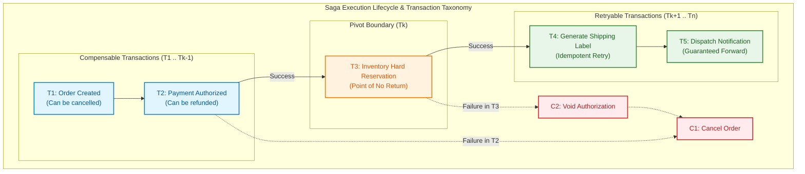
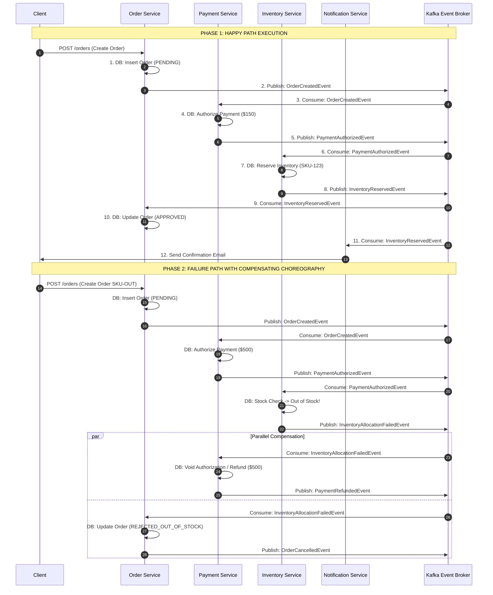
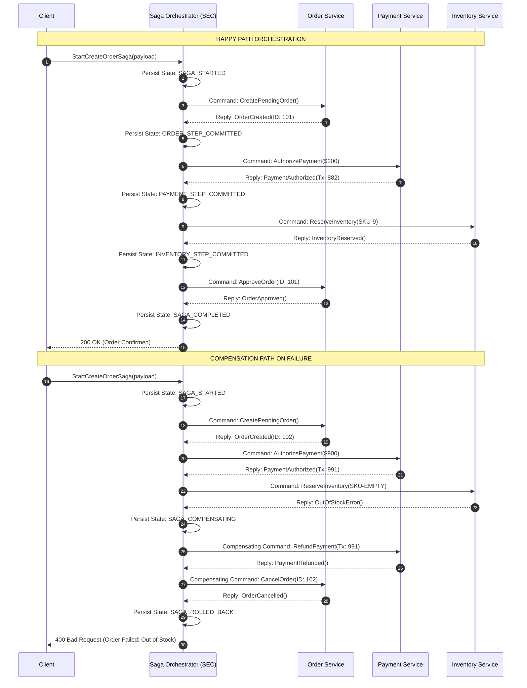
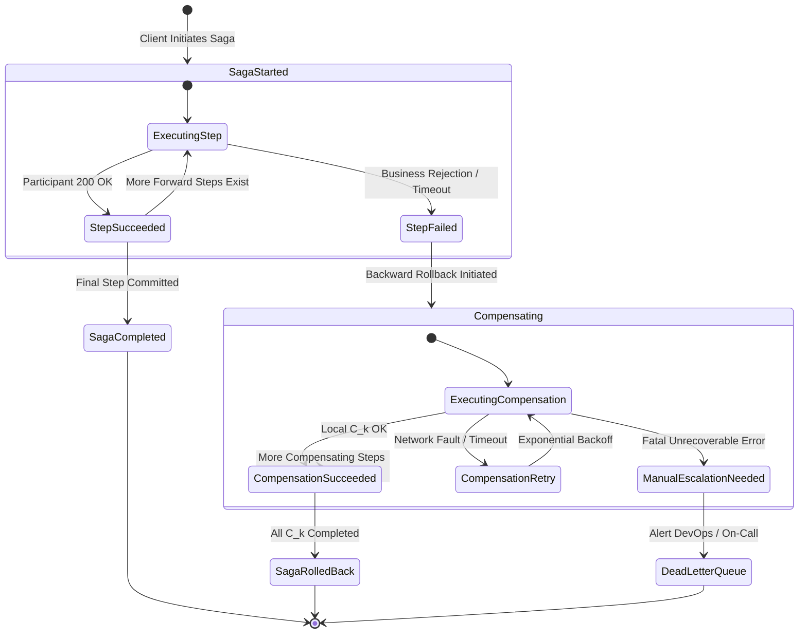
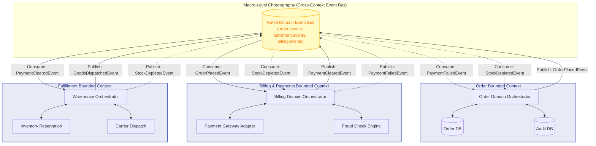
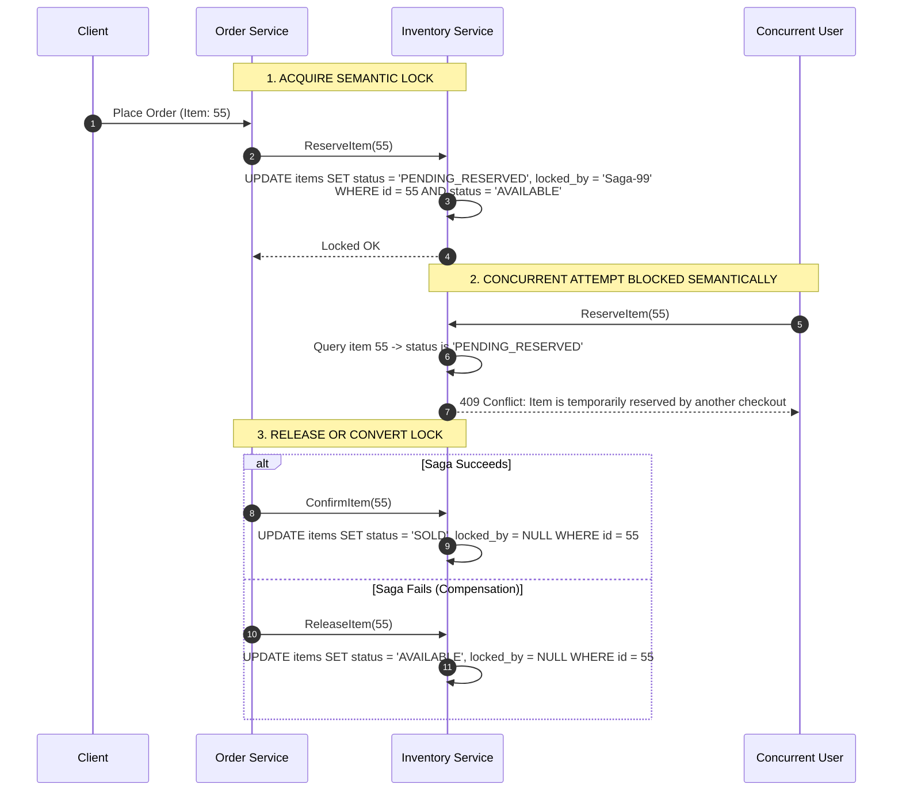
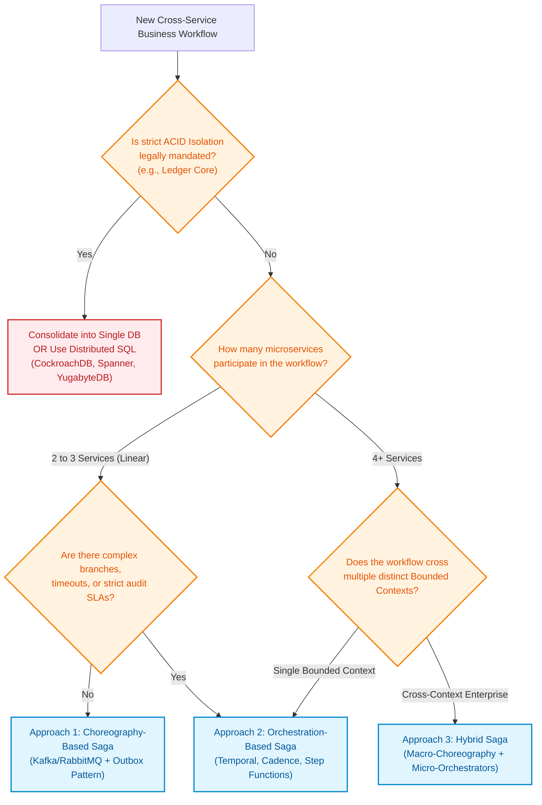

# Microservices Design Patterns: Saga Pattern

## 1. Pattern Overview and Architectural Intent

In traditional monolithic enterprise architectures, data consistency across multiple domain aggregates is guaranteed by the relational database management system (RDBMS) via local **ACID** (Atomicity, Consistency, Isolation, Durability) transactions. A single database engine utilizes database locks (shared and exclusive row/table locks), Write-Ahead Logging (WAL), and multi-version concurrency control (MVCC) to ensure that either all mutations succeed or none do, while isolating concurrent operations from intermediate, inconsistent state.

In modern distributed microservices architectures, data is decentralized according to the **Database-per-Service** pattern. Each microservice encapsulates its own persistence store—ranging from PostgreSQL, MySQL, and Oracle to DynamoDB, Cassandra, and MongoDB. An end-to-end business workflow (such as customer order fulfillment, flight and hotel booking, or loan disbursement) spans multiple microservice boundaries and independent databases.

```
+-----------------------------------------------------------------------------------+
|                              BUSINESS TRANSACTION                                 |
|                                                                                   |
|  +--------------------+   +--------------------+   +---------------------------+  |
|  |   Order Service    |   |  Payment Service   |   |    Inventory Service      |  |
|  | +----------------+ |   | +----------------+ |   | +-----------------------+ |  |
|  | | PostgreSQL DB  | |   | |   Stripe/DB    | |   | |      MongoDB / DB     |  |
|  | +----------------+ |   | +----------------+ |   | +-----------------------+ |  |
|  +--------------------+   +--------------------+   +---------------------------+  |
+-----------------------------------------------------------------------------------+
        Cross-service boundaries require cross-database consistency guarantees
```

### The Fallacy of Two-Phase Commit (2PC / XA) in Microservices

Historically, distributed transactions across heterogeneous databases were solved using the **Two-Phase Commit (2PC)** protocol managed by an XA-compliant Transaction Manager (e.g., JTA, Tuxedo). However, 2PC is fundamentally unviable in distributed cloud-native microservices for the following systemic reasons:

1. **Synchronous Blocking and Latency Amplification:**
   In 2PC, all participating nodes acquire and hold row locks during Phase 1 (`Prepare`) and keep them held until Phase 2 (`Commit` or `Abort`) finishes. In a microservices architecture spanning high-latency networks, lock-holding duration increases by orders of magnitude (from microseconds to hundreds of milliseconds or seconds). This collapses database connection pools and degrades system throughput.
2. **Coordinator as a Single Point of Failure (SPOF):**
   If the distributed transaction coordinator crashes during the window between Phase 1 and Phase 2, cohort services remain blocked indefinitely, holding exclusive database locks on resources.
3. **Incompatibility with Modern NoSQL and Third-Party APIs:**
   Modern distributed datastores (Apache Cassandra, ScyllaDB, AWS DynamoDB) and external SaaS payment gateways (Stripe, Adyen, PayPal) do not support the XA/2PC protocol. You cannot issue a `PREPARE` statement to a third-party credit card gateway.
4. **CAP Theorem & PACELC Trade-offs:**
   Under the CAP Theorem, 2PC strictly chooses Consistency over Availability ($CP$). In the presence of network partitions or transient node failures across microservices, 2PC rejects all writes. Modern distributed systems prioritize Availability and Partition Tolerance ($AP$) or latency-bounded consistency.

---

### The Saga Pattern: Theoretical Foundation

The **Saga Pattern** was first formulated in 1987 by **Hector Garcia-Molina and Kenneth Salem** (Princeton University) as a conceptual mechanism to handle Long-Lived Transactions (LLTs) without holding long-duration database locks.

> [!NOTE]
> **Formal Definition:**
> A Saga is a sequence of local transactions:
> $$S = \{ T_1, T_2, T_3, \dots, T_n \}$$
> Where each $T_i$ is a local transaction executed within the boundaries of a specific microservice. Each local transaction updates the service's private database and produces an event or message that triggers the subsequent local transaction $T_{i+1}$.
>
> If any local transaction $T_k$ ($1 \le k \le n$) fails due to business rule violations (e.g., insufficient funds, inventory out-of-stock) or technical faults, the Saga guarantees eventual consistency by executing a sequence of **compensating transactions**:
> $$C = \{ C_{k-1}, C_{k-2}, \dots, C_1 \}$$
> where each $C_i$ semantically reverses the side effects committed by $T_i$.

```
Forward Execution:   [ T1 ] ----> [ T2 ] ----> [ T3 (Fails!) ]
                                                  |
Backward Rollback:   [ C1 ] <---- [ C2 ] <--------+
```

### The ACID vs. BASE Paradigm Shift

The Saga Pattern fundamentally abandons traditional **ACID** transactions in favor of the **BASE** model:

| ACID Property | Traditional RDBMS Implementation | Saga Pattern Equivalent (BASE) |
| :--- | :--- | :--- |
| **Atomicity** | Guaranteed via Undo Log / WAL rollback. Either all mutations commit or none do. | **Compensating Atomicity**: Partial local commits are allowed to persist temporarily; atomicity is achieved backward via compensating transactions or forward via retries. |
| **Consistency** | Strict database invariants enforced instantaneously via constraints and triggers. | **Eventual Consistency**: The global system passes through intermediate, non-consistent states before settling into a terminal consistent state. |
| **Isolation** | Lock-based isolation levels (Read Committed, Repeatable Read, Serializable). | **NO Native Isolation**: Sagas lack the "I" of ACID. Intermediate uncommitted changes are visible to concurrent sagas, requiring application-level semantic concurrency control. |
| **Durability** | Committed transactions survive system crashes via persistent disk flush. | **Local Durability**: Each local step commits durably to its own datastore before triggering the next step. |

---

## 2. Core Anatomy of a Saga: Transaction Taxonomy and State Machine

A production Saga does not treat every step identically. Microservices architects categorize each step into one of three distinct transaction types to ensure deterministic forward or backward progression.



### 1. Compensable Transactions ($T_1, \dots, T_{k-1}$)
* **Definition**: Transactions that precede the Pivot Transaction and can be semantically undone if a subsequent step fails.
* **Requirements**: Must have an explicitly designed, tested, and idempotent **Compensating Transaction** ($C_i$).
* **Example**: Authorizing a payment, placing a provisional order hold, booking a temporary seat reservation.

### 2. The Pivot Transaction ($T_k$)
* **Definition**: The structural inflection point of the Saga. It is the "Point of No Return".
* **Semantics**:
  * If the Pivot Transaction **succeeds**, the Saga is guaranteed to commit forward. No preceding transactions ($T_1 \dots T_{k-1}$) will ever be compensated.
  * If the Pivot Transaction **fails**, the Saga terminates forward execution and initiates backward compensation ($C_{k-1} \dots C_1$).
* **Example**: The actual physical debit of funds, charging an irreversible third-party fee, or submitting an irreversible order to a warehouse manufacturing line.

### 3. Retryable (Forward-Only) Transactions ($T_{k+1}, \dots, T_n$)
* **Definition**: Transactions that follow a successful Pivot Transaction.
* **Semantics**: These steps **cannot fail for business reasons**. They may encounter network timeouts, node crashes, or infrastructure outages, but they are guaranteed to eventually succeed through retries, backoff algorithms, and dead-letter queues.
* **Requirements**: Must be strictly idempotent. Compensating transactions are never written for retryable steps because the saga never rolls back after the pivot.
* **Example**: Emitting a receipt email, updating analytical data warehouses, generating a courier shipping label.

---

### Recovery Strategies: Backward vs. Forward

```
                                  +---------------------------------------+
                                  |        SAGA EXECUTION STRATEGY        |
                                  +---------------------------------------+
                                                     |
                     +-------------------------------+-------------------------------+
                     |                                                               |
                     v                                                               v
       +----------------------------+                                  +----------------------------+
       |     BACKWARD RECOVERY      |                                  |      FORWARD RECOVERY      |
       +----------------------------+                                  +----------------------------+
       | - Triggered before Pivot.  |                                  | - Triggered at/after Pivot.|
       | - Executes C(k-1)...C(1).  |                                  | - Retries T(k)...T(n).     |
       | - Aborts business intent.  |                                  | - Drives to final success. |
       | - Requires compensating   |                                  | - Requires idempotency and |
       |   transaction logic.       |                                  |   resilient supervisors.   |
       +----------------------------+                                  +----------------------------+
```

1. **Backward Recovery (Rollback Compensation):**
   When a compensable step fails, the system executes compensating transactions in reverse order of execution. If $T_1 \to T_2 \to T_3$ executed and $T_3$ failed, the system executes $C_2 \to C_1$.
2. **Forward Recovery (Retry to Completion):**
   Used when an operation cannot be compensated or business rules dictate that the operation must succeed once initiated. The system uses durable state storage, persistent message queues, exponential backoff, and circuit breakers to drive the workflow to 100% completion.

---

## 3. Approach 1: Choreography-Based Saga (Decentralized, Event-Driven)

### Conceptual Mechanics

In a **Choreography-Based Saga**, there is no central orchestrator or master coordinator. Participating microservices collaborate reactively by publishing domain events to a distributed message streaming platform (e.g., Apache Kafka, RabbitMQ, AWS SNS/SQS) and subscribing to events emitted by other services.

Each service listens to incoming events, performs its local transaction, and publishes one or more new events. If a business failure occurs, the failing service publishes a failure event, and preceding services listen to this event to execute their respective compensations.



### High-Level Design (HLD): Broker Topology & Schema Evolution

To prevent cross-talk and maintain clean event stream boundaries, event streams are organized around domain topics:

```
[order.events]      --> { OrderCreatedEvent, OrderApprovedEvent, OrderCancelledEvent }
[payment.events]    --> { PaymentAuthorizedEvent, PaymentFailedEvent, PaymentRefundedEvent }
[inventory.events]  --> { InventoryReservedEvent, InventoryAllocationFailedEvent }
```

#### Event Envelope Specification (CloudEvents Compliant)

Every event emitted in a choreographed saga must carry standard metadata for correlation, causation, and tracing:

```json
{
  "specversion": "1.0",
  "id": "evt-f81d4fae-7dec-11d0-a765-00a0c91e6bf6",
  "source": "/services/order-service",
  "type": "com.ecommerce.order.created",
  "datacontenttype": "application/json",
  "time": "2026-10-14T20:15:30.123Z",
  "correlationid": "saga-9b1deb4d-3b7d-4bad-9bdd-2b0d7b3dcb6d",
  "causationid": "cmd-1234-abcd-5678",
  "data": {
    "orderId": "ord-883912",
    "customerId": "cust-9921",
    "totalAmount": 149.99,
    "currency": "USD",
    "items": [
      { "sku": "SKU-PRO-MACBOOK", "quantity": 1, "price": 149.99 }
    ]
  }
}
```

* **`correlationid`**: Identifies the overall Saga instance across all microservices. Every service copies this ID from the incoming event to any subsequent outbound events.
* **`causationid`**: Identifies the specific event or command that directly triggered this event, forming a causal DAG for distributed tracing.

---

### Low-Level Design (LLD): Outbox Pattern & Idempotency Pipeline

In choreography, two severe failure modes immediately arise:
1. **The Dual Commit Trap**: A service updates its local database, but crashes before it can publish the event to Kafka. Or, it publishes the event to Kafka, but the database commit fails.
2. **At-Least-Once Delivery**: Message brokers duplicate messages during network retries or rebalances.

#### 1. The Transactional Outbox Pattern

To solve the Dual Commit Trap, database updates and outbound event emissions must happen atomically inside a single ACID database transaction using an `outbox` table.

```
+-------------------------------------------------------------------------+
| Local Microservice Database Transaction                                 |
|                                                                         |
|  1. INSERT INTO orders (...)                                            |
|  2. INSERT INTO outbox (id, aggregate_type, payload, status)            |
|  3. COMMIT LOCAL TRANSACTION                                            |
+-------------------------------------------------------------------------+
                                    |
                                    v (Asynchronous CDC via Debezium / Engine)
                        +-----------------------+
                        |  Outbox Message Relay |
                        +-----------------------+
                                    |
                                    v (Publish)
                        +-----------------------+
                        |   Apache Kafka Topic  |
                        +-----------------------+
```

#### 2. Outbox & Idempotency Schema (PostgreSQL DDL)

```sql
-- Main Domain Entity Table
CREATE TABLE orders (
    order_id VARCHAR(64) PRIMARY KEY,
    customer_id VARCHAR(64) NOT NULL,
    total_amount NUMERIC(12, 2) NOT NULL,
    currency VARCHAR(3) NOT NULL,
    status VARCHAR(32) NOT NULL, -- PENDING, APPROVED, CANCELLED
    created_at TIMESTAMPTZ NOT NULL DEFAULT NOW(),
    updated_at TIMESTAMPTZ NOT NULL DEFAULT NOW()
);

-- Transactional Outbox Table
CREATE TABLE outbox_events (
    event_id UUID PRIMARY KEY,
    aggregate_type VARCHAR(64) NOT NULL,
    aggregate_id VARCHAR(64) NOT NULL,
    event_type VARCHAR(128) NOT NULL,
    payload JSONB NOT NULL,
    correlation_id VARCHAR(64) NOT NULL,
    created_at TIMESTAMPTZ NOT NULL DEFAULT NOW(),
    published BOOLEAN NOT NULL DEFAULT FALSE
);
CREATE INDEX idx_outbox_unpublished ON outbox_events(created_at) WHERE published = FALSE;

-- Idempotent Consumer Deduplication Table
CREATE TABLE processed_events (
    event_id UUID PRIMARY KEY,
    consumer_group VARCHAR(64) NOT NULL,
    processed_at TIMESTAMPTZ NOT NULL DEFAULT NOW()
);
```

---

### Production Implementation: Choreographed Event Consumer & Compensation

Below is a production-grade TypeScript / Node.js implementation showing how an Inventory Service handles `PaymentAuthorizedEvent`, performs idempotent local allocation, and publishes compensation on failure.

```typescript
import { Pool, PoolClient } from 'pg';
import { Kafka, Consumer, Producer } from 'kafkajs';
import { v4 as uuidv4 } from 'uuid';

interface CloudEvent<T> {
  id: string;
  type: string;
  correlationid: string;
  causationid: string;
  data: T;
}

interface PaymentAuthorizedPayload {
  orderId: string;
  customerId: string;
  items: Array<{ sku: string; quantity: number }>;
}

export class ChoreographedInventoryConsumer {
  private dbPool: Pool;
  private kafkaProducer: Producer;
  private kafkaConsumer: Consumer;

  constructor(dbPool: Pool, kafka: Kafka) {
    this.dbPool = dbPool;
    this.kafkaProducer = kafka.producer();
    this.kafkaConsumer = kafka.consumer({ groupId: 'inventory-service-saga-group' });
  }

  public async start(): Promise<void> {
    await this.kafkaProducer.connect();
    await this.kafkaConsumer.connect();
    await this.kafkaConsumer.subscribe({ topic: 'payment.events', fromBeginning: false });

    await this.kafkaConsumer.run({
      eachMessage: async ({ message }) => {
        if (!message.value) return;

        const event: CloudEvent<PaymentAuthorizedPayload> = JSON.parse(
          message.value.toString()
        );

        if (event.type === 'com.ecommerce.payment.authorized') {
          await this.handlePaymentAuthorized(event);
        }
      },
    });
  }

  private async handlePaymentAuthorized(
    event: CloudEvent<PaymentAuthorizedPayload>
  ): Promise<void> {
    const client: PoolClient = await this.dbPool.connect();

    try {
      await client.query('BEGIN');

      // 1. Idempotency Check: Guard against duplicate message deliveries
      const idempotencyCheck = await client.query(
        'INSERT INTO processed_events (event_id, consumer_group) VALUES ($1, $2) ON CONFLICT DO NOTHING RETURNING event_id',
        [event.id, 'inventory-service-saga-group']
      );

      if (idempotencyCheck.rowCount === 0) {
        // Event was already processed; safely acknowledge and exit
        await client.query('ROLLBACK');
        return;
      }

      const { orderId, items } = event.data;
      let stockAvailable = true;

      // 2. Perform local inventory verification and deduction
      for (const item of items) {
        const res = await client.query(
          'UPDATE inventory SET available_stock = available_stock - $1 WHERE sku = $2 AND available_stock >= $1 RETURNING sku',
          [item.quantity, item.sku]
        );

        if (res.rowCount === 0) {
          stockAvailable = false;
          break;
        }
      }

      if (stockAvailable) {
        // 3a. Success Path: Record domain event in transactional outbox
        const successEvent: CloudEvent<any> = {
          id: uuidv4(),
          type: 'com.ecommerce.inventory.reserved',
          correlationid: event.correlationid,
          causationid: event.id,
          data: { orderId, items, status: 'RESERVED' },
        };

        await client.query(
          `INSERT INTO outbox_events (event_id, aggregate_type, aggregate_id, event_type, payload, correlation_id)
           VALUES ($1, $2, $3, $4, $5, $6)`,
          [successEvent.id, 'Inventory', orderId, successEvent.type, successEvent.data, event.correlationid]
        );
      } else {
        // 3b. Business Failure Path: Trigger backward compensation across the saga
        const failureEvent: CloudEvent<any> = {
          id: uuidv4(),
          type: 'com.ecommerce.inventory.allocation_failed',
          correlationid: event.correlationid,
          causationid: event.id,
          data: {
            orderId,
            reason: 'INSUFFICIENT_STOCK',
            failedAt: new Date().toISOString(),
          },
        };

        await client.query(
          `INSERT INTO outbox_events (event_id, aggregate_type, aggregate_id, event_type, payload, correlation_id)
           VALUES ($1, $2, $3, $4, $5, $6)`,
          [failureEvent.id, 'Inventory', orderId, failureEvent.type, failureEvent.data, event.correlationid]
        );
      }

      await client.query('COMMIT');
    } catch (err) {
      await client.query('ROLLBACK');
      // Rethrow to trigger Kafka retry / exponential backoff
      throw err;
    } finally {
      client.release();
    }
  }
}
```

---

## 4. Approach 2: Orchestration-Based Saga (Centralized Coordinator)

### Conceptual Mechanics

In an **Orchestration-Based Saga**, a centralized component known as the **Saga Execution Coordinator (SEC)** or **Workflow Engine** is explicitly responsible for orchestrating the overall distributed transaction.

The Orchestrator maintains the global state machine, issues commands to participant microservices (via synchronous gRPC/REST or asynchronous message queues), awaits command execution replies, and decides the next transition. If an error occurs, the Orchestrator deterministically executes compensating commands in reverse order.



---

### High-Level Design (HLD): Saga Execution Coordinator (SEC) Architecture

To prevent the Orchestrator from becoming a Single Point of Failure (SPOF) or a performance bottleneck, modern orchestration engines (such as Temporal, Cadence, Camunda Zeebe, or custom SEC clusters) implement an **Event-Sourced, Partitioned-Consensus Architecture**.

```
                           +------------------------+
                           |  External API Gateway  |
                           +------------------------+
                                       |
                                       v
               +------------------------------------------------+
               |      Saga Orchestrator Cluster (SEC Nodes)     |
               |                                                |
               |   +--------------+          +--------------+   |
               |   |  SEC Node 1  |          |  SEC Node 2  |   |
               |   |  (Leader P1) |          |  (Leader P2) |   |
               |   +--------------+          +--------------+   |
               +------------------------------------------------+
                               |                 |
            +------------------+                 +------------------+
            |                                                       |
            v                                                       v
+-----------------------+                               +-----------------------+
|  Partitioned State DB |                               |  Task / Command Queue |
| (Cassandra / Postgres)|                               |  (Kafka / AWS SQS)    |
| - State History Log   |                               | - Order Commands      |
| - Optimistic Lock Ver |                               | - Payment Commands    |
| - Step Payloads       |                               | - Inventory Commands  |
+-----------------------+                               +-----------------------+
```

1. **State Partitioning via Consistent Hashing:**
   Incoming Sagas are assigned a unique `saga_id`. The cluster hashes `saga_id` to determine which coordinator instance owns the in-memory execution pipeline, ensuring horizontal scalability.
2. **Deterministic Replay / Journaling:**
   Every step transition, command emission, and response is appended to an append-only state journal. If an SEC node crashes mid-saga, a replacement node reads the journal log, deterministically reconstructs the state machine, and resumes execution without re-executing completed operations.
3. **Distributed Timers & Heartbeats:**
   The SEC maintains durable timers for timeouts (e.g., waiting a maximum of 15 seconds for a payment gateway response). If a timeout fires, the SEC triggers compensation.

---

### Saga Coordinator State Machine Diagram



---

### Low-Level Design (LLD): Persistent State Store Schema

The SEC relies on a relational or NoSQL persistent schema that guarantees transactional state updates and concurrency protection via optimistic locking.

```sql
CREATE TABLE saga_instances (
    saga_id VARCHAR(64) PRIMARY KEY,
    saga_type VARCHAR(64) NOT NULL, -- e.g., 'ORDER_FULFILLMENT'
    current_state VARCHAR(32) NOT NULL, -- STARTED, COMPENSATING, COMPLETED, ROLLED_BACK, FAILED
    current_step INT NOT NULL DEFAULT 0,
    payload JSONB NOT NULL,
    compensation_status JSONB,
    version INT NOT NULL DEFAULT 1, -- Optimistic concurrency control
    created_at TIMESTAMPTZ NOT NULL DEFAULT NOW(),
    updated_at TIMESTAMPTZ NOT NULL DEFAULT NOW()
);

CREATE TABLE saga_step_executions (
    step_id UUID PRIMARY KEY,
    saga_id VARCHAR(64) NOT NULL REFERENCES saga_instances(saga_id),
    step_index INT NOT NULL,
    step_name VARCHAR(64) NOT NULL,
    service_name VARCHAR(64) NOT NULL,
    execution_type VARCHAR(16) NOT NULL, -- 'FORWARD', 'COMPENSATION'
    status VARCHAR(32) NOT NULL, -- PENDING, COMPLETED, FAILED, TIMED_OUT
    request_payload JSONB,
    response_payload JSONB,
    retry_count INT NOT NULL DEFAULT 0,
    started_at TIMESTAMPTZ NOT NULL DEFAULT NOW(),
    completed_at TIMESTAMPTZ
);

CREATE INDEX idx_saga_state ON saga_instances(current_state);
```

---

### Production Implementation: Robust Go Saga Orchestrator

Below is a complete, concurrent, production-grade Saga Orchestrator implementation written in **Go**. It features step abstraction, forward execution, reverse compensation rollback upon failure, timeout contexts, and error propagation.

```go
package saga

import (
	"context"
	"errors"
	"fmt"
	"sync"
	"time"
)

// StepStatus defines the execution state of an individual saga step
type StepStatus string

const (
	StatusPending     StepStatus = "PENDING"
	StatusCompleted   StepStatus = "COMPLETED"
	StatusFailed      StepStatus = "FAILED"
	StatusCompensated StepStatus = "COMPENSATED"
)

// Step defines the contract for an executable and compensable unit of work
type Step interface {
	Name() string
	Execute(ctx context.Context, sagaCtx *SagaContext) error
	Compensate(ctx context.Context, sagaCtx *SagaContext) error
}

// SagaContext carries thread-safe state data across steps
type SagaContext struct {
	mu   sync.RWMutex
	data map[string]interface{}
}

func NewSagaContext() *SagaContext {
	return &SagaContext{
		data: make(map[string]interface{}),
	}
}

func (s *SagaContext) Set(key string, val interface{}) {
	s.mu.Lock()
	defer s.mu.Unlock()
	s.data[key] = val
}

func (s *SagaContext) Get(key string) (interface{}, bool) {
	s.mu.RLock()
	defer s.mu.RUnlock()
	val, ok := s.data[key]
	return val, ok
}

// Orchestrator coordinates the execution and compensation lifecycle
type Orchestrator struct {
	sagaID string
	steps  []Step
}

func NewOrchestrator(sagaID string) *Orchestrator {
	return &Orchestrator{
		sagaID: sagaID,
		steps:  make([]Step, 0),
	}
}

func (o *Orchestrator) AddStep(step Step) *Orchestrator {
	o.steps = append(o.steps, step)
	return o
}

// Execute runs forward transactions; if any fail, it invokes backward compensation
func (o *Orchestrator) Execute(ctx context.Context, sagaCtx *SagaContext) error {
	executedSteps := make([]Step, 0)

	for i, step := range o.steps {
		select {
		case <-ctx.Done():
			o.compensate(ctx, executedSteps, sagaCtx)
			return fmt.Errorf("saga %s aborted by context timeout/cancellation: %w", o.sagaID, ctx.Err())
		default:
		}

		fmt.Printf("[Saga-%s] Executing step %d: %s\n", o.sagaID, i+1, step.Name())
		err := step.Execute(ctx, sagaCtx)
		if err != nil {
			fmt.Printf("[Saga-%s] Step %s failed: %v. Initiating backward compensation.\n", o.sagaID, step.Name(), err)
			o.compensate(ctx, executedSteps, sagaCtx)
			return fmt.Errorf("saga %s execution failed at step %s: %w", o.sagaID, step.Name(), err)
		}

		executedSteps = append(executedSteps, step)
	}

	fmt.Printf("[Saga-%s] All steps successfully committed.\n", o.sagaID)
	return nil
}

// compensate rolls back successfully executed steps in strictly reverse order
func (o *Orchestrator) compensate(ctx context.Context, executedSteps []Step, sagaCtx *SagaContext) {
	for i := len(executedSteps) - 1; i >= 0; i-- {
		step := executedSteps[i]
		fmt.Printf("[Saga-%s] Rolling back step %d: %s\n", o.sagaID, i+1, step.Name())

		// Compensations must be aggressively retried with backoff
		var compErr error
		for attempt := 1; attempt <= 3; attempt++ {
			compErr = step.Compensate(ctx, sagaCtx)
			if compErr == nil {
				break
			}
			fmt.Printf("[Saga-%s] Compensation %s failed on attempt %d: %v. Retrying...\n",
				o.sagaID, step.Name(), attempt, compErr)
			time.Sleep(time.Duration(attempt*100) * time.Millisecond)
		}

		if compErr != nil {
			// In production, publish to Dead Letter Queue (DLQ) for human intervention
			fmt.Printf("[CRITICAL] Saga %s failed to compensate step %s after 3 attempts! Alerting on-call.\n",
				o.sagaID, step.Name())
		}
	}
}

// --- CONCRETE STEP IMPLEMENTATIONS ---

type OrderStep struct{}

func (s *OrderStep) Name() string { return "CreateOrderStep" }
func (s *OrderStep) Execute(ctx context.Context, sagaCtx *SagaContext) error {
	sagaCtx.Set("orderId", "ORD-9951")
	return nil
}
func (s *OrderStep) Compensate(ctx context.Context, sagaCtx *SagaContext) error {
	orderID, _ := sagaCtx.Get("orderId")
	fmt.Printf("Compensate: Cancelling order %v in database\n", orderID)
	return nil
}

type PaymentStep struct{}

func (s *PaymentStep) Name() string { return "AuthorizePaymentStep" }
func (s *PaymentStep) Execute(ctx context.Context, sagaCtx *SagaContext) error {
	sagaCtx.Set("paymentAuthCode", "AUTH-88192")
	return nil
}
func (s *PaymentStep) Compensate(ctx context.Context, sagaCtx *SagaContext) error {
	authCode, _ := sagaCtx.Get("paymentAuthCode")
	fmt.Printf("Compensate: Voiding payment authorization %v via payment gateway\n", authCode)
	return nil
}

type InventoryStep struct{ FailOnExecution bool }

func (s *InventoryStep) Name() string { return "ReserveInventoryStep" }
func (s *InventoryStep) Execute(ctx context.Context, sagaCtx *SagaContext) error {
	if s.FailOnExecution {
		return errors.New("out of stock: SKU-IPHONE-15")
	}
	sagaCtx.Set("reservationId", "RES-5501")
	return nil
}
func (s *InventoryStep) Compensate(ctx context.Context, sagaCtx *SagaContext) error {
	resID, _ := sagaCtx.Get("reservationId")
	fmt.Printf("Compensate: Releasing inventory reservation %v\n", resID)
	return nil
}
```

---

## 5. Approach 3: Hybrid Saga (Hierarchical Orchestration & Choreography)

In large-scale enterprise microservice ecosystems (e.g., Netflix, Uber, Amazon), neither pure choreography nor pure monolithic orchestration works cleanly:
* **Pure Choreography Flaws at Scale:** With 50+ microservices, tracing event cascades becomes impossible. Circular dependencies arise, and debugging a failed transaction requires correlating logs across dozens of separate systems.
* **Pure Orchestration Flaws at Scale:** A single central orchestrator violates team autonomy and bounded contexts, coupling disparate domain models into one god-service that bottlenecks deployment pipelines.

The industry solution is the **Hybrid Saga (Macro-Choreography with Micro-Orchestration)**:
1. **Across Bounded Context Boundaries (Macro Level):** Systems communicate asynchronously via **Choreography** using high-level business events on an event bus (e.g., Kafka).
2. **Within a Single Bounded Context (Micro Level):** Each domain implements an **Internal Orchestrator** to manage its private, tightly-coupled multi-step transactional flows.



### Compensation Bubbles in Hybrid Sagas

A major benefit of Hybrid Sagas is the concept of a **Compensation Bubble**:
* If an error occurs *inside* a bounded context (e.g., Billing Orchestrator encounters a transient card network failure), it can retry or try an alternative payment method (e.g., fallback to PayPal) internally without polluting the global Kafka event stream.
* Global compensation events are emitted only when an entire domain boundary fails exhaustively.

---

## 6. Solving ACID-Less Saga Concurrency & Isolation Anomalies

Because Sagas commit local database transactions immediately at each step without holding cross-service locks, intermediate states are exposed to concurrent transactions. **Sagas lack Isolation (the "I" in ACID).**

Without defensive architecture, systems suffer from three classic distributed concurrency anomalies:

```
+---------------------------------------------------------------------------------------+
|                              SAGA ISOLATION ANOMALIES                                 |
+------------------------------------+--------------------------------------------------+
| Anomaly Type                       | System Impact                                    |
+------------------------------------+--------------------------------------------------+
| 1. Dirty Read                      | Saga A modifies balance from $100 -> $50.        |
|                                    | Saga B reads $50 and commits an order.           |
|                                    | Saga A fails and compensates back to $100.       |
|                                    | Result: Saga B made decisions on phantom data.   |
+------------------------------------+--------------------------------------------------+
| 2. Lost Update                     | Saga A reads stock = 10, reserves 2 (stock = 8). |
|                                    | Concurrent Saga B reads stock = 10, reserves 3.  |
|                                    | Saga B writes stock = 7, overwriting Saga A!     |
+------------------------------------+--------------------------------------------------+
| 3. Non-Repeatable (Fuzzy) Read     | Step 1 of Saga A checks user status: VIP.        |
|                                    | Concurrent Saga B demotes user to Standard.      |
|                                    | Step 3 of Saga A attempts to apply VIP discount. |
+------------------------------------+--------------------------------------------------+
```

To counter these anomalies, distributed systems engineers apply five formal design strategies:

### 1. Semantic Locking (The Dirty Flag Pattern)

Instead of using database-level row locks across services, the application acquires a **Semantic Lock** by setting a domain entity's status to a transient pending state (e.g., `ORDER_PENDING_APPROVAL`, `FUNDS_HELD`, `SEAT_TENTATIVE`).



### 2. Commutative Updates

Design local update operations such that their execution order does not alter the mathematical outcome. 

* **Non-Commutative:** `SET balance = 100` (Order of execution changes final balance).
* **Commutative:** `DEBIT balance by 20`, `CREDIT balance by 20`.
By designing transactions as delta adjustments (`current_balance + amount`) rather than absolute overwrites, concurrent sagas modifying the same entity avoid lost updates, provided an invariant constraint check (`CHECK (balance >= 0)`) prevents illegal underflows.

### 3. Pessimistic Read Projections (CQRS View Separation)

To prevent Dirty Reads by external clients, separate the **Write Model** from the **Read Model** using Command Query Responsibility Segregation (CQRS):
* The Saga writes to the internal transactional store, where states transition through `PENDING_AUTHORIZATION`, `PENDING_INVENTORY`.
* The Read Model (Elasticsearch or read-replica projection) is updated **only after the Pivot Transaction commits**. External client queries hitting the Read Model never observe dirty intermediate states.

### 4. Version Vectors and Monotonic Logical Clocks

To prevent out-of-order event delivery (e.g., an `OrderCancelledEvent` arriving at a consumer *before* `OrderCreatedEvent` due to network delays), every domain entity stores a monotonically increasing `version` or logical timestamp:

```sql
UPDATE orders 
SET status = 'CANCELLED', version = version + 1 
WHERE order_id = :orderId AND version = :expectedVersion;
```

If an event arrives with an obsolete version vector, it is rejected or buffered in a pending sequence table.

---

## 7. Real-World Edge Cases, Failure Modes, and Resiliency Protocols

### Edge Case 1: Uncompensable Pivot Failure

**Problem:** What happens if a Compensating Transaction ($C_i$) itself encounters a persistent database failure or external API failure (e.g., Stripe API is down with HTTP 500 when attempting to issue a refund)?

```
Saga Forward:   [ T1: Create Order ] ---> [ T2: Charge Card ] ---> [ T3: Out of Stock! ]
                                                                             |
Saga Rollback:  [ C1: Cancel Order ] <--- [ C2: Refund (FAIL: 500) ] <-------+
                                                  |
                                                  v
                                     HOW DO WE RECOVER?
```

**Architectural Solutions:**
1. **Compensations Must Never Give Up (Infinite Exponential Backoff):**
   Compensating transactions **must not be designed to fail permanently**. Unlike forward business steps that fail due to rule violations (e.g., insufficient balance), compensations must succeed. The SEC must retry compensations with exponential backoff and jitter indefinitely until network or service availability recovers.
2. **Dead Letter Queue (DLQ) & Human-in-the-Loop Escalation:**
   If a compensation reaches a maximum retry ceiling (e.g., 50 retries over 24 hours), the saga enters an `ESCALATED_MANUAL_INTERVENTION` state. The event is pushed to an administrative DLQ alerting an on-call engineer via PagerDuty, accompanied by a reconciliation dashboard to trigger manual adjustment.

---

### Edge Case 2: Out-of-Order Message Arrival (The "Cancel Before Create" Race)

**Problem:** In asynchronous choreographed architectures, network partitioning or partition rebalancing can cause an event emitted later to arrive at a downstream consumer *before* an event emitted earlier.

For example, a user creates an order and immediately cancels it. `OrderCancelledEvent` arrives at Payment Service *before* `OrderCreatedEvent`.

```
Timeline:
t1: Order Service publishes OrderCreatedEvent (Delayed in transit)
t2: User cancels order -> Order Service publishes OrderCancelledEvent
t3: Payment Service receives OrderCancelledEvent (No order exists in DB!)
t4: Payment Service receives OrderCreatedEvent (Authorizes payment for cancelled order!) -> CRITICAL LEAK!
```

**Architectural Solution: Tombstone Records & State Pre-Creation**

When an entity receives a cancellation event for an ID it has not yet observed, it inserts a **Tombstone Record** with state `CANCELLED_PRE_CREATION`:

```sql
-- When Payment Service receives OrderCancelledEvent for non-existent order
INSERT INTO payments (order_id, status, created_at)
VALUES ('ORD-101', 'CANCELLED_BEFORE_PAYMENT', NOW())
ON CONFLICT (order_id) DO UPDATE 
SET status = 'CANCELLED';

-- When OrderCreatedEvent subsequently arrives later:
INSERT INTO payments (order_id, amount, status)
VALUES ('ORD-101', 150.00, 'AUTHORIZED')
ON CONFLICT (order_id) DO NOTHING; -- Prevents resurrected authorization!
```

---

### Edge Case 3: Cyclic Event Storms (Choreography Cascades)

**Problem:** In complex choreography, Service A emits `Event A`, causing Service B to emit `Event B`, which inadvertently causes Service A to emit `Event A` again, creating an infinite processing loop that consumes cluster compute and network bandwidth.

**Architectural Countermeasures:**
1. **DAG Validation at Build/Lint Time:** Model event flows as a Directed Acyclic Graph (DAG) in CI/CD pipelines to detect circular dependency loops before deployment.
2. **Hop Count / Metadata Tracing:** Include a `hop_count` field in every CloudEvent envelope. Increment the counter on every hop; if `hop_count > 15`, terminate the pipeline immediately and publish to an incident channel.

---

### Edge Case 4: Coordinator Crash Recovery & Journal Replay

**Problem:** The central Saga Orchestrator server crashes while executing Step 4 of a 7-step Saga. How does the replacement coordinator instance resume without repeating Step 1, 2, and 3?

**Architectural Protocol:**
1. **Event Sourcing / Write-Ahead State Persistence:**
   Before dispatching any command, the SEC writes a `STEP_PREPARING` record. When the reply is received, it writes `STEP_COMMITTED`.
2. **Deterministic Rehydration:**
   When a new orchestrator node takes ownership of the crashed instance's partition, it rehydrates the saga's internal state machine by replaying its historical journal:
   * It sees `Step 1: COMMITTED`, `Step 2: COMMITTED`, `Step 3: COMMITTED`.
   * It sees `Step 4: PREPARING` without a matching `COMMITTED` entry.
   * The SEC dispatches an **idempotent inquiry command** to Service 4: `QueryStepStatus(saga_id, step_index)`.
   * If Service 4 finished, the SEC marks Step 4 committed and moves to Step 5. If Service 4 never received it, the SEC safely re-dispatches Step 4.

---

## 8. Production Comparison & Trade-Off Matrix

Choosing between Choreography, Orchestration, Hybrid, and traditional Two-Phase Commit requires balancing systemic trade-offs:

| Architectural Dimension | Choreography-Based Saga | Orchestration-Based Saga | Hybrid Saga | Two-Phase Commit (2PC / XA) |
| :--- | :--- | :--- | :--- | :--- |
| **Coordination Model** | Fully Decentralized (Peer-to-Peer events) | Centralized Controller (Command/Reply) | Hierarchical (Macro-events, Micro-commands) | Centralized Transaction Coordinator |
| **Service Coupling** | **Low (Domain level)**; High (Event schema contract) | **Medium**; Participants know nothing about workflow | **Balanced**; Contexts isolated, internals private | **Extreme**; Participants locked to XA protocol |
| **System Visibility & Tracing** | **Poor**; Requires distributed tracing (Jaeger/Zipkin) | **Superior**; Central dashboard monitors state machine | **High**; Context dashboards + global event trace | **Low**; Opaque lock-manager state |
| **Blast Radius of Outages** | **Small**; Individual services can queue messages | **Large**; Orchestrator crash can stall all workflows | **Localized**; Faults contained in bounded contexts | **Catastrophic**; Unresolved locks freeze tables |
| **Development Complexity** | Low for 2–3 steps; Exponential for > 5 steps | Constant; Workflow logic localized in code | Moderate to High; Requires domain boundary design | Low application code; Extreme DB tuning |
| **Latency & Throughput** | Highest (Non-blocking async messaging) | Medium (Network hop through SEC per step) | High (Optimized inside domains) | **Lowest** (Synchronous lock waits) |
| **Testing & Verification** | **Difficult**; Requires spinning up broker + all nodes | **Easy**; Orchestrator can be unit/integration tested | Moderate; Testable per context | Difficult across distributed databases |
| **Deadlock Vulnerability** | None (No locks held) | None (No locks held) | None (No locks held) | **High** (Cross-database deadlocks) |
| **Recommended Scope** | Simple flows (2–4 services, linear pipelines) | Complex flows (> 5 steps, branching, timeouts) | Large enterprise scale (Multiple business domains) | Single monolithic database, legacy banking |

---

## 9. Real-World Case Studies at Scale

### Case Study 1: Uber Cadence / Temporal for Trip Lifecycle

```
[ Rider Requests Ride ] 
         |
         v
+------------------+     gRPC Commands     +---------------------+
|  Trip Workflows  | --------------------> | Matching Service    |
|   (Cadence SEC)  | <-------------------- | (Find Driver)       |
|                  |                       +---------------------+
|                  |                       +---------------------+
|                  | --------------------> | Driver Service      |
|                  | <-------------------- | (Accept Ride)       |
|                  |                       +---------------------+
|                  |                       +---------------------+
|                  | --------------------> | Payment Service     |
|                  | <-------------------- | (Hold/Capture Fare) |
+------------------+                       +---------------------+
```

* **Context:** Uber's core trip lifecycle (Rider Request $\to$ Driver Match $\to$ Pickup $\to$ Route $\to$ Drop-off $\to$ Payment) involves dozens of microservices.
* **Why Choreography Failed:** 
  Early implementations at Uber utilized choreographed message passing over Kafka. As the platform grew, edge cases proliferated: riders cancelling while drivers were en route; fraud detection flags triggering during trips; credit card pre-authorizations expiring during 2-hour rides. Debugging why an individual ride stalled required joining logs from 15 Kafka topics and 8 microservices. The event web became an unmaintainable "spaghetti architecture."
* **The Solution (Cadence/Temporal Orchestration):**
  Uber created **Cadence** (later open-sourced and evolved into **Temporal**). The trip lifecycle is defined as a durable, stateful code workflow.
* **Key Architectural Innovations:**
  * **Event History Replay:** Workflows are written in standard Go code. State is deterministically reconstructed upon failover by replaying the activity event history log.
  * **Long-Running Distributed Timers:** A workflow can sleep for 30 minutes awaiting a rider to show up at a pickup point, consuming zero CPU cycles while persisted to disk.

---

### Case Study 2: Amazon E-Commerce Checkout & Multi-Warehouse Fulfillment

* **Context:** When an Amazon customer clicks "Buy Now", the transaction spans payment capture, dynamic promotions, multi-warehouse physical fulfillment, and third-party logistics (UPS, FedEx).
* **The Architecture (Hybrid Orchestration with AWS Step Functions & SQS):**
  1. **Phase 1 (Compensable Checkout):** Orchestrated via internal workflow engines.
     * Step 1: Validate cart and prime membership.
     * Step 2: Acquire a **Semantic Lock** on warehouse inventory (`PROVISIONAL_HOLD` for 15 minutes).
     * Step 3: Trigger payment charge through payment processor.
  2. **Phase 2 (The Pivot):**
     * Payment charge succeeds. The order transitions from `PENDING` to `COMMITTED`. The customer's credit card has been charged; this is the point of no return.
  3. **Phase 3 (Retryable Forward Fulfillment):**
     * The order details are pushed to asynchronous queue topologies for physical picking, packing, and courier label printing.
     * If a label generation service is down, the workflow does not refund the credit card; it retries with exponential backoff until the shipping printer comes back online.

---

## 10. System Design Interview Masterclass: Deep Technical Questions

### Q1: How do you prevent the "Lost Update" anomaly when multiple concurrent Sagas modify the same bank account or inventory item?

**Deep Answer:**
Because Sagas lack database-level cross-service isolation, two concurrent sagas could read the same initial state, compute a new state, and overwrite each other's changes.

Three architectural strategies prevent this:
1. **Semantic Locking (Dirty Flag):** The first saga marks the record state as `LOCKED_BY_SAGA_A`. Any concurrent saga attempting to modify the record reads this flag and either fails fast, blocks waiting on an event, or deposits its request into a FIFO queue.
2. **Commutative SQL Expressions:** Avoid setting absolute values (e.g., `SET stock = 8`). Instead, write atomic delta queries:
   ```sql
   UPDATE inventory 
   SET available_stock = available_stock - 2 
   WHERE sku = 'SKU-A' AND available_stock >= 2;
   ```
   Because relational databases lock rows during an in-place `UPDATE`, concurrent executions serialize at the row level, preserving mathematical correctness regardless of execution order.
3. **Optimistic Concurrency Control (OCC) with Retry:** Include a `version` column. When persisting, assert `WHERE id = :id AND version = :readVersion`. If another saga updated the record in the interim, the update returns `0` modified rows, prompting the failing saga to re-read and retry.

---

### Q2: What happens if a Compensating Transaction fails halfway through? How do you guarantee atomicity of the rollback?

**Deep Answer:**
A compensating transaction cannot rely on an automatic rollback of its own rollback. If a compensation fails:
1. **Differentiate Transient vs. Permanent Errors:**
   * **Transient Errors (Network drops, HTTP 503, DB connection pool exhausted):** The coordinator must retry the compensation indefinitely using **Exponential Backoff with Full Jitter** ($T_{\text{sleep}} = \text{random}(0, \min(M, T_{\text{base}} \times 2^{\text{attempt}}))$).
   * **Permanent Errors (Invalid business state, authentication bug):** Retrying code bugs will never succeed.
2. **The "Compensations Must Be Idempotent" Law:**
   Because compensations will be retried repeatedly, they must be strictly idempotent. Executing `RefundPayment($100)` five times must only refund the customer once.
3. **Escalation to Manual Dead-Letter Super-State:**
   If a compensation fails after a configured threshold (e.g., 20 retries), the SEC transitions the saga to `COMPENSATION_BLOCKED_REQUIRES_MANUAL_INTERVENTION`. It pushes the full state journal and stack trace to a Dead Letter Queue (DLQ), emits a high-severity alert to PagerDuty, and enables an administrator to manually intervene via a back-office tool.

---

### Q3: How do you design an Outbox Pattern with Debezium to guarantee exactly-once event publication in a Choreographed Saga?

**Deep Answer:**
Achieving reliable event emission without distributed transactions requires combining the Transactional Outbox Pattern with Change Data Capture (CDC):

```
Application --> [ BEGIN TX -> Update Business Tables -> INSERT outbox_events -> COMMIT ]
                                                               |
                                                               v (WAL Engine)
                                                      PostgreSQL WAL Logs
                                                               |
                                                               v (Tail WAL)
                                                      Debezium CDC Connector
                                                               |
                                                               v (Publish with ID)
                                                      Apache Kafka Topic
```

1. **Transactional Insertion:** Inside the local microservice transaction, the application writes domain changes and writes an event envelope into an `outbox_events` table in the same database.
2. **Log-Based CDC via Debezium:** Debezium connects to the database's native transaction log (PostgreSQL `pgoutput` WAL or MySQL Binlog). It captures changes made to `outbox_events` asynchronously without polling overhead.
3. **Handling the "Exactly-Once" Myth:** Kafka guarantees **at-least-once** delivery across network partitions. To achieve end-to-end effective *exactly-once processing*, downstream consumers must implement **Idempotent Consumer Logic**:
   * Every event has a unique UUID `id`.
   * The consumer checks a local `processed_events` table within its local database transaction. If `INSERT INTO processed_events VALUES (event_id)` fails on primary key conflict, the message is ignored.

---

### Q4: If an orchestration service crashes mid-saga, how does a new orchestrator node take over without repeating already executed steps?

**Deep Answer:**
The orchestrator must be designed as an **Event-Sourced State Machine**:
1. **Write-Ahead Step Scheduling:**
   Before dispatching a command to a worker or participant service, the SEC appends a `STEP_SCHEDULED` record to its durable state database.
2. **Reply Journaling:**
   When the SEC receives a successful reply, it records `STEP_COMPLETED` along with the output payload.
3. **Partition Failover and Journal Rehydration:**
   When an SEC node crashes, the cluster's consensus coordinator (e.g., Raft group or Kubernetes lease) reassigns the partition to a healthy SEC node. The new node loads the event journal for the active `saga_id`.
4. **Idempotent State Resumption:**
   * Steps marked `STEP_COMPLETED` are bypassed.
   * If a step is in `STEP_SCHEDULED` without a corresponding `STEP_COMPLETED`, the node does not assume it failed. It sends an idempotent inquiry request (`CheckStatus`) to the participant service.
   * If the participant completed the work, the SEC fast-forwards; if the participant never received it, the SEC re-dispatches the command.

---

### Q5: How do you handle out-of-order event delivery where a `PaymentRefunded` or `OrderCancelled` event arrives before `OrderCreated`?

**Deep Answer:**
This is a standard race condition in distributed message brokers that have multiple partitions or network-delayed delivery paths.

**Architectural Solutions:**
1. **Tombstone Placeholders:**
   When the consumer receives `OrderCancelledEvent` for an unknown `orderId`, it creates a record in the database:
   ```sql
   INSERT INTO orders (id, status, is_cancelled) 
   VALUES ('ORD-55', 'PRE_CREATION_CANCELLED', TRUE);
   ```
   When `OrderCreatedEvent` subsequently arrives, the insert statement uses an upsert clause:
   ```sql
   INSERT INTO orders (id, status, is_cancelled) 
   VALUES ('ORD-55', 'CREATED', FALSE)
   ON CONFLICT (id) DO UPDATE 
   SET status = CASE 
       WHEN orders.is_cancelled = TRUE THEN 'CANCELLED' 
       ELSE 'CREATED' 
   END;
   ```
2. **Version Vectors / Lamport Timestamps:**
   Include a monotonically increasing `sequence_number` in event headers generated by the aggregate root. If a consumer expects sequence `1` but receives sequence `2`, it holds sequence `2` in a local buffer or dead-letter queue for a grace period (e.g., 5 seconds) waiting for sequence `1` to arrive.

---

### Q6: When should an enterprise transition from Choreography to Orchestration, and how can a Hybrid architecture bridge the gap?

**Deep Answer:**
* **Transition Trigger Indicators:**
  1. **Step Count Threshold:** When a business flow exceeds **4 to 5 microservice hops**, choreography becomes exponentially harder to trace, test, and reason about.
  2. **Complex Branching and Conditional Paths:** Choreography excels at linear pipelines ($A \to B \to C$). If the flow requires dynamic branching (e.g., *if customer is VIP and country is US, execute step 3a, else step 3b*), embedding that routing logic into decentralized event consumers creates severe tight coupling.
  3. **Regulatory Auditing & SLA Demands:** When financial or healthcare compliance requires displaying the exact real-time state of a transaction on a single management pane.
* **The Hybrid Bridge:**
  Keep high-level domain boundaries decoupled via Kafka events (Macro-Choreography). Inside each domain (Orders, Payments, Logistics), deploy a domain-specific orchestrator (e.g., Temporal or Go-based SEC) to manage local multi-step complexities (Micro-Orchestration).

---

### Q7: How do you test distributed Sagas in CI/CD environments?

**Deep Answer:**
Production saga architectures require three layers of automated verification:
1. **Contract Testing with Pact:**
   Verify that command and event schemas between orchestrators and participant microservices match expectations without deploying the full network stack.
2. **Deterministic Time-Travel / Simulation Testing:**
   Frameworks like Temporal allow writing unit tests that execute months of workflow logic in milliseconds using a virtualized mock environment. This verifies edge cases like timer expirations, compensation ordering, and retry ceilings deterministically.
3. **Chaos Engineering & Fault Injection (e.g., Chaos Mesh, Gremlin):**
   In staging environments, inject specific network failures during active sagas:
   * Kill participant service pods immediately after they update their local DB but before they send a reply.
   * Drop 30% of broker packets to trigger coordinator timeouts.
   * Validate that the saga either successfully recovers forward or cleanly compensations backward without leaving orphan holds.

---

## 11. Architectural Decision Flowchart

Use this decision matrix when choosing an architectural strategy for cross-service transactions:


