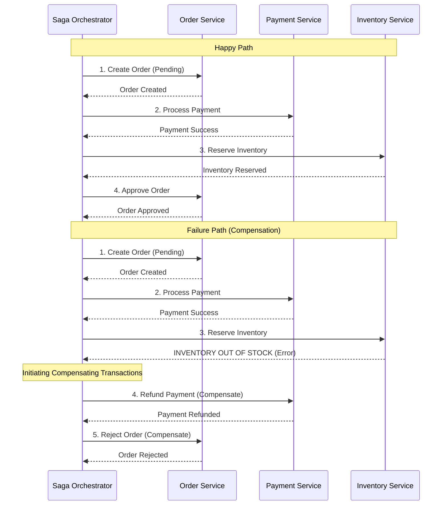

# Microservices Design Patterns: Saga Pattern

## 1. Pattern Overview and Intent

In a monolithic application, maintaining data consistency across multiple entities is straightforward: you use a single database transaction (ACID properties). 

In a microservices architecture, data is typically decentralized (Database per Service pattern). An operation that spans multiple microservices requires updating data in multiple, independent databases. Traditional distributed transactions like **Two-Phase Commit (2PC)** are slow, cause locking issues, and are not supported by many modern NoSQL databases or message brokers.

The **Saga Pattern** is a solution for managing distributed transactions without 2PC. It achieves data consistency by breaking the distributed transaction into a sequence of local transactions. Each local transaction updates the database of its respective service and publishes an event or message to trigger the next local transaction in the saga.

If a local transaction fails (e.g., business rule violation), the saga executes **compensating transactions** to undo the changes made by the preceding local transactions.

## 2. Detailed Explanation of How It Works

There are two primary ways to coordinate a Saga: **Choreography** and **Orchestration**.

### 1. Choreography-Based Saga
There is no central coordinator. Each service listens for events from other services and decides if it should take action.
* **Flow:** Service A does its work -> publishes `Event A`. Service B listens to `Event A` -> does its work -> publishes `Event B`.
* **Pros:** Simple, no central point of failure, loosely coupled.
* **Cons:** Hard to track the overall status of the transaction. Complex sagas become a confusing "spaghetti" of events.

### 2. Orchestration-Based Saga
A centralized coordinator (the Orchestrator) manages the saga. It tells each service what local transaction to execute.
* **Flow:** Orchestrator tells Service A to do work. Service A replies `Done`. Orchestrator tells Service B to do work.
* **Pros:** Clear flow of logic, easy to monitor state, avoids cyclic dependencies between services.
* **Cons:** Orchestrator becomes a single point of failure and can easily absorb too much business logic (becoming a "God Service").

### Architecture Diagram (Orchestration with Compensation)

## 3. Real-World Example: Order Management System

Consider an E-commerce Order Management System. Placing an order involves three services:
1. `OrderService`: Creates the order.
2. `PaymentService`: Charges the customer's credit card.
3. `InventoryService`: Reserves the items in the warehouse.

**The Saga Steps:**
1. `OrderService` receives a POST request. It creates an Order in a `PENDING` state.
2. The Saga Orchestrator sends a command to `PaymentService` to charge $100.
3. `PaymentService` succeeds.
4. The Saga Orchestrator sends a command to `InventoryService` to reserve 1 Laptop.
5. **Failure!** The `InventoryService` discovers the Laptop is out of stock.

**The Compensation Steps:**
1. The Saga Orchestrator catches the failure from `InventoryService`.
2. It sends a `RefundPayment` command to the `PaymentService`. `PaymentService` refunds the $100.
3. It sends a `CancelOrder` command to the `OrderService`. `OrderService` updates the order state to `CANCELLED`.

Data consistency is restored!

## 4. Pros and Cons

### Pros
* **Maintains Data Consistency**: Allows data consistency across multiple microservices without requiring distributed locks or 2PC.
* **Scalable**: Services do not hold database locks while waiting for other services to complete (unlike 2PC), meaning high throughput is maintained.

### Cons
* **High Complexity**: Designing, implementing, and testing compensating transactions is inherently complex.
* **Eventual Consistency**: The system is only eventually consistent. While the saga is running, a user might read partially committed data (Lack of Isolation).
* **Idempotency Requirement**: Services must be idempotent (safe to retry) because messages might be delivered more than once in a distributed system.

## 5. When to Use / When NOT to Use

**When to Use:**
* When an operation needs to update data in multiple services.
* When 2PC is not an option (e.g., using NoSQL, communicating over high-latency networks, or requiring high throughput).

**When NOT to Use:**
* For simple, single-service operations.
* When strict, immediate consistency (ACID Isolation) is an absolute business requirement (in such rare cases, you might have to reconsider microservices boundaries or use a distributed relational DB).

## 6. Common Interview Questions

1. **What is a Compensating Transaction?**
   * *Answer:* A local transaction that semantically undoes the effect of a previously executed local transaction in a saga. For example, if the initial transaction was "Charge Credit Card", the compensating transaction is "Refund Credit Card".
2. **What is the difference between Choreography and Orchestration?**
   * *Answer:* Choreography is decentralized (services publish and listen to events). Orchestration is centralized (a controller directs the services). Choreography is better for simple workflows (2-3 steps), while Orchestration is better for complex workflows with many steps and failure scenarios.
3. **How does Saga compare to Two-Phase Commit (2PC)?**
   * *Answer:* 2PC uses locks to guarantee strict ACID consistency across nodes, but it suffers from low throughput, potential deadlocks, and blocking if the coordinator fails. Saga avoids locks, offers high throughput, and uses compensating transactions to provide eventual consistency.
4. **How do you handle the lack of Isolation in Sagas?**
   * *Answer:* Sagas lack the "I" in ACID. To prevent dirty reads, you can use semantic locks (e.g., an order state is set to `PENDING` rather than `APPROVED` so other services know it's not finalized), or use versioning.

*(This concludes the deep dive into the Saga Pattern.)*
