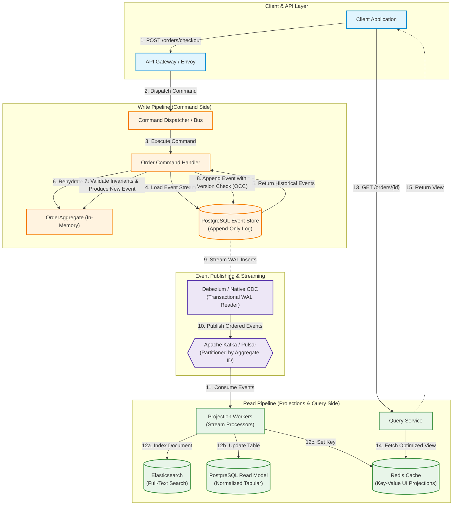
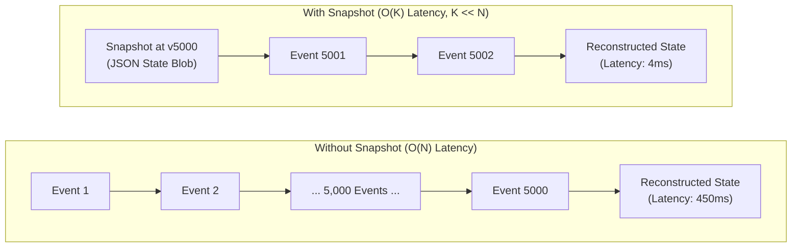
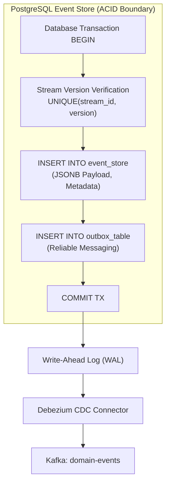
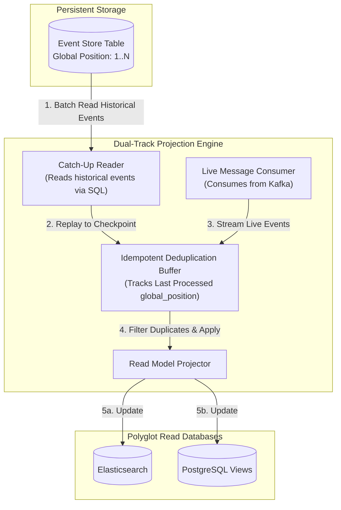
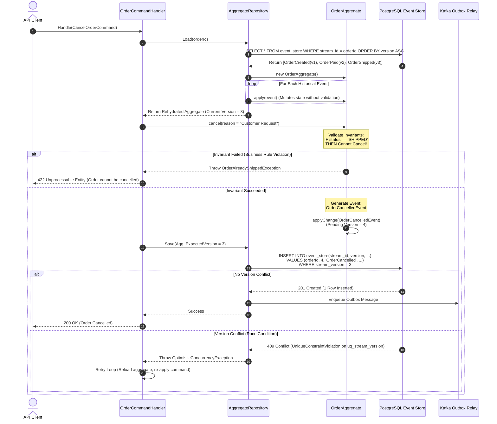
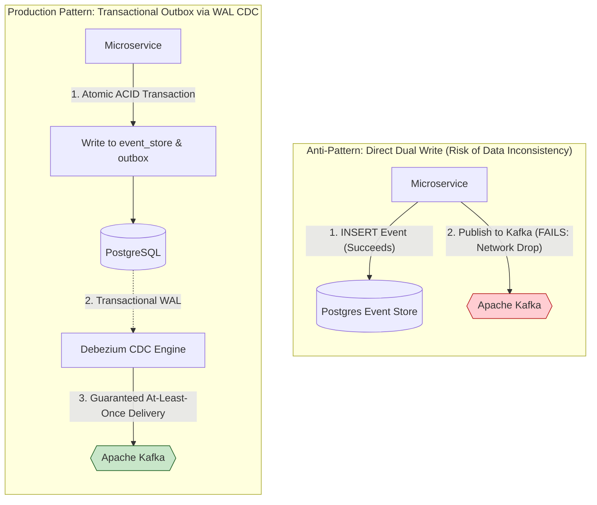

# Event Sourcing Pattern

## 1. Pattern Overview and Core Intent

The **Event Sourcing Pattern** is an architectural paradigm where state changes are modeled and persisted as an immutable, append-only sequence of domain events rather than mutating records in place. In traditional systems, persistence mechanisms overwrite current state, discarding the historical context of how that state was reached. In contrast, Event Sourcing treats domain events as the foundational source of truth. The current state of any business entity (aggregate) is not directly stored; it is transiently derived by replaying its historical stream of events from the beginning of time or from a known checkpoint.

```
Traditional CRUD:   [State V1] ──(UPDATE in place)──> [State V2] ──(DELETE)──> [Null / Lost History]
Event Sourcing:     [Event 1: Created] ──> [Event 2: ItemAdded] ──> [Event 3: AddressUpdated] ──> [Current State Derived]
```

### 1.1 State-Oriented vs. Event-Oriented Persistence

In a standard state-oriented (CRUD) architecture, database tables represent the *current snapshot* of reality. A banking account balance is stored as a single numeric column in an `accounts` table:

```sql
-- Traditional State-Oriented Persistence
UPDATE accounts 
SET balance = balance - 150.00, updated_at = NOW() 
WHERE account_id = 'acc-8842';
```

This destructive update creates three fundamental architectural liabilities:
1. **Loss of Intent:** Why did the balance decrease? Was it an ATM withdrawal, a fraudulent wire transfer, a subscription fee, or a bank penalty? The state table retains the *result*, but discards the *business intent*.
2. **Loss of Temporal Reality:** What was the exact balance on March 14 at 11:23 AM? Answering this requires complex, audit-table triggers or external CDC logging that often diverges from application business logic.
3. **Impedance Mismatch & Concurrency Contention:** High-frequency updates to the same row cause severe database row-lock contention, deadlocks, and write amplification on indexed columns.

Event-Oriented Persistence replaces destructive mutation with an immutable ledger of domain facts:

$$\text{State}_t = \text{Fold}\Big(\text{InitialState}, [e_1, e_2, e_3, \dots, e_t]\Big)$$

```
                               ┌─────────────────────────────────────────────────────────┐
                               │                    Event Stream                         │
                               │                                                         │
Initial State ──[ + Event 1 ]──┼─> AccountOpened       (Balance: $0)                     │
              ──[ + Event 2 ]──┼─> FundsDeposited      (Amount: +$500, Balance: $500)    │
              ──[ + Event 3 ]──┼─> DebitCardIssued     (Card: ...4921)                   │
              ──[ + Event 4 ]──┼─> FundsWithdrawn      (Amount: -$150, Balance: $350)    │
                               │                                                         │
                               └────────────────────────────┬────────────────────────────┘
                                                            ▼
                                           Reconstructed State: Balance = $350
```

### 1.2 Core Architectural Drivers

| Architectural Driver | Business & Technical Impact |
| :--- | :--- |
| **Complete Auditability & Provenance** | Regulatory compliance (SOX, PCI-DSS, HIPAA, IFRS 9) requires non-repudiable audit logs. The event log *is* the persistence layer, making audit forgery architecturally impossible. |
| **Temporal Querying & "Time Travel"** | Any aggregate can be materialized at any point in time $t$. Essential for retroactive fraud analysis, debugging historical race conditions, and legal discovery. |
| **Complete Root Cause Analysis** | When a critical bug occurs, engineers can extract the exact event stream from production and replay it through a debugger locally to observe the deterministic state failure. |
| **Elimination of Object-Relational Impedance Mismatch** | Aggregates do not need complex ORM mapping over 30 normalized tables. An aggregate writes a flat event structure and loads its state by folding events in memory. |
| **Seamless Asynchronous Integration** | Events recorded in the event store naturally power reactive workflows, stream processing (Kafka/Flink), and denormalized query views via CQRS. |

---

## 2. Core Building Blocks & Terminology

```
   ┌────────────────┐         ┌────────────────┐         ┌────────────────┐
   │    Command     │ ──────> │   Aggregate    │ ──────> │     Event      │
   │ (Intent to Act)│         │ (Business Logic│         │ (Fact That Has │
   │                │         │ & Invariants)  │         │   Happened)    │
   └────────────────┘         └────────────────┘         └────────────────┘
           │                                                     │
           │ Rejected if invalid                                 │ Appended if valid
           ▼                                                     ▼
     Domain Error                                           Event Store
```

### 2.1 Commands vs. Events vs. Queries
- **Command:** An expression of **intent** sent to the system by an actor (e.g., `WithdrawFunds`, `AddItemToCart`). Commands are named in the imperative mood, target a specific aggregate, and can be rejected if business invariants fail.
- **Domain Event:** A notification of a **fact that has occurred** in the domain (e.g., `FundsWithdrawn`, `ItemAddedToCart`). Events are named in the past tense, are immutable, and cannot be rejected once committed.
- **Query:** A read-only request for state that does not produce events or alter the system.

### 2.2 Aggregates & Aggregate Roots
An **Aggregate** is a cluster of domain objects (entities and value objects) bounded by an **Aggregate Root**. The Aggregate Root is the sole gateway through which external commands interact with the domain model.
- **Invariant Enforcement:** The aggregate guarantees that all business rules hold true before any new event is generated.
- **Transactional Boundary:** In an event-sourced architecture, an atomic transaction spans **exactly one aggregate instance**. Cross-aggregate consistency is managed asynchronously via Sagas or Process Managers.

### 2.3 The Event Store
The Event Store is a specialized database optimized for append-only log operations. It provides three foundational guarantees:
1. **Append-Only Write Semantics:** Events are inserted at the end of an aggregate stream; updates and deletes are strictly prohibited.
2. **Stream-Level Ordering:** Events within a specific aggregate stream ($StreamID$) are strictly ordered by a monotonic sequence number ($1, 2, 3, \dots, N$).
3. **Optimistic Concurrency Control (OCC):** Appends succeed only if the expected stream version matches the database version at the instant of insertion.

### 2.4 State Rehydration & Event Handlers
**Rehydration** is the process of restoring an aggregate's in-memory state from storage:
1. Fetch all events associated with $StreamID$ ordered by $SequenceNumber$ ascending.
2. Instantiate an empty instance of the Aggregate Root.
3. Iterate over the events, invoking internal state-mutating handlers (`apply(event)`) without executing command validation rules.

---

## 3. Comprehensive End-to-End Architecture

The following diagram illustrates a production-grade Event Sourcing architecture featuring Command-Query Responsibility Segregation (CQRS), asynchronous projection workers, and polyglot read models.



---

## 4. Architectural Approaches & Variants

Event Sourcing can be realized through several distinct infrastructure topologies depending on latency requirements, operational complexity budgets, and scaling dimensions.

### Approach 1: Pure Append-Only Event Store (EventStoreDB vs. Apache Kafka)

A specialized append-only engine treats event streams as first-class primitives.

```
Dedicated Event Store Engine (EventStoreDB / Marten):
   Stream: Order-101 ──> [Event 1 (v1)] ──> [Event 2 (v2)] ──> [Event 3 (v3)]
   Stream: Order-102 ──> [Event 1 (v1)] ──> [Event 2 (v2)]
   Stream: User-550  ──> [Event 1 (v1)]
   (Millions of isolated lightweight streams with atomic version guarantees)
```

#### High-Level Design (HLD)
- **Engine Selection:** Dedicated databases like **EventStoreDB** or PostgreSQL-based engines like **Marten**.
- **Stream Granularity:** Every aggregate has its own distinct, isolated stream named using the pattern `{AggregateType}-{AggregateId}` (e.g., `Order-88a24`).
- **Subscription Types:**
  - *Catch-up Subscriptions:* Read from a specific stream position ($offset$) to the end, then receive live events in real-time. Essential for building projections.
  - *Persistent Subscriptions:* Competing consumer pattern with server-side checkpointing and message acknowledgment.

#### Low-Level Design (LLD): The Fallacy of "Kafka as an Aggregate Event Store"
Engineers frequently ask: *Can we use Apache Kafka directly as our primary aggregate event store?* While technically possible, using Kafka as the primary store for fine-grained aggregate rehydration introduces severe architectural mismatches:

| Architectural Requirement | Dedicated Event Store (EventStoreDB / RDBMS) | Apache Kafka |
| :--- | :--- | :--- |
| **Stream Count** | Hundreds of millions of unique aggregate streams. | Partition count is practically constrained (typically $< 4,000$ per broker; higher in KRaft, but not millions). |
| **Optimistic Concurrency Control** | Native per-stream atomic conditional append (`expectedVersion = 4`). | No native OCC per aggregate ID across arbitrary partition keys. Requires external coordination. |
| **Random Stream Replay** | Fetch all events for `Order-991` via index scan in $< 2\text{ms}$. | Fetching an arbitrary aggregate requires reading through an entire partition or custom consumer seeking. |
| **Storage Semantics** | Permanent retention with aggregate-level indexing. | Log retention is time or byte-bounded; log compaction operates on key-tombstones, not event history. |

> [!IMPORTANT]
> **Production Recommendation:** Use a database with native indexing (EventStoreDB or an RDBMS) as your **System of Record (Event Store)**, and stream committed events into **Apache Kafka** as a high-throughput distribution backbone for downstream projections and microservice consumers.

---

### Approach 2: Event Sourcing with Periodic Snapshotting

As aggregates evolve over months or years, an aggregate stream can accumulate thousands of events. Rehydrating an aggregate by loading and executing $10,000$ events on every command leads to prohibitive $O(N)$ CPU and I/O latency.



#### Snapshot Interval Mechanics
A snapshot captures the complete internal state of an aggregate at a specific sequence number:

$$K = \text{CurrentVersion} \pmod{\text{SnapshotInterval}}$$

If $K = 0$, an asynchronous worker or the write pipeline serializes the aggregate state into a dedicated snapshot table or object store.

#### Rehydration Algorithm Pseudocode
```python
def rehydrate_aggregate(aggregate_id, event_store, snapshot_store):
    # Step 1: Check for latest snapshot
    snapshot = snapshot_store.get_latest(aggregate_id)
    
    if snapshot is not None:
        aggregate = AggregateRoot.from_snapshot(snapshot.state, snapshot.version)
        start_version = snapshot.version + 1
    else:
        aggregate = AggregateRoot.empty(aggregate_id)
        start_version = 1

    # Step 2: Fetch only delta events occurring after snapshot
    delta_events = event_store.get_events_since(aggregate_id, from_version=start_version)

    # Step 3: Fast-forward state
    for event in delta_events:
        aggregate.apply_historical_event(event)
        
    return aggregate
```

---

### Approach 3: Relational DB-Backed Event Store (PostgreSQL + JSONB)

For most enterprises, building an Event Store on top of an established relational database (e.g., PostgreSQL or MySQL 8) offers the optimal balance of transactional safety, tooling maturity, and operational confidence.



#### Database Schema Design (PostgreSQL DDL)

```sql
-- 1. Streams Table: Tracks stream metadata and active version
CREATE TABLE event_streams (
    stream_id         UUID PRIMARY KEY,
    aggregate_type    VARCHAR(128) NOT NULL,
    current_version   BIGINT NOT NULL DEFAULT 0,
    created_at        TIMESTAMPTZ NOT NULL DEFAULT NOW(),
    updated_at        TIMESTAMPTZ NOT NULL DEFAULT NOW()
);

-- 2. Events Table: Immutable append-only log of domain events
CREATE TABLE event_store (
    global_position   BIGSERIAL PRIMARY KEY,
    stream_id         UUID NOT NULL REFERENCES event_streams(stream_id) ON DELETE RESTRICT,
    version           BIGINT NOT NULL,
    event_type        VARCHAR(256) NOT NULL,
    event_id          UUID NOT NULL UNIQUE,
    payload           JSONB NOT NULL,
    metadata          JSONB NOT NULL,
    created_at        TIMESTAMPTZ NOT NULL DEFAULT NOW(),
    
    -- Absolute guarantee of Optimistic Concurrency Control per aggregate stream
    CONSTRAINT uq_stream_version UNIQUE (stream_id, version)
);

-- Indexes for performance
CREATE INDEX idx_event_store_stream_id_version 
    ON event_store (stream_id, version ASC);

CREATE INDEX idx_event_store_global_pos 
    ON event_store (global_position ASC);

CREATE INDEX idx_event_store_event_type 
    ON event_store (event_type);

-- 3. Snapshots Table: Periodic state checkpoints
CREATE TABLE aggregate_snapshots (
    stream_id         UUID NOT NULL REFERENCES event_streams(stream_id) ON DELETE CASCADE,
    version           BIGINT NOT NULL,
    state             JSONB NOT NULL,
    created_at        TIMESTAMPTZ NOT NULL DEFAULT NOW(),
    PRIMARY KEY (stream_id, version)
);
```

---

### Approach 4: Event Sourcing Integrated with CQRS & Dual-Track Subscriptions

Event Sourced systems separate the write model (optimistic locking, validation, append-only) from the read model (denormalized, index-optimized projections). To ensure read models survive restarts and process live events without dropping data, production projections employ **Dual-Track Subscriptions**.



---

## 5. Low-Level Design & Concurrency Mechanics

### 5.1 The Rehydration & Command Execution Lifecycle

The following sequence diagram details the complete round-trip of command handling, aggregate rehydration from an event stream, invariant enforcement, atomic insertion with OCC, and notification.



---

### 5.2 Optimistic Concurrency Control (OCC) & Conflict Resolution

In a distributed microservice cluster, multiple concurrent workers may attempt to execute commands on the same aggregate simultaneously. Event Sourcing handles this with mathematical precision using sequence numbers.

```mermaid
flowchart TD
    Start["Incoming Command: AddItemToCart"] --> ReadStore["Read Current Stream Version (v = 5)"]
    ReadStore --> Compute["Execute Invariant Logic in Memory<br/>Prepare New Event: ItemAdded<br/>Target Version = 6"]
    Compute --> AttemptAppend["Execute SQL INSERT with version = 6"]
    
    AttemptAppend --> CheckUnique{"Did INSERT Violate<br/>UNIQUE(stream_id, version)?"}
    
    CheckUnique -- "No (Row Written)" --> SuccessCommit["Commit Transaction<br/>Publish Event to Kafka<br/>Return 200 OK to Client"]
    
    CheckUnique -- "Yes (Collision)" --> ConflictCatch["Catch ConcurrencyConflictException"]
    ConflictCatch --> RetryPolicy{"Max Retries<br/>Exceeded?"}
    
    RetryPolicy -- "No" --> Backoff["Apply Exponential Backoff + Jitter"]
    Backoff --> ReadStore
    
    RetryPolicy -- "Yes" --> AbortFail["Abort Command<br/>Return 409 Conflict to Client"]

    classDef success fill:#C8E6C9,stroke:#2E7D32,stroke-width:2px;
    classDef conflict fill:#FFCDD2,stroke:#C62828,stroke-width:2px;
    classDef process fill:#E3F2FD,stroke:#1565C0,stroke-width:2px;

    SuccessCommit class:success;
    ConflictCatch,AbortFail class:conflict;
    Start,ReadStore,Compute,AttemptAppend,CheckUnique,RetryPolicy,Backoff class:process;
```

---

## 6. Concrete Production Code Implementations

### 6.1 TypeScript / Node.js Production Implementation

The following implementation provides a complete, battle-tested Aggregate Root framework with strict event rehydration, uncommitted event tracking, and optimistic locking against PostgreSQL.

#### Core Framework Abstractions

```typescript
// domain/event.ts
export interface DomainEvent<T = any> {
  readonly eventId: string;
  readonly aggregateId: string;
  readonly eventType: string;
  readonly aggregateVersion: number;
  readonly timestamp: Date;
  readonly data: T;
  readonly metadata: Record<string, any>;
}

// domain/aggregate-root.ts
export abstract class AggregateRoot {
  private _id: string = '';
  private _version: number = 0; // Committed version in the event store
  private readonly _uncommittedEvents: DomainEvent[] = [];

  get id(): string {
    return this._id;
  }

  get version(): number {
    return this._version;
  }

  get uncommittedEvents(): readonly DomainEvent[] {
    return [...this._uncommittedEvents];
  }

  public markEventsAsCommitted(): void {
    this._uncommittedEvents.length = 0;
  }

  public loadFromHistory(events: DomainEvent[]): void {
    for (const event of events) {
      this.mutate(event);
      this._version = event.aggregateVersion;
      this._id = event.aggregateId;
    }
  }

  protected applyChange(eventData: any, eventType: string): void {
    const nextVersion = this._version + this._uncommittedEvents.length + 1;
    const event: DomainEvent = {
      eventId: crypto.randomUUID(),
      aggregateId: this._id,
      eventType,
      aggregateVersion: nextVersion,
      timestamp: new Date(),
      data: eventData,
      metadata: { correlationId: crypto.randomUUID() },
    };

    this.mutate(event);
    this._uncommittedEvents.push(event);
  }

  // Abstract dispatch method: maps domain event to internal state mutation
  protected abstract mutate(event: DomainEvent): void;
}
```

#### Concrete Domain Aggregate: BankAccount

```typescript
// domain/bank-account.ts
import { AggregateRoot } from './aggregate-root';
import { DomainEvent } from './event';

export class InsufficientFundsException extends Error {}
export class AccountAlreadyFrozenException extends Error {}

export class BankAccountAggregate extends AggregateRoot {
  private _balance: number = 0;
  private _isFrozen: boolean = false;

  get balance(): number {
    return this._balance;
  }

  get isFrozen(): boolean {
    return this._isFrozen;
  }

  public static openAccount(accountId: string, initialDeposit: number): BankAccountAggregate {
    if (initialDeposit < 0) {
      throw new Error("Initial deposit cannot be negative");
    }
    const account = new BankAccountAggregate();
    (account as any)._id = accountId;
    account.applyChange({ accountId, initialDeposit }, 'AccountOpened');
    return account;
  }

  public deposit(amount: number): void {
    if (this._isFrozen) throw new AccountAlreadyFrozenException("Account is frozen");
    if (amount <= 0) throw new Error("Deposit amount must be positive");

    this.applyChange({ amount }, 'FundsDeposited');
  }

  public withdraw(amount: number): void {
    if (this._isFrozen) throw new AccountAlreadyFrozenException("Account is frozen");
    if (amount <= 0) throw new Error("Withdrawal amount must be positive");
    if (this._balance - amount < 0) {
      throw new InsufficientFundsException(`Cannot withdraw ${amount}. Current balance: ${this._balance}`);
    }

    this.applyChange({ amount }, 'FundsWithdrawn');
  }

  public freeze(reason: string): void {
    if (this._isFrozen) return; // Idempotent
    this.applyChange({ reason }, 'AccountFrozen');
  }

  // Pure state mutation without business rule evaluation
  protected mutate(event: DomainEvent): void {
    switch (event.eventType) {
      case 'AccountOpened':
        (this as any)._id = event.data.accountId;
        this._balance = event.data.initialDeposit;
        this._isFrozen = false;
        break;
      case 'FundsDeposited':
        this._balance += event.data.amount;
        break;
      case 'FundsWithdrawn':
        this._balance -= event.data.amount;
        break;
      case 'AccountFrozen':
        this._isFrozen = true;
        break;
      default:
        throw new Error(`Unhandled domain event: ${event.eventType}`);
    }
  }
}
```

#### PostgreSQL Event Store Repository with Optimistic Concurrency

```typescript
// infrastructure/postgres-event-store.ts
import { Pool, PoolClient } from 'pg';
import { DomainEvent, AggregateRoot } from '../domain/aggregate-root';

export class ConcurrencyException extends Error {
  constructor(streamId: string, expected: number, actual: number) {
    super(`Concurrency conflict on stream ${streamId}. Expected v${expected}, but found v${actual}`);
  }
}

export class PostgresEventStoreRepository<T extends AggregateRoot> {
  constructor(
    private readonly dbPool: Pool,
    private readonly aggregateFactory: () => T,
    private readonly aggregateType: string
  ) {}

  public async load(streamId: string): Promise<T> {
    const client: PoolClient = await this.dbPool.connect();
    try {
      const res = await client.query(
        `SELECT event_id, stream_id, version, event_type, payload, metadata, created_at
         FROM event_store 
         WHERE stream_id = $1 
         ORDER BY version ASC`,
        [streamId]
      );

      if (res.rows.length === 0) {
        throw new Error(`Aggregate with ID ${streamId} not found`);
      }

      const events: DomainEvent[] = res.rows.map(row => ({
        eventId: row.event_id,
        aggregateId: row.stream_id,
        aggregateVersion: parseInt(row.version, 10),
        eventType: row.event_type,
        data: row.payload,
        metadata: row.metadata,
        timestamp: row.created_at,
      }));

      const aggregate = this.aggregateFactory();
      aggregate.loadFromHistory(events);
      return aggregate;
    } finally {
      client.release();
    }
  }

  public async save(aggregate: T): Promise<void> {
    const uncommitted = aggregate.uncommittedEvents;
    if (uncommitted.length === 0) return;

    const client: PoolClient = await this.dbPool.connect();
    try {
      await client.query('BEGIN');

      const expectedVersion = aggregate.version;
      const streamId = aggregate.id;

      // Verify and lock stream or insert on first event
      const streamCheck = await client.query(
        `SELECT current_version FROM event_streams WHERE stream_id = $1 FOR UPDATE`,
        [streamId]
      );

      if (streamCheck.rows.length === 0) {
        if (expectedVersion !== 0) {
          throw new ConcurrencyException(streamId, expectedVersion, 0);
        }
        await client.query(
          `INSERT INTO event_streams (stream_id, aggregate_type, current_version) VALUES ($1, $2, $3)`,
          [streamId, this.aggregateType, uncommitted.length]
        );
      } else {
        const currentVersion = parseInt(streamCheck.rows[0].current_version, 10);
        if (currentVersion !== expectedVersion) {
          throw new ConcurrencyException(streamId, expectedVersion, currentVersion);
        }
        await client.query(
          `UPDATE event_streams SET current_version = $1, updated_at = NOW() WHERE stream_id = $2`,
          [expectedVersion + uncommitted.length, streamId]
        );
      }

      // Append all uncommitted events
      for (const event of uncommitted) {
        await client.query(
          `INSERT INTO event_store 
           (stream_id, version, event_type, event_id, payload, metadata, created_at)
           VALUES ($1, $2, $3, $4, $5, $6, $7)`,
          [
            event.aggregateId,
            event.aggregateVersion,
            event.eventType,
            event.eventId,
            JSON.stringify(event.data),
            JSON.stringify(event.metadata),
            event.timestamp,
          ]
        );
      }

      await client.query('COMMIT');
      aggregate.markEventsAsCommitted();
    } catch (err: any) {
      await client.query('ROLLBACK');
      // PostgreSQL unique constraint violation error code: 23505
      if (err.code === '23505') {
        throw new ConcurrencyException(aggregate.id, aggregate.version, -1);
      }
      throw err;
    } finally {
      client.release();
    }
  }
}
```

---

## 7. Event Schema Evolution & Long-Term Maintenance

In traditional software, schema changes are handled via database migrations (`ALTER TABLE ADD COLUMN`). In Event Sourcing, historical events are **cryptographically immutable**. An event persisted 5 years ago cannot be rewritten in place without invalidating audit logs and hash chains.

```mermaid
flowchart TD
    subgraph StorageLayer["Immutable Storage (Database Disk)"]
        RawV1["Raw Event: CustomerRegistered v1<br/>{ 'name': 'John Doe', 'addr': 'NY' }"]
    end

    subgraph UpcastingPipeline["Upcasting Interceptor Pipeline"]
        Upcast1["Upcaster V1 -> V2<br/>Split 'name' into 'firstName' & 'lastName'"]
        Upcast2["Upcaster V2 -> V3<br/>Add ISO Country Code default ('US')"]
    end

    subgraph DomainLayer["In-Memory Domain Aggregate"]
        Agg["Aggregate.apply(CustomerRegistered v3)<br/>{ firstName: 'John', lastName: 'Doe', country: 'US' }"]
    end

    RawV1 -->|"1. Read Raw JSON"| Upcast1
    Upcast1 -->|"2. Upcast to V2"| Upcast2
    Upcast2 -->|"3. Upcast to V3"| Agg

    classDef store fill:#ECEFF1,stroke:#455A64,stroke-width:2px;
    classDef upcaster fill:#FFF8E1,stroke:#FFA000,stroke-width:2px;
    classDef domain fill:#E8F5E9,stroke:#2E7D32,stroke-width:2px;

    RawV1 class:store;
    Upcast1,Upcast2 class:upcaster;
    Agg class:domain;
```

### 7.1 Schema Evolution Taxonomy

| Strategy | Mechanism | Pros | Cons |
| :--- | :--- | :--- | :--- |
| **Weak Schema / Tolerant Reader** | Design events with loose serialization (JSON/Protobuf optional fields). Missing fields fall back to sensible defaults. | Zero migration code; extremely cheap to adopt. | Cannot handle complex domain restructuring (e.g., splitting one field into three). |
| **Upcasting (Recommended)** | An interceptor intercepts historical events as they are read from storage and transforms them in memory into the latest version before the aggregate sees them. | Database remains completely immutable; code only handles the latest domain model version. | Minimal CPU overhead on read; upcaster chain must be maintained. |
| **Multi-Version Handlers** | Aggregate implements multiple event handlers: `apply(OrderV1)` and `apply(OrderV2)`. | No transformation middleware needed. | Pollutes domain logic with historical baggage and legacy structures. |
| **Copy & Transform Migration** | A batch job reads an entire event store stream, applies transformations, and writes a new immutable stream. | Eliminates legacy upcasters completely. | High risk, expensive operational maintenance, requires coordination of offsets and downtime. |

#### Upcaster Pipeline Implementation in TypeScript

```typescript
export interface Upcaster<TInput = any, TOutput = any> {
  readonly eventType: string;
  readonly sourceVersion: number;
  readonly targetVersion: number;
  upcast(event: DomainEvent<TInput>): DomainEvent<TOutput>;
}

export class CustomerRegisteredV1ToV2Upcaster implements Upcaster {
  readonly eventType = 'CustomerRegistered';
  readonly sourceVersion = 1;
  readonly targetVersion = 2;

  upcast(event: DomainEvent<{ fullName: string; email: string }>): DomainEvent<{ firstName: string; lastName: string; email: string }> {
    const parts = event.data.fullName.split(' ');
    const firstName = parts[0] || '';
    const lastName = parts.slice(1).join(' ') || '';

    return {
      ...event,
      aggregateVersion: event.aggregateVersion,
      data: {
        firstName,
        lastName,
        email: event.data.email,
      },
      metadata: {
        ...event.metadata,
        upcastedFromVersion: 1,
        upcastedToVersion: 2,
      },
    };
  }
}

export class UpcasterChain {
  private upcasters = new Map<string, Upcaster[]>();

  public register(upcaster: Upcaster): void {
    const list = this.upcasters.get(upcaster.eventType) || [];
    list.push(upcaster);
    // Sort upcasters by source version ascending
    list.sort((a, b) => a.sourceVersion - b.sourceVersion);
    this.upcasters.set(upcaster.eventType, list);
  }

  public process(event: DomainEvent): DomainEvent {
    let currentEvent = event;
    const chain = this.upcasters.get(event.eventType) || [];

    for (const upcaster of chain) {
      const currentVersion = currentEvent.metadata.schemaVersion || 1;
      if (currentVersion === upcaster.sourceVersion) {
        currentEvent = upcaster.upcast(currentEvent);
        currentEvent.metadata.schemaVersion = upcaster.targetVersion;
      }
    }

    return currentEvent;
  }
}
```

---

## 8. Production Edge Cases, Failure Modes & Resiliency

### 8.1 The Dual-Write Problem: Outbox Pattern vs. Change Data Capture (CDC)

When committing an event to the Event Store, the application must also broadcast that event to Kafka so read models can update. If the database write succeeds but the Kafka publish fails due to a network partition, the read model falls out of sync permanently.



### 8.2 GDPR Compliance & "Right to Be Forgotten" (Crypto-Shredding)

Article 17 of the EU GDPR mandates that systems provide the ability to erase personal data upon request. However, Event Sourcing fundamentally relies on **append-only, immutable storage**. Deleting historical rows from the event store invalidates aggregate integrity and breaks stream sequence numbers.

#### The Solution: Cryptographic Shredding
Instead of physically deleting event rows, personal identifying information (PII) is encrypted with a unique, per-user cryptographic key before storage.

```mermaid
flowchart LR
    subgraph WritePhase["Write Phase: Ingestion"]
        UserPII["User PII<br/>(SSN, Name, Email)"]
        KMS["KMS (Key Management Service)<br/>User Key: key-user-8841"]
        EncryptedPayload["Encrypted JSON Payload<br/>{ 'data': 'AES256_GCM(0x4a9f...)' }"]
        
        UserPII -->|"Encrypt with User Key"| KMS
        KMS --> EncryptedPayload
        EncryptedPayload -->|"Append to Immutable Store"| EventStore[("Event Store Log")]
    end

    subgraph ShredPhase["GDPR Erasure Request (Right to be Forgotten)"]
        GDPRReq["POST /users/8841/forget"]
        DeleteKey["KMS: Crypto-Shred Key<br/>DELETE key-user-8841"]
        EventStoreAfter[("Event Store Log<br/>Payload now unreadable ciphertext!")]
        
        GDPRReq --> DeleteKey
        DeleteKey -.->|"Key Permanently Destroyed"| EventStoreAfter
    end

    classDef kms fill:#FFF9C4,stroke:#FBC02D,stroke-width:2px;
    classDef store fill:#ECEFF1,stroke:#455A64,stroke-width:2px;
    classDef delete fill:#FFCDD2,stroke:#D32F2F,stroke-width:2px;

    KMS class:kms;
    EventStore,EventStoreAfter class:store;
    DeleteKey,GDPRReq class:delete;
```

When a user exercises their Right to be Forgotten:
1. The service sends an atomic command to the Key Management Service (AWS KMS, HashiCorp Vault) to destroy `key-user-8841`.
2. The encrypted payloads in historical events immediately become mathematically impossible to decrypt.
3. The event store retains structural integrity (version numbers and event counts remain intact), satisfying both GDPR erasure and architectural immutability.

### 8.3 Handling Poison Pill Events

A **Poison Pill Event** is a corrupted or malformed event persisted to the event store that crashes projection consumers or aggregate rehydration loops every time it is parsed.

#### Mitigation Architecture
1. **Quarantine / Dead-Letter Stream:** When a deserialization or schema mapping exception occurs, the consumer catches the error, records the failure count, and routes the aggregate stream ID to a `poison_pill_quarantine` table after $N$ failed retries.
2. **Circuit Breaking Projections:** The projection pauses processing for that specific aggregate partition while allowing all healthy aggregate streams to proceed.
3. **In-Flight Compensating Upcasters:** Rather than mutating the raw event in the database, deploy an emergency hotfix upcaster that sanitizes or bypasses the malformed fields during hydration.

### 8.4 Eventual Consistency & "Read-Your-Own-Writes"

Because projections update asynchronously, a client submitting an `AddItemToCart` command might immediately issue a `GET /cart` request and receive a stale response (the event hasn't reached Elasticsearch or Redis yet).

#### Architectural Solutions:
1. **Optimistic UI Updates:** The client UI renders the action immediately assuming success, rolling back only if the HTTP command fails.
2. **Causality Tokens (Version Matching Headers):**
   - The command API response returns an HTTP Header: `X-Aggregate-Version: 6`.
   - The subsequent query API request includes: `X-Wait-For-Version: 6`.
   - The Query Service checks the read model version. If `readModel.version < 6`, it holds the HTTP connection open (polling or using Redis Pub/Sub) for up to $500\text{ms}$ until the projection catches up.

---

## 9. Production Comparison & Trade-Off Matrix

| Architectural Dimension | Traditional State CRUD | Pure Event Store (EventStoreDB) | Relational DB Event Store (Postgres) | Kafka-Centric Event Log | Snapshotting Hybrid |
| :--- | :--- | :--- | :--- | :--- | :--- |
| **Write Latency** | Low to Moderate (In-place index lock) | Ultra-Low ($< 2\text{ms}$, raw sequential append) | Low ($3-6\text{ms}$, single indexed append) | Ultra-Low ($< 2\text{ms}$, batch log append) | Low (Write speed unaffected; snapshot written async) |
| **Read Latency (Aggregate Rehydrate)** | Immediate ($O(1)$ row fetch) | $O(N)$ with event count; fast for small streams | $O(N)$ with event count; bounded by index scan | High / Poor (Scan partition or seek offsets) | Ultra-Fast ($O(K)$ where $K \le \text{Interval}$) |
| **Concurrency Model** | Pessimistic / Row Lock (`SELECT FOR UPDATE`) | Native Stream Version OCC | Native Database Unique Constraints | Partition-level serialization | Stream Version OCC |
| **Implementation Complexity** | Low (Industry default, extensive tooling) | High (Specialized DB, paradigm shift) | Moderate (Standard SQL, custom framework) | Very High (Requires custom aggregate indexing) | Moderate to High |
| **Auditability & Provenance** | None (Destroyed on mutation) | Perfect (Immutable history) | Perfect (Immutable history) | Perfect (Until retention expiry) | Perfect (Snapshots do not delete events) |
| **Schema Evolution Cost** | Low (Run database DDL migration) | High (Requires Upcasting pipeline) | High (Requires Upcasting pipeline) | Very High (Avro/Protobuf schema registry) | High (Requires snapshot serialization versioning) |
| **Operational Overhead** | Low (Well understood by SRE teams) | Moderate (Requires clustering EventStoreDB) | Very Low (Standard enterprise PostgreSQL) | High (Kafka broker, ZK/KRaft management) | Low to Moderate |
| **Recommended Scale** | Simple CRUD, small workflows | Domain-driven microservices ($> 50\text{k}$ ops/sec) | Enterprise core business ($1\text{k} - 20\text{k}$ ops/sec) | Streaming telemetry, enterprise pub/sub | High-lifecycle entities ($> 1\text{k}$ events/stream) |

---

## 10. Real-World Case Studies

### 10.1 Financial & Core Banking Ledgers: The LMAX Exchange Architecture
- **Problem:** Financial exchanges cannot afford database row-locking contention on currency trading accounts handling millions of transactions per second.
- **Implementation:** LMAX pioneered the **Disruptor Architecture** combined with Event Sourcing. All incoming trade commands are converted to an event sequence written to an ultra-fast non-blocking ring buffer.
- **Mechanism:** Instead of querying an account balance in a relational database, the single-threaded in-memory business engine processes events sequentially without concurrency locks, sustaining over **6 million orders per second** with sub-microsecond determinism.
- **Audit:** Any financial dispute is resolved deterministically by replaying the trading day's event log into an independent verification engine.

### 10.2 Git: The Ultimate Event-Sourced Version Control System
- **Problem:** Software engineering teams require non-destructive branching, continuous auditing, and the ability to roll back any code change to any point in history.
- **Implementation:** Git is fundamentally an immutable, content-addressable event store.
- **Mechanism:**
  - A *Commit* is an immutable domain event containing author metadata, timestamp, parent commit hashes, and a pointer to a tree snapshot.
  - Commits are appended to a Directed Acyclic Graph (DAG). You never mutate a commit; even `git revert` simply appends a new compensating event that inverts prior changes.
  - Snapshotting: Git periodically executes `git gc` (garbage collection), packaging loose objects into packfiles with delta-compression—the exact equivalent of aggregate snapshotting.

### 10.3 Uber: Trip Lifecycle & State Machine Streaming
- **Problem:** A ride-sharing trip involves a complex, multi-party state machine (`Requested`, `Matched`, `DriverEnRoute`, `PassengerPickedUp`, `InTransit`, `Completed`, `FareSettled`). State races occur constantly (e.g., driver arrives while rider cancels).
- **Implementation:** Uber utilizes event-driven state streams to coordinate trips across riders, drivers, and payment gateways.
- **Mechanism:** Every action produces an immutable event keyed by `trip_id`. If a rider cancellation arrives after a driver has marked the trip as started, the conflict is resolved deterministically based on event sequence ordering. The event stream directly fuels fraud detection algorithms and real-time billing reconciliation.

---

## 11. System Design Interview Guide

### Q1: How do you handle schema evolution over 5–10 years when historical events are immutable?
**Answer:**
You adopt a **Multi-Stage Upcasting Pipeline**:
1. Never modify or delete historical event records in the database.
2. In the storage abstraction layer, insert an upcasting interceptor between the database driver and the aggregate factory.
3. When loading historical events for an aggregate, an event stored as `v1` passes through chained transformation functions (`v1 -> v2 -> v3`) in memory. The aggregate root only ever receives and processes the current `v3` schema.
4. For minor additions (e.g., adding an optional phone number), use **Tolerant Reader** semantics with default values in JSON/Protobuf schemas to avoid code overhead.

### Q2: How do you enforce cross-aggregate uniqueness constraints (e.g., unique customer email) in Event Sourcing?
**Answer:**
Because an aggregate's boundary is strictly isolated to its own stream ID, an aggregate cannot check whether another aggregate already claimed an email address without reading all historical events across the system.
**Architectural Approaches:**
1. **Reservation Table Pattern (Strong Consistency):** Maintain a dedicated relational lookup table `unique_emails(email VARCHAR PRIMARY KEY, aggregate_id UUID)`. Before creating the aggregate, execute an atomic SQL `INSERT INTO unique_emails` inside the command handler transaction. If the insert fails with a unique constraint violation, reject the command immediately.
2. **Saga / Process Manager (Eventual Consistency):** Allow the aggregate to generate a `CustomerRegistered` event optimistically. An asynchronous process manager checks the email registry. If a duplicate is found, it issues a compensating command (`DeactivateAccountDueToDuplicateEmail`).

### Q3: How do you guarantee "Read-Your-Own-Writes" consistency when writes are event-sourced and queries hit an eventual read projection?
**Answer:**
1. **Client-Side Causality Tokens:** Upon committing an event, the write API returns the new stream version: `{ "version": 14 }`.
2. The subsequent query request includes this token: `GET /profile?min_version=14`.
3. The Query Service inspects the read model's `last_applied_version`.
4. If `last_applied_version >= 14`, the read model responds immediately.
5. If `last_applied_version < 14`, the service uses a lightweight polling loop, WebSocket latch, or Redis Pub/Sub subscription to hold the request until the projection worker reaches or exceeds version 14 (with a short fallback timeout of 500ms).

### Q4: How do you legally and technically satisfy GDPR "Right to Be Forgotten" in an immutable append-only event store?
**Answer:**
Implement **Cryptographic Shredding**:
1. Store all personally identifiable information (PII) encrypted with a per-user Data Encryption Key (DEK) managed in an enterprise KMS (e.g., AWS KMS, HashiCorp Vault).
2. The event store only stores ciphertext: `{ "userId": "u-12", "encryptedPii": "AQIDAHj..." }`.
3. When an erasure request is executed under GDPR Article 17, the application permanently deletes the specific user's DEK from the KMS.
4. Without the key, the encrypted historical event data is irrevocably transformed into unrecoverable random noise, legally and cryptographically satisfying erasure without mutating the physical log or breaking stream version sequences.

### Q5: Why is Apache Kafka NOT a direct drop-in replacement for a dedicated Event Store?
**Answer:**
1. **Stream Cardinality:** Enterprise systems often contain hundreds of millions of aggregates. Kafka cannot scale to millions of topics or partitions. If all aggregates share a single topic partitioned by aggregate ID, rehydrating a single aggregate requires scanning or seeking through megabytes of unrelated partition records.
2. **No Per-Aggregate OCC:** Kafka provides partition-level ordering, but lacks atomic conditional writes per key (`APPEND IF aggregate_version == 5`).
3. **Compaction Mismatch:** Kafka log compaction deletes older events with the same key, keeping only the latest value. This destroys the historical audit trail fundamental to Event Sourcing.
*Kafka should be used as the pub/sub event distribution highway, not the primary aggregate event store.*

### Q6: How do you coordinate distributed transactions and rollbacks across multiple event-sourced microservices?
**Answer:**
Traditional two-phase commit (2PC) is incompatible with distributed event sourcing. Instead, use the **Saga Pattern (Choreography or Orchestration)**:
1. **Compensating Events:** Transactions never "roll back" physically. Instead, forward progress is made by appending compensating domain events (e.g., `PaymentAuthorized` is followed by `PaymentRefunded`).
2. **Saga Orchestrator:** An event-driven state machine listens to events from collaborating services (`OrderService`, `PaymentService`, `InventoryService`) and issues sequential commands.
3. Every step in the saga appends events to its local event store, ensuring full auditability of both successful and compensating paths.

### Q7: What happens when an aggregate accumulates 1,000,000 events? How do you maintain sub-10ms cold start latency?
**Answer:**
1. **Periodic Snapshotting:** Save a snapshot of the aggregate state every $K$ events (e.g., $K = 500$). Rehydration only reads the snapshot plus $\le 500$ delta events.
2. **Stream Archival & Rolling Windows:** In domains like banking ledgers, close the active stream at fixed financial intervals (e.g., end-of-fiscal-year). Write a closing `YearlyLedgerClosed` event containing the ending balance, and start a brand-new stream (`Account-8841-2027`) initialized with an `AccountBalanceCarriedForward` event.
3. **In-Memory Caching:** Keep hot aggregates resident in memory (using an Actor model like Akka/Pekko or Microsoft Orleans) so commands do not trigger disk rehydration.

### Q8: How do you migrate an active, mission-critical CRUD database with 100M rows to Event Sourcing with zero downtime?
**Answer:**
Use the **Strangler Fig Pattern with Change Data Capture**:
1. **Baseline Snapshot Ingestion:** Run a batch extraction job that reads the existing CRUD database and emits an initial synthetic event: `EntityMigratedV1(state = row_data)`. Append these into the new Event Store as version 1.
2. **Dual-Writing via Interceptor:** Deploy an application proxy or CDC pipeline that captures every incoming CRUD mutation and translates it into a corresponding domain event appended to the Event Store.
3. **Shadow Read Projections:** Build read projections from the Event Store and run continuous verification jobs comparing projection state against legacy CRUD tables to verify 100% byte-for-byte parity.
4. **Traffic Cutover:** Switch read traffic to the CQRS query services, then switch write traffic to the Event Sourced command endpoints. Deprecate the legacy tables.

---

## 12. Architectural Decision Checklist & Anti-Patterns

### When to Use Event Sourcing
- [x] Domains requiring non-repudiable audit trails and historical compliance (Banking, Insurance, Healthcare, Legal).
- [x] Systems that inherently model state transitions as business events (Logistics tracking, Ride-sharing, Telematics, Gaming).
- [x] High-concurrency systems where relational table locking causes severe write contention.
- [x] Applications heavily relying on CQRS and polyglot read models (Elasticsearch, Graph DBs, In-memory caches).
- [x] Systems requiring temporal analysis, simulation, or deterministic debugging via event replay.

### When NOT to Use Event Sourcing
- [ ] Simple CRUD applications (Admin dashboards, basic content management systems).
- [ ] Systems where eventual consistency is strictly impermissible across all queries.
- [ ] Teams lacking mature experience in distributed systems, asynchronous event flows, and schema evolution.
- [ ] Scenarios where data privacy mandates frequent, indiscriminate physical deletion across raw storage without crypto-shredding infrastructure.

### Critical Anti-Patterns to Avoid
1. **Entity as Event Log (The "God Aggregate"):** Modeling an entire organization or customer catalog as a single aggregate stream. Aggregate streams must be fine-grained and tightly bounded.
2. **Using Events as Commands:** Emitting events that instruct another service what to do (`PleaseChargeCreditCard`) rather than stating what occurred (`OrderPlaced`). Events must be past-tense business facts.
3. **Leaking UI Concerns into Domain Events:** Structuring domain events to match front-end form fields rather than core business intent.
4. **Modifying Historical Events in Database:** Never execute SQL `UPDATE` or `DELETE` on the `event_store` table. Fix bugs by deploying upcasters or issuing compensating domain events.
