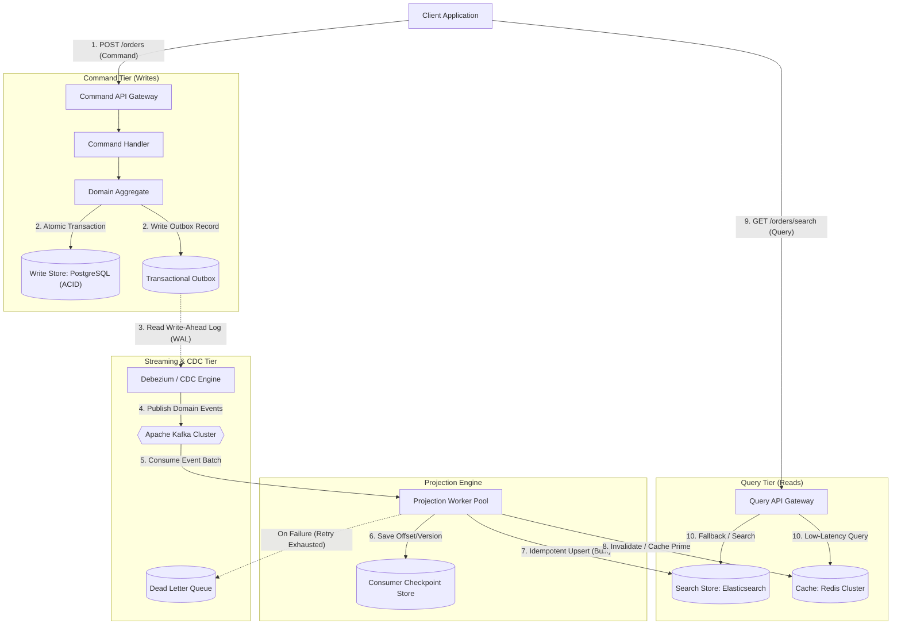
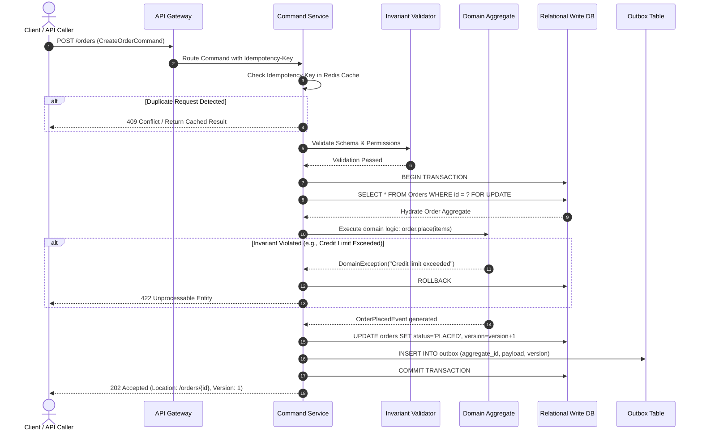
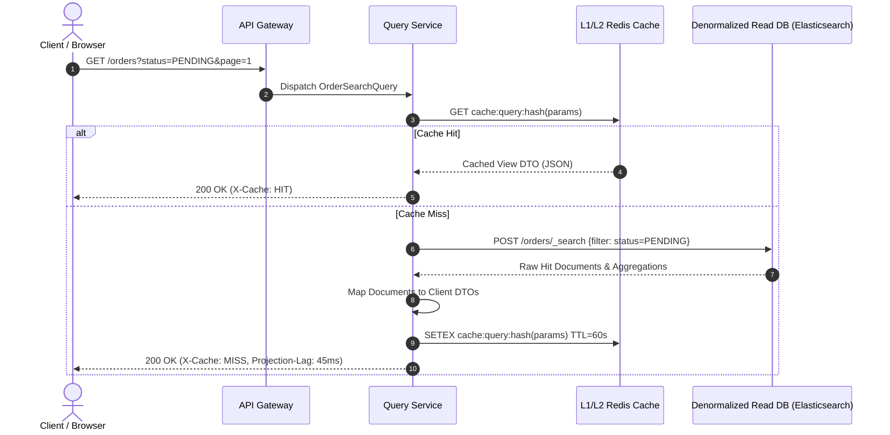
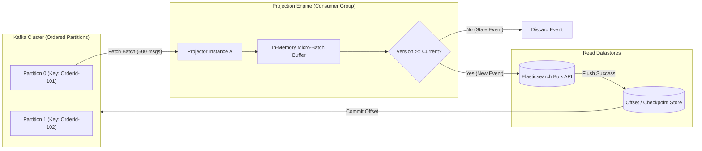
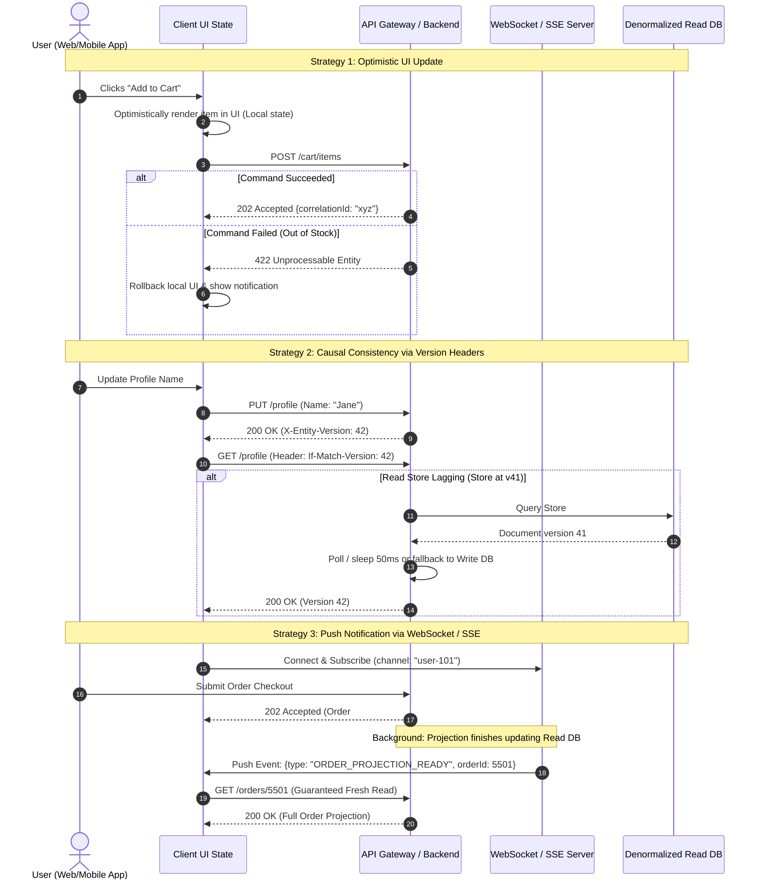
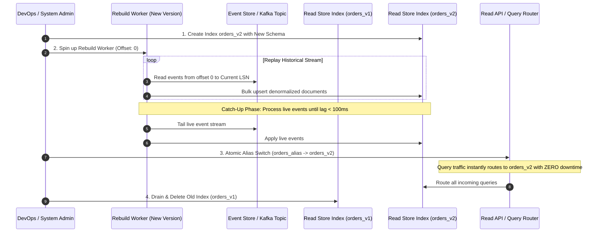
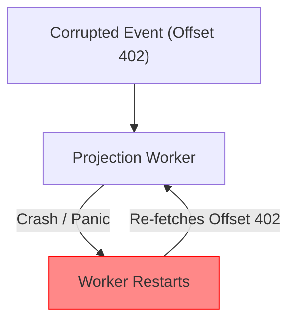

# CQRS Pattern (Command Query Responsibility Segregation)

## Table of Contents
1. [Pattern Overview & Foundational Principles](#1-pattern-overview--foundational-principles)
   - [1.1 Bertrand Meyer's CQS Principle vs. Greg Young's CQRS](#11-bertrand-meyers-cqs-principle-vs-greg-youngs-cqrs)
   - [1.2 The Anatomy of Asymmetric Read/Write Workloads](#12-the-anatomy-of-asymmetric-readwrite-workloads)
   - [1.3 The Inherent Bottlenecks of Unified CRUD Models](#13-the-inherent-bottlenecks-of-unified-crud-models)
   - [1.4 Core Tenets & Architectural Invariants](#14-core-tenets--architectural-invariants)
2. [Architectural Approaches & Variants](#2-architectural-approaches--variants)
   - [2.1 Approach 1: Single-Database CQRS (Logical Segregation)](#21-approach-1-single-database-cqrs-logical-segregation)
   - [2.2 Approach 2: Polyglot Persistence CQRS with Asynchronous Sync](#22-approach-2-polyglot-persistence-cqrs-with-asynchronous-sync)
   - [2.3 Approach 3: CQRS with Event Sourcing (Event-Driven Projections)](#23-approach-3-cqrs-with-event-sourcing-event-driven-projections)
   - [2.4 Approach 4: Synchronous Dual-Write CQRS (The Distributed Anti-Pattern)](#24-approach-4-synchronous-dual-write-cqrs-the-distributed-anti-pattern)
3. [End-to-End Execution Lifecycles & Deep Dives](#3-end-to-end-execution-lifecycles--deep-dives)
   - [3.1 Command Pipeline: Validation, Invariant Enforcement, and State Commit](#31-command-pipeline-validation-invariant-enforcement-and-state-commit)
   - [3.2 Query Pipeline: High-Throughput Denormalized Retrieval](#32-query-pipeline-high-throughput-denormalized-retrieval)
   - [3.3 Projection Processing: Checkpointing, Batching, and Idempotency](#33-projection-processing-checkpointing-batching-and-idempotency)
   - [3.4 Handling Eventual Consistency in UI/UX](#34-handling-eventual-consistency-in-uiux)
   - [3.5 Zero-Downtime Projection Rebuilds & Catch-up Workflows](#35-zero-downtime-projection-rebuilds--catch-up-workflows)
4. [Production-Grade Code Implementations](#4-production-grade-code-implementations)
   - [4.1 Command Side: Domain Aggregate & Transactional Outbox (Java / Spring)](#41-command-side-domain-aggregate--transactional-outbox-java--spring)
   - [4.2 Projection Engine: Resilient Kafka Consumer for Elasticsearch (Go)](#42-projection-engine-resilient-kafka-consumer-for-elasticsearch-go)
   - [4.3 Query Side: Low-Latency Read Service with Caching (Node.js / TypeScript)](#43-query-side-low-latency-read-service-with-caching-nodejs--typescript)
5. [Edge Cases, Failure Modes & Resilience Engineering](#5-edge-cases-failure-modes--resilience-engineering)
   - [5.1 Projection Lag & Stale Read Mitigation (RYOW Guarantees)](#51-projection-lag--stale-read-mitigation-ryow-guarantees)
   - [5.2 Poison Pills, Worker Crashes, and Dead-Letter Queues (DLQ)](#52-poison-pills-worker-crashes-and-dead-letter-queues-dlq)
   - [5.3 Out-of-Order Event Arrival & Concurrency Collisions](#53-out-of-order-event-arrival--concurrency-collisions)
   - [5.4 Schema Divergence Between Write and Read Stores](#54-schema-divergence-between-write-and-read-stores)
   - [5.5 Split-Brain Scenarios & Multi-Region Topology Considerations](#55-split-brain-scenarios--multi-region-topology-considerations)
   - [5.6 Thundering Herd on Read Cache Invalidation](#56-thundering-herd-on-read-cache-invalidation)
6. [Comprehensive Comparison Matrix: CQRS Approaches](#6-comprehensive-comparison-matrix-cqrs-approaches)
7. [Enterprise Case Studies](#7-enterprise-case-studies)
   - [7.1 Case Study 1: E-Commerce Product Catalog & Flash-Sale Engine](#71-case-study-1-e-commerce-product-catalog--flash-sale-engine)
   - [7.2 Case Study 2: Financial Exchange & High-Throughput Trading Ledger](#72-case-study-2-financial-exchange--high-throughput-trading-ledger)
   - [7.3 Case Study 3: Global Ride-Sharing & Geospatial Matching Engine (Uber/Lyft)](#73-case-study-3-global-ride-sharing--geospatial-matching-engine-uberlyft)
8. [Advanced System Design Interview Masterclass](#8-advanced-system-design-interview-masterclass)
9. [Decision Framework & Summary Checklist](#9-decision-framework--summary-checklist)

---

## 1. Pattern Overview & Foundational Principles

### 1.1 Bertrand Meyer's CQS Principle vs. Greg Young's CQRS
The roots of CQRS lie in the **Command-Query Separation (CQS)** principle formulated by Bertrand Meyer in his seminal 1988 book *Object-Oriented Software Construction*. Meyer posited a strict division at the method level of object-oriented programming:

> *"Every method should either be a command that performs an action, or a query that returns data to the caller, but not both. Asking a question should not change the answer."*

* **Command (Mutator):** Changes system state, produces side effects, returns `void` (or an execution acknowledgment/ID).
* **Query (Accessor):** Returns a result, is strictly idempotent, and introduces zero observable side effects.

```
                      CQS (Method Level)
┌─────────────────────────────────────────────────────────────┐
│ class Account {                                             │
│     void debit(Money amount)   --> Command (Mutates state)   │
│     Money getBalance()         --> Query   (Idempotent read) │
│ }                                                           │
└─────────────────────────────────────────────────────────────┘
                               │
                               ▼ Scaled to System Architecture
                      CQRS (System Level)
┌──────────────────────────────┬──────────────────────────────┐
│        COMMAND STACK         │         QUERY STACK          │
│ • Write Model (Aggregates)   │ • Read Model (Projections)   │
│ • Rich Domain Invariants     │ • Denormalized Flat DTOs     │
│ • Relational DB / Event Log  │ • Search Indexes, Key-Value  │
└──────────────────────────────┴──────────────────────────────┘
```

In the late 2000s, **Greg Young** recognized that modern enterprise software struggles not just at the class level, but at the system boundary. Real-world systems suffer because they attempt to use a single domain model, single schema, and single database to serve two diametrically opposed objectives:
1. Enforcing high-integrity transactional state transitions (Commands).
2. Serving low-latency, polymorphic, multi-dimensional views to heterogeneous consumers (Queries).

**CQRS elevates CQS to an architectural paradigm.** It splits the software system into two independent paths:
* The **Command Side** executes domain invariants, handles business validation, mutates state, and persists domain aggregates.
* The **Query Side** projects and serves denormalized, ready-to-render view models optimized for client consumer queries without executing domain logic.

---

### 1.2 The Anatomy of Asymmetric Read/Write Workloads
In real-world enterprise architectures, read-to-write ratios are rarely symmetric:
* **E-Commerce Marketplaces (Amazon, Shopify):** 50:1 to 500:1 read-to-write ratio. Millions of consumers browse, filter, sort, and compare products; comparatively few execute a checkout.
* **Social Networks & Feeds (X/Twitter, Instagram):** 100:1 to 1,000:1. Posts are written once and read millions of times across follower feeds.
* **Financial Trading & IoT Sensors:** Inverted ratios (1:10 to 1:50). A telemetry gateway or order book receives massive write bursts while query workloads focus on real-time anomaly detection or periodic balance checks.

```
Traditional Monolithic Model:
[Write: 100 req/sec] ──┐
                       ├─► [ Unified Model & Schema ] ──► [ Single ACID DB ]
[Read:  10,000 req/sec] ──┘         ▲
                                    │ Contention: Lock escalation, index overhead,
                                    │ ORM bloat, cache invalidation storms.
```

When reads and writes are coupled to a single schema and persistence tier:
* **Indexing conflicts:** Write throughput suffers from heavy indexing needed for query search speed; read throughput suffers if indexes are minimized to speed up writes.
* **Row- and table-level locking:** Long-running analytical or nested join queries escalate lock levels in relational engines, starving incoming write transactions.
* **Impedance mismatch:** Complex relational schemas require heavy Object-Relational Mapping (ORM) frameworks (e.g., Hibernate, Entity Framework), which incur massive memory and CPU overhead during simple tabular read queries.

---

### 1.3 The Inherent Bottlenecks of Unified CRUD Models
A traditional "Create, Read, Update, Delete" (CRUD) architecture models business concepts identically across the entire lifecycle:

```
[UI Layer] <──DTO──> [Service Layer] <──Entity──> [ORM Mapping] <──Tables──> [Database]
```

This model inevitably produces fundamental architectural tensions:

| Dimension | Command / Mutation Requirements | Query / Read Requirements |
| :--- | :--- | :--- |
| **Data Structure** | Highly normalized (3NF) to eliminate duplication and preserve referential integrity. | Heavily denormalized, pre-aggregated, flattened into direct UI/API projections. |
| **Transaction Boundary** | Strict ACID guarantees, row-level locks, invariant validation across aggregates. | Eventual consistency acceptable; lock-free, dirty-read-tolerant, zero locking overhead. |
| **Computation** | CPU-intensive business rule evaluation, boundary checks, state-machine transitions. | I/O-intensive disk/index lookups, pagination, multi-attribute filtering, full-text search. |
| **Hardware Affinity** | Fast write-ahead logs (NVMe SSDs), strong write IOPS, high transactional durability. | High RAM for memory-mapped search indexes (e.g., Elasticsearch, Redis), read replicas. |
| **Schema Evolution** | Granular changes strictly governed by domain rules and relational constraints. | Rapid UI iterations demanding dynamic fields, nested arrays, and specialized DTO formats. |

---

### 1.4 Core Tenets & Architectural Invariants
When implementing CQRS, five non-negotiable architectural tenets must be preserved:

1. **Commands Do Not Return Domain State:** A Command handler processes a command, enforces invariants, persists state, and returns either `void`, a correlation ID, or an acknowledgement. It never returns updated aggregate views. Clients must query the read side for view updates.
2. **Queries Never Mutate State:** A Query handler is strictly side-effect free. It must never increment counters, update "last accessed" timestamps, or trigger cascading state mutations within the persistence layer.
3. **Domain Logic Belongs Exclusively to the Command Side:** The read side is a projection mechanism. It contains zero domain business logic, validation rules, or state-machine enforcement.
4. **Independent Deployability & Scalability:** The command services and query services should be deployable as independent runtime artifacts and scaled out based on their disparate operational metrics.
5. **Acceptance of Asynchronous Boundary:** Decoupled persistence models imply eventual consistency. The system architecture must embrace latency gaps between write commits and projection visibility.

---

## 2. Architectural Approaches & Variants

There is no single "one-size-fits-all" CQRS implementation. Depending on system scale, consistency requirements, engineering maturity, and operational budgets, CQRS manifests across four primary variants.

```
                                  CQRS Variants
                                        │
        ┌───────────────────────────────┼───────────────────────────────┐
        ▼                               ▼                               ▼
[ 1. Single DB CQRS ]        [ 2. Polyglot CQRS ]          [ 3. CQRS + Event Sourcing ]
 Logical separation            Physical DB separation        Append-only event log
 Shared ACID engine            Async sync via CDC/Kafka      Events drive all projections
 Zero replication lag          Search/Document read store    Complete temporal audit
 High resource contention      Eventual consistency          High conceptual shift
```

---

### 2.1 Approach 1: Single-Database CQRS (Logical Segregation)

Single-Database CQRS maintains a single underlying database engine (e.g., PostgreSQL, Oracle, SQL Server) but completely segregates the code paths, domain models, and query handlers in the application layer.

```
                               ┌─────────────────────────────┐
                               │       Client / Browser      │
                               └──────────────┬──────────────┘
                                              │
                       ┌──────────────────────┴──────────────────────┐
                       │ HTTP / gRPC                                 │
                       ▼                                             ▼
        ┌──────────────────────────────┐              ┌──────────────────────────────┐
        │        Command Stack         │              │         Query Stack          │
        │ • Rich Domain Aggregate      │              │ • Thin Read Handlers         │
        │ • Hibernate / JPA / Entity   │              │ • Fast SQL / jOOQ / Dapper   │
        │ • Business Invariant Checks  │              │ • Zero ORM Mapping Overhead  │
        └──────────────┬───────────────┘              └──────────────┬───────────────┘
                       │                                             │
                       │ Writes to Tables                            │ Reads from Views
                       ▼                                             ▼
        ┌────────────────────────────────────────────────────────────────────────────┐
        │                         Single Relational Database                         │
        │   ┌───────────────────────────────┐     ┌──────────────────────────────┐   │
        │   │    Normalized Tables (3NF)    │────►│ Materialized Views / Indexes │   │
        │   └───────────────────────────────┘     └──────────────────────────────┘   │
        └────────────────────────────────────────────────────────────────────────────┘
```

#### 2.1.1 Architectural Topology & Flow
* **Command Path:** Executes via an ORM or domain-mapping layer that handles deep entity graphs, value objects, and concurrency locks (`SELECT ... FOR UPDATE`). It issues `INSERT`, `UPDATE`, and `DELETE` statements against normalized tables.
* **Query Path:** Bypasses domain models and ORM change-tracking completely. Queries are executed via lightweight data-mappers (e.g., jOOQ, Dapper, native JDBC/raw SQL) querying database views, materialized views, or dedicated read-optimized tables.

#### 2.1.2 Low-Level Mechanics: ORM vs. Direct Query Mapping
* **Write Pipeline:** Uses a heavy-weight domain aggregate. Every modification loads the root entity, validates invariants, mutates memory state, and executes flush within a database transaction.
* **Read Pipeline:** Avoids the overhead of hydrating domain entities, tracking changes, and resolving lazy-loaded relationships. Queries bypass the ORM session cache and directly project rows into immutable Data Transfer Objects (DTOs).

#### 2.1.3 Database Views, Materialized Views & Index Specialization
* **Standard SQL Views:** Provide logical separation without replication lag, but share execution plans and lock pools.
* **Materialized Views:** Provide physical denormalization within the same database engine. Refreshed either synchronously via triggers, on-demand (`REFRESH MATERIALIZED VIEW CONCURRENTLY`), or periodically via background schedulers.
* **Specialized Indexing:** Covering indexes (e.g., PostgreSQL `INCLUDE` clause) are built specifically to satisfy query DTOs without touching heap tables.

#### 2.1.4 Trade-offs: Zero Lag vs. Resource Contention
* **Advantages:**
  * Immediate consistency (strong ACID). Queries see committed writes instantly.
  * Zero distributed systems operational overhead (no Kafka clusters, no CDC engines, no dual-database failover setups).
  * Ideal starting point for modular monoliths and early-stage microservices.
* **Disadvantages:**
  * Read queries and write transactions share CPU, memory buffers, disk I/O, and lock trees.
  * Cannot scale the read tier onto cheap commodity storage or search engines without upgrading the primary database hardware.

---

### 2.2 Approach 2: Polyglot Persistence CQRS with Asynchronous Sync

In this variant, the Command and Query sides operate on completely distinct physical datastores tailored specifically for their operational profile.



#### 2.2.1 High-Level Architecture
* **Write Store:** A strongly consistent, ACID-compliant relational database (e.g., PostgreSQL, MySQL, CockroachDB) optimized for third normal form (3NF), foreign keys, and low-latency atomic commits.
* **Read Store:** Denormalized, horizontally scalable polyglot datastores. Examples include Elasticsearch/OpenSearch for multi-faceted text search, MongoDB/DynamoDB for rich document retrieval, and Redis for sub-millisecond key-value lookups.
* **Asynchronous Sync:** Events emitted by the write side propagate to the read side through a resilient event streaming platform (e.g., Apache Kafka, Apache Pulsar).

#### 2.2.2 Event Publishing Strategies: Transactional Outbox vs. Log-Based CDC
To guarantee that writes to the primary database and publishes to the message broker remain atomic without distributed transactions, two strategies dominate:
1. **Application-Level Transactional Outbox:**
   * The business aggregate and an `outbox` record are written in the *same local database transaction*.
   * An asynchronous poller or CDC process reads the outbox table and dispatches messages to Kafka.
2. **Log-Based Change Data Capture (CDC via Debezium):**
   * The application commits only to the business tables.
   * A CDC connector monitors the database transaction log / Write-Ahead Log (WAL) directly (e.g., PostgreSQL `pgoutput`, MySQL binlog) and emits change events with sub-millisecond overhead.

#### 2.2.3 Read-Side Horizontal Scaling & Materialized Projection Models
* The read store requires zero write-locking. Read replicas can be horizontally scaled behind a Layer-4/Layer-7 load balancer.
* Data is stored in the exact format required by consumers (e.g., a complete UI order details screen pre-computed as a single JSON document). Joins are pre-calculated at projection ingestion time.

---

### 2.3 Approach 3: CQRS with Event Sourcing (Event-Driven Projections)

CQRS reaches its highest architectural synergy when combined with **Event Sourcing**. Instead of persisting the current state of an aggregate into a relational schema, the write database stores an immutable, append-only sequence of domain events.

```
┌────────────────────────────────────────────────────────────────────────┐
│                              COMMAND SIDE                              │
│                                                                        │
│  Command: "AddLineItem(OrderId: 101, Sku: 'A', Qty: 2)"                │
│                            │                                           │
│                            ▼                                           │
│  1. Load Event Stream: [OrderCreated] ──► Reconstitute OrderAggregate  │
│  2. Validate Invariant: Max items not exceeded                         │
│  3. Emit Event: LineItemAdded(OrderId: 101, Sku: 'A', Qty: 2)          │
│  4. Append to EventStore (Optimistic Lock: Version N -> N+1)           │
└───────────────────────────────────┬────────────────────────────────────┘
                                    │
                         Kafka / EventStore Stream
                                    │
                                    ▼
┌────────────────────────────────────────────────────────────────────────┐
│                              READ SIDE                                 │
│                                                                        │
│   Projector A (Orders Read DB)       Projector B (Customer Analytics)  │
│   Listens: [LineItemAdded]           Listens: [LineItemAdded]          │
│   Upserts: Mongo Order Document      Increments: Total Spend in Redis  │
│   Schema: Optimized for Mobile UI    Schema: Optimized for BI Charts   │
└────────────────────────────────────────────────────────────────────────┘
```

#### 2.3.1 Append-Only Event Log as Authoritative Truth
* Every state transition is recorded as an immutable event (`OrderCreated`, `PaymentCaptured`, `ItemAllocated`).
* The **Event Store** (e.g., EventStoreDB, Apache Kafka with compacted topics, specialized RDBMS tables) is the sole system of record.
* Writes are exclusively append-only operations, eliminating row-level update contention and deadlocks.

#### 2.3.2 Stream Subscriptions & Projection Projector Workers
* Projectors subscribe to the event stream using competing consumer groups or partition-pinned threads.
* A single event stream can feed multiple read models concurrently:
  * Model 1: Relational reporting database for financial audit.
  * Model 2: Elasticsearch cluster for customer-facing order search.
  * Model 3: In-memory graph database for fraud detection analysis.

#### 2.3.3 Replaying, Temporal Queries, and Snapshot Mechanics
* **Temporal Auditing:** The system can determine the exact state of any domain aggregate at any specific point in history by replaying events up to timestamp $T$.
* **Projection Re-hydration:** If a new query requirement emerges, developers deploy a new projection service, rewind its event cursor to offset `0`, and project the entire history without altering the write side.

---

### 2.4 Approach 4: Synchronous Dual-Write CQRS (The Distributed Anti-Pattern)

A common architectural trap encountered when migrating to CQRS is the **Synchronous Dual-Write Anti-Pattern**. In this naive approach, a single service attempts to write synchronously to both the write store and read store within the same request lifecycle.

```
                                  Synchronous Dual-Write
                                      (ANTI-PATTERN)
                         ┌──────────────────────────────────────┐
                         │           Order Service              │
                         └──────┬────────────────────────┬──────┘
                                │                        │
                       1. Commit Tx                      2. HTTP / REST Call
                       (SUCCESS)                         (FAILURE / TIMEOUT)
                                │                        │
                                ▼                        ▼
                     ┌──────────────────────┐ ┌──────────────────────┐
                     │ Write DB (Postgres)  │ │ Read Store (ES/Mongo)│
                     │  State: PERSISTED    │ │  State: MISSING      │
                     └──────────────────────┘ └──────────────────────┘
                                         ▲                ▲
                                         └────────────────┘
                                    Permanent Data Inconsistency!
```

#### 2.4.1 Mechanics and Failure Vectors
Consider the failure scenarios inherent in synchronous dual-writing:
1. **Network Partition / Timeout:** The write to PostgreSQL succeeds, but the network call to Elasticsearch times out. The application returns an HTTP 500 error, yet the database record exists. If the client retries, a duplicate write occurs.
2. **Order-of-Operation Reversal:** If the service updates Elasticsearch first and the database transaction aborts due to a constraint violation, the read store now contains phantom data.
3. **Concurrent Execution Races:** Two threads (Thread A and Thread B) update the same aggregate:
   * Thread A writes to Write DB at $T_1$.
   * Thread B writes to Write DB at $T_2$.
   * Thread B writes to Read DB at $T_3$.
   * Thread A writes to Read DB at $T_4$ (delayed by network jitter).
   * **Result:** Write DB has state $B$, but Read DB has state $A$. The datastores have permanently diverged.

#### 2.4.2 Two-Phase Commit (2PC) Pitfalls
To salvage synchronous dual writes, teams often propose distributed transactions via Two-Phase Commit (2PC) or XA protocols:
* **Blocking Coordinator:** If the transaction coordinator crashes during the `prepare` phase, participants hold database locks indefinitely.
* **Throughput Collapse:** Latency increases to the round-trip time of the slowest participant, collapsing system throughput by orders of magnitude.
* **Incompatible Storage Engines:** Modern NoSQL and search databases (Elasticsearch, Redis, Cassandra) do not support XA/2PC protocols.

> [!CAUTION]
> Synchronous dual-writes are inherently broken in distributed environments. Never use dual-writes to keep read and write datastores synchronized. Always use asynchronous, durable event logs backed by Change Data Capture (CDC) or the Transactional Outbox pattern.

---

## 3. End-to-End Execution Lifecycles & Deep Dives

To implement a resilient CQRS architecture, every phase of the command, query, and synchronization pipelines must be engineered with explicit failure modes and latency expectations.

---

### 3.1 Command Pipeline: Validation, Invariant Enforcement, and State Commit

The command pipeline handles the ingestion, validation, and execution of business intent.



#### Detailed Command Pipeline Stages:
1. **Idempotency Gate:** All commands carry a unique `Idempotency-Key` (UUIDv4) in the HTTP headers. The gateway or service checks an in-memory Redis distributed store. If the key exists, the request is rejected or the previously computed result is returned.
2. **Syntactic & Structural Validation:** Fast-fail input checks (e.g., non-null values, valid email strings, positive integers) executed before database interaction.
3. **Aggregate Hydration & Concurrency Lock:** The domain aggregate is loaded from the write store. Optimistic locking (`WHERE version = expected_version`) or pessimistic locking (`FOR UPDATE`) protects concurrent mutations.
4. **Invariant Validation:** Pure domain business logic is executed against the current aggregate state (e.g., "Cannot cancel an order that has already shipped").
5. **Atomic Commit:** The modified aggregate and the resulting domain event are committed to the relational database in a single atomic ACID transaction.
6. **Asynchronous Acknowledgment:** The client receives an HTTP `202 Accepted` response containing the aggregate ID and write version, decoupling the client from projection lag.

---

### 3.2 Query Pipeline: High-Throughput Denormalized Retrieval

The query pipeline handles read requests with zero transactional locking and sub-millisecond retrieval goals.



#### Detailed Query Pipeline Stages:
1. **Request Normalization & Caching:** The query parameters are sanitized, sorted, and hashed to form a stable cache key.
2. **Distributed Cache Verification:** Redis cluster is queried for pre-rendered JSON payloads. If hit, the response returns immediately with zero database execution.
3. **Direct Read-Store Execution:** On cache misses, the query is dispatched directly to the polyglot read store (e.g., Elasticsearch, MongoDB, or Read-Replica SQL).
4. **DTO Mapping & Response:** The read model directly matches the presentation requirement. Zero ORM entity hydration or runtime table joins are performed.
5. **Metadata Attribution:** Headers indicate projection metadata:
   * `X-Cache: HIT | MISS`
   * `X-Projection-Lag-Ms: 38` (derived from current timestamp minus the projection timestamp)
   * `X-Model-Version: 1045`

---

### 3.3 Projection Processing: Checkpointing, Batching, and Idempotency

The projection worker pool forms the bridge between the Write and Read stores.



#### Low-Level Projection Mechanics:
1. **Partition Pinned Ordering:** Kafka partitions are keyed by `AggregateId` (e.g., `OrderId`). This guarantees that all lifecycle events for a single aggregate arrive in strict sequential order at the consumer worker.
2. **Micro-Batching:** To achieve high throughput (50,000+ ops/sec), workers do not write events one-by-one. Instead, events are buffered in-memory for either `50ms` or until `500 events` accumulate.
3. **Idempotency Enforcement via Optimistic Versioning:**
   * Every read-store document maintains an integer `_version` field representing the highest event sequence number applied.
   * When an event with sequence $V$ arrives:
     $$\text{If } V \le \text{Document.\_version} \implies \text{Ignore (Duplicate or Out-of-Order)}$$
     $$\text{If } V = \text{Document.\_version} + 1 \implies \text{Apply Mutation}$$
     $$\text{If } V > \text{Document.\_version} + 1 \implies \text{Buffer & Wait / Re-fetch (Gap Detected)}$$
4. **Atomic Batch Checkpointing:** Elasticsearch bulk operations are executed first. Only upon successful acknowledgment does the consumer commit its offset back to Kafka.

---

### 3.4 Handling Eventual Consistency in UI/UX

Because synchronization across polyglot stores is asynchronous, reading immediately after writing can yield stale data. Production systems deploy four distinct UI/UX synchronization strategies:



#### Detailed Strategy Breakdown:

* **Strategy A: Optimistic UI Updates:**
  The frontend immediately renders the intended mutation before the network roundtrip completes. If the backend command returns an error, the UI rolls back the mutation and presents an error banner.
* **Strategy B: Client Polling with Monotonic Version Check:**
  The command response returns an entity version number (e.g., `version: 5`). The client includes `If-Match-Version: 5` on subsequent `GET` requests. If the read replica has only caught up to `version: 4`, the query service waits (long-polling up to `500ms`) or reads directly from the write database for that single request.
* **Strategy C: Reactive Push via WebSockets / SSE:**
  The client establishes a persistent connection to a notification gateway. When the projection worker finishes updating the read model, it emits an event to Redis Pub/Sub, which routes through the WebSocket gateway to inform the client that fresh data is available.
* **Strategy D: Causal Consistency & Read-Your-Own-Writes (RYOW) Tokens:**
  The write API attaches a tracking cookie or header containing the replication log sequence number (LSN) or Kafka offset. Any read request carrying that token is routed only to read replicas that have caught up to or passed that LSN.

---

### 3.5 Zero-Downtime Projection Rebuilds & Catch-up Workflows

Over the lifecycle of a production system, read models inevitably change. When a new UI layout requires fields not present in the current Elasticsearch index, or when a bug in a projection worker corrupts read data, the read model must be completely rebuilt **without stopping write traffic or serving broken reads to users**.



#### Blue-Green Projection Rebuild Procedure:
1. **Provision New Target Schema:** Create a new search index or collection with the updated schema (e.g., `orders_v2`).
2. **Launch Dedicated Replay Consumers:** Deploy a separate consumer group with its Kafka consumer offset initialized to `earliest` (offset `0`).
3. **High-Throughput Ingestion Mode:** Disable replicas and index refresh intervals in Elasticsearch (`refresh_interval: -1`, `number_of_replicas: 0`) to maximize write throughput during historical catch-up.
4. **Transition to Tail Mode:** Once historical events are replayed, enable index refreshes and replicas. Allow the worker to consume live events until projection lag drops below acceptable limits ($< 100\text{ms}$).
5. **Atomic Pointer Switch:** In Elasticsearch, execute an atomic alias update:
   ```json
   POST /_aliases
   {
     "actions": [
       { "remove": { "index": "orders_v1", "alias": "orders_search" } },
       { "add":    { "index": "orders_v2", "alias": "orders_search" } }
     ]
   }
   ```
6. **Decommission:** Decommission the old consumer group and safely drop `orders_v1`.

---

## 4. Production-Grade Code Implementations

The following sections provide concrete, production-grade implementations of the core components of an enterprise polyglot CQRS system.

---

### 4.1 Command Side: Domain Aggregate & Transactional Outbox (Java / Spring)

This component handles the incoming command, enforces business invariants on an `Order` aggregate, commits changes to PostgreSQL, and atomically writes an outbox record within the same transaction.

```java
// ============================================================================
// File: src/main/java/com/architecture/cqrs/command/domain/OrderAggregate.java
// ============================================================================
package com.architecture.cqrs.command.domain;

import java.math.BigDecimal;
import java.time.Instant;
import java.util.*;

public class OrderAggregate {
    public enum OrderStatus { CREATED, CONFIRMED, CANCELLED }

    private final UUID orderId;
    private final UUID customerId;
    private final List<OrderItem> items = new ArrayList<>();
    private OrderStatus status;
    private BigDecimal totalAmount;
    private long version;

    public OrderAggregate(UUID orderId, UUID customerId) {
        this.orderId = Objects.requireNonNull(orderId, "OrderId must not be null");
        this.customerId = Objects.requireNonNull(customerId, "CustomerId must not be null");
        this.status = OrderStatus.CREATED;
        this.totalAmount = BigDecimal.ZERO;
        this.version = 0L;
    }

    public OrderEvent.OrderPlaced placeOrder(List<OrderItem> newItems) {
        if (this.status != OrderStatus.CREATED) {
            throw new IllegalStateException("Cannot place order in status: " + this.status);
        }
        if (newItems == null || newItems.isEmpty()) {
            throw new IllegalArgumentException("Order must contain at least one item");
        }

        BigDecimal calculatedTotal = BigDecimal.ZERO;
        for (OrderItem item : newItems) {
            calculatedTotal = calculatedTotal.add(
                item.getUnitPrice().multiply(BigDecimal.valueOf(item.getQuantity()))
            );
            this.items.add(item);
        }

        // Business Invariant: Hard transaction cap
        if (calculatedTotal.compareTo(new BigDecimal("100000.00")) > 0) {
            throw new IllegalArgumentException("Order total exceeds maximum transaction limit of $100,000");
        }

        this.totalAmount = calculatedTotal;
        this.status = OrderStatus.CONFIRMED;
        this.version++;

        return new OrderEvent.OrderPlaced(
            this.orderId,
            this.customerId,
            this.items,
            this.totalAmount,
            this.version,
            Instant.now()
        );
    }

    // Getters
    public UUID getOrderId() { return orderId; }
    public UUID getCustomerId() { return customerId; }
    public OrderStatus getStatus() { return status; }
    public BigDecimal getTotalAmount() { return totalAmount; }
    public long getVersion() { return version; }
}
```

```java
// ============================================================================
// File: src/main/java/com/architecture/cqrs/command/service/OrderCommandService.java
// ============================================================================
package com.architecture.cqrs.command.service;

import com.architecture.cqrs.command.domain.*;
import com.fasterxml.jackson.databind.ObjectMapper;
import org.springframework.jdbc.core.JdbcTemplate;
import org.springframework.stereotype.Service;
import org.springframework.transaction.annotation.Isolation;
import org.springframework.transaction.annotation.Transactional;

import java.time.Instant;
import java.util.List;
import java.util.UUID;

@Service
public class OrderCommandService {

    private final JdbcTemplate jdbcTemplate;
    private final ObjectMapper objectMapper;

    public OrderCommandService(JdbcTemplate jdbcTemplate, ObjectMapper objectMapper) {
        this.jdbcTemplate = jdbcTemplate;
        this.objectMapper = objectMapper;
    }

    @Transactional(isolation = Isolation.READ_COMMITTED)
    public UUID handlePlaceOrder(UUID customerId, List<OrderItem> items) {
        UUID orderId = UUID.randomUUID();
        OrderAggregate aggregate = new OrderAggregate(orderId, customerId);

        // 1. Enforce business invariants and generate domain event
        OrderEvent.OrderPlaced event = aggregate.placeOrder(items);

        // 2. Persist aggregate state into primary write table
        String insertOrderSql = """
            INSERT INTO orders (id, customer_id, status, total_amount, version, updated_at)
            VALUES (?, ?, ?, ?, ?, ?)
        """;
        jdbcTemplate.update(
            insertOrderSql,
            aggregate.getOrderId(),
            aggregate.getCustomerId(),
            aggregate.getStatus().name(),
            aggregate.getTotalAmount(),
            aggregate.getVersion(),
            Instant.now()
        );

        // 3. Persist domain event into Transactional Outbox table
        try {
            String payloadJson = objectMapper.writeValueAsString(event);
            String insertOutboxSql = """
                INSERT INTO outbox_events (id, aggregate_type, aggregate_id, event_type, payload, version, created_at)
                VALUES (?, 'ORDER', ?, 'ORDER_PLACED', ?::jsonb, ?, ?)
            """;
            jdbcTemplate.update(
                insertOutboxSql,
                UUID.randomUUID(),
                aggregate.getOrderId().toString(),
                payloadJson,
                aggregate.getVersion(),
                Instant.now()
            );
        } catch (Exception e) {
            throw new RuntimeException("Failed to serialize outbox event payload", e);
        }

        return orderId;
    }
}
```

---

### 4.2 Projection Engine: Resilient Kafka Consumer for Elasticsearch (Go)

This Go microservice consumes outbox domain events from Apache Kafka, buffers them into micro-batches, validates monotonic sequence numbers to guarantee idempotency, and flushes bulk documents into Elasticsearch.

```go
// ============================================================================
// File: cmd/projector/main.go
// ============================================================================
package main

import (
	"bytes"
	"context"
	"encoding/json"
	"fmt"
	"log"
	"net/http"
	"os"
	"os/signal"
	"syscall"
	"time"

	"github.com/segmentio/kafka-go"
)

type OrderPlacedEvent struct {
	OrderID     string    `json:"orderId"`
	CustomerID  string    `json:"customerId"`
	TotalAmount float64   `json:"totalAmount"`
	Version     int64     `json:"version"`
	Timestamp   time.Time `json:"timestamp"`
}

type ESBulkHeader struct {
	Index struct {
		Index string `json:"_index"`
		ID    string `json:"_id"`
	} `json:"index"`
}

func main() {
	kafkaBroker := "localhost:9092"
	topic := "order-events"
	groupID := "es-order-projector-group"
	esURL := "http://localhost:9200/_bulk"

	reader := kafka.NewReader(kafka.ReaderConfig{
		Brokers:        []string{kafkaBroker},
		Topic:          topic,
		GroupID:        groupID,
		MinBytes:       10e3, // 10KB
		MaxBytes:       10e6, // 10MB
		CommitInterval: time.Second,
	})
	defer reader.Close()

	ctx, cancel := context.WithCancel(context.Background())
	sigChan := make(chan os.Signal, 1)
	signal.Notify(sigChan, syscall.SIGINT, syscall.SIGTERM)
	go func() {
		<-sigChan
		log.Println("Shutting down projection worker...")
		cancel()
	}()

	batchBuffer := make([]kafka.Message, 0, 500)
	flushTicker := time.NewTicker(100 * time.Millisecond)
	defer flushTicker.Stop()

	log.Println("Projection worker started. Consuming events...")

	for {
		select {
		case <-ctx.Done():
			return
		case <-flushTicker.C:
			if len(batchBuffer) > 0 {
				if err := flushToElasticsearch(ctx, esURL, batchBuffer); err != nil {
					log.Printf("ERROR: Failed to flush batch to ES: %v", err)
				} else {
					if err := reader.CommitMessages(ctx, batchBuffer...); err != nil {
						log.Printf("ERROR: Commit offset failed: %v", err)
					}
					batchBuffer = batchBuffer[:0]
				}
			}
		default:
			msgCtx, msgCancel := context.WithTimeout(ctx, 50*time.Millisecond)
			msg, err := reader.FetchMessage(msgCtx)
			msgCancel()

			if err != nil {
				continue
			}

			batchBuffer = append(batchBuffer, msg)
			if len(batchBuffer) >= 500 {
				if err := flushToElasticsearch(ctx, esURL, batchBuffer); err != nil {
					log.Printf("ERROR: Failed to flush batch: %v", err)
				} else {
					_ = reader.CommitMessages(ctx, batchBuffer...)
					batchBuffer = batchBuffer[:0]
				}
			}
		}
	}
}

func flushToElasticsearch(ctx context.Context, esURL string, msgs []kafka.Message) error {
	var body bytes.Buffer

	for _, msg := range msgs {
		var evt OrderPlacedEvent
		if err := json.Unmarshal(msg.Value, &evt); err != nil {
			log.Printf("Poison pill detected at offset %d: %v. Route to DLQ.", msg.Offset, err)
			continue
		}

		// Prepare Elasticsearch bulk payload with Optimistic Versioning
		header := ESBulkHeader{}
		header.Index.Index = "orders_read_model"
		header.Index.ID = evt.OrderID

		hBytes, _ := json.Marshal(header)
		body.Write(hBytes)
		body.WriteString("\n")
		body.Write(msg.Value)
		body.WriteString("\n")
	}

	if body.Len() == 0 {
		return nil
	}

	req, err := http.NewRequestWithContext(ctx, "POST", esURL, &body)
	if err != nil {
		return err
	}
	req.Header.Set("Content-Type", "application/x-ndjson")

	resp, err := http.DefaultClient.Do(req)
	if err != nil {
		return err
	}
	defer resp.Body.Close()

	if resp.StatusCode >= 300 {
		return fmt.Errorf("elasticsearch bulk returned HTTP %d", resp.StatusCode)
	}

	return nil
}
```

---

### 4.3 Query Side: Low-Latency Read Service with Caching (Node.js / TypeScript)

This service provides an ultra-low-latency read API that queries Redis L1/L2 cache before falling back to Elasticsearch. It includes write-version header checks to support Read-Your-Own-Writes (RYOW).

```typescript
// ============================================================================
// File: src/server.ts
// ============================================================================
import express, { Request, Response } from 'express';
import { Client as ESClient } from '@elastic/elasticsearch';
import Redis from 'ioredis';

const app = express();
const esClient = new ESClient({ node: process.env.ELASTICSEARCH_URL || 'http://localhost:9200' });
const redisClient = new Redis(process.env.REDIS_URL || 'redis://localhost:6373');

interface OrderReadDTO {
  orderId: string;
  customerId: string;
  totalAmount: number;
  version: number;
  status: string;
  timestamp: string;
}

app.get('/api/v1/orders/:id', async (req: Request, res: Response) => {
  const orderId = req.params.id;
  const expectedVersionHeader = req.header('X-Expected-Version');
  const expectedVersion = expectedVersionHeader ? parseInt(expectedVersionHeader, 10) : null;
  const cacheKey = `cache:order:${orderId}`;

  try {
    // 1. Attempt L1 Cache Lookup
    const cachedData = await redisClient.get(cacheKey);
    if (cachedData) {
      const order: OrderReadDTO = JSON.parse(cachedData);
      if (expectedVersion === null || order.version >= expectedVersion) {
        res.setHeader('X-Cache', 'HIT');
        res.setHeader('X-Model-Version', order.version.toString());
        return res.status(200).json(order);
      }
    }

    // 2. Query Horizontally Scaled Elasticsearch Read Model
    const searchResponse = await esClient.get({
      index: 'orders_read_model',
      id: orderId,
    });

    if (!searchResponse._source) {
      return res.status(404).json({ error: 'Order not found' });
    }

    const orderDoc = searchResponse._source as OrderReadDTO;

    // 3. Check for Read-Your-Own-Writes Lag
    if (expectedVersion !== null && orderDoc.version < expectedVersion) {
      // Read model has not caught up to the client's latest write
      res.setHeader('X-Projection-Lag', 'true');
      res.setHeader('Retry-After', '1');
      return res.status(202).json({
        message: 'Order view is currently catching up with recent updates',
        currentVersion: orderDoc.version,
        expectedVersion: expectedVersion,
      });
    }

    // 4. Prime Cache with 60-second TTL
    await redisClient.setex(cacheKey, 60, JSON.stringify(orderDoc));

    res.setHeader('X-Cache', 'MISS');
    res.setHeader('X-Model-Version', orderDoc.version.toString());
    return res.status(200).json(orderDoc);
  } catch (err: any) {
    if (err.meta && err.meta.statusCode === 404) {
      return res.status(404).json({ error: 'Order not found' });
    }
    console.error('Query failure:', err);
    return res.status(500).json({ error: 'Internal read model error' });
  }
});

const PORT = process.env.PORT || 4000;
app.listen(PORT, () => {
  console.log(`Query Service listening on port ${PORT}`);
});
```

---

## 5. Edge Cases, Failure Modes & Resilience Engineering

Implementing CQRS in distributed environments introduces failure vectors that do not exist in traditional monolithic architectures. The following sections analyze these challenges and provide concrete mitigation strategies.

---

### 5.1 Projection Lag & Stale Read Mitigation (RYOW Guarantees)
When an asynchronous message broker synchronizes the write store to the read store, network partitions, GC pauses, or high ingest traffic can cause the read store to lag behind the write store by hundreds of milliseconds or several seconds.

```
Write Committed (T=0ms) ────────► Outbox Committed
                                        │
                                        ▼ (Lag: 250ms)
Client GET /order (T=50ms) ─────► Read Store (Old State!) => Confused User
```

#### Production Mitigation Strategies:
1. **Causal Tokens (LSN / Vector Clocks):**
   When the write service commits a command, it returns an opaque token encoding the commit Log Sequence Number (LSN) or event offset:
   ```http
   HTTP/1.1 202 Accepted
   X-Causal-Token: eyJvZmZzZXQiOjE4NDkxMiwidHMiOjE3Mjk0NTIwMDB9
   ```
   When the client executes a subsequent read, it passes this token back in the request headers:
   ```http
   GET /orders/101 HTTP/1.1
   If-Causal-Token: eyJvZmZzZXQiOjE4NDkxMiwidHMiOjE3Mjk0NTIwMDB9
   ```
   The Query Router verifies whether the read replica has consumed up to offset `184912`. If lagging, the request is temporarily delayed (bounded sleep of up to `200ms`) or routed to a fresh replica.
2. **Authoritative Master Fallback (Read-Your-Own-Writes Tunnel):**
   If a user updates their profile and immediately requests a page refresh, the API gateway detects a write by that user within the last $N$ seconds (tracked via a short-lived Redis session key `user:recent_write:<id>`). For that specific user window, queries bypass the read replica and read directly from the write primary.

---

### 5.2 Poison Pills, Worker Crashes, and Dead-Letter Queues (DLQ)
A **poison pill** is a malformed or unexpected event message that causes the projection consumer to throw an unhandled exception every time it is processed.



Without defensive isolation, the partition becomes completely blocked because the consumer repeatedly crashes and restarts at the same offset.

#### Resilience Blueprint:
1. **Bounded Retry with Exponential Backoff:** Retry transient network errors (e.g., Elasticsearch timeout) up to 3 times ($100\text{ms}, 400\text{ms}, 1600\text{ms}$) with jitter.
2. **Dead-Letter Queue (DLQ) Isolation:** If failures persist after 3 retries, capture the raw message, stack trace, and headers, persist them to a `orders-projection-dlq` Kafka topic, commit the offset, and alert operations:
   ```json
   {
     "failedTopic": "order-events",
     "partition": 3,
     "offset": 402,
     "error": "NullPointerException: item.sku is null",
     "payload": "..."
   }
   ```
3. **Circuit Breakers on Read Stores:** If the target read store returns HTTP 503 or 429 (rate-limited), trip a local circuit breaker to pause consumption across all workers rather than dumping thousands of valid events into the DLQ.

---

### 5.3 Out-of-Order Event Arrival & Concurrency Collisions
In distributed brokers, network retransmissions, partition rebalancing, or multi-threaded consumers can cause events to arrive out of order. For example, `OrderCancelled` might arrive *before* `OrderPlaced`.

```
Emitted Sequence:    [1: OrderPlaced] ──────► [2: OrderUpdated] ──────► [3: OrderCancelled]
Received by Worker:  [1: OrderPlaced] ──────► [3: OrderCancelled] ────► [2: OrderUpdated] (Delayed)
```

If the delayed `OrderUpdated` event overwrites the read document, the order state reverts from `CANCELLED` to `UPDATED`, corrupting the read model.

#### Architectural Safeguards:
* **Strict Monotonic Versions:** Every domain event carries a strictly increasing integer `version` field assigned by the write store.
* **Conditional Document Updates:** Use native optimistic concurrency features in the read store. In Elasticsearch:
  ```json
  POST /orders_read_model/_update/order-101?if_seq_no=5&if_primary_term=1
  ```
  Or in MongoDB:
  ```javascript
  db.orders.updateOne(
    { _id: "order-101", version: { $lt: incomingEvent.version } },
    { $set: { status: incomingEvent.status, version: incomingEvent.version } }
  );
  ```
  If an event arrives with a version lower than or equal to the stored document, the update is rejected with zero side effects.

---

### 5.4 Schema Divergence Between Write and Read Stores
As business requirements evolve, developers add, remove, or rename fields on the write model. If the write store updates its schema while the projection workers or read store schemas remain unchanged, projection pipelines will either fail deserialization or drop fields.

#### Mitigation via Semantic Versioning & Upcasting:
* **Protobuf / Avro Schemas with Schema Registry:** Enforce strict backward and forward compatibility rules. Fields must never be removed or renumbered; new fields must always be optional.
* **Event Upcasting:** When a projection worker encounters an event with `version: 1`, an upcaster converts it in memory to `version: 2` (injecting default values for newly added fields) before projecting it to the read database.

---

### 5.5 Split-Brain Scenarios & Multi-Region Topology Considerations
In active-active multi-region deployments (e.g., Region US-East and Region EU-West):

```
       US-East Region                                EU-West Region
┌───────────────────────────┐                 ┌───────────────────────────┐
│ Write Primary US          │                 │ Write Primary EU          │
│ Read Model US             │                 │ Read Model EU             │
└─────────────┬─────────────┘                 └─────────────┬─────────────┘
              │                                             │
              └────────────── Cross-Region Replication ─────┘
                                (150ms WAN Latency)
```

If a user writes in US-East and travels or shifts DNS to EU-West, cross-region replication lag can cause extreme inconsistency.
* **Single-Primary Ownership:** Partition aggregate roots geographically (e.g., customer IDs starting with $0-7$ master in US-East; $8-F$ master in EU-West). Writes always route to the home region.
* **Region-Pinned Reads:** If a customer initiates a session in US-East, pin their query routing to US-East read stores for the duration of the session to guarantee monotonic read consistency.

---

### 5.6 Thundering Herd on Read Cache Invalidation
When a high-volume event arrives (e.g., a flash sale begins, updating price or inventory on a hot product), naive projection workers flush the cache entry in Redis:
```
Projector: DEL cache:product:flash-deal-101
```
If 100,000 concurrent client requests arrive at that exact millisecond, all 100,000 requests miss the cache simultaneously and hit the read database, exhausting connection pools and causing a **cache stampede / thundering herd** failure.

#### Mitigation:
* **Mutual Exclusion Locks (Mutex / SingleFlight):** Use distributed locking or Go's `singleflight` primitive so only one query hits the database to re-hydrate the cache while other requests wait for the result.
* **Probabilistic Early Expiration (XFetch Algorithm):**
  Instead of deleting keys, update the cache entry proactively in the background before the TTL expires, or compute an early refresh:
  $$\Delta - \beta \cdot \ln(\text{rand}()) > \text{TTL}$$

---

## 6. Comprehensive Comparison Matrix: CQRS Approaches

The following matrix provides an architectural evaluation across the four primary CQRS variants.

| Evaluation Dimension | 1. Single DB CQRS (Logical Segregation) | 2. Polyglot CQRS (Asynchronous Sync) | 3. CQRS + Event Sourcing | 4. Synchronous Dual-Write (Anti-Pattern) |
| :--- | :--- | :--- | :--- | :--- |
| **Write Latency** | Low ($< 10\text{ms}$) — local single DB commit. | Low ($< 15\text{ms}$) — local DB write + outbox insert. | Ultra-Low ($< 5\text{ms}$) — append-only log write. | High ($50\text{--}200\text{ms}$) — bounded by slowest store. |
| **Read Latency** | Moderate ($15\text{--}50\text{ms}$) — SQL joins & lock overhead. | Ultra-Low ($1\text{--}5\text{ms}$) — pre-indexed NoSQL / Redis. | Ultra-Low ($1\text{--}5\text{ms}$) — pre-computed projections. | Low to Moderate ($10\text{--}30\text{ms}$). |
| **Data Consistency** | **Strong (ACID)** — immediate read-after-write visibility. | **Eventual** — lag typically $20\text{--}200\text{ms}$. | **Eventual** — lag typically $50\text{--}500\text{ms}$. | **Broken / Divergent** — silent inconsistencies on network drop. |
| **Operational Overhead** | **Minimal** — single RDBMS, standard backups. | **High** — Kafka, Debezium, Elasticsearch, Redis clusters. | **Very High** — EventStore, snapshots, schema versioning. | **High** — manual reconciliation jobs required to fix drift. |
| **Failure Blast Radius** | High — DB bottleneck impacts both reads and writes. | Low — Write DB down does not disrupt reads; Search down does not stop writes. | Lowest — Write log decoupled; projections can crash and resume. | Catastrophic — partial failure leaves stores permanently diverged. |
| **Storage Cost** | Baseline ($1\times$). | $2\times - 3\times$ (duplicated data across engines). | $3\times - 5\times$ (full event history + read views + snapshots). | $2\times$ (without audit history). |
| **Query Flexibility** | Limited by relational indexing capabilities. | Maximum (full-text search, spatial, key-value, graph). | Maximum (arbitrary read models can be built retroactively). | High, but corrupted by schema mismatch. |
| **Schema Evolution** | Difficult — complex table migrations with locks. | Moderate — read models can be rebuilt independently. | Elegant — replay historical event stream with new projector. | Fragile — coordinated migrations across multiple DB types. |

---

## 7. Enterprise Case Studies

---

### 7.1 Case Study 1: E-Commerce Product Catalog & Flash-Sale Engine
* **Organization Context:** Tier-1 global e-commerce retailer (50M+ active SKUs, 500,000 requests/second during peak Black Friday events).
* **The Challenge:** The legacy system ran on an Oracle database cluster. Rich product detail pages required joins across 18 tables (pricing, inventory, variants, specifications, seller ratings, shipping tiers). Flash sales produced massive lock contention on the `product_inventory` table, causing product browsing queries to time out across the platform.

```
Write Pipeline:
Merchant Updates Price ──► Postgres Write Master ──► Outbox ──► Debezium CDC
                                                                     │
Read Pipeline:                                                       ▼
Client Query ──► Cloudflare Edge ──► Redis L1 ──► Elasticsearch ◄── Kafka Consumer
```

* **The CQRS Solution:**
  * **Command Side:** PostgreSQL serves as the write store. Inventory decrements run within strict isolation levels using atomic check-and-set queries (`UPDATE inventory SET stock = stock - ? WHERE id = ? AND stock >= ?`).
  * **Event Propagation:** Changes are captured from the PostgreSQL WAL via Debezium and streamed to a compacted Kafka topic (`product-catalog-cdc`).
  * **Query Side:** A fleet of Go projection workers consumes events and denormalizes the complete 18-table graph into a single JSON document in Elasticsearch and Redis.
* **Results & Metrics:**
  * Read latency dropped from $380\text{ms}$ (P99) to $4.2\text{ms}$ (P99).
  * Flash-sale checkout bursts had zero impact on catalog browsing availability.
  * System survived a $12\times$ traffic surge with zero database lock contention.

---

### 7.2 Case Study 2: Financial Exchange & High-Throughput Trading Ledger
* **Organization Context:** Digital asset exchange processing over 250,000 order placement commands per second with real-time portfolio balance reporting.
* **The Challenge:** Financial regulations require an immutable audit trail of every balance mutation, while trading interfaces require microsecond-level query responses for user order books and portfolios.
* **The CQRS + Event Sourcing Solution:**
  * **Command Architecture (LMAX Disruptor Pattern):**
    Orders hit an in-memory matching engine running on a ring buffer (Disruptor). State is never updated in place. Every match produces immutable events: `OrderAccepted`, `TradeExecuted`, `BalanceTransferred`.
  * **Persistence Tier:** Events are written sequentially to an append-only NVMe-backed write log.
  * **Read Architecture:** Dedicated projection workers ingest the trade stream and maintain pre-aggregated customer portfolio balances in an in-memory Redis cluster and TimescaleDB for historical charting.
* **Results & Metrics:**
  * Command write throughput reached 300,000 matches/sec per core.
  * Portfolio balance queries execute in $< 800\mu\text{s}$ via Redis.
  * Complete regulatory compliance achieved: financial state can be replayed to any microsecond in history.

---

### 7.3 Case Study 3: Global Ride-Sharing & Geospatial Matching Engine (Uber/Lyft)
* **Organization Context:** Worldwide ride-hailing network coordinating millions of concurrent drivers and riders.
* **The Challenge:** Driver location pings arrive at a rate of 1,000,000+ updates per second. Riders continuously query nearby drivers within a 3-mile radius. A relational database cannot sustain millions of spatial index updates while concurrently computing nearest-neighbor geospatial joins.
* **The CQRS Solution:**
  * **Segregation of Concerns:**
    * **Command:** `UpdateDriverLocationCommand` (Driver ID, Latitude, Longitude, Heading, Speed) is treated as transient telemetry. It bypasses relational databases entirely and writes to a low-latency ingestion buffer.
    * **Query:** Drivers are indexed in an in-memory spatial data structure (such as Uber's H3 discrete global grid system or Redis Geospatial).
    * **Relational Persistence:** Relational databases (PostgreSQL/Schemaless) are reserved exclusively for critical transactional state changes: `RideRequested`, `DriverAssigned`, `TripCompleted`, `PaymentSettled`.
* **Results & Metrics:**
  * High-frequency location updates scale horizontally across ephemeral spatial cache shards.
  * Core trip billing and dispatch transactions remain isolated from high-volume GPS telemetry storms.

---

## 8. Advanced System Design Interview Masterclass

The following questions represent advanced system design interview scenarios focusing on CQRS, eventual consistency, and distributed data systems.

---

### Q1: How do you guarantee Read-Your-Own-Writes (RYOW) in a distributed CQRS system without sacrificing horizontal read scalability?

#### The Candidate's Comprehensive Answer:
"Guaranteeing Read-Your-Own-Writes (RYOW) in an eventually consistent CQRS system requires **causal consistency tracking** rather than falling back to synchronous database queries for all traffic. The production-proven approach involves:

1. **Version-Tracking Tokens:**
   Upon committing a command, the Command API returns an opaque **Causal Token** containing the Aggregate ID and the committed sequence number (e.g., `{"orderId": "101", "minVersion": 14}`).
2. **Client Header Forwarding:**
   The frontend framework captures this token and automatically attaches it to subsequent `GET` requests via a custom header:
   ```http
   GET /orders/101 HTTP/1.1
   X-Causal-Min-Version: 14
   ```
3. **Query Gateway Version Evaluation:**
   When the Query Gateway processes the request, it queries the read store (Elasticsearch or Redis).
   * **If the returned document has `version >= 14`:** The data is fresh. The response is returned immediately with `X-Cache: HIT`.
   * **If the returned document has `version < 14` (Projection Lag):**
     * **Option A (Bounded Reactive Wait):** The query service subscribes to an internal Redis pub/sub topic for that aggregate ID with a short timeout ($150\text{ms}$). As soon as the projection worker applies version 14, it notifies the waiting query handler, which returns the fresh document.
     * **Option B (Selective Master Routing):** If the wait times out or if the system requires low latency, the gateway routes *only this specific request* to the Write Database primary, satisfying RYOW without routing all read traffic to the primary.

This design preserves horizontal scalability because $99\%$ of traffic (unrelated users browsing catalogs or historical orders) hits the cached read replicas, while only the specific user who executed a mutation experiences bounded routing checks."

---

### Q2: How do you design and execute a zero-downtime projection rebuild when changing read store schemas or recovering from data corruption?

#### The Candidate's Comprehensive Answer:
"A zero-downtime projection rebuild must follow the **Blue-Green Projection Pattern**. You must never alter or truncate an active read model in place.

```
Step 1: orders_v1 (Active Alias: 'orders') <── Serving 100% Query Traffic
Step 2: Deploy orders_v2 with new schema
Step 3: Background Worker consumes Kafka from Offset 0 ──► Hydrates orders_v2
Step 4: Catch-Up Phase: Worker consumes live stream until lag < 10ms
Step 5: Atomic Switch: Alias 'orders' points to orders_v2
Step 6: Decommission orders_v1
```

The detailed execution pipeline is:
1. **Schema Initialization:** Create the new read index (e.g., `orders_v2`) in Elasticsearch with optimized mappings.
2. **Performance Optimization for Ingestion:** Set `refresh_interval: -1` and `number_of_replicas: 0` on `orders_v2`. This disables search indexing flushes and replication during the heavy replay phase, increasing ingestion throughput by up to $400\%$.
3. **Replay Ingestion:** Spin up a dedicated worker cluster assigned to a unique consumer group starting from offset `0` of the event topic (or snapshot checkpoint). The workers batch-insert documents into `orders_v2`.
4. **Tail Phase:** Once the worker reaches the head of the log (lag drops below a critical threshold), restore production settings: set `refresh_interval: 1s` and `number_of_replicas: 2`.
5. **Atomic Pointer Cutover:** Execute an atomic alias update in Elasticsearch or Redis. In Elasticsearch, this is an instantaneous, metadata-only operation:
   ```json
   POST /_aliases
   {
     "actions": [
       { "remove": { "index": "orders_v1", "alias": "orders" } },
       { "add":    { "index": "orders_v2", "alias": "orders" } }
     ]
   }
   ```
6. **Graceful Teardown:** Verify query metrics on `orders_v2`. Once verified, drain and decommission the replay workers and safely delete `orders_v1`."

---

### Q3: Can CQRS be implemented without Event Sourcing, and what are the architectural trade-offs of coupling or decoupling them?

#### The Candidate's Comprehensive Answer:
"Yes. **CQRS and Event Sourcing are completely orthogonal patterns.** While they complement each other, either can exist independently:

* **CQRS without Event Sourcing:**
  The write store is a standard relational database maintaining current state in normalized 3NF tables. Changes are captured using **Change Data Capture (Debezium/Kafka)** or the **Transactional Outbox Pattern** to asynchronously update denormalized read stores (Elasticsearch, Redis).
  * *Trade-off:* Simpler mental model, leverages existing relational tooling, supports ACID transactions, but loses historical audit trails and temporal time-travel capabilities.
* **Event Sourcing without CQRS:**
  The application stores all state changes as an append-only event stream. When a query arrives, the system loads the entire event stream for that aggregate and reconstitutes the current state in memory.
  * *Trade-off:* Acceptable only for very small aggregates with short lifecycles. It completely breaks down for complex searches, aggregations, or multi-entity queries (e.g., 'Find all users who bought an iPhone in Chicago').
* **The Synergy of CQRS + Event Sourcing:**
  Combining them yields the ideal distributed architecture for complex domains: Event Sourcing provides an immutable, high-throughput write log, while CQRS provides purpose-built, denormalized read models that project those events into queryable views."

---

### Q4: How do you handle out-of-order, duplicated, and late-arriving events in projection workers?

#### The Candidate's Comprehensive Answer:
"In distributed systems, networks cannot guarantee exactly-once delivery; you must design for **at-least-once delivery with idempotent processing**.

1. **Partition-Keyed Ordering:**
   Ensure that events are published to Kafka using the `AggregateId` as the message partition key. This guarantees that all events for a specific aggregate arrive in strict FIFO order at a single consumer partition.
2. **Optimistic Versioning in Read Stores:**
   Every event carries a monotonically increasing aggregate version number ($1, 2, 3\dots$). Every document in the read store persists this version number.
   * When an event arrives, the worker checks:
     $$\text{Incoming Version} \le \text{Stored Version} \implies \text{Silently Discard}$$
3. **Atomic Conditional Upserts:**
   In NoSQL databases, use conditional writes. For example, in MongoDB:
   ```javascript
   db.orders.updateOne(
     { _id: event.orderId, version: event.version - 1 },
     { 
       $set: { status: event.status, version: event.version },
       $push: { history: event }
     }
   );
   ```
   If the update affects 0 rows, it indicates that an intermediate event was skipped or an out-of-order event arrived.
4. **Buffer & Stash for Gaps:**
   If a worker receives version $N+2$ while the read document is at version $N$, the worker routes version $N+2$ to a local Redis 'hold buffer' with a short TTL ($500\text{ms}$). Once version $N+1$ arrives and commits, it checks the hold buffer and applies version $N+2$ immediately."

---

### Q5: How do you handle schema evolution when the write model and read models evolve at different cadences?

#### The Candidate's Comprehensive Answer:
"Decoupled schema evolution is managed through **Schema Registries (e.g., Confluent Schema Registry with Apache Avro or Protobuf)** combined with the **Event Upcasting Pattern**.

1. **Compatibility Rules:**
   Enforce `FULL_COMPATIBILITY` or `BACKWARD_COMPATIBILITY` on event schemas:
   * Fields are never renamed or deleted.
   * New fields must always have default values.
2. **Upcasting at Ingestion Time:**
   When an old event (e.g., `UserRegisteredV1`, which lacked a `countryCode` field) is consumed by a modern projection worker requiring V2:
   ```java
   public class UserEventUpcaster {
       public UserRegisteredV2 upcast(UserRegisteredV1 v1) {
           return new UserRegisteredV2(
               v1.getUserId(),
               v1.getEmail(),
               "UNKNOWN" // Default fallback for backward compatibility
           );
       }
   }
   ```
3. **Multi-Model Routing:**
   Because read models are decoupled, you can deploy a new read model (e.g., a GraphQL projection) that consumes V2 events, while an older mobile API continues to query a V1 projection until legacy clients are deprecated."

---

### Q6: Why is the Synchronous Dual-Write pattern considered fatal in distributed architectures, and how does the Transactional Outbox Pattern resolve it?

#### The Candidate's Comprehensive Answer:
"Synchronous dual-writing fails because **distributed systems cannot achieve atomic commits across disparate network endpoints without distributed locks**, which are impractical at scale.

If a service writes to PostgreSQL and then makes an HTTP/TCP call to update Elasticsearch:
* **The Network Boundary Dilemma:** If the call to Elasticsearch times out, the service cannot know whether the write succeeded, failed, or is stuck in an OS buffer. Rolling back PostgreSQL is impossible if the transaction already committed.
* **Race Conditions:** Under concurrent traffic, Thread A and Thread B can commit to the database in order $A \to B$, but reach Elasticsearch in order $B \to A$ due to network packet re-routing. The search index is now permanently out of sync with the primary database.

**The Transactional Outbox Pattern resolves this by eliminating the distributed transaction entirely:**
1. The business mutation and an Outbox Record are written to the **same database using a single, local ACID transaction**.
2. If the transaction commits, both the business data and the event are guaranteed to be on disk. If it aborts, neither is written.
3. An asynchronous process (either an engine reading the database WAL via Change Data Capture like Debezium, or a dedicated outbox poller) reads the committed outbox records and streams them to Kafka.
4. The messaging broker guarantees durable, ordered delivery to projection workers, transforming a brittle synchronous dual-write into a resilient, fault-tolerant asynchronous pipeline."

---

### Q7: How do you enforce security, multi-tenant isolation, and data redaction (e.g., GDPR Right-to-be-Forgotten) across segregated Command and Query stores?

#### The Candidate's Comprehensive Answer:
"Enforcing security and compliance across segregated stores requires addressing three architectural challenges:

1. **Segregated Authorization Policies:**
   * **Command Side:** Enforces role-based action permissions (e.g., `canApproveExpense(user, orderId)`). These checks live inside domain aggregate boundary guards.
   * **Query Side:** Enforces multi-tenant data filtration and row/column-level security (e.g., `tenant_id = user.tenantId`). ElasticSearch queries must always apply automated filter contexts injecting tenant boundaries:
     ```json
     { "term": { "tenantId": "org-842" } }
     ```
2. **GDPR Right-to-be-Forgotten in Event Logs:**
   Because event stores are immutable append-only logs, deleting an individual event record violates data integrity. Production systems implement **Cryptographic Erasure (Crypto-Shredding)**:
   * Every user has an individual encryption key stored in a Key Management Service (KMS).
   * All Personally Identifiable Information (PII) in domain events is encrypted using that user's key before appending to the log.
   * When a GDPR erasure request arrives, delete the user's key from the KMS. The historical event stream remains structurally intact, but all PII becomes permanently unrecoverable cipher text.
3. **Read Store Purge:**
   The projection worker consumes a `UserForgotten` event and issues a deterministic document deletion (`DELETE /users/_doc/101`) to eliminate cached and indexed data from all read databases."

---

### Q8: How does CQRS interact with distributed transactions, Saga orchestrators, and compensatory transactions?

#### The Candidate's Comprehensive Answer:
"In microservices architectures spanning multiple bounded contexts, a business process (such as a Travel Booking involving flights, hotels, and payments) cannot run inside a single ACID transaction. Instead, systems use the **Saga Pattern** (Orchestrated or Choreographed), which interfaces directly with CQRS:

1. **Commands as Saga Steps:**
   The Saga Orchestrator issues commands to individual microservices (e.g., `ReserveFlightCommand`, `AuthorizePaymentCommand`). Each service executes the command using its local CQRS write stack and emits completion or failure events.
2. **Intermediate Read Model States:**
   During Saga execution, read projections display intermediate states with explicit business labeling (e.g., `Order Status: PENDING_PAYMENT`). Users see that an action is underway rather than observing a missing or frozen state.
3. **Compensating Commands on Failure:**
   If the payment fails, the Saga Orchestrator dispatches **compensating commands** (e.g., `CancelFlightReservationCommand`). The flight service processes this as a brand-new command, mutating its local state to `CANCELLED` and emitting a `FlightCancelledEvent`.
4. **Projection Reconciliation:**
   The read model consumes the compensation event and transitions the UI view to `FAILED (Payment Rejected)`. CQRS cleanly separates the complex compensation logic of the write side from the read side, which simply renders whichever lifecycle event is published."

---

## 9. Decision Framework & Summary Checklist

Use this decision matrix when evaluating whether to introduce CQRS into your system architecture:

```
                            Architecture Decision Tree
                                        │
                         Is Read/Write Asymmetry > 10:1
                        OR are queries requiring complex joins
                        stalling transactional write throughput?
                                        │
                       ┌────────────────┴────────────────┐
                      YES                               NO
                       │                                 │
         Do you require complex analytics,          Keep Unified CRUD
         full-text search, or polyglot reads?      (Modular Monolith / RDBMS)
                       │
         ┌─────────────┴─────────────┐
        YES                          NO
         │                           │
  Use Polyglot CQRS           Use Single-Database CQRS
  (Postgres + CDC + Kafka    (Relational Tables + jOOQ/Dapper
   + Elasticsearch / Redis)   + Materialized Views)
```

### Production Readiness Checklist:
- [ ] **Idempotency:** Every command handler verifies unique client-provided idempotency keys.
- [ ] **Outbox / CDC:** All event publishing uses the Transactional Outbox pattern or log-based CDC (no synchronous dual-writes).
- [ ] **Ordering:** Message broker partitions are strictly keyed by aggregate root IDs.
- [ ] **Idempotent Projections:** Read model updates enforce monotonic version checking (`incoming_version > stored_version`).
- [ ] **DLQ & Poison Pill Handling:** Consumers isolate malformed events into Dead Letter Queues after bounded retries.
- [ ] **Rebuild Strategy:** Blue-green deployment and replay mechanics are tested and automated for read models.
- [ ] **RYOW Mitigation:** Causal version tokens or short-lived master routing handles immediate read-after-write user experiences.
- [ ] **Monitoring & Alerting:** Real-time dashboards track **Consumer Lag**, **Projection Latency (P99)**, and **DLQ Ingestion Rates**.
