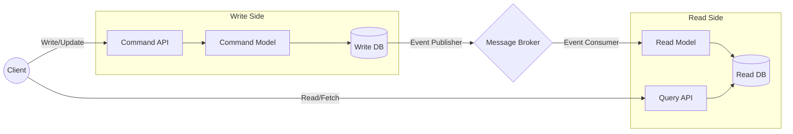

# CQRS Pattern (Command Query Responsibility Segregation)

## 1. Pattern Overview and Intent
CQRS (Command Query Responsibility Segregation) is an architectural pattern that separates the data mutation operations (Commands) from the data retrieval operations (Queries) into distinct, separate interfaces and often separate physical datastores.

**Intent:**
- Maximize performance, scalability, and security by isolating reads from writes.
- Allow independent scaling of read and write workloads.
- Simplify complex domain models by splitting them into two specialized models.

## 2. Detailed Explanation of How it Works

In traditional architectures, the same data model is used to query and update a database. This often leads to a compromise where the model is neither perfectly optimized for complex reads nor for high-throughput writes.

CQRS separates these concerns:
- **Commands:** Change the state of the system but do not return data. They focus on business logic and validation. They write to a Write DB (often a normalized RDBMS or Event Store).
- **Queries:** Return data but do not change the state of the system. They focus on fast data retrieval. They read from a Read DB (often a denormalized NoSQL database, document store, or search index).

**Synchronization:**
Because the Write DB and Read DB are separate, they must be synchronized. This is typically achieved using an event-driven architecture. When a Command updates the Write DB, an event is published. A projector/updater service listens to this event and updates the Read DB.

### Architecture Diagram



## 3. Real-World Example: Ride-Sharing System (Uber/Lyft)

In a ride-sharing app, the actions (commands) are complex, but the data display (queries) must be blazingly fast.

### The Write Model (Command)
A user requests a ride. The `RequestRideCommand` hits the write side. The domain logic checks driver availability, user balance, etc. Once validated, it stores the ride state in a transactional PostgreSQL database.

### The Read Model (Query)
Users constantly query driver locations and ride status. The read model is heavily denormalized and stored in Redis or Elasticsearch.

### Code Snippet (Pseudocode)

```python
# COMMAND SIDE
class UpdateDriverLocationCommand:
    def __init__(self, driver_id, lat, long):
        self.driver_id = driver_id
        self.lat = lat
        self.long = long

def handle_update_location(cmd: UpdateDriverLocationCommand):
    # 1. Validate business rules (e.g., driver is active)
    # 2. Update relational Write DB
    db.execute("UPDATE drivers SET lat=?, long=? WHERE id=?", cmd.lat, cmd.long, cmd.driver_id)
    # 3. Publish Event
    event_bus.publish(LocationUpdatedEvent(cmd.driver_id, cmd.lat, cmd.long))

# EVENT HANDLER (SYNC)
def on_location_updated(event: LocationUpdatedEvent):
    # Update denormalized Read DB (e.g., Redis geospatial index)
    redis.geoadd("driver_locations", event.long, event.lat, event.driver_id)

# QUERY SIDE
def get_nearby_drivers(lat, long, radius):
    # Instantly fetch from highly optimized Read DB
    return redis.georadius("driver_locations", long, lat, radius)
```

## 4. Pros and Cons

### Pros
- **Independent Scaling:** Read and write workloads can be scaled independently. Read-heavy systems can scale the Read DB and Query APIs without affecting writes.
- **Optimized Data Schemas:** The read side can use materialized views or NoSQL for instant querying, while the write side stays normalized for data integrity.
- **Security:** Easier to ensure that only the right entities can modify data.
- **Flexibility:** You can have multiple read models tailored for different clients (e.g., mobile vs. web dashboard).

### Cons
- **Eventual Consistency:** The read database is updated asynchronously, meaning clients might read stale data momentarily.
- **Increased Complexity:** You now manage two databases, an event broker, and syncing logic instead of a simple CRUD app.
- **Infrastructure Overhead:** More moving parts to deploy, monitor, and maintain.

## 5. When to Use / When NOT to Use

**When to Use:**
- Collaborative domains where multiple users access the same data in parallel.
- Systems with a massive disparity between read and write volumes (e.g., a social network feed).
- When combined with Event Sourcing.

**When NOT to Use:**
- Simple CRUD applications where reads and writes are straightforward.
- Applications where strong consistency across all views is an absolute requirement.
- When the team lacks experience with message brokers and eventual consistency.

## 6. Common Interview Questions
1. **How do you handle eventual consistency in a UI when using CQRS?**
   *Answer:* The UI can use optimistic updates (updating the UI before the read DB is updated), polling the read DB until the expected state is reached, or using WebSockets/Server-Sent Events to push updates to the UI once the read DB is synchronized.
2. **Can CQRS be used without Event Sourcing?**
   *Answer:* Yes. You can use standard relational updates on the Write DB and trigger events via Change Data Capture (CDC) or explicit message publishing to update the Read DB. Event Sourcing is not mandatory for CQRS, though they pair exceptionally well.
3. **What happens if the message broker goes down?**
   *Answer:* The Write DB will still process commands (if decoupled correctly), but the Read DB will become stale. Systems must implement outbox patterns to ensure events are reliably delivered once the broker recovers.
