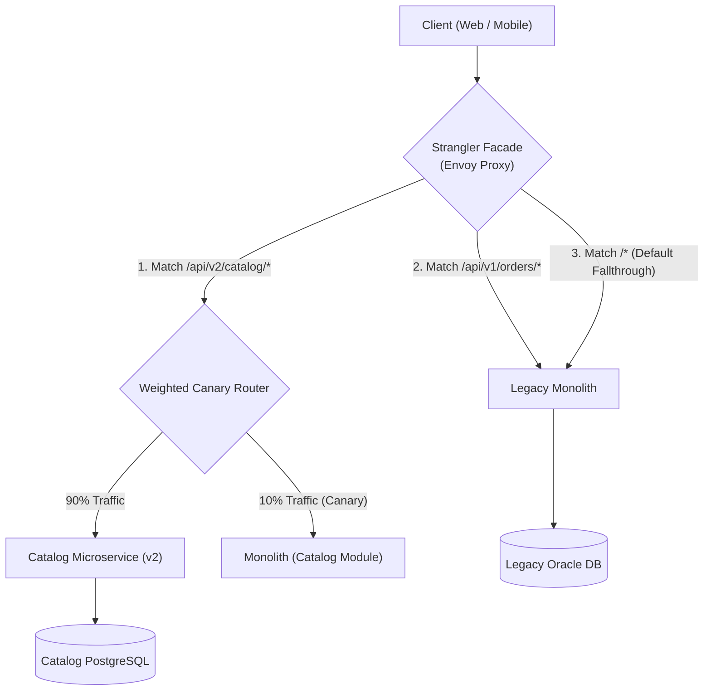
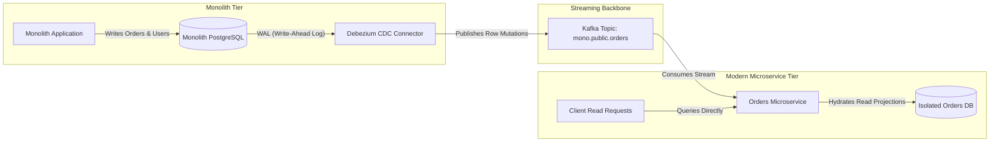
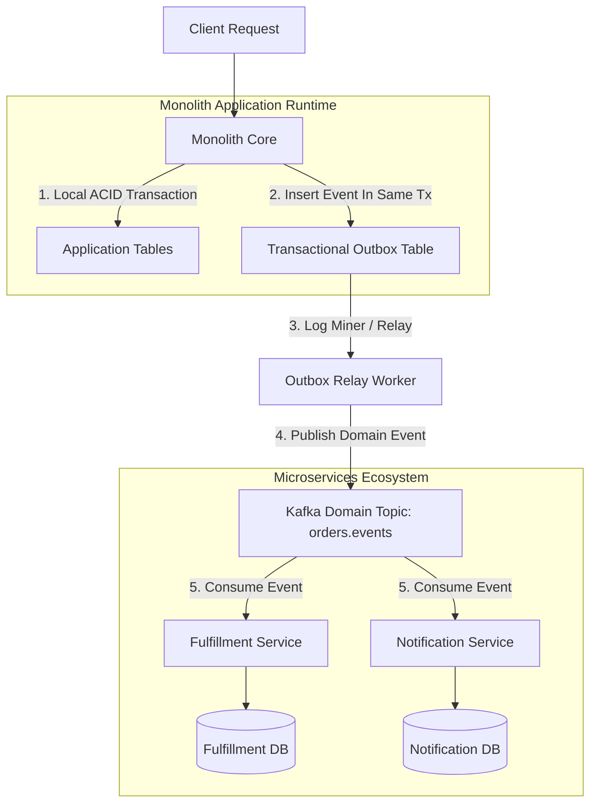
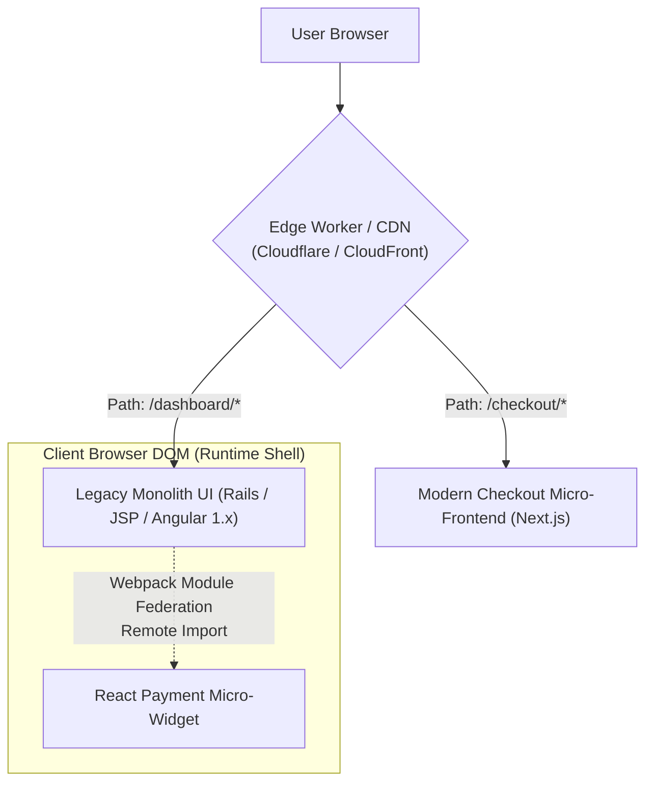
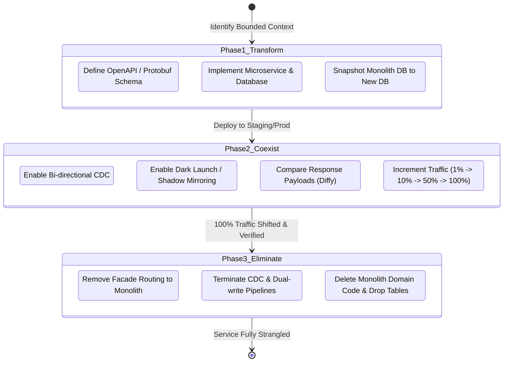
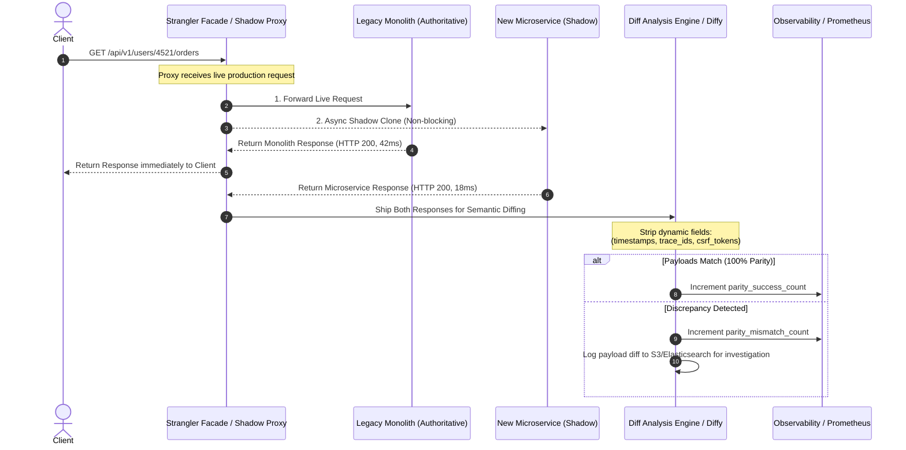
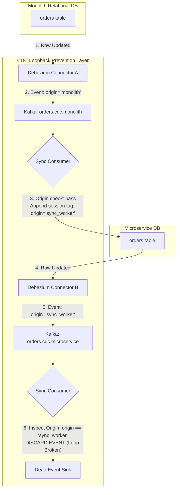
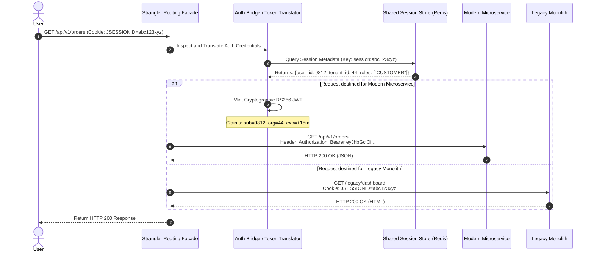
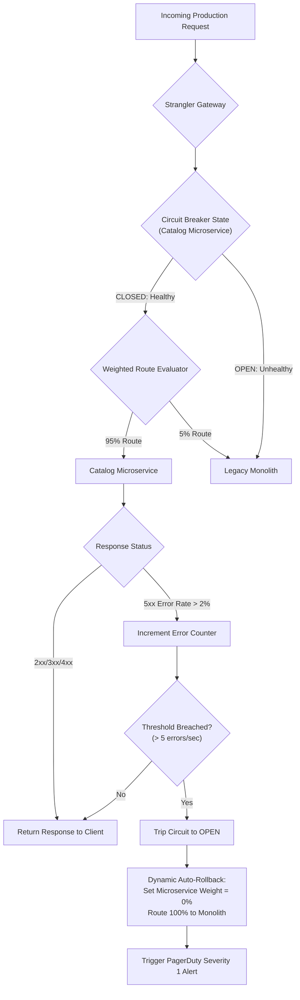

# Strangler Fig Pattern: Production Architectural Guide

## 1. Executive Architectural Overview & Theoretical Foundations

### 1.1 The Legacy Monolith Dilemma & The Anatomy of "Big Bang" Migration Failures
Legacy monolithic systems often represent decades of accumulated business logic, complex domain rules, and massive operational inertia. As organizations scale, these monoliths inevitably exhibit severe architectural decay:
- **Coupled Deployments:** A bug in a low-priority reporting subsystem can destabilize the primary transaction processing engine.
- **Cognitive & Organizational Bottlenecks:** Dozens of feature teams committing to a single repository trigger constant merge conflicts, serialized testing pipelines, and multi-hour build queues.
- **Heterogeneous Scaling Impossibility:** High-CPU cryptographic tasks or machine learning scoring routines require scaling the entire monolith—including memory-intensive caching layers—leading to inefficient infrastructure utilization.

Historically, organizations attempted to resolve these pathologies via **"Big Bang" migrations**: an ambitious initiative where an engineering organization attempts to build a modern, microservice-based system in parallel from scratch, freeze or dual-implement new features over 18 to 36 months, and switch production traffic in a single "cutover weekend."

```
The Big Bang Trap:
Year 0: Monolith (v1.0) ─── Feature Work Continues ───> Monolith (v2.5, 400 new features)
          │
          └── Parallel Rewrite Project ─── 24 Months ───> New System (Only implements v1.0 specs!)
                                                            [Cutover Fails: Specification Gap]
```

Big Bang rewrites fail with near certainty due to four systemic realities:
1. **Moving Target Dynamics:** The business cannot freeze features for two years. The legacy monolith continues evolving, creating a constantly widening specification gap between the legacy reality and the greenfield target.
2. **Hidden Specification & Undocumented Quirks:** Edge-case business logic (e.g., weird tax exemptions for specific jurisdictions implemented in 2014) is rarely documented. Rewrites invariably miss these subtle behaviors until customer-facing production incidents occur.
3. **All-or-Nothing Risk Concentration:** Switching 100% of production traffic exposes the entire customer base to unknown memory leaks, unvetted connection pool sizing, and query performance anomalies simultaneously.
4. **Executive Fatigue and Budget Exhaustion:** When a rewrite exceeds its 12-month budget with zero incremental revenue or performance delivered to production, leadership frequently cancels the initiative, leaving the organization with two half-baked systems to maintain.

---

### 1.2 Martin Fowler's Metaphor: The Australian Strangler Fig Tree
In 2004, Martin Fowler observed the Australian strangler fig (*Ficus watkinsiana*). The strangler fig begins its lifecycle when a bird deposits a seed in the upper canopy branches of a host tree. The seedling germinates and grows downward, wrapping roots around the host trunk until they penetrate the forest soil below. Over decades, the fig's root and branch network expands, gradually enveloping the host tree. Eventually, the interior host tree dies and rots away, leaving a towering, hollow cylindrical tree composed entirely of the strangler fig.

Applied to distributed software systems:
- The **Host Tree** is the legacy monolithic application and its unified datastore.
- The **Strangler Fig Seedling** is the intercepting routing facade (reverse proxy, API gateway, or message interceptor).
- The **Growing Aerial Roots** are the newly developed microservices that incrementally capture specific domain boundaries.
- The **Hollow Core** is the state reached when all capabilities have been extracted, allowing the legacy monolith to be cleanly dismantled and decommissioned without customer downtime.

---

### 1.3 Core Intent, Principles, and Migration Philosophy
The **Strangler Fig Pattern** operationalizes incremental modernization. Its fundamental objective is to replace system components progressively without halting feature delivery or incurring catastrophic cutover risk.

```
       ┌─────────────────────────────────────────────────────────────┐
       │                Core Strangler Philosophy                     │
       │                                                             │
       │  1. Intercept at the Perimeter  ──> Facade governs traffic  │
       │  2. Transform Incrementally     ──> Build 1 bounded context │
       │  3. Coexist Harmoniously        ──> Bi-directional sync     │
       │  4. Eliminate Fearlessly        ──> Prune legacy code paths │
       └─────────────────────────────────────────────────────────────┘
```

The pattern is governed by three non-negotiable operational principles:
- **Continuous Production Value:** Every extracted capability must be shipped to production and handle live traffic within weeks—not years.
- **Instant Rollback Guarantees:** Any routing change must be dynamic and reversible in sub-second timeframes via configuration (e.g., routing weights in an API Gateway), completely decoupling deployment from release.
- **Strict Bounded Context Isolation:** Extracted microservices must own their datastores completely; they must never directly read or write to the monolithic database via shared SQL queries or shared schemas.

---

### 1.4 The 4-Stage Evolutionary Architecture

```mermaid
flowchart TD
    subgraph Stage1["Stage 1: Monolithic State"]
        C1["Clients"] --> M1["Monolith (All Domains)"]
        M1 --> D1[("Monolithic DB")]
    end

    subgraph Stage2["Stage 2: Interception & First Service"]
        C2["Clients"] --> F2{"Routing Facade"}
        F2 -->|"/api/v1/reviews"| S2A["Reviews Microservice"]
        F2 -->|"/* (All Other Traffic)"| M2["Monolith"]
        S2A --> D2A[("Reviews DB")]
        M2 --> D2[("Monolithic DB")]
        D2 -.->|"CDC Sync"| D2A
    end

    subgraph Stage3["Stage 3: Mature Coexistence"]
        C3["Clients"] --> F3{"Routing Facade"}
        F3 -->|"/api/v1/reviews"| S3A["Reviews Service"]
        F3 -->|"/api/v1/orders"| S3B["Orders Service"]
        F3 -->|"/api/v1/billing"| S3C["Billing Service"]
        F3 -->|"Legacy Remnants"| M3["Monolith (Core Legacy)"]
        S3A --> D3A[("Reviews DB")]
        S3B --> D3B[("Orders DB")]
        S3C --> D3C[("Billing DB")]
        M3 --> D3[("Monolithic DB")]
        S3B <-->|"Bi-Directional Event Bridge"| M3
    end

    subgraph Stage4["Stage 4: Complete Decommission"]
        C4["Clients"] --> F4{"API Gateway"}
        F4 --> S4A["Reviews Service"]
        F4 --> S4B["Orders Service"]
        F4 --> S4C["Billing Service"]
        F4 --> S4D["Catalog Service"]
        S4A --> D4A[("Reviews DB")]
        S4B --> D4B[("Orders DB")]
        S4C --> D4C[("Billing DB")]
        S4D --> D4D[("Catalog DB")]
    end
```



---

## 2. Comprehensive Breakdown of Strangler Architectural Approaches

Migrating a legacy monolith is not purely an HTTP routing challenge. Different architectural tiers dictate distinct interception and strangulation strategies. Production architectures typically employ a combination of four distinct approaches:

```
┌────────────────────────────────────────────────────────────────────────┐
│               Strangler Fig Implementation Approaches                  │
├────────────────────────────┬───────────────────────────────────────────┤
│ 1. HTTP / Routing Facade   │ Network edge reverse proxy (Envoy, Nginx) │
│ 2. Data Interception (CDC) │ Database log tailing (Debezium, Kafka)    │
│ 3. Event-Driven Intercept  │ Asynchronous domain events & Outbox       │
│ 4. UI / Micro-Frontend     │ Presentation layer routing & Module Fed   │
└────────────────────────────┴───────────────────────────────────────────┘
```

---

### 2.1 Approach 1: HTTP / Routing Facade Strangler

The HTTP/Routing Facade is the most widely adopted pattern. A high-performance reverse proxy (such as Envoy, Nginx, Traefik, or cloud ALBs/API Gateways) is positioned directly in front of the entire legacy system.

#### High-Level Design (HLD)
Every external request hits the routing facade first. The facade examines incoming URI paths, HTTP methods, headers, or client cookies, and evaluates routing rules to decide whether the request is serviced by the legacy monolith or routed to an extracted microservice.



#### Key Responsibilities of the Facade:
1. **URI Path Routing:** Directing specific API paths (e.g., `/api/v1/inventory/*`) to the new cluster.
2. **Weighted Canary Traffic Splitting:** Splitting a single URI path between monolith and microservice (e.g., 99% to monolith, 1% to microservice) to validate stability.
3. **Session & Identity Injection:** Extracting legacy session cookies, validating them against a distributed cache, and minting modern JSON Web Tokens (JWTs) before forwarding to microservices.
4. **Header-Based Developer Overrides:** Allowing QA and internal engineers to pass headers like `X-Route-Target: microservice` to test new implementations without exposing real users.

#### Concrete Production Implementations

##### 1. Production Envoy Configuration (Weighted Canary & Path Splitting)
The following production-grade Envoy configuration routes `/api/v1/products` across the legacy monolith and the new microservice using weighted cluster routing, while shadowing 10% of traffic to the microservice for dark launch testing:

```yaml
static_resources:
  listeners:
  - name: ingress_strangler_listener
    address:
      socket_address:
        address: 0.0.0.0
        port_value: 8080
    filter_chains:
    - filters:
      - name: envoy.filters.network.http_connection_manager
        typed_config:
          "@type": type.googleapis.com/envoy.extensions.filters.network.http_connection_manager.v3.HttpConnectionManager
          stat_prefix: ingress_http
          codec_type: AUTO
          route_config:
            name: strangler_routes
            virtual_hosts:
            - name: core_services
              domains: ["*"]
              routes:
              # Rule 1: Header override for internal dogfooding / QA testing
              - match:
                  prefix: "/api/v1/catalog"
                  headers:
                  - name: "X-Migration-Cohort"
                    exact_match: "alpha-tester"
                route:
                  cluster: catalog_microservice_cluster
                  timeout: 2.5s

              # Rule 2: Production Canary Shifting for Catalog Service
              - match:
                  prefix: "/api/v1/catalog"
                route:
                  weighted_clusters:
                    clusters:
                    - name: legacy_monolith_cluster
                      weight: 85
                    - name: catalog_microservice_cluster
                      weight: 15
                  timeout: 3.0s
                  retry_policy:
                    retry_on: "5xx,connect-failure,refused-stream"
                    num_retries: 2
                    per_try_timeout: 1.0s
                  # Shadow (Dark Launch) 10% of remaining legacy traffic to microservice
                  request_mirror_policies:
                  - cluster: catalog_microservice_cluster
                    runtime_fraction:
                      default_value:
                        numerator: 10
                        denominator: HUNDRED

              # Rule 3: Default Fallthrough Route to Monolith
              - match:
                  prefix: "/"
                route:
                  cluster: legacy_monolith_cluster
                  timeout: 10.0s

          http_filters:
          - name: envoy.filters.http.router
            typed_config:
              "@type": type.googleapis.com/envoy.extensions.filters.http.router.v3.Router

  clusters:
  - name: catalog_microservice_cluster
    connect_timeout: 0.5s
    type: STRICT_DNS
    dns_lookup_family: V4_ONLY
    lb_policy: ROUND_ROBIN
    load_assignment:
      cluster_name: catalog_microservice_cluster
      endpoints:
      - lb_endpoints:
        - endpoint:
            address:
              socket_address:
                address: catalog-service.internal.production
                port_value: 8080

  - name: legacy_monolith_cluster
    connect_timeout: 1.0s
    type: STRICT_DNS
    dns_lookup_family: V4_ONLY
    lb_policy: ROUND_ROBIN
    load_assignment:
      cluster_name: legacy_monolith_cluster
      endpoints:
      - lb_endpoints:
        - endpoint:
            address:
              socket_address:
                address: monolith-app.internal.production
                port_value: 8080
```

##### 2. Production Nginx Configuration (Canary via Split Clients)
For teams running standard Nginx reverse proxies, the `split_clients` directive allows deterministic hashing of client IP addresses or session tokens to provide sticky canary routing during migration:

```nginx
# Map client remote address or cookie to deterministic bucket
split_clients "${remote_addr}${http_authorization}" $strangler_upstream {
    10%     catalog_microservice;
    *       legacy_monolith;
}

upstream catalog_microservice {
    server catalog-service-01.internal:8080 max_fails=3 fail_timeout=10s;
    server catalog-service-02.internal:8080 max_fails=3 fail_timeout=10s;
    keepalive 64;
}

upstream legacy_monolith {
    server monolith-app-01.internal:8080 max_fails=2 fail_timeout=5s;
    server monolith-app-02.internal:8080 max_fails=2 fail_timeout=5s;
    keepalive 32;
}

server {
    listen 80;
    server_name api.enterprise.com;

    # Universal Request Tracking Correlation ID
    proxy_set_header X-Request-ID $request_id;
    proxy_set_header Host $host;
    proxy_set_header X-Real-IP $remote_addr;

    # Strangled Catalog Endpoint with Deterministic Canary Splitting
    location /api/v1/catalog {
        # Administrative override header for testing
        if ($http_x_force_route = "microservice") {
            proxy_pass http://catalog_microservice;
            break;
        }

        proxy_pass http://$strangler_upstream;
        proxy_http_version 1.1;
        proxy_set_header Connection "";
        
        # Immediate fallback to monolith if microservice fails with 5xx
        proxy_next_upstream error timeout http_502 http_503 http_504;
        proxy_next_upstream_tries 2;
        proxy_next_upstream_timeout 1s;
    }

    # Unstrangled core logic directed to legacy monolith
    location / {
        proxy_pass http://legacy_monolith;
        proxy_http_version 1.1;
        proxy_set_header Connection "";
        proxy_read_timeout 15s;
    }
}
```

---

### 2.2 Approach 2: Data Interception & Change Data Capture (CDC) Strangler

While the HTTP facade intercepts incoming user calls, the core state of an enterprise system resides in the database. When extracting a microservice, you cannot immediately switch the write authority if other monolithic modules still perform direct SQL joins against those tables.

The **CDC Strangler** captures row-level mutations from the monolithic database's transaction log (e.g., MySQL binary log, PostgreSQL Write-Ahead Log [WAL], Oracle GoldenGate) and streams them into Kafka. Modern microservices consume these logs to continuously hydrate their own isolated operational datastores.

#### Architecture Topology



#### Low-Level Design (LLD): Hydration Pipeline
1. **Zero-Downtime Snapshot:** Debezium establishes an initial consistent snapshot of the monolithic `orders` table without taking global table locks.
2. **Log Streaming:** As the monolith continues writing updates, inserts, and deletes, Debezium captures each WAL event, converts it into an Avro/JSON payload containing both before-state and after-state images, and pushes it to Kafka.
3. **Consumer Idempotency:** The new microservice consumes the Kafka stream. Because Kafka provides at-least-once delivery, the consumer uses database `UPSERT` statements keyed by the primary identifier to maintain mathematical idempotency.
4. **Transition to Primary Write Authority:** Once the new microservice read store is verified to have zero replication lag, the HTTP routing facade switches write requests to the microservice. The CDC stream is then inverted (or bi-directional synchronization is enabled) to sync changes back to the monolith for any legacy reporting queries.

#### Concrete Debezium MySQL Connector Configuration
```json
{
  "name": "monolith-cdc-orders-source",
  "config": {
    "connector.class": "io.debezium.connector.mysql.MySqlConnector",
    "tasks.max": "1",
    "database.hostname": "monolith-db.internal.production",
    "database.port": "3306",
    "database.user": "debezium_cdc",
    "database.password": "${file:/secrets/db-credentials.properties:cdc_password}",
    "database.server.id": "184054",
    "database.server.name": "monolith_prod",
    "database.include.list": "monolith_core",
    "table.include.list": "monolith_core.orders,monolith_core.order_line_items",
    "database.history.kafka.bootstrap.servers": "kafka:9092",
    "database.history.kafka.topic": "schema-changes.monolith.orders",
    "include.schema.changes": "true",
    "tombstones.on.delete": "true",
    "decimal.handling.mode": "double",
    "time.precision.mode": "connect",
    "snapshot.mode": "when_needed",
    "snapshot.locking.mode": "minimal"
  }
}
```

---

### 2.3 Approach 3: Event-Driven Interception Strangler

In complex distributed architectures, directly querying databases via CDC can leak low-level database schema representations into domain models. The **Event-Driven Interception Strangler** shifts interception into the application layer: the monolith is retrofitted to publish high-level, semantic **Domain Events** (e.g., `OrderPlaced`, `CustomerAddressUpdated`, `PaymentCaptured`) whenever internal business transactions commit.

#### High-Level Design (HLD)



#### Mechanics of Application-Level Interception
1. **Transactional Outbox Integration:** Rather than publishing directly over the network inside the monolithic transaction (which triggers the classic Dual-Write problem), the monolith writes the domain event into an `outbox` table in the exact same relational transaction.
2. **Event Relaying:** An asynchronous process tails the outbox table and dispatches events to Apache Kafka or RabbitMQ with strict ordering guarantees.
3. **Microservices Take Over Side-Effects:** Instead of the monolith executing email sending, inventory reservations, or analytics tracking directly within its sprawling code tree, newly deployed microservices consume the domain events and take over these side effects.
4. **Command Redirection:** Over time, the primary command endpoints are switched at the API Gateway to route directly to the new microservice, which then publishes events back to the monolith to notify it of state changes.

---

### 2.4 Approach 4: UI & Micro-Frontend Strangler

Modernization efforts often stall when backend microservices are ready, but the monolithic frontend (e.g., an monolithic Rails application rendering server-side ERB templates or an ancient AngularJS 1.x single-page app) cannot easily consume modern REST/GraphQL APIs without significant rewrite overhead.

The **UI / Micro-Frontend Strangler** intercepts user interactions at the presentation layer, allowing individual views, tabs, or components to be built with modern frameworks (e.g., React, Vue, Next.js) and embedded directly inside the legacy user interface.

#### Edge Routing & Module Federation Architecture



#### Core Mechanisms
- **Edge Routing (Page-Level Strangling):** The CDN or Edge Worker inspects the URL path. Standard pages (e.g., `/account`, `/help`) route to the legacy monolithic web server. Newly modernized routes (e.g., `/cart`, `/checkout`) route to independent, server-rendered micro-frontend containers.
- **Client-Side Module Federation (Component-Level Strangling):** Using Webpack 5 Module Federation or Single-SPA, the legacy host page dynamically downloads and mounts micro-frontend bundles at runtime into placeholder `<div>` containers, sharing global authentication tokens and state via a unified event bus (`window.dispatchEvent`).

---

## 3. Low-Level Design (LLD), Validation, & Synchronization Mechanics

Executing a Strangler Fig migration without data corruption or user-visible regressions requires rigorous engineering across validation, synchronization, and authentication.

---

### 3.1 Phased Migration Lifecycle: Transform, Coexist, Eliminate

Every bounded context extracted via the Strangler Fig pattern must strictly follow the three-phase operational lifecycle:

```
┌────────────────────────────────────────────────────────────────────────┐
│                   Phased Strangler Lifecycle                           │
│                                                                        │
│   Phase 1: TRANSFORM  ──> Build microservice & parallel data store     │
│   Phase 2: COEXIST    ──> Dual-run, dark launch, shadow validation     │
│   Phase 3: ELIMINATE  ──> Cut primary traffic, prune legacy code paths │
└────────────────────────────────────────────────────────────────────────┘
```



---

### 3.2 Shadow Traffic & Dark Launching Verification

Before directing real customer traffic to a newly extracted microservice, engineers must verify that the new implementation produces responses semantically identical to the monolith under genuine production load and concurrency.

#### Dark Launching Architecture with Shadow Proxy
The API gateway or an intermediary shadow proxy duplicates incoming live read requests. The primary request is sent to the legacy monolith and immediately returned to the client to guarantee zero user impact. The cloned request is asynchronously forwarded to the new microservice. Both response payloads are captured, sanitized of dynamic non-deterministic data (e.g., timestamps, UUIDs, server IDs), and compared byte-for-byte or field-by-field.



#### Production Go Implementation: High-Performance Async Shadow Diff Proxy
Below is a production-grade, concurrent Go proxy implementation capable of handling thousands of requests per second, asynchronously cloning traffic, sanitizing non-deterministic JSON keys, and flagging regression diffs:

```go
package main

import (
	"bytes"
	"crypto/sha256"
	"encoding/hex"
	"encoding/json"
	"io"
	"log"
	"net/http"
	"net/http/httputil"
	"net/url"
	"reflect"
	"strings"
	"time"
)

type Config struct {
	MonolithURL    string
	MicroserviceURL string
	IgnoredJSONKeys []string
}

type ShadowProxy struct {
	monolithProxy    *httputil.ReverseProxy
	microserviceURL  *url.URL
	httpClient       *http.Client
	ignoredKeys      map[string]bool
}

func NewShadowProxy(cfg Config) *ShadowProxy {
	monoTarget, err := url.Parse(cfg.MonolithURL)
	if err != nil {
		log.Fatalf("Invalid monolith URL: %v", err)
	}
	microTarget, err := url.Parse(cfg.MicroserviceURL)
	if err != nil {
		log.Fatalf("Invalid microservice URL: %v", err)
	}

	ignored := make(map[string]bool)
	for _, k := range cfg.IgnoredJSONKeys {
		ignored[strings.ToLower(k)] = true
	}

	return &ShadowProxy{
		monolithProxy:   httputil.NewSingleHostReverseProxy(monoTarget),
		microserviceURL: microTarget,
		httpClient: &http.Client{
			Timeout: 3 * time.Second,
		},
		ignoredKeys: ignored,
	}
}

func (sp *ShadowProxy) ServeHTTP(w http.ResponseWriter, r *http.Request) {
	// Read and clone the request body for shadowing
	var bodyBytes []byte
	if r.Body != nil {
		bodyBytes, _ = io.ReadAll(r.Body)
		r.Body = io.NopCloser(bytes.NewBuffer(bodyBytes))
	}

	// Capture Monolith response using ResponseRecorder
	recorder := &responseCapture{
		ResponseWriter: w,
		body:           &bytes.Buffer{},
	}

	// Execute primary authoritative call to monolith
	sp.monolithProxy.ServeHTTP(recorder, r)

	// Asynchronously shadow read operations (GET/HEAD) to prevent side-effects
	if r.Method == http.MethodGet || r.Method == http.MethodHead {
		go sp.executeShadowCall(r, bodyBytes, recorder.statusCode, recorder.body.Bytes())
	}
}

func (sp *ShadowProxy) executeShadowCall(originalReq *http.Request, body []byte, monoStatus int, monoBody []byte) {
	shadowURL := *sp.microserviceURL
	shadowURL.Path = originalReq.URL.Path
	shadowURL.RawQuery = originalReq.URL.RawQuery

	shadowReq, err := http.NewRequest(originalReq.Method, shadowURL.String(), bytes.NewBuffer(body))
	if err != nil {
		log.Printf("[Shadow Error] Failed to create shadow request: %v", err)
		return
	}

	// Propagate trace headers
	for k, v := range originalReq.Header {
		shadowReq.Header[k] = v
	}
	shadowReq.Header.Set("X-Shadow-Traffic", "true")

	resp, err := sp.httpClient.Do(shadowReq)
	if err != nil {
		log.Printf("[Shadow Network Error] Target down: %v", err)
		return
	}
	defer resp.Body.Close()

	shadowBody, _ := io.ReadAll(resp.Body)

	// Verify Status Code Parity
	if resp.StatusCode != monoStatus {
		log.Printf("[Parity Failure: Status Mismatch] Path: %s | Monolith: %d | Microservice: %d",
			originalReq.URL.Path, monoStatus, resp.StatusCode)
		return
	}

	// Compare JSON bodies
	sp.compareJSONResponses(originalReq.URL.Path, monoBody, shadowBody)
}

func (sp *ShadowProxy) compareJSONResponses(path string, monoRaw, microRaw []byte) {
	var monoData, microData interface{}
	if err := json.Unmarshal(monoRaw, &monoData); err != nil {
		return // Non-JSON payload
	}
	if err := json.Unmarshal(microRaw, &microData); err != nil {
		log.Printf("[Parity Failure: Invalid JSON in Microservice] Path: %s", path)
		return
	}

	cleanedMono := sp.sanitizeData(monoData)
	cleanedMicro := sp.sanitizeData(microData)

	if !reflect.DeepEqual(cleanedMono, cleanedMicro) {
		log.Printf("[Parity Failure: Data Discrepancy] Path: %s\nMono:  %s\nMicro: %s",
			path, hashPayload(cleanedMono), hashPayload(cleanedMicro))
	}
}

func (sp *ShadowProxy) sanitizeData(data interface{}) interface{} {
	switch val := data.(type) {
	case map[string]interface{}:
		cleaned := make(map[string]interface{})
		for k, v := range val {
			if !sp.ignoredKeys[strings.ToLower(k)] {
				cleaned[k] = sp.sanitizeData(v)
			}
		}
		return cleaned
	case []interface{}:
		cleaned := make([]interface{}, len(val))
		for i, v := range val {
			cleaned[i] = sp.sanitizeData(v)
		}
		return cleaned
	default:
		return val
	}
}

type responseCapture struct {
	http.ResponseWriter
	statusCode int
	body       *bytes.Buffer
}

func (rc *responseCapture) WriteHeader(code int) {
	rc.statusCode = code
	rc.ResponseWriter.WriteHeader(code)
}

func (rc *responseCapture) Write(b []byte) (int, error) {
	rc.body.Write(b)
	return rc.ResponseWriter.Write(b)
}

func hashPayload(v interface{}) string {
	b, _ := json.Marshal(v)
	h := sha256.Sum256(b)
	return hex.EncodeToString(h[:8])
}
```

---

### 3.3 Bi-Directional Database Synchronization & Loopback Prevention

During the coexistence phase, some features write to the legacy monolith database, while newly migrated features write to the microservice datastore. Both datastores must remain continuously synchronized in near real-time without introducing infinite replication loops (loopbacks) or split-brain write collisions.

#### The Loopback Hazard
If Monolith DB syncs changes to Microservice DB via CDC, and Microservice DB syncs back to Monolith DB via CDC, an update to Record A in the monolith triggers an update in the microservice, which produces a new CDC event that updates the monolith again—resulting in an infinite cascading loop that saturates database CPU and crashes the messaging cluster.



#### Loopback Prevention Strategies:
1. **Metadata Origin Tagging:** Every database write executed by synchronization processes sets a database connection session variable or write audit column (e.g., `_last_modified_by = 'CDC_REPLICA_SYNC'`). The CDC log reader filters out transactions committed by that application identity.
2. **Deterministic Version Vectors & Lamport Timestamps:** Records carry a monotonic version sequence. If a received event has a version number less than or equal to the local database entity's version, the event is safely dropped.
3. **Partitioned Bounded Master Authority:** Prevent bi-directional writes on the same column. If customer profile fields are split, declare that the microservice is the authoritative master for `email` and `address`, while the monolith remains the master for `credit_limit` until Phase 3 cutover.

#### Production CDC Loopback-Safe Sync Handler (Go)
```go
package sync

import (
	"context"
	"database/sql"
	"encoding/json"
	"fmt"
	"log"
	"time"
)

type CDCRecord struct {
	Before        map[string]interface{} `json:"before"`
	After         map[string]interface{} `json:"after"`
	SourceOrigin  string                 `json:"source_origin"` // e.g. "MONOLITH", "MICROSERVICE", "SYNC_WORKER"
	Version       int64                  `json:"version"`
	UpdatedAt     int64                  `json:"updated_at"`
}

type SyncHandler struct {
	db           *sql.DB
	localOrigin  string // Identifier for this service, e.g. "MICROSERVICE"
}

func NewSyncHandler(db *sql.DB, localOrigin string) *SyncHandler {
	return &SyncHandler{
		db:          db,
		localOrigin: localOrigin,
	}
}

// ProcessIncomingCDCEvent executes an idempotent write while suppressing loopbacks
func (sh *SyncHandler) ProcessIncomingCDCEvent(ctx context.Context, payload []byte) error {
	var event CDCRecord
	if err := json.Unmarshal(payload, &event); err != nil {
		return fmt.Errorf("failed to decode CDC payload: %w", err)
	}

	// 1. Loopback Breaker: Discard events originated by automated sync workers
	if event.SourceOrigin == "SYNC_WORKER" || event.SourceOrigin == sh.localOrigin {
		// Log and discard; this change originated locally
		return nil
	}

	orderID, ok := event.After["id"].(string)
	if !ok {
		return fmt.Errorf("missing order id in after image")
	}
	status := event.After["status"].(string)
	incomingVersion := event.Version

	// 2. Atomic Upsert with Version Check and Origin Tagging
	tx, err := sh.db.BeginTx(ctx, &sql.TxOptions{Isolation: sql.LevelReadCommitted})
	if err != nil {
		return err
	}
	defer tx.Rollback()

	// Set session level tag to denote replication context in current connection
	_, err = tx.ExecContext(ctx, "SET LOCAL application_name = 'SYNC_WORKER'")
	if err != nil {
		return fmt.Errorf("failed to tag session context: %w", err)
	}

	// Guard against out-of-order delivery using optimistic version checking
	query := `
		INSERT INTO orders (id, status, version, last_modified_by, updated_at)
		VALUES ($1, $2, $3, 'SYNC_WORKER', NOW())
		ON CONFLICT (id) DO UPDATE
		SET status = EXCLUDED.status,
		    version = EXCLUDED.version,
		    last_modified_by = 'SYNC_WORKER',
		    updated_at = NOW()
		WHERE orders.version < EXCLUDED.version;
	`

	res, err := tx.ExecContext(ctx, query, orderID, status, incomingVersion)
	if err != nil {
		return fmt.Errorf("database sync error: %w", err)
	}

	rowsAffected, _ := res.RowsAffected()
	if rowsAffected == 0 {
		log.Printf("[Sync Ignored] Older or duplicate version %d received for Order %s", incomingVersion, orderID)
	}

	return tx.Commit()
}
```

---

### 3.4 Shared Sessions & Authentication Bridging

One of the most persistent operational hurdles during a Strangler migration is **session state continuity**. Legacy monoliths typically rely on stateful, server-side sticky sessions stored in an in-memory session table or Tomcat/JVM session cluster, identified by an opaque HTTP cookie (`JSESSIONID`, `PHPSESSID`, `ASP.NET_SessionId`). Modern microservices, by contrast, expect stateless cryptographic tokens (such as asymmetric JWTs or OAuth2 Bearer tokens).

#### Token Translation & Auth Bridge Pattern



#### Token Translation Bridge Middleware (Node.js/Express)
The following auth bridge validates the legacy session cookie against a centralized Redis session store, generates an ephemeral JWT on the fly, and injects it into the outbound request headers destined for the downstream microservices:

```typescript
import { Request, Response, NextFunction } from 'express';
import Redis from 'ioredis';
import jwt from 'jsonwebtoken';
import fs from 'fs';

const redisClient = new Redis(process.env.REDIS_SESSION_URL || 'redis://localhost:6379');
const PRIVATE_KEY = fs.readFileSync('/etc/secrets/jwt-signing-key.pem');

export interface AuthenticatedUser {
  userId: string;
  tenantId: string;
  roles: string[];
  email: string;
}

export async function authBridgeMiddleware(req: Request, res: Response, next: NextFunction) {
  const legacySessionId = req.cookies['JSESSIONID'] || req.cookies['SESSION_ID'];

  if (!legacySessionId) {
    // If request already has modern Bearer token, allow downstream validation
    if (req.headers.authorization?.startsWith('Bearer ')) {
      return next();
    }
    return res.status(401).json({ error: 'Unauthenticated: No session token present' });
  }

  try {
    // 1. Fetch raw session from shared Redis store populated by monolith
    const sessionData = await redisClient.get(`session:${legacySessionId}`);
    if (!sessionData) {
      return res.status(401).json({ error: 'Session expired or invalidated' });
    }

    const session: AuthenticatedUser = JSON.parse(sessionData);

    // 2. Mint short-lived RS256 JWT for the downstream microservices
    const token = jwt.sign(
      {
        sub: session.userId,
        tenant_id: session.tenantId,
        roles: session.roles,
        email: session.email,
        iss: 'strangler-auth-bridge',
      },
      PRIVATE_KEY,
      {
        algorithm: 'RS256',
        expiresIn: '5m', // Short lifespan guarantees freshness
      }
    );

    // 3. Inject Authorization header for downstream microservice
    req.headers['authorization'] = `Bearer ${token}`;
    req.headers['x-authenticated-user'] = session.userId;

    next();
  } catch (error) {
    console.error('[AuthBridge Error] Token translation failed:', error);
    return res.status(500).json({ error: 'Internal Authentication Error' });
  }
}
```

---

## 4. Traffic Routing & Dynamic Shifting Deep Dive

### 4.1 Canary Shifting Strategies
Transitioning live traffic to a newly extracted microservice must never be a 0% to 100% binary toggle. Production systems leverage a calibrated four-stage rollout:

1. **Internal Employee Cohort (0% Public Traffic):** Routing rules evaluate the caller's identity or VPN subnet. Requests from corporate IP addresses or accounts tagged with `is_internal_tester=true` route to the microservice.
2. **Statistical Canary Splitting (1% - 5%):** A pseudo-random hash of the user ID routes a small percentage of external production traffic to the new service. Systems monitor latency percentiles (p95, p99), error rates, and CPU/memory utilization.
3. **Sticky Cohort Progression (25% -> 50%):** Traffic percentage increases in stages. Session stickiness ensures a given user does not toggle between monolith and microservice across consecutive requests during the same shopping session.
4. **Authoritative Cutover (100%):** All traffic targets the microservice. The monolith route is turned off in the gateway, but legacy code remains untouched for 14 days as an emergency safety net.

---

### 4.2 Automated Health Checks & Instant Rollback Circuit Breakers

The strangler facade must feature automated circuit breaking. If the newly extracted microservice encounters an unhandled exception loop, memory exhaustion, or increased database latency, the facade must automatically revert traffic to the legacy monolith without human intervention.



---

## 5. Real-World Edge Cases, Failure Modes, and Resiliency

Deploying the Strangler Fig pattern in high-throughput environments introduces subtle distributed systems failure modes that do not exist in pure monoliths or pure greenfield microservices.

### 5.1 Data Drift & Silent Data Corruption
**The Failure:** When bi-directional synchronization or CDC pipelines drop events or process them out of order, the legacy monolith database and the new microservice database silently diverge. Customers see different account balances or order statuses depending on which service serves their query.

**Mitigation & Resiliency:**
- **Asynchronous Reconciliation Daemons:** Implement an offline batch verification worker (e.g., Apache Spark or Go cron job) that continuously reads primary keys from both datastores, computes cryptographic hashes of the record fields, and logs discrepancies into a dead-letter drift table.
- **Strict Tombstoning:** In distributed CDC, deletes must never perform physical row truncation (`DROP` or hard `DELETE`). Instead, employ logical soft-deletes (`deleted_at TIMESTAMP`) and emit Debezium tombstone messages to ensure downstream databases consistently delete matching records.

---

### 5.2 Circular Dependencies between Monolith and Microservices
**The Failure:** Service A is extracted from the monolith. However, Service A still needs to calculate customer discount rates, so it calls an internal API on the Monolith. Meanwhile, the Monolith is processing an invoice and calls Service A to verify inventory. This creates an unmonitored circular network dependency: `Monolith -> Service A -> Monolith`.

```
                    ┌────────────────────────────┐
                    │      Legacy Monolith       │
                    └───────┬────────────▲───────┘
                            │            │
         1. Invoicing Call  │            │  2. Compute Discount Call
         (Blocks Thread T1) │            │  (Blocks Thread T2)
                            ▼            │
                    ┌────────────────────┴───────┐
                    │    Order Microservice      │
                    └────────────────────────────┘
```

When high load arrives, Monolith Thread Pool 1 blocks waiting on Service A, which in turn calls the Monolith, saturating Monolith Thread Pool 2. The entire system deadlocks in a distributed cascading failure.

**Mitigation & Resiliency:**
- **Strict Layered Dependency Invariant:** Define a strict unidirectional communication rule: Microservices are never permitted to make synchronous HTTP/RPC calls back into the legacy monolith.
- **CQRS Read Replicas:** If the microservice requires discount rate calculations, either duplicate that business logic into a shared library, or asynchronously project discount tables into the microservice database via CDC so reads remain local.

---

### 5.3 Dual-Write Split-Brain
**The Failure:** An engineering team attempts to synchronize the monolith and microservice by having the application layer write to both databases simultaneously (`monoDB.save(order); microDB.save(order);`). If the network flickers after the first write succeeds, the second write fails, leaving the system in an unrecoverable split-brain state.

**Mitigation & Resiliency:**
- **Strict Prohibition of Application Dual-Writes:** Never perform non-transactional dual writes across distinct network datastores in application code.
- Always use the **Transactional Outbox Pattern** or **CDC (Change Data Capture)**, ensuring that local persistence is guaranteed by the local database engine and replication is handled by a durable message broker.

---

### 5.4 Thundering Herd on Legacy DB during Cache Warmup
**The Failure:** When a read-heavy microservice is launched, its local cache (e.g., Redis cluster) is cold. If 50,000 requests per second are shifted to the new microservice, the cache misses cascade down into the legacy database or CDC extraction layer, crashing the legacy database.

**Mitigation & Resiliency:**
- **Pre-Warming Pipelines:** Before enabling traffic routing at the facade, run an offline extract-transform-load (ETL) pipeline that reads the top 20% most active keys from the monolith and pre-populates the new microservice cache.
- **Singleflight Pattern (Request Coalescing):** Employ the Singleflight concurrency pattern inside the microservice so that multiple concurrent cache misses for the same key result in only a single upstream query.

---

### 5.5 Session Invalidation and Logout Synchronization
**The Failure:** A user logs out on the legacy monolith UI. The monolith clears the local server session. However, the microservice authorization layer issued an independent JWT with a 1-hour expiration. An attacker who stole the JWT can continue making authenticated API calls to the microservice long after the user logged out of the monolith.

**Mitigation & Resiliency:**
- **Distributed Revocation Lists:** When a logout event occurs anywhere in the ecosystem, publish a `UserLoggedOutEvent` to a Redis Pub/Sub cluster.
- All microservices maintain an in-memory Bloom filter or Redis set of revoked tokens or user logout timestamps (`user_revoked_before[userId] = logoutTimestamp`) and reject any JWT minted before that timestamp.

---

## 6. Comprehensive Comparison Matrix across Strangler Approaches

| Architectural Dimension | Approach 1: HTTP / Routing Facade | Approach 2: Data Interception (CDC) | Approach 3: Event-Driven Interception | Approach 4: UI / Micro-Frontend |
| :--- | :--- | :--- | :--- | :--- |
| **Interception Layer** | OSI Layer 7 (HTTP/Reverse Proxy) | Database Storage Engine (WAL / Binlog) | Application Domain Model (Outbox/Kafka) | Presentation Layer (Browser DOM / CDN) |
| **Network Latency Overhead** | +1.5ms to 5ms (Reverse proxy network hop) | Sub-millisecond (Asynchronous to client write) | Negligible (Async outbox publishing) | 0ms (Handled client-side or at edge CDN) |
| **Implementation Complexity** | Low to Moderate (Config-driven in Envoy/Nginx) | High (Kafka Connect, schema drift management) | Moderate to High (Code refactoring in monolith) | Moderate (Module Federation, bundler tuning) |
| **Operational Maintenance** | Low (Proxy clusters, standardized routing) | High (CDC connectors, log compaction, offset lag) | Moderate (Broker clustering, consumer lag alerts) | Low to Moderate (Frontend deployment pipelines) |
| **Blast Radius of Failure** | High if gateway crashes; Low per-route | Low for user writes; High for data accuracy | Low (Decoupled async consumer failure) | Isolated to UI rendering; Backend unaffected |
| **Data Consistency Guarantee** | Immediate (Routed to authoritative single DB) | Eventual Consistency (Replication lag: 50ms-2s) | Eventual Consistency (Dependent on consumers) | Client-side transient state dependent |
| **Zero Monolith Code Changes** | **Yes** (Pure network-level routing) | **Yes** (Tails database logs directly) | **No** (Monolith must emit domain events) | **No** (Monolith templates must embed shells) |
| **Best Suited For** | Clean REST/GraphQL endpoints, external APIs | Monoliths with tight relational coupling | Complex asynchronous workflows, side-effects | Legacy monolithic SPAs, CMS, portal sites |

---

## 7. Real-World Enterprise Case Studies

### 7.1 Shopify: Modular Monolith to Podded Services & GraphQL Strangler Facade
- **The Challenge:** Shopify operates one of the world's largest monolithic Ruby on Rails applications. As their engineering organization scaled to thousands of developers, deployment contention and memory consumption on their MySQL clusters became severe.
- **The Solution:** Rather than attempting a disastrous "Big Bang" rewrite of their core e-commerce engine, Shopify implemented a modular strangler strategy. First, they used a static analysis tool (`Packwerk`) to enforce strict bounded contexts inside the Rails codebase, forbidding cross-module SQL joins. Next, they deployed a unified **GraphQL Routing Facade** at their perimeter.
- **The Execution:** Newly architected domains (such as their global inventory allocation engine) were implemented as high-performance Go and Java microservices. The perimeter GraphQL engine routed queries for inventory directly to the new services, while older checkout logic routed to the core Rails application. This allowed Shopify to seamlessly sustain Black Friday / Cyber Monday transaction spikes with zero platform downtime.

---

### 7.2 Netflix: Monolithic Datacenter Architecture to AWS Cloud Microservices
- **The Challenge:** In August 2008, a major database corruption event in Netflix's private datacenter halted DVD shipments for three days. Leadership made the strategic decision to migrate their entire customer-facing architecture to AWS cloud microservices.
- **The Solution:** Netflix invented what became the industry standard for the Strangler Fig pattern at scale. They built **Zuul**, an edge reverse proxy and routing facade.
- **The Execution:** Every incoming device request hit Zuul first. Netflix systematically identified vertical business capabilities—starting with non-critical services like movie recommendations and user reviews—and carved them out into independent Java Spring Boot microservices running on AWS EC2. The legacy datacenter monolith continued processing core account billing for years until all peripheral streaming, discovery, and catalog systems were completely strangled. Once the hollow datacenter shell had zero remaining ingress routes, the physical datacenter was permanently powered down.

---

### 7.3 UK Government Digital Service (GOV.UK): Strangling 300+ Departmental Silos
- **The Challenge:** The United Kingdom government previously maintained hundreds of disparate, monolithic departmental websites and transactional portals, each running on completely different proprietary software stacks, databases, and authentication mechanisms.
- **The Solution:** The UK Government Digital Service (GDS) used the Strangler Fig Pattern at the DNS and reverse-proxy level to create `GOV.UK`.
- **The Execution:** GDS deployed an intelligent router and caching CDN layer that intercepted all domain traffic. When a citizen accessed a service (e.g., renewing a passport or road tax), the router routed the request to modern, standardized Ruby and Go micro-applications if that specific journey had been migrated. If not, the proxy seamlessly routed backward to legacy legacy departmental backends while maintaining a consistent visual theme. This incremental strangling replaced hundreds of costly legacy contracts without a single national service disruption.

---

## 8. Advanced System Design Interview Masterclass

The Strangler Fig Pattern is one of the most frequently tested concepts in senior and principal system design interviews. Below are 7 rigorous, technically demanding interview questions with architectural solutions.

---

### Q1: How do you migrate a mission-critical billing system without downtime or payment double-charging?
**Architectural Answer:**
Migrating payment or billing systems carries extreme risk: duplicate charges trigger regulatory penalties and loss of customer trust. To execute safely:
1. **Double-Read, Single-Write Architecture:** First, deploy the new Billing Microservice in read-only shadow mode. The legacy monolith continues executing all payment captures. All card tokenization and processor transactions remain 100% authoritative on the monolith.
2. **Deterministic Idempotency Key Injection:** Position the Strangler Facade to generate a deterministic UUID idempotency key based on `hash(userId, orderId, cartTotal, timestampMinute)`. Pass this idempotency key down to both the legacy monolith and the payment gateway (e.g., Stripe, Adyen). Even if an unintended network retry occurs, the external payment processor rejects the duplicate charge.
3. **Cutover via Distributed Mutex:** When switching write authority:
   - Place the specific customer account into a transient 2-second "maintenance lock" using a Redis distributed lock (`Redlock`).
   - Flush pending outbox transactions from the monolith to ensure the new service has 100% current state.
   - Switch the facade route to the Billing Microservice.
   - Release the lock. All subsequent charges are processed exclusively by the new microservice, rendering double-charging structurally impossible.

---

### Q2: In an HTTP strangler facade, how do you handle stateful transactions that span both legacy monolith and new microservices?
**Architectural Answer:**
During multi-year migrations, business transactions frequently span both legacy and modern boundaries (e.g., the new Order Microservice reserves stock, but the legacy Monolith updates loyalty points and generates shipping manifests).
1. **Never Use Distributed Two-Phase Commit (2PC):** 2PC locks database resources across network boundaries, collapsing availability and drastically degrading latency.
2. **Implement an Orchestrated Saga Pattern:**
   - The newly extracted service acts as the **Saga Orchestrator**.
   - Step 1: The microservice executes its local transaction (reserve stock).
   - Step 2: The microservice dispatches an asynchronous command via Kafka to a dedicated **Anti-Corruption Layer (ACL)** endpoint on the monolith (`POST /legacy/api/internal/loyalty/accrue`).
   - Step 3: If the monolith returns success, the transaction marks complete.
3. **Compensating Transactions for Failure Handling:** If the legacy monolith fails to process its step (e.g., loyalty account locked), the Saga Orchestrator triggers an explicit compensating transaction (`POST /api/v1/inventory/release`) to roll back the microservice state cleanly.

---

### Q3: How do you prevent loopback storms when implementing bi-directional database synchronization between monolith and microservice DBs?
**Architectural Answer:**
Loopback storms occur when CDC replication engines fail to distinguish between organic user updates and automated replication updates. To break the cycle deterministically:
1. **Database Session Context Variables:** Before the replication consumer applies a synchronized row update, it sets a local session variable within the database transaction (e.g., PostgreSQL: `SET LOCAL replication.origin = 'CDC_REPLICA'`; MySQL: `SET @disable_binlog = 1` or session-level user variables).
2. **CDC Connector Filtering:** Configure Debezium's `HeaderRun` or SMT (Single Message Transform) to read the transaction metadata. If the transaction was flagged with `replication.origin == 'CDC_REPLICA'`, the connector drops the event immediately, preventing it from ever being emitted to Kafka.
3. **Idempotent Version Fencing:** Every entity schema contains a monotonic `version` column. When applying a sync event:
   ```sql
   UPDATE accounts 
   SET balance = :balance, version = :version 
   WHERE id = :id AND version < :version;
   ```
   If a looped event arrives out-of-order or redundantly, the `WHERE` clause evaluates to false, updating zero rows and terminating the loop.

---

### Q4: What is the exact sequence and strategy for deprecating and safely deleting the strangled monolithic code without causing runtime regressions?
**Architectural Answer:**
Deleting code in a monolith is notoriously dangerous due to hidden internal couplings (e.g., reflective method invocations, scheduled background cron tasks, or orphaned internal shared libraries).
1. **Tombstoning (Log & Metric Trapping):** Before deleting any Java/Ruby/Go class inside the monolith, add a runtime telemetry probe at the entrance of the legacy method:
   ```java
   public void processOrder(Order order) {
       Metrics.counter("legacy.deadcode.order_process.invocations").increment();
       logger.warn("DEPRECATED_ACCESS: processOrder invoked by " + CallerFinder.getCaller());
       // ... existing code ...
   }
   ```
2. **Observe for 30-60 Days:** Verify that the metric counter remains at exactly zero across month-end billing cycles, quarterly accounting jobs, and seasonal data backups.
3. **Feature Flag Isolation:** Wrap the entire module behind a dynamic kill-switch. If triggered unexpectedly, throw a clear `UnsupportedOperationException` that is immediately trapped and alerted.
4. **Physical Pull Request Deletion:** Prune the code, compile all unit/integration tests to ensure no compilation breaks, drop the abandoned database tables in a staged migration, and reclaim infrastructure resources.

---

### Q5: How do you manage join queries and relational integrity when one table has been moved to a microservice but related foreign-key tables remain in the monolith?
**Architectural Answer:**
When the `orders` table moves to a microservice while `customers` and `order_items` remain in the monolith, cross-database SQL joins (`JOIN customers ON orders.customer_id = customers.id`) become impossible.
1. **Anti-Corruption Layer (ACL) API Composition:** The Strangler Facade or an API Gateway query aggregator calls both services in parallel and merges the JSON responses in memory before returning to the frontend:
   ```
   Client <-- Gateway Composition <-- [Order Service GET /orders/123]
                                  <-- [Monolith GET /customers/456]
   ```
2. **Read-Side Data Replication (CQRS Projection):** If high query throughput prohibits multi-hop API aggregation, stream the monolithic `customers` table into the Order Microservice database via CDC as a read-only materialized view. The microservice performs local SQL joins against this replicated read projection.
3. **Relax Relational Foreign Keys to Logical Invariants:** Drop physical foreign key constraints at the database level. Enforce referential integrity in the microservice application domain using schema validators and asynchronous reconciliation checks.

---

### Q6: How do you architect shadow traffic (dark launching) for mutating POST/PUT/DELETE requests without corrupting production downstream systems?
**Architectural Answer:**
Shadowing read traffic (GET) is safe because it is idempotent and has no side effects. Shadowing mutating writes (POST/PUT/DELETE) is exceptionally hazardous because it could trigger duplicate emails, redundant credit card charges, or corrupted third-party API state.
1. **Downstream Mocking & Virtualization:** When cloning a write request to the candidate microservice, configure the microservice's external dependencies (e.g., SendGrid, Stripe, fulfillment vendors) to point to high-fidelity mock servers or sandbox environments that acknowledge requests without taking physical action.
2. **Transaction Rollback Testing (Dry-Run Mode):** Inject an HTTP header `X-Shadow-Execution: dry-run`. The microservice executes all business logic, validates constraints, and writes to an isolated shadow database. At the final line of code before returning the response, the database transaction is explicitly rolled back:
   ```go
   if isShadowRequest {
       tx.Rollback() // Guarantees zero persistent mutation
       return renderResponse()
   }
   tx.Commit()
   ```
3. **Database Forking / Ephemeral Branching:** In modern cloud-native environments (e.g., AWS Aurora clone, Neon branching), spin up an ephemeral branch of the production database for the duration of the dark launch test. Route the shadow mutating requests directly to this throwaway database branch, evaluate performance and data integrity, and tear it down upon completion.

---

### Q7: How do you address performance degradations caused by multi-hop inter-service network latency when newly extracted microservices must continuously call back into the monolith?
**Architectural Answer:**
During the migration, latency frequently degrades because what used to be an ultra-fast in-memory function call inside the monolith is transformed into an HTTP/gRPC network call over the VPC (`Client -> Facade -> Microservice -> Monolith -> DB`).
1. **Implement Aggressive In-Memory / Distributed Caching:** For static or slow-changing reference data (e.g., configuration parameters, tax rates, catalog categories) retrieved from the monolith, deploy a local in-process cache (e.g., Caffeine in Java, Go-Cache) with a 60-second TTL, or a distributed Redis cache with event-based cache invalidation.
2. **Protocol Upgrades (gRPC & HTTP/2 with Connection Pooling):** Replace verbose, uncompressed JSON-over-HTTP/1.1 inter-service calls with gRPC over HTTP/2 using binary Protocol Buffers. Keep persistent, warm TCP connection pools between the microservice and the monolith to eliminate TCP handshake and TLS negotiation overhead.
3. **Batching & Bulk Queries:** Refactor chattier fine-grained API calls (`GET /api/user/{id}` called 50 times in a loop) into vectorized batch endpoints (`POST /api/users/batch [ids...]`) to collapse 50 network round-trips into a single asynchronous network fetch.
4. **Co-Locate Infrastructure in Identical Availability Zones:** Ensure that both the legacy monolith cluster and the new microservice Kubernetes pods are deployed within the same physical AWS/GCP Availability Zone (AZ) and VPC Peering topology, keeping intra-service network latency under 0.8 milliseconds.

---

## 9. Summary & Architectural Checklist

When executing the Strangler Fig pattern in production, use the following operational checklist:

```
[ ] Establish Strangler Facade (Envoy / Nginx / ALB) before changing any code.
[ ] Ensure universal end-to-end tracing (Traceparent / X-Request-ID) across both systems.
[ ] Bridge Authentication: Convert legacy stateful cookies to short-lived RS256 JWTs at the perimeter.
[ ] Isolate Databases: Strictly prohibit new microservices from directly querying monolithic database tables.
[ ] Implement CDC (Debezium/Kafka) with explicit Loopback Detection before enabling parallel writes.
[ ] Validate with Dark Launching / Shadow Traffic (Diffy) until response parity reaches 100%.
[ ] Enable Canary Shifting (1% -> 10% -> 50% -> 100%) backed by automated circuit breakers.
[ ] Continuous Data Reconciliation: Run daily automated diff checks between datastores.
[ ] Log-and-Tombstone legacy code paths before physical removal to prevent regressions.
[ ] Prune monolithic dead code and drop legacy database tables cleanly.
```
