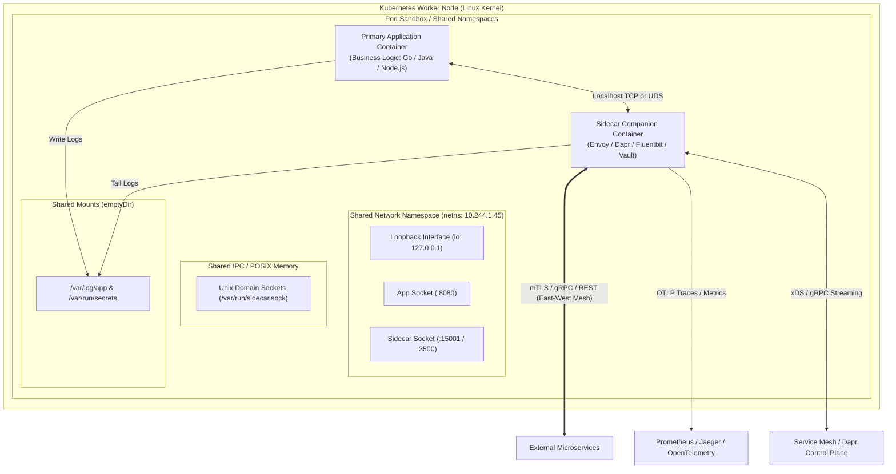
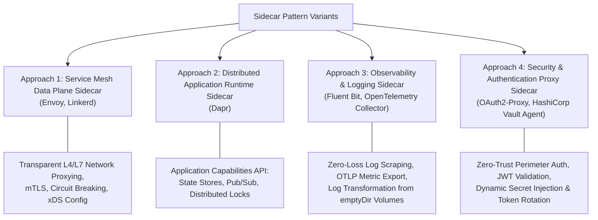
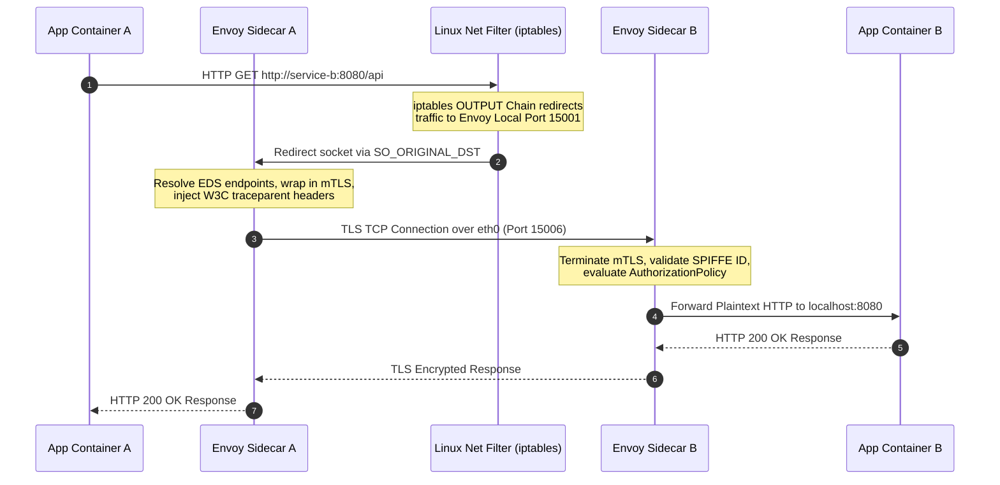
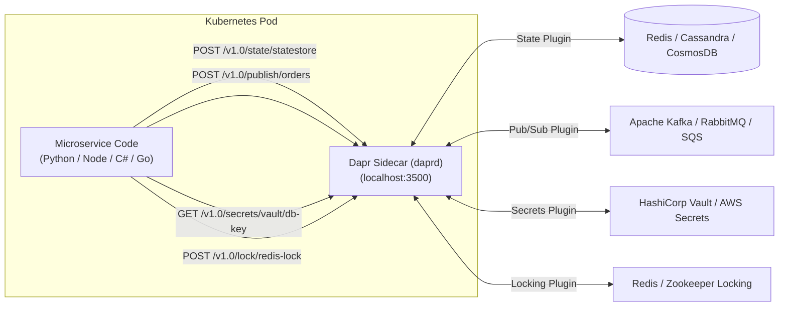
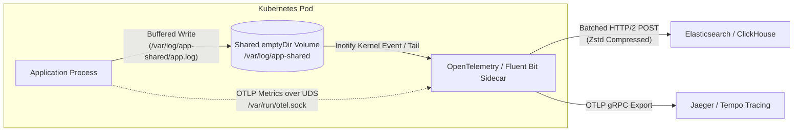
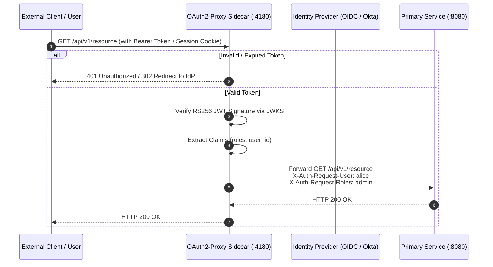
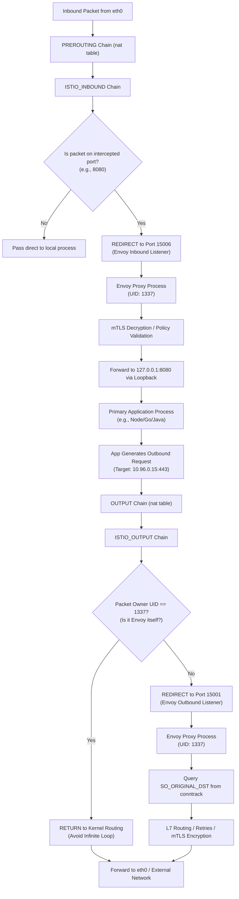
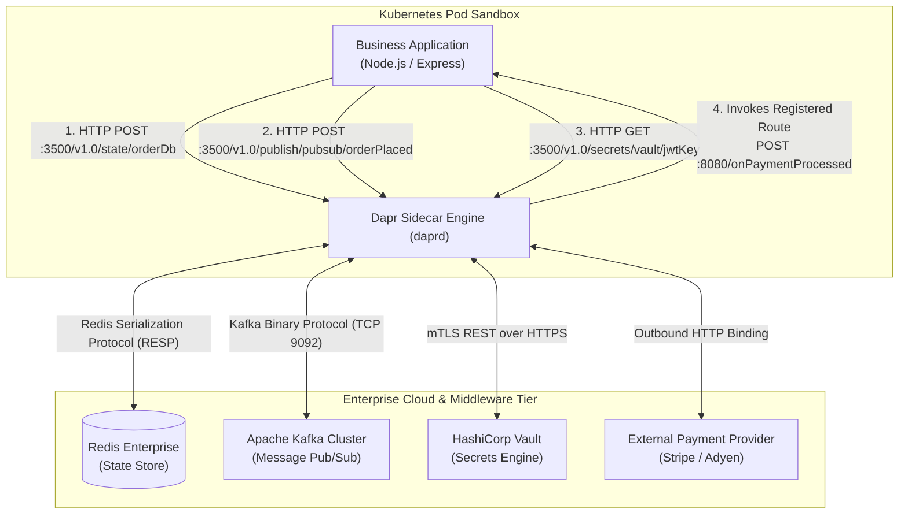
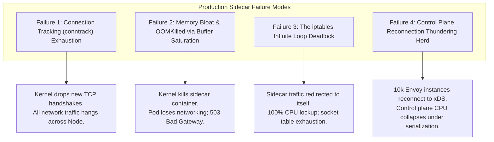
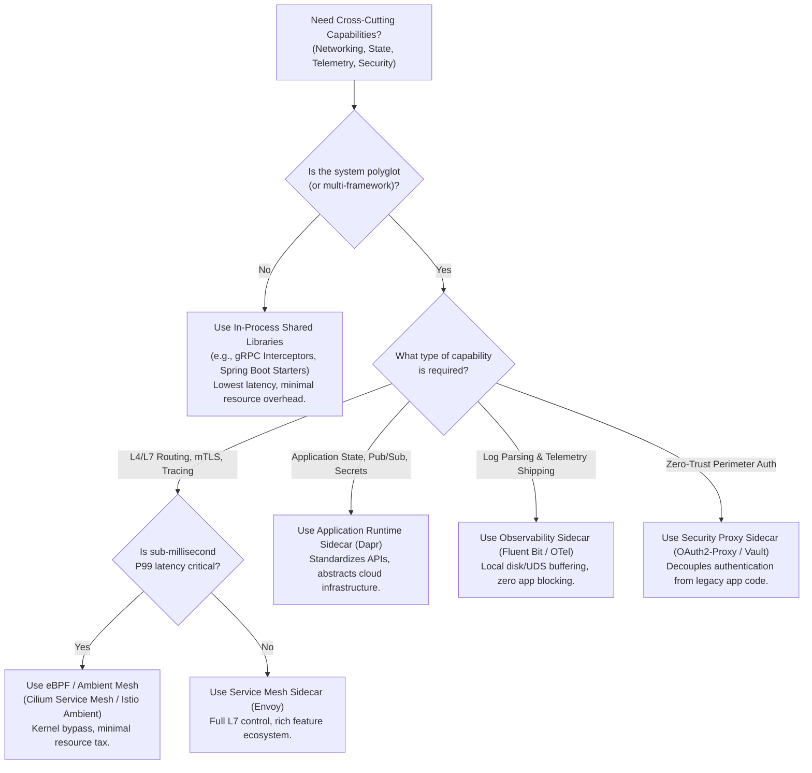

# Sidecar Pattern: Distributed Architecture, Implementation Mechanics, and Production Engineering

## 1. Pattern Overview and Core Architecture

The **Sidecar Pattern** is a foundational distributed systems design pattern in which an auxiliary, independent process or container is deployed alongside a primary application service. Originating from the physical analogy of a passenger motorcycle sidecar—which attaches to a primary vehicle without modifying its engine or frame—the sidecar container shares the identical lifecycle, execution context, network namespace, and storage volumes as the primary application container.



### 1.1 Intent and Foundational Rationale
In enterprise microservices, primary services should focus exclusively on distinct business domains (e.g., billing, catalog, order processing). However, real-world distributed architectures require extensive cross-cutting capabilities:
- **Mutual TLS (mTLS) Encryption and Dynamic Identity Attestation**
- **Dynamic Traffic Routing, Retries, Exponential Backoff, and Outlier Detection (Circuit Breaking)**
- **Distributed Context Propagation, OpenTelemetry Traces, Metrics, and Structured Logging**
- **Service Discovery, Dynamic Configuration Reloading, and Secret Decryption**
- **Distributed State Management, Pub/Sub Messaging Abstractions, and Distributed Locking**

Historically, engineering teams implemented these cross-cutting features via language-specific client libraries (e.g., Netflix Ribbon, Hystrix, Finagle, Spring Cloud). In polyglot environments containing services in Java, Go, Python, Rust, and Node.js, this library-driven approach results in severe technical debt:
1. **Divergent Implementation Semantics:** A retry policy or token-bucket rate limiter implemented in Go behaves subtly differently from one written in Java.
2. **Library Version Drift & Maintenance Churn:** Security vulnerabilities (e.g., OpenSSL or Jackson CVEs) require recompiling, testing, and redeploying hundreds of distinct application codebases.
3. **Language Lock-in:** Platform innovation is constrained because introducing a new language (e.g., Rust) requires porting entire platform SDKs.

The Sidecar pattern externalizes these infrastructure concerns out of process into a collocated binary.

### 1.2 Pod Architecture and Linux Namespace Isolation
In container orchestrators like Kubernetes, the atomic scheduling unit is the **Pod**. A Pod is not a single container, but a group of one or more Linux containers bound by shared kernel namespaces:

| Linux Namespace | Sidecar Sharing Model | Architectural Benefit & Mechanics |
| :--- | :--- | :--- |
| **Network (`CLONE_NEWNET`)** | **Shared** | All containers in the Pod share the same virtual network device (`eth0`), loopback interface (`lo`), IP address, and port space. The application communicates with the sidecar over `127.0.0.1` or intercepting routing tables. |
| **IPC (`CLONE_NEWIPC`)** | **Shared** | Shared System V IPC and POSIX message queues/shared memory allow ultra-low-latency inter-process communication without TCP overhead. |
| **Mount (`CLONE_NEWNS`)** | **Isolated by default, shared via Volumes** | File systems are isolated. However, Kubernetes `emptyDir` or `hostPath` volumes can be mounted into both containers, enabling the application to write data or UDS sockets that the sidecar consumes directly. |
| **PID (`CLONE_NEWPID`)** | **Isolated by default (Configurable)** | When `shareProcessNamespace: true` is configured in the Pod spec, containers can view and signal (`kill -HUP`) each other's process IDs, enabling sidecars to restart or inspect host processes. |
| **User (`CLONE_NEWUSER`)** | **Isolated or Shared** | Allows containers to run under different UIDs/GIDs (essential for iptables owner-matching traffic bypass). |

---

## 2. Architectural Approaches and Variants

The sidecar pattern manifests across four distinct enterprise variants, each designed for specific operational objectives:



---

### Approach 1: Service Mesh Data Plane Sidecar (Envoy / Linkerd)

#### Conceptual Mechanics
The Service Mesh Data Plane sidecar intercepts all inbound and outbound network traffic transparently. The primary application remains unaware that traffic is being routed through an intermediary. Outbound calls to `http://payment-service:8080/charge` are captured at the kernel level, inspected at Layer 7, augmented with distributed tracing headers (`traceparent`), encrypted into mutual TLS with short-lived X.509 certificates, and routed across the wire. Inbound calls are decrypted, authenticated against SPIFFE identities, subjected to authorization policies, and forwarded locally to the application port.

#### High-Level Design (HLD)
- **Control Plane:** Centralized systems (e.g., Istiod, Linkerd Control Plane) stream real-time endpoint topology, cryptographic keys, and routing rules to sidecars using dynamic gRPC streaming APIs (e.g., Envoy xDS: LDS, RDS, CDS, EDS).
- **Data Plane:** An Envoy proxy instance running alongside every microservice container inside the same network namespace.
- **Sidecar Injection:** A Kubernetes `MutatingAdmissionWebhook` intercepts Pod creation manifests, automatically injecting the sidecar container definition, volume mounts, and network initialization containers.



#### Low-Level Design (LLD): Traffic Interception Mechanics
Traffic interception occurs through one of two primary technologies: **iptables (Netfilter)** or **eBPF (Extended Berkeley Packet Filter)**.

##### 1. Netfilter / iptables Loopback Interception
An `initContainer` running with the `NET_ADMIN` Linux capability configures iptables rules inside the Pod's network namespace before the main application starts.

1. **Outbound Interception (`OUTPUT` chain):** 
   - All outgoing TCP packets generated by the application are routed into the custom `ISTIO_OUTPUT` chain.
   - To avoid an infinite loop where the sidecar proxy's own outgoing traffic is captured, iptables filters by process owner UID:
     ```bash
     iptables -t nat -A ISTIO_OUTPUT -m owner --uid-owner 1337 -j RETURN
     ```
   - Traffic destined for `127.0.0.1` is permitted if bypassed; otherwise, non-Envoy traffic is redirected to Envoy’s virtual outbound listener port `15001` via `REDIRECT`:
     ```bash
     iptables -t nat -A ISTIO_OUTPUT -p tcp -j REDIRECT --to-ports 15001
     ```
2. **Inbound Interception (`PREROUTING` chain):**
   - Packets arriving at the Pod’s `eth0` interface enter Netfilter’s `PREROUTING` chain.
   - Packets destined for application ports are diverted to the custom `ISTIO_INBOUND` chain and redirected to Envoy's inbound port `15006`:
     ```bash
     iptables -t nat -A ISTIO_INBOUND -p tcp -j REDIRECT --to-ports 15006
     ```
3. **Preserving Original Destination (`SO_ORIGINAL_DST`):**
   - When iptables redirects a packet using `REDIRECT`, it alters the destination IP to `127.0.0.1`.
   - The Linux kernel records the original destination address in the Netfilter connection tracking table (`conntrack`).
   - Envoy queries the socket API using `getsockopt(fd, SOL_IP, SO_ORIGINAL_DST, &orig_addr, &addr_len)` to extract the destination IP and port originally requested by the application.

##### 2. eBPF (Cilium / Ambient Mesh) Bypass
Instead of traversing the kernel's network stack and Netfilter tables twice (App -> TCP/IP -> iptables -> Envoy -> TCP/IP -> eth0), eBPF hooks into the socket layer (`sockops`):
- When an active socket connection is established over loopback, eBPF attaches `BPF_PROG_TYPE_SOCK_OPS` and `sk_msg` programs.
- Sockets are mapped into a kernel `BPF_MAP_TYPE_SOCKHASH`.
- When the application calls `write()` or `sendmsg()`, the eBPF program intercepts the memory buffer at the socket interface and directly redirects it to the inbound queue of the sidecar's socket buffer.
- This bypasses TCP sequence calculation, packet encapsulation, and iptables processing, eliminating 20–30% of sidecar latency overhead.

#### Production Kubernetes Manifest: App + Envoy Sidecar + InitContainer

```yaml
apiVersion: apps/v1
kind: Deployment
metadata:
  name: order-service
  namespace: production
  labels:
    app: order-service
spec:
  replicas: 3
  selector:
    matchLabels:
      app: order-service
  template:
    metadata:
      labels:
        app: order-service
      annotations:
        sidecar.istio.io/inject: "false" # Explicit manual demonstration
    spec:
      initContainers:
        - name: istio-init
          image: docker.io/istio/proxyv2:1.20.0
          securityContext:
            capabilities:
              add:
                - NET_ADMIN
                - NET_RAW
            runAsUser: 0
            runAsNonRoot: false
          command:
            - istio-iptables
            - "-p"
            - "15001" # Inbound/Outbound capture port
            - "-z"
            - "15006" # Inbound port
            - "-u"
            - "1337"  # Proxy UID to bypass
            - "-m"
            - "REDIRECT"
            - "-i"
            - "*"     # Intercept all inbound interfaces
            - "-b"
            - "8080"  # Application inbound port to redirect
            - "-d"
            - "15090,15021,15020" # Exclude metrics and health ports
      containers:
        # Primary Application Container
        - name: application
          image: registry.internal.net/apps/order-service:v2.4.1
          ports:
            - containerPort: 8080
              name: http-server
          resources:
            requests:
              cpu: "500m"
              memory: "512Mi"
            limits:
              cpu: "2000m"
              memory: "2Gi"
          env:
            - name: SERVER_PORT
              value: "8080"
          readinessProbe:
            httpGet:
              path: /healthz
              port: 8080
            initialDelaySeconds: 5
            periodSeconds: 10

        # Sidecar Data Plane Proxy Container
        - name: istio-proxy
          image: docker.io/istio/proxyv2:1.20.0
          securityContext:
            runAsUser: 1337
            runAsGroup: 1337
            runAsNonRoot: true
            readOnlyRootFilesystem: true
            allowPrivilegeEscalation: false
            capabilities:
              drop:
                - ALL
          ports:
            - containerPort: 15001
              name: envoy-outbound
            - containerPort: 15006
              name: envoy-inbound
            - containerPort: 15090
              name: envoy-prom
          resources:
            requests:
              cpu: "100m"
              memory: "128Mi"
            limits:
              cpu: "1000m"
              memory: "1Gi"
          lifecycle:
            preStop:
              exec:
                command:
                  - /usr/local/bin/pilot-agent
                  - request
                  - POST
                  - /drain_listeners?inboundonly
```

---

### Approach 2: Distributed Application Runtime Sidecar (Dapr)

#### Conceptual Mechanics
While a service mesh focuses on **networking infrastructure** (L4/L7 routing, mTLS, observability), the Distributed Application Runtime (Dapr) sidecar focuses on **application-level building blocks**. Dapr provides developers with a standard gRPC or HTTP API running on `localhost:3500` that decouples business logic from state management, pub/sub brokers, secret stores, and distributed locking.



#### Low-Level Design (LLD): Building Block Abstractions
1. **State Management & Concurrency Control:**
   - The application writes state via:
     `POST http://localhost:3500/v1.0/state/my-statestore`
     with JSON payload `[{"key": "order_4821", "value": {...}, "etag": "3"}]`.
   - Dapr implements Optimistic Concurrency Control (OCC) using ETags. If the underlying data store is Redis, Dapr translates this call into an atomic Redis Lua script verifying the ETag before updating the key.
2. **Pub/Sub Broker Abstraction:**
   - Outbound: `POST http://localhost:3500/v1.0/publish/order-pubsub/orders`
   - Inbound: Dapr subscribes to Kafka or RabbitMQ, handles consumer group partition balancing, deserializes CloudEvents, and invokes an HTTP callback on the app container: `POST http://localhost:8080/orders`.
3. **Resilience Policies:** Dapr sidecars execute circuit breaking, retries, and rate limiting directly against external infrastructure components without requiring SDK upgrades in the application.

#### Production Manifest: Dapr Sidecar Injection and Redis Component

```yaml
apiVersion: apps/v1
kind: Deployment
metadata:
  name: checkout-service
  namespace: e-commerce
spec:
  replicas: 2
  selector:
    matchLabels:
      app: checkout
  template:
    metadata:
      labels:
        app: checkout
      annotations:
        dapr.io/enabled: "true"
        dapr.io/app-id: "checkout"
        dapr.io/app-port: "8080"
        dapr.io/app-protocol: "http"
        dapr.io/dapr-http-port: "3500"
        dapr.io/dapr-grpc-port: "50001"
        dapr.io/sidecar-cpu-request: "100m"
        dapr.io/sidecar-memory-request: "128Mi"
        dapr.io/sidecar-cpu-limit: "500m"
        dapr.io/sidecar-memory-limit: "512Mi"
    spec:
      containers:
        - name: checkout
          image: registry.internal.net/apps/checkout:v1.1.0
          ports:
            - containerPort: 8080
---
apiVersion: dapr.io/v1alpha1
kind: Component
metadata:
  name: statestore
  namespace: e-commerce
spec:
  type: state.redis
  version: v1
  metadata:
    - name: redisHost
      value: "redis-cluster.database.svc.cluster.local:6379"
    - name: redisPassword
      secretKeyRef:
        name: redis-secret
        key: redis-password
    - name: enableTLS
      value: "true"
    - name: actorStateStore
      value: "true"
```

---

### Approach 3: Observability & Logging Sidecar (Fluent Bit / OpenTelemetry Collector)

#### Conceptual Mechanics
In high-throughput microservices, emitting logs to `stdout`/`stderr` causes the container engine (Docker/containerd) to write logs to disk via host-level json files, creating disk I/O bottlenecks and potential logging drops. The Observability Sidecar approach relies on a shared memory buffer or a shared `emptyDir` POSIX filesystem volume. 

The application writes high-density JSON logs directly into a designated local file or Unix Domain Socket. The sidecar tails the socket or file, buffers logs in memory, filters or masks sensitive fields (PII/credit card info), compresses the payloads using zstandard/gzip, and asynchronously ships batches to centralized storage (Elasticsearch, OpenSearch, ClickHouse).



#### Low-Level Design (LLD): Shared Volume File Descriptors and Memory Leaks
- **Inotify & Epoll Tailing:** Fluent Bit utilizes the Linux `inotify` API to receive kernel events whenever the application flushes bytes to the log file.
- **Log Rotation Handshakes:** When the application rotates logs (e.g., renaming `app.log` to `app.log.1`), the sidecar maintains the open file descriptor (`open()`) until the remaining bytes are consumed, preventing lost log entries during file truncation.
- **Backpressure and Disk Throttling:** If the centralized log cluster suffers degraded latency, the sidecar enforces an in-memory ring-buffer limit (e.g., `Mem_Buf_Limit 50MB`). Once exceeded, Fluent Bit halts tailing or leverages local disk buffering (`storage.type filesystem`), preventing container memory crashes (`OOMKilled`).

---

### Approach 4: Security & Authentication Proxy Sidecar (OAuth2-Proxy / HashiCorp Vault Agent)

#### Conceptual Mechanics
Security proxies offload authentication and credential management completely. 
- **OAuth2 Proxy:** Serves as a reverse proxy in front of an unauthenticated microservice. It intercepts all incoming requests, initiates OpenID Connect (OIDC) authorization flows with Identity Providers (Okta, Keycloak, Auth0), verifies JWT signatures, checks RBAC claims, and forwards only authenticated requests to the main app container with injected identity headers (e.g., `X-User-Email: user@company.com`).
- **Vault Agent Sidecar:** Authenticates to HashiCorp Vault via Kubernetes Service Account tokens, dynamically requests short-lived database credentials, renders them into a shared volume `/etc/secrets/database.env`, and triggers an application reload when secrets expire.



---

## 3. Low-Level Mechanics and Kernel Internals

### 3.1 iptables Packet Interception and Redirection Pipeline

The standard service mesh sidecar (e.g., Envoy in Istio) relies on Netfilter packet filtering. The diagram below illustrates the exact route a network packet takes through the Linux kernel chains:



### 3.2 Inter-Container Communication: Localhost TCP vs Unix Domain Sockets (UDS)

When designing sidecars for extreme high-throughput (50,000+ RPS per Pod), the communication medium between the application and the sidecar introduces substantial performance implications:

```
+-----------------------------------------------------------------------------------+
| 1. Localhost TCP (127.0.0.1)                                                      |
|                                                                                   |
|  App Socket ---> [TCP/IP Stack] ---> [Loopback Device] ---> [TCP/IP Stack]        |
|                       |                                          |                |
|                  Checksums, TCP ACKs, Flow Control Window        v                |
|                                                            Sidecar Socket         |
+-----------------------------------------------------------------------------------+
| 2. Unix Domain Sockets (UDS - Stream / Datagram)                                  |
|                                                                                   |
|  App Socket ---------------> [Kernel VFS / Socket Buffer] --------> Sidecar Socket |
|                       (Zero TCP Packet Headers, Direct Memory Copy)               |
+-----------------------------------------------------------------------------------+
```

#### Detailed Benchmark Comparison: Localhost TCP vs UDS

| Metric | Localhost TCP (`127.0.0.1`) | Unix Domain Socket (UDS) | Architectural Implication |
| :--- | :--- | :--- | :--- |
| **P99 Latency (1KB payload)** | ~120 µs | ~65 µs | UDS cuts intra-pod latency by **~45%** by skipping IP/TCP header serialization. |
| **Throughput (Single Core)** | ~35,000 msgs/sec | ~68,000 msgs/sec | UDS achieves nearly **2x** throughput due to reduced CPU context switching. |
| **Kernel Stack Traversal** | Full TCP/IP, Loopback driver, Netfilter hooks | VFS layer, Direct socket buffer (`sk_buff`) copy | TCP incurs checksum calculation, TCP sliding window, and ACK overhead. |
| **Port Exhaustion Risk** | High (`TIME_WAIT` sockets can exhaust ephemeral port range) | Non-existent (Represented as file descriptors on filesystem) | UDS eliminates `EADDRNOTAVAIL` and ephemeral port allocation limits. |
| **Access Control (Security)** | Port-based; open to any process in the network namespace | Linux POSIX file permissions (`chmod 0660`, UID/GID) | UDS enables strict OS-level authorization between containers. |

---

### 3.3 Sidecar Lifecycle Management: Kubernetes 1.28+ Native Sidecars

#### The Legacy Dilemma (Pre-Kubernetes 1.28)
Historically, Kubernetes treated all containers in a Pod's `spec.containers` list equally and started them in parallel. This caused severe, intermittent production outages:
1. **Startup Race Condition:** The primary application initialized, made an immediate database migration or external service call, and failed because the network proxy sidecar was still initializing.
2. **Termination Race Condition:** During a rolling update, the Kubelet sent `SIGTERM` concurrently to all containers. The sidecar proxy terminated first, causing all in-flight requests from the application to abruptly abort with `Connection refused` (502 / 503).
3. **Batch Job / CronJob Hangs:** Kubernetes Pods remain in a `Running` state until *all* containers terminate. In a batch job, the main worker container would finish its task and exit (code 0), but the sidecar proxy ran indefinitely, wasting cluster resources and preventing job completion.

#### The Modern Solution: Native Sidecar Containers (KEP-753)
Starting in Kubernetes 1.28 (and GA in 1.29+), Kubernetes introduced native sidecar support by enhancing the `initContainers` specification with `restartPolicy: Always`.

```mermaid
sequenceDiagram
    autonumber
    participant Kubelet
    participant InitC as Regular Init Container
    participant SidecarC as Native Sidecar (initContainer restartPolicy: Always)
    participant AppC as Primary Application Container

    Note over Kubelet,SidecarC: Pod Initialization Phase
    Kubelet->>InitC: Start regular initContainer
    InitC-->>Kubelet: Complete execution (exit 0)
    
    Kubelet->>SidecarC: Start Native Sidecar Container
    loop Startup Probe Evaluation
        Kubelet->>SidecarC: Execute Startup Probe (e.g., HTTP GET :15021/healthz/ready)
        SidecarC-->>Kubelet: 200 OK (Sidecar Ready)
    end
    
    Note over Kubelet,AppC: Application Startup Phase
    Kubelet->>AppC: Start Application Container (Guaranteed: Sidecar is fully ready)
    
    Note over AppC,SidecarC: Pod Execution Phase (Sidecar runs continuously)
    AppC<-->SidecarC: Steady-state bidirectional communication
    
    Note over Kubelet,AppC: Pod Termination Phase
    Kubelet->>AppC: Send SIGTERM to Application Container
    AppC->>AppC: Complete in-flight requests (Graceful Shutdown)
    AppC-->>Kubelet: Process exits (exit 0)
    
    Note over Kubelet,SidecarC: Sidecar Shutdown Phase
    Kubelet->>SidecarC: Send SIGTERM to Sidecar (Only after App exits!)
    SidecarC-->>Kubelet: Process exits (exit 0)
```

#### Production Kubernetes Manifest: Native Sidecar Specification

```yaml
apiVersion: apps/v1
kind: Deployment
metadata:
  name: billing-worker
  namespace: finance
spec:
  replicas: 1
  selector:
    matchLabels:
      app: billing-worker
  template:
    metadata:
      labels:
        app: billing-worker
    spec:
      initContainers:
        # 1. Standard one-shot init container
        - name: schema-migrator
          image: registry.internal.net/db/migrator:v1.0
          command: ["/bin/migrate", "-up"]

        # 2. Kubernetes Native Sidecar Container
        - name: vault-agent-sidecar
          image: hashicorp/vault:1.15.2
          restartPolicy: Always # <--- Marks this as a Native Sidecar!
          command: ["vault", "agent", "-config=/etc/vault/vault-agent-config.hcl"]
          volumeMounts:
            - name: vault-config
              mountPath: /etc/vault
            - name: shared-secrets
              mountPath: /vault/secrets
          startupProbe:
            httpGet:
              path: /v1/sys/health
              port: 8200
            failureThreshold: 30
            periodSeconds: 2
          resources:
            requests:
              cpu: "50m"
              memory: "64Mi"
            limits:
              cpu: "200m"
              memory: "256Mi"

      containers:
        # Primary Application Container
        - name: billing-app
          image: registry.internal.net/apps/billing:v3.2.0
          volumeMounts:
            - name: shared-secrets
              mountPath: /vault/secrets
          resources:
            requests:
              cpu: "500m"
              memory: "512Mi"
      volumes:
        - name: vault-config
          configMap:
            name: vault-agent-config
        - name: shared-secrets
          emptyDir:
            medium: Memory # Store secrets exclusively in RAM (tmpfs)
```

---

### 3.4 Resource Overhead Calculation and Capacity Planning

Operating a sidecar fleet across thousands of microservice instances requires rigorous mathematical modeling of CPU and memory footprints.

#### Memory Sizing Formula
The total memory allocated to an Envoy sidecar proxy is governed by:

$$\text{Memory}_{\text{Envoy}} = \text{BaseMemory} + (\text{ActiveConns} \times \text{BufferPerConn}) + \text{RoutingConfigFootprint}$$

Where:
- $\text{BaseMemory}$: The baseline resident set size (RSS) of the compiled proxy binary and runtime libraries (typically **35 MB to 50 MB**).
- $\text{ActiveConns}$: Number of concurrent downstream (inbound) and upstream (outbound) TCP connections.
- $\text{BufferPerConn}$: Configured Envoy socket buffer limits (`max_request_headers_kb` + `per_connection_buffer_limit_bytes`). By default, Envoy allocates up to **1 MB per connection**, but tuned production systems reduce this to **32 KB - 64 KB**.
- $\text{RoutingConfigFootprint}$: The size of the dynamic xDS configuration cache (endpoints, routes, clusters). In an untuned cluster with 1,000 services and 10,000 endpoints, an unfiltered xDS cache can consume **150 MB to 300 MB** per sidecar. By utilizing Istio `Sidecar` resources to restrict discovery scoping to only direct dependencies, this drops to **< 15 MB**.

#### Example Sizing Calculation:
For a service processing 5,000 requests/sec with 500 concurrent connections and a scoped dependency tree:
- $\text{BaseMemory} = 40\text{ MB}$
- $\text{Connection Buffers} = 500 \times 64\text{ KB} = 32\text{ MB}$
- $\text{Scoped xDS Config} = 12\text{ MB}$
- **Total Required Memory Allocation:** $\approx 84\text{ MB}$ (Safe Limit: $256\text{ MB}$).

#### CPU Sizing Principles:
- Envoy utilizes an asynchronous, non-blocking event-driven loop (`epoll` on Linux) backed by worker threads.
- **Worker Thread Rule:** Pinned to the number of allocated virtual CPU cores. If a Pod is granted `cpu: "2"`, Envoy should be configured with `--concurrency 2`. Setting concurrency higher than allocated CPU causes extreme context-switching thrashing in the Linux kernel scheduler (`cfs_quota`).
- **Cryptographic Cost:** AES-GCM mTLS encryption adds approximately **0.15 to 0.40 milliseconds** of CPU compute per request for 4KB payloads on modern CPUs with AES-NI instructions.

---

## 4. Architectural Deep-Dive: Dapr Multi-Building-Block Flow

To illustrate the breadth of the sidecar pattern beyond networking, the following diagram details how an application utilizes a Dapr sidecar to interact with heterogeneous cloud backends without embedding a single vendor-specific SDK:



---

## 5. Real-World Failure Modes, Edge Cases, and Resiliency Engineering

Deploying tens of thousands of sidecars introduces subtle distributed failure modes that can cascade across entire clusters if not systematically mitigated.



### 5.1 Failure Mode 1: `conntrack` Table Exhaustion on Host Nodes
- **Mechanism:** In iptables-based interception, every intercepted TCP connection generates an entry in the kernel's Netfilter connection tracking table (`nf_conntrack`). A single HTTP request passing through a sidecar creates multiple connection states (Client -> Envoy, Envoy -> Server). Under heavy microservice traffic with short-lived connections (no keep-alive), the host's `nf_conntrack_max` table saturates.
- **Symptom:** Kernel log alerts: `nf_conntrack: table full, dropping packet`. All incoming network traffic to the entire worker node is dropped silently, impacting *all* Pods on that physical host.
- **Mitigation:**
  1. Increase host limits via sysctl:
     ```sysctl
     net.netfilter.nf_conntrack_max = 1048576
     net.netfilter.nf_conntrack_tcp_timeout_established = 600
     ```
  2. Enforce strict HTTP/2 and HTTP/3 persistent connection pooling between sidecars to prevent TCP handoff churn.
  3. Migrate to eBPF-based socket redirection (e.g., Cilium), which completely bypasses Netfilter `conntrack`.

### 5.2 Failure Mode 2: Memory Exhaustion (OOMKilled) via Buffer Saturation
- **Mechanism:** If an upstream service responds slowly, a high-throughput downstream client continues pushing request data. The sidecar proxy buffers data in user-space memory waiting to flush to the upstream socket. If `per_connection_buffer_limit_bytes` is left unconstrained or set too high, the sidecar hits its Kubernetes memory limit and is terminated with Linux Exit Code 137 (`OOMKilled`).
- **Symptom:** Pod restarts repeatedly; intermittent `503 Service Unavailable` or `504 Gateway Timeout` errors.
- **Mitigation:**
  1. Explicitly configure buffer limits in Envoy:
     ```yaml
     per_connection_buffer_limit_bytes: 32768 # 32 KB per socket
     ```
  2. Enable HTTP/2 Flow Control (`initial_stream_window_size: 65535` and `initial_connection_window_size: 1048576`), which exerts backpressure on the client when internal buffers fill.

### 5.3 Failure Mode 3: The iptables Loopback Interception Deadlock
- **Mechanism:** If the iptables redirection rule fails to properly exclude the sidecar’s own user ID (`-m owner --uid-owner 1337 -j RETURN`), outbound packets emitted by the sidecar are re-routed back to its own inbound interception listener.
- **Symptom:** The proxy consumes 100% CPU on all worker threads; file descriptor tables exhaust rapidly; logs are filled with recursive loop connections until the Pod becomes unresponsive.
- **Mitigation:**
  - Automated CI validation of iptables rules.
  - Dedicated non-root user enforcement (`runAsUser: 1337`) on the proxy container.

### 5.4 Failure Mode 4: Thundering Herd during Control Plane Reconnection
- **Mechanism:** In large deployments (e.g., 5,000 Pods), if the central control plane (Istiod / Dapr Sentry) undergoes a rolling restart, all 5,000 sidecar proxies lose their gRPC xDS connections simultaneously. When the control plane returns, all 5,000 proxies immediately initiate TLS handshakes and request full cluster configuration snapshots concurrently.
- **Symptom:** Control plane CPU spikes to 100%; memory explodes under protobuf serialization; sidecars fail to receive routing updates, leaving the data plane frozen in a stale state.
- **Mitigation:**
  - Implement Full Jitter Exponential Backoff in the sidecar reconnection client:
    
    $$T_{\text{backoff}} = \min(T_{\text{max}}, T_{\text{base}} \times 2^{\text{attempt}}) \times \text{random}(0.5, 1.5)$$
  
  - Deploy control plane instances with horizontal auto-scaling and gRPC rate-limiting interceptors.

---

## 6. Comprehensive Comparison Matrix: Architectural Topologies

Selecting the correct pattern for cross-cutting infrastructure capabilities requires evaluating trade-offs across five competing architectural paradigms:

| Architectural Metric | In-Process Library (e.g., Spring Cloud, Finagle) | Sidecar Pattern (Envoy, Dapr) | Node Agent / DaemonSet (e.g., Datadog, Node Envoy) | Centralized API Gateway (Kong, Apigee) | eBPF Kernel Mesh (Cilium Service Mesh) |
| :--- | :--- | :--- | :--- | :--- | :--- |
| **Deployment Unit** | Embedded JAR / Binary | Collocated Container in Pod | 1 Container per Kubernetes Node | Dedicated Ingress Cluster | Kernel BPF Programs per Node |
| **P99 Latency Overhead** | **Negligible** (< 0.05 ms) | **Low** (0.5 – 2.0 ms per hop) | **Low** (0.2 – 0.8 ms) | **Moderate** (2.0 – 8.0 ms) | **Ultra-Low** (< 0.1 ms) |
| **CPU / Memory Overhead** | **Lowest** (Shared with JVM/app) | **Highest** (Multiplied by thousands of Pods) | **Low** (Constant per Node) | **Low** (Concentrated on gateway) | **Extremely Low** (Direct kernel memory) |
| **Polyglot Independence** | **Zero** (Must rewrite SDK for every language) | **Absolute** (Agnostic to app language) | **Absolute** (Agnostic to app language) | **Absolute** (Edge layer) | **Absolute** (Kernel layer) |
| **Blast Radius** | **Application-level** (Thread starvation affects only app) | **Pod-level** (Sidecar crash impacts only that Pod) | **Node-level** (Agent failure breaks all Pods on Node) | **Cluster-level** (Gateway failure drops all ingress) | **Host Kernel** (BPF panics can crash the OS) |
| **L7 Protocol Inspection** | Full / Deep | Full / Deep (HTTP/1/2/3, gRPC, Redis, Kafka) | Limited to Node ports | Full / Edge-focused | Moderate (Basic HTTP; complex L7 requires Envoy) |
| **Lifecycle Coupling** | Tied to App Build | Tied to Pod Lifecycle (starts/stops with app) | Decoupled from Pod Lifecycle | Completely Decoupled | Completely Decoupled |
| **Upgrade Velocity** | **Slowest** (Requires full microservice rebuilds) | **Fast** (Rolling Pod restarts) | **Fastest** (Rolling DaemonSet upgrade) | **Fastest** (Centralized deployment) | **Fastest** (Kernel BPF map updates) |

---

## 7. Real-World Case Studies and Industry Implementations

### 7.1 Lyft and the Genesis of Envoy Proxy
- **Context:** Around 2015, Lyft transitioned from a monolithic PHP application to a polyglot microservices architecture utilizing Python, Go, and PHP.
- **The Challenge:** As the service graph expanded to hundreds of services, networking anomalies, intermittent 500 errors, and uneven request distribution caused widespread outages. Developers were spending weeks porting Twitter's Finagle architecture from Scala into Python and Go.
- **The Solution:** Matt Klein and the Lyft infrastructure team authored **Envoy** and pioneered the sidecar architecture. Every microservice at Lyft was injected with an Envoy sidecar.
- **Architectural Impact:**
  - Standardized metrics (P95/P99 latency, status codes) were instantly available across every service without writing code.
  - Automatic distributed tracing header propagation (`x-request-id`, `x-b3-traceid`) made systemic call graphs visible.
  - Implemented client-side load balancing with outlier detection (ejection of failing upstream endpoints), increasing Lyft’s overall 99.99% availability goals.

### 7.2 Netflix Prana: The Pre-Kubernetes Sidecar Pattern
- **Context:** In 2014, Netflix had built a world-class microservice infrastructure (Eureka for service discovery, Ribbon for IPC load balancing, Hystrix for circuit breaking, Archaius for dynamic configuration). However, these SDKs were strictly built for the Java Virtual Machine (JVM).
- **The Challenge:** Teams building non-JVM services (Node.js for web rendering, Python for machine learning, C++ for media encoding) were cut off from the Netflix platform ecosystem.
- **The Solution:** Netflix developed **Prana**, a sidecar process written in Java that ran on the same Amazon EC2 instance alongside non-JVM applications.
- **Architectural Mechanics:**
  - The non-JVM app communicated with Prana via simple HTTP on `localhost:8078`.
  - To register with Eureka: Prana announced itself and heartbeat-monitored the non-JVM process.
  - To invoke another service: The Node.js app requested `http://localhost:8078/proxy?service=recommendations&path=/getRecs`. Prana invoked Ribbon to balance the request and wrapped it in a Hystrix circuit breaker.
  - *Legacy:* Prana validated the sidecar pattern long before Kubernetes formalized the concept of Pods.

### 7.3 Dapr in Global Financial Microservices
- **Context:** A global financial institution needed to run microservices across hybrid cloud environments (AWS, Azure, and on-premises OpenShift).
- **The Challenge:** Different cloud environments mandated different backing services: AWS used Amazon SQS and DynamoDB; Azure used Azure Service Bus and Cosmos DB; on-prem used Kafka and PostgreSQL. Writing cloud-specific SDK bindings meant maintaining three separate codebases per microservice.
- **The Solution:** The enterprise standardized on the Dapr sidecar runtime.
- **Architectural Impact:**
  - Developers wrote to the generic Dapr State and Pub/Sub APIs (`http://localhost:3500`).
  - Infrastructure operators swapped environment-specific YAML configuration manifests without changing a single line of microservice application code.
  - Migrated legacy workloads between cloud providers in hours rather than months.

---

## 8. System Design Interview Mastery: Deep-Dive Questions & Answers

### Q1: How does an iptables-based sidecar intercept outbound traffic without intercepting its own traffic?
**Answer:**
If an iptables rule blindly matches all outgoing TCP packets and redirects them to the sidecar’s listening port (e.g., 15001), any packet generated by the sidecar proxy itself destined for an external service would also be redirected back into port 15001, resulting in an immediate infinite loop and system crash.

To break this loop, the network setup (via `initContainers` or CNI plugins) relies on **Linux Netfilter UID/GID matching**:
1. The sidecar proxy process is strictly configured to execute under a dedicated non-root User ID (conventionally UID `1337` in Istio).
2. In the `nat` table’s `OUTPUT` chain, an iptables rule checks the owner of the socket generating the packet:
   ```bash
   iptables -t nat -A ISTIO_OUTPUT -m owner --uid-owner 1337 -j RETURN
   ```
3. The `-j RETURN` target halts traversal of the `ISTIO_OUTPUT` interception chain for any packet emitted by UID `1337`, dropping it back into standard kernel routing, which emits the packet across the physical interface (`eth0`).
4. Packets originating from any other UID (i.e., the application container running as UID 1000 or root) fall through to the subsequent rule, which redirects them to the proxy port:
   ```bash
   iptables -t nat -A ISTIO_OUTPUT -p tcp -j REDIRECT --to-ports 15001
   ```

---

### Q2: Compare Unix Domain Sockets (UDS) vs TCP Localhost for app-to-sidecar communication in high-throughput systems. What are the trade-offs?
**Answer:**
- **TCP Localhost (`127.0.0.1`):**
  - *Mechanism:* Traverses the entire TCP/IP network stack inside the kernel. Packets undergo TCP segmentation, sequence number assignment, checksum calculations, ACKs, and loopback driver processing.
  - *Overhead:* High CPU context switching; risk of ephemeral port exhaustion under extreme connection creation rates; subject to `TIME_WAIT` socket cleanup latency.
  - *Advantage:* Universally supported by every programming language and framework without custom socket configuration.
- **Unix Domain Sockets (UDS):**
  - *Mechanism:* Operates as a stream or datagram FIFO pipe directly within the Linux Virtual File System (VFS). Data written to a UDS is copied directly between the sender's and receiver's kernel socket buffers (`sk_buff`) without TCP framing, checksums, or routing tables.
  - *Overhead:* Extremely low CPU cost; **~40-50% lower P99 latency**; zero possibility of port exhaustion.
  - *Trade-offs:* Requires sharing a common filesystem volume (e.g., Kubernetes `emptyDir`) between containers; application code must support connecting to Unix socket paths (e.g., `unix:///var/run/sidecar.sock`); file permission/ownership (`chmod`/`chown`) management is required during container startup.

---

### Q3: How do you solve container startup and shutdown race conditions in Kubernetes pre-1.28 versus modern Kubernetes?
**Answer:**
- **Pre-Kubernetes 1.28 (Workarounds):**
  - *Startup Race:* The application starts before the sidecar is initialized, causing immediate network failures.
    - *Fix:* Use an in-app healthcheck polling loop or inject an init-wrapper script into the app container that polls the sidecar's health endpoint (`curl --silent --fail http://localhost:15021/healthz/ready`) before launching the primary binary.
  - *Shutdown Race:* The sidecar shuts down before the application finishes completing in-flight requests.
    - *Fix:* Configure a `preStop` hook on the sidecar proxy that executes a sleep or an active connection drain API call:
      ```yaml
      lifecycle:
        preStop:
          exec:
            command: ["/bin/sh", "-c", "sleep 15"]
      ```
      This forces Kubelet to delay sending `SIGTERM` to the sidecar, keeping the network data plane alive while the application terminates.
- **Modern Kubernetes (1.28+ Native Sidecars):**
  - Define the sidecar inside `spec.initContainers` with `restartPolicy: Always`.
  - *Startup:* Kubelet starts the native sidecar and blocks the initialization of subsequent containers until the sidecar's `startupProbe` succeeds. The app container is guaranteed to launch only when the sidecar is fully operational.
  - *Shutdown:* During Pod termination, Kubelet reverses the lifecycle sequence: primary containers receive `SIGTERM` first and terminate gracefully. The native sidecar container remains alive throughout the termination grace period and receives `SIGTERM` only after all main application containers have completely exited.

---

### Q4: What is the CPU and memory cost of deploying 1,000 microservice instances with sidecars, and when should you migrate to a DaemonSet or Ambient Mesh?
**Answer:**
- **Resource Footprint Calculation:**
  - Assume a typical unoptimized Envoy sidecar consuming **128 MB RAM** and reserving **0.1 vCPU**.
  - Across 1,000 Pods:
    - **Memory:** $1,000 \times 128\text{ MB} = 128\text{ GB}$ of RAM dedicated purely to proxies.
    - **CPU:** $1,000 \times 0.1\text{ vCPU} = 100\text{ vCPU cores}$ reserved.
  - In clusters with micro-services that only consume 64 MB of RAM for business logic, the sidecar footprint introduces a **200% infrastructure overhead tax**.
- **When to Migrate to Node-Level Agents (DaemonSet) or Ambient Mesh (Istio Ambient / Cilium):**
  1. *High Density of Small Microservices:* When cluster compute costs are dominated by proxy overhead rather than application workloads.
  2. *Frequent Application Restarts:* Where sidecar startup latency (1–3 seconds) violates cold-start SLAs (e.g., Serverless / Knative).
  3. *Ambient Mesh Transition:* Migrating to a dual-tier model where L4 mutual TLS is handled by a single shared per-node Rust/C-based proxy (e.g., Istio `ztunnel`), and L7 capabilities (header routing, retries) are selectively deployed as independent "waypoint proxies" only for services that specifically require them.

---

### Q5: How does eBPF replace or augment the Sidecar pattern in modern Service Meshes?
**Answer:**
eBPF (Extended Berkeley Packet Filter) changes the relationship between the Linux kernel and user-space network proxies in two primary ways:

1. **Acceleration (Sidecar Optimization):**
   - Instead of replacing the sidecar, eBPF replaces iptables. Using `sockops` and `sk_msg` programs, eBPF intercepts the socket creation events of the application and the local sidecar proxy.
   - It directly interconnects the TCP sockets at the kernel socket buffer layer.
   - Packets skip the entire loopback device network stack, Netfilter connection tracking, and IP routing tables, reducing sidecar latency by up to 30%.
2. **Replacement (Sidecarless Mesh / Ambient Architecture):**
   - eBPF running in the kernel (e.g., Cilium Service Mesh) can natively perform Layer 3 and Layer 4 operations: service discovery, connection routing, packet encryption (via IPsec or WireGuard), and L4 metric generation without any sidecar container existing inside the Pod.
   - *Limitation:* Deep Layer 7 operations (Wasm plugins, complex regex HTTP header mutations, advanced payload transformations) are extremely difficult or impossible to execute safely inside the kernel's eBPF verifier limits. Therefore, modern architectures use eBPF for L4 networking and route L7 traffic to an external, out-of-process waypoint proxy.

---

### Q6: How do you handle configuration drift and zero-downtime reconfiguration across a fleet of 10,000 sidecar proxies?
**Answer:**
- **Dynamic Streaming APIs (Envoy xDS Protocol):**
  - Sidecars must never rely on static configuration files or require container restarts to pick up new routing rules or certificates.
  - Envoy establishes a persistent bidirectional gRPC stream to the control plane using the **Aggregated Discovery Service (ADS)**.
- **State Machine Synchronization:**
  - The control plane pushes delta updates (e.g., `DeltaDiscoveryRequest`/`DeltaDiscoveryResponse`) containing only the specific IP endpoints or virtual routes that changed, rather than resending the entire cluster topology.
  - Updates follow a strict dependency sequence:
    1. **CDS (Cluster Discovery):** Establish new upstream cluster definitions.
    2. **EDS (Endpoint Discovery):** Populate backend IP endpoints.
    3. **LDS (Listener Discovery):** Configure ports and TLS certificates.
    4. **RDS (Route Discovery):** Atomically switch traffic routing to the new clusters.
- **Zero-Downtime Hot Restarts:** If the proxy binary itself must be upgraded without dropping TCP connections, modern proxies utilize shared memory and socket passing:
  - The new proxy process starts up alongside the old process.
  - The old process passes its active listening file descriptors to the new process over a Unix Domain Socket using `SCM_RIGHTS`.
  - The new process begins accepting new incoming handshakes; the old process stops accepting new connections, drains existing in-flight connections over a grace period, and cleanly exits.

---

### Q7: How does a security sidecar implement zero-trust mTLS without modifying legacy application code?
**Answer:**
1. **Identity Provisioning (SPIFFE/SPIRE):**
   - Each Pod is associated with a Kubernetes `ServiceAccount`.
   - A node-level or sidecar security agent verifies the Pod's identity using the Kubernetes token review API and issues a **SPIFFE ID** (e.g., `spiffe://cluster.local/ns/prod/sa/order-service-sa`).
   - The agent mints an X.509 certificate containing this SPIFFE ID in the Subject Alternative Name (SAN) and mounts it into the sidecar proxy memory space.
2. **Transparent Outbound Handshake:**
   - The legacy application emits an unencrypted HTTP request to `http://catalog-service:8080/items`.
   - The outbound iptables rule intercepts the packet and routes it to the local sidecar.
   - The sidecar pauses the connection, initiates a TLS 1.3 handshake with the remote catalog service's sidecar, presents its local X.509 client certificate, and verifies the remote certificate against the cluster's trusted Root CA.
3. **Inbound Enforcement & Cryptographic Cleansing:**
   - The remote sidecar accepts the TLS handshake, validates the client certificate, extracts the caller's SPIFFE identity, and checks authorization policies (e.g., "Is `order-service-sa` allowed to perform `GET` on `/items`?").
   - If permitted, the sidecar decrypts the payload and delivers plaintext HTTP over `localhost` to the legacy application container. The application receives zero-trust encryption without altering a single line of business logic.

---

### Q8: Design a failure-resilient telemetry sidecar that guarantees application requests are never blocked even during telemetry backpressure.
**Answer:**
```
+---------------------------------------------------------------------------------+
| Application Container                                                           |
|                                                                                 |
|  [Business Logic] ---> Non-Blocking Write ---> [In-Memory Ring Buffer / UDS]    |
|                             |                                                   |
|                        If Buffer Full?                                          |
|                             |                                                   |
|                     (Drop Metric / Increment Local Counter)                     |
+---------------------------------------------------------------------------------+
                                       |
                                       v
+---------------------------------------------------------------------------------+
| Telemetry Sidecar (OpenTelemetry / Fluent Bit)                                  |
|                                                                                 |
|  [Consumer Worker] <--- Drain Events                                            |
|          |                                                                      |
|          v                                                                      |
|  [Internal Queue] ---> [Batch & Zstd Compress] ---> Flush to Central Collector   |
|          |                                                    |                 |
|     If Saturation?                                     Backpressure / Timeout   |
|          v                                                    |                 |
|  [Spill to Local tmpfs Disk]                            Retries with Jitter     |
+---------------------------------------------------------------------------------+
```

- **Architectural Mechanics:**
  1. **Non-Blocking IPC Transport:** The application must never emit telemetry synchronously over network boundaries. It writes metrics/traces to a shared POSIX ring buffer or UDP/UDS socket. If the socket buffer is saturated, the client library **drops the telemetry record immediately** rather than blocking the application execution thread.
  2. **Circuit Breaker on Internal Queue:** The telemetry sidecar maintains an in-memory queue with an upper bound (e.g., 64 MB). 
  3. **Multi-Stage Spooling:** When the centralized telemetry pipeline experiences degraded performance, the sidecar temporarily diverts incoming records to a local `tmpfs` disk volume.
  4. **Strict Isolation of Blast Radius:** Resource limits (`cgroups`) ensure that even if the telemetry sidecar reaches 100% CPU utilization processing backlogged logs, the Linux Completely Fair Scheduler (CFS) restricts it from starving the primary application container of its guaranteed compute shares.

---

## 9. Summary & Architectural Decision Guide



The Sidecar Pattern remains the premier architectural mechanism for decoupling infrastructure capabilities from application business logic in large-scale, polyglot distributed systems. When applied with a rigorous understanding of Linux kernel mechanics, namespace boundaries, and resource overhead, it enables platform teams to operate secure, observable, and resilient microservice fleets at cloud scale.
