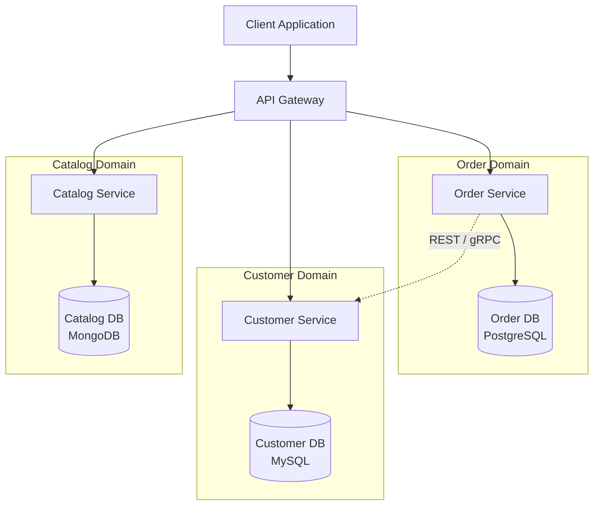

# Database Per Service Pattern

## 1. Pattern Overview and Intent

The **Database Per Service** pattern is a core principle of microservices architecture that dictates each microservice should own its own database or data store. In a monolithic architecture, a single, shared database is typically used by all application components. While this makes querying and transactions simpler, it creates tight coupling between different domains.

The intent of the Database Per Service pattern is to:
- **Ensure Loose Coupling:** Services can be developed, deployed, and scaled independently without worrying about schema changes impacting other services.
- **Enable Polyglot Persistence:** Different services have different data storage requirements (e.g., a product catalog might use a NoSQL document store, while a financial transaction service uses a relational SQL database). This pattern allows teams to choose the best database technology for their specific use case.
- **Improve Fault Isolation:** If one database goes down, it only affects the service that owns it, rather than bringing down the entire system.

By mandating that services can only access each other's data through well-defined APIs, this pattern enforces encapsulation and boundary isolation.

---

## 2. Detailed Explanation of How It Works

In this pattern, the database is considered a private implementation detail of the microservice. Other services are explicitly prohibited from connecting directly to the database of another service.

### Polyglot Persistence
Polyglot persistence is the practice of using different data storage technologies within a single application or system to meet specific needs.
- **Relational Databases (PostgreSQL, MySQL):** Good for structured data with strict ACID transaction requirements (e.g., Billing, Orders).
- **Document Databases (MongoDB, Couchbase):** Good for unstructured or semi-structured data, high read/write throughput (e.g., Product Catalog, Content Management).
- **Key-Value Stores (Redis, DynamoDB):** Good for caching, session management, and simple lookups.
- **Graph Databases (Neo4j):** Good for highly connected data (e.g., Social Networks, Recommendation Engines).

### Architecture Diagram



### Dealing with Cross-Service Data Access
Since direct database access is not allowed, services must communicate to gather required data.
1. **Synchronous APIs:** Service A calls Service B via REST or gRPC to get the necessary data.
2. **Asynchronous Events:** Service B publishes events when its data changes, and Service A subscribes to these events to maintain a local, read-optimized replica (CQRS approach).

---

## 3. Real-World Example: E-Commerce System

Consider an E-Commerce system with `Order`, `Customer`, and `Inventory` services.

### Code Snippet (Pseudocode)

**Order Service (Java / Spring Boot):**
```java
@RestController
@RequestMapping("/orders")
public class OrderController {
    
    private final OrderRepository orderRepository; // Local DB access
    private final CustomerServiceClient customerClient; // HTTP Client to Customer Service
    
    @PostMapping
    public ResponseEntity<Order> createOrder(@RequestBody CreateOrderRequest request) {
        // 1. Validate customer via API call (Cross-service query)
        CustomerInfo customer = customerClient.getCustomer(request.getCustomerId());
        if (!customer.isActive()) {
            throw new InvalidCustomerException();
        }
        
        // 2. Save order to local DB
        Order order = new Order(request);
        orderRepository.save(order);
        
        return ResponseEntity.ok(order);
    }
}
```

In this example, the `OrderService` does not query the `customers` table directly. It uses an HTTP client to ask the `CustomerService` for customer details.

---

## 4. Detailed Pros and Cons

### Pros
- **Decoupling & Autonomy:** Teams can alter schemas, upgrade database versions, or migrate to a new database engine without coordinating with other teams.
- **Scalability:** Databases can be scaled independently based on the specific load of their associated service.
- **Polyglot Persistence:** Optimal data storage technologies can be selected per domain.
- **Fault Isolation:** A failure in one service's database doesn't cause a systemic outage.

### Cons
- **Complexity in Queries:** Distributed joins are required to gather data spanning multiple services. You can no longer write a simple `SELECT ... JOIN` query.
- **Complexity in Transactions:** Implementing transactions across multiple services requires patterns like the **Saga Pattern**, which is complex to design and debug.
- **Data Duplication:** To optimize reads and avoid constant API calls, data is often duplicated across services (using CQRS and Event Sourcing), leading to eventual consistency and storage overhead.
- **Operational Overhead:** Managing, backing up, and monitoring multiple different database instances and technologies requires a sophisticated DevOps capability.

---

## 5. When to Use / When NOT to Use

### When to Use:
- When migrating from a monolith to microservices and aiming for true decoupling.
- When different services have drastically different scale, throughput, or data structure requirements (necessitating polyglot persistence).
- In large organizations where different teams need complete autonomy over their domain.

### When NOT to Use:
- In small, simple applications where the overhead of distributed data management outweighs the benefits.
- If your system relies heavily on complex ACID transactions spanning the entire data model.
- If the organization lacks the DevOps maturity to manage dozens of different database instances.

---

## 6. Common Interview Questions

1. **How do you perform joins in a Database per Service architecture?**
   - *Answer:* Joins are typically performed in memory by an API Composition layer or API Gateway, which calls the underlying services and aggregates the results. Alternatively, the CQRS pattern can be used to maintain a read-optimized, materialized view of the joined data in a separate data store.

2. **How do you handle distributed transactions across multiple services?**
   - *Answer:* Distributed transactions are typically handled using the Saga pattern. A Saga is a sequence of local transactions. Each local transaction updates the database and publishes a message or event to trigger the next local transaction in the saga. If a local transaction fails, the saga executes a series of compensating transactions that undo the changes made by the preceding local transactions.

3. **What is Polyglot Persistence and why is it useful?**
   - *Answer:* It's the use of multiple data storage technologies within a system. It's useful because different domains have different needs; a search service might need Elasticsearch, while a financial ledger needs a relational DB. The Database per Service pattern naturally enables this.

4. **How do you maintain data consistency in this pattern?**
   - *Answer:* Consistency is typically maintained through Eventual Consistency. Services publish domain events when data changes, and other services subscribe to these events to update their own local databases or caches.

5. **What happens if one of the databases in your polyglot setup goes down?**
   - *Answer:* Only the specific service relying on that database is directly impacted. If designed well, other services should degrade gracefully or continue to function using cached data or asynchronous communication (e.g., using an outbox pattern to queue messages until the database is back up).
