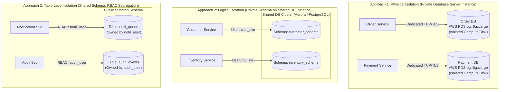
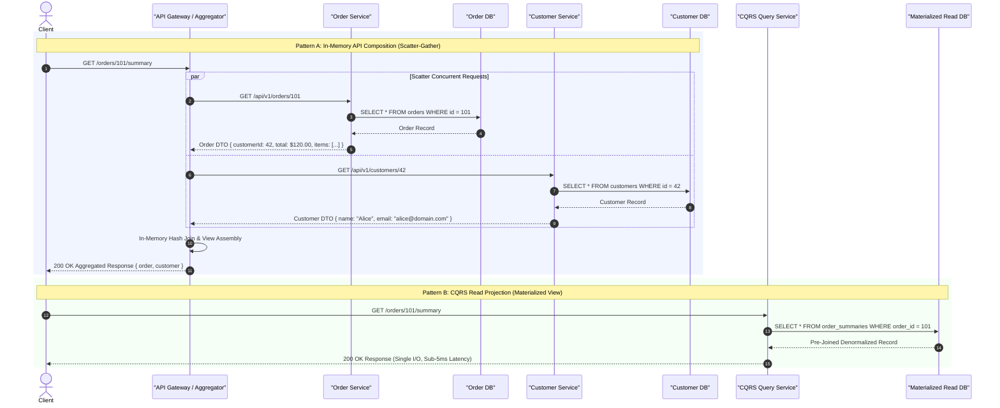
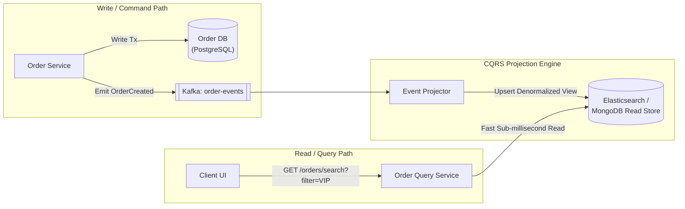
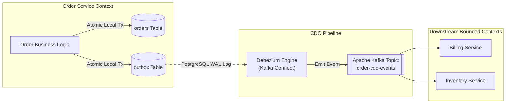
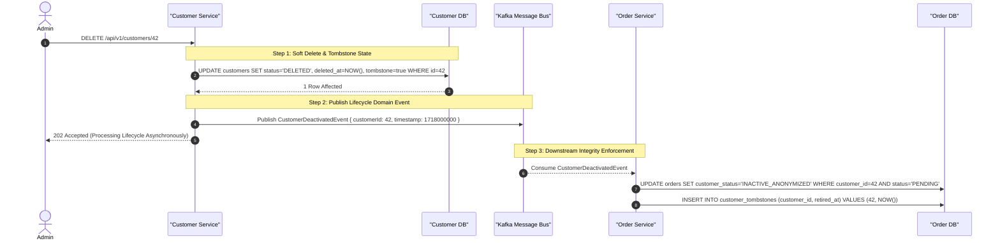
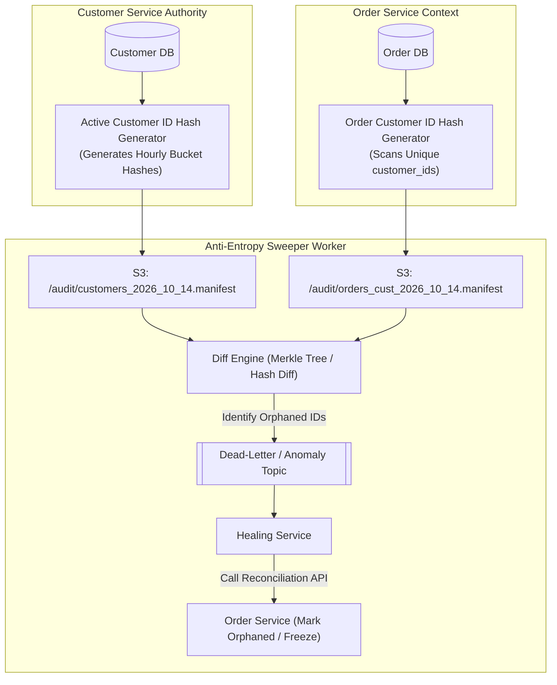
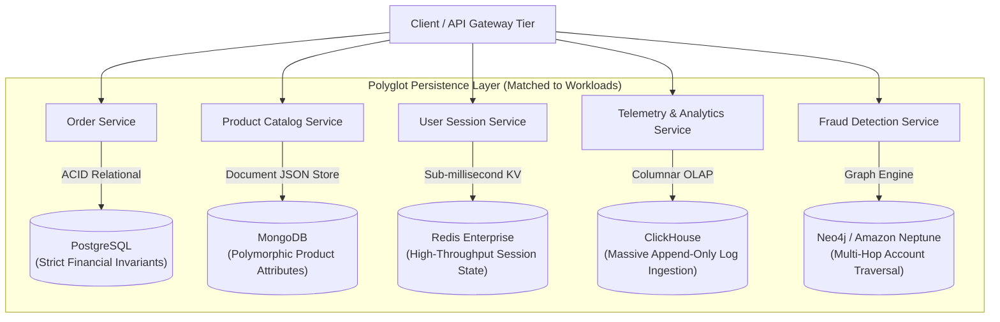
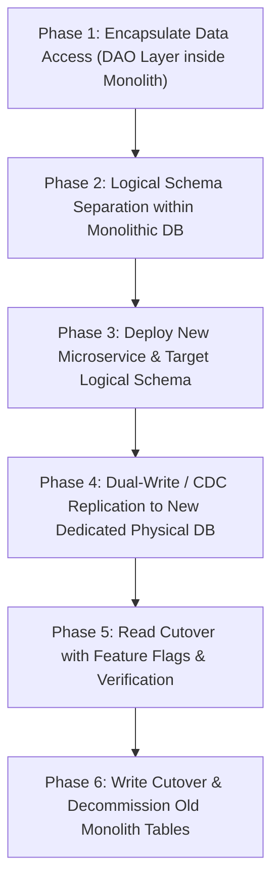

# Database-Per-Service Pattern: Production-Grade Architectural Guide

## 1. Pattern Overview & Architectural Intent

The **Database-Per-Service** pattern is the foundational data management architecture for distributed microservices. It mandates that **each microservice strictly encapsulates and owns its persistent data storage**, treating its database as a private implementation detail. No external component, service, or client is permitted to bypass the service boundary to query, mutate, or inspect the underlying database directly.

```
       [ Client Request Layer ]
                  │
                  ▼
         [ API Gateway Tier ]
         ├─── HTTP / gRPC ───┐
         │                   │
         ▼                   ▼
┌──────────────────┐┌──────────────────┐
│  Order Service   ││ Customer Service │
│ (Bounded Context)││ (Bounded Context)│
└────────┬─────────┘└────────┬─────────┘
         │ Private           │ Private
         │ Connection        │ Connection
         ▼                   ▼
┌──────────────────┐┌──────────────────┐
│ Order Data Store ││Customer DataStore│
│ (PostgreSQL ACID)││  (MongoDB / KV)  │
└──────────────────┘└──────────────────┘
```

### The Core Architectural Tenets
1. **Zero Direct Cross-Database Access:** Services communicate exclusively through explicit, documented public contracts (synchronous REST/gRPC APIs or asynchronous event streams). Direct database links, cross-schema foreign keys, and distributed shared memory are strictly forbidden.
2. **Encapsulation & Information Hiding:** The physical schema, table structures, index strategies, and storage engine choices are encapsulated entirely inside the microservice's domain boundary. Changes to schemas do not cause cascading compilation or runtime failures across organizational teams.
3. **Decoupled Lifecycle & Autonomous Deployability:** Engineering teams operating on a specific service retain end-to-end sovereignty to evolve schemas, apply migrations, tune database configurations, and refactor data models without cross-team synchronization meetings or locked release trains.
4. **Failure Domain Isolation:** A catastrophic database event—such as table lock exhaustion, unindexed runaway queries, connection pool saturation, or disk corruption—is isolated to a single microservice, preventing cascading cluster-wide outages.
5. **Polyglot Persistence Alignment:** Data storage engines are selected based on workload access patterns (e.g., relational ACID for financial ledgers, document stores for sparse catalogs, key-value stores for low-latency session caching, graph databases for fraud rings) rather than forcing an entire enterprise onto a single generic relational engine.

---

## 2. Domain-Driven Design (DDD) Foundations & The Shared Database Antipattern

### Bounded Contexts & Aggregate Roots
In Domain-Driven Design (DDD), a complex enterprise domain is decomposed into smaller, autonomous **Bounded Contexts**. A Bounded Context sets linguistic and structural boundaries within which a domain model applies consistently.

Inside a Bounded Context, entities and value objects are grouped into **Aggregates**, governed by an **Aggregate Root**:
* **Aggregate Root Invariance:** All external access to an aggregate must flow through the Aggregate Root entity, which is responsible for enforcing transactional integrity and business invariants.
* **Storage Boundary Congruence:** The Database-Per-Service pattern maps physical persistence directly to these DDD Bounded Contexts. An aggregate's state is persisted exclusively inside its context's private datastore.

```
┌─────────────────────────────────────────────────────────────┐
│ Order Bounded Context                                       │
│                                                             │
│  ┌───────────────────────────────────────────────────────┐  │
│  │ Order Aggregate Root                                  │  │
│  │  - OrderId: UUID                                      │  │
│  │  - OrderStatus: PENDING | CONFIRMED | SHIPPED         │  │
│  │  - LineItems: List<OrderLineItem> (Entity)            │  │
│  │  - DeliveryAddress: Address (Value Object)            │  │
│  │                                                       │  │
│  │  [Business Invariant: TotalPrice == Sum(Items) + Tax] │  │
│  └───────────────────────────┬───────────────────────────┘  │
│                              │                              │
│                              ▼                              │
│                 [ Order Service Repository ]                │
│                              │                              │
│                              ▼                              │
│              [ Private Database: orders_db ]                │
└─────────────────────────────────────────────────────────────┘
```

### The Shared Database Antipattern (Integration Database)
The legacy architectural alternative—the **Shared Database (Integration Database)** pattern—allows multiple applications or services to read and write directly to a centralized database instance. While superficially convenient, it creates severe systemic liabilities:

```
[Service A: Orders]      [Service B: Billing]      [Service C: Shipping]
        │                        │                         │
        └───────────────┬────────┴─────────────────────────┘
                        ▼
         ┌───────────────────────────────┐
         │    Shared Monolithic DB       │
         │  - Table: orders              │
         │  - Table: order_payments      │
         │  - Table: shipments           │
         │  (Shared Locks, Shared Pool)  │
         └───────────────────────────────┘
  * Single Point of Failure (SPOF)
  * Hidden Schema Coupling (Breaking DDL Cascades)
  * Distributed Lock Contention & Noisy Neighbors
```

#### Why the Shared Database Breaks Microservices
1. **Invisible Architectural Coupling:** When Service A and Service B query the same `orders` table, the table becomes a de facto public contract. Renaming a column or splitting a table requires coordinating deployments between independent teams, annihilating release velocity.
2. **Cascading Lock Contention:** A long-running analytical query executed by Service C can acquire shared locks or exhaust I/O bandwidth on the shared database, starving low-latency transactional writes executed by Service A.
3. **Impediment to Polyglot Optimization:** A relational engine forced to store time-series telemetry, social graph connections, and transactional ledger entries satisfies none of these workloads optimally.
4. **Dual-Write Vulnerabilities & Bypassed Domain Logic:** When Service B updates rows directly in Service A's tables, it completely bypasses the business rules, validations, and audit logs compiled into Service A's codebase.

---

## 3. Architectural Taxonomy: The Three Isolation Approaches

Organizations implementing Database-Per-Service choose between three distinct isolation models along a spectrum of operational cost, isolation strength, and complexity:



---

### 3.1 Approach 1: Private Database Server Instance Per Service (Physical Isolation)

In this approach, each microservice connects to an entirely independent, dedicated physical or virtual database server instance (e.g., an independent AWS RDS instance, Azure SQL Managed Instance, or self-hosted database cluster).

```
┌─────────────────────────────────┐       ┌─────────────────────────────────┐
│       Order Microservice        │       │      Customer Microservice      │
│  - Kubernetes Pod Replica Set   │       │  - Kubernetes Pod Replica Set   │
└────────────────┬────────────────┘       └────────────────┬────────────────┘
                 │ Dedicated VPC Link                      │ Dedicated VPC Link
                 ▼                                         ▼
┌─────────────────────────────────┐       ┌─────────────────────────────────┐
│ Dedicated DB Cluster: orders-db │       │ Dedicated DB Cluster: cust-db   │
│ - Engine: PostgreSQL 16         │       │ - Engine: MongoDB Enterprise    │
│ - Compute: 8 vCPU, 32GB RAM     │       │ - Compute: 4 vCPU, 16GB RAM     │
│ - Storage: Provisioned IOPS     │       │ - Storage: NVMe SSD             │
│ - Independent Backups / KMS Key │       │ - Independent Backups / KMS Key │
└─────────────────────────────────┘       └─────────────────────────────────┘
```

#### High-Level Design (HLD)
* **Compute & Storage Separation:** Each database instance has dedicated CPU, RAM, disk I/O channels, and network bandwidth. No physical resources are shared.
* **Failover Domains:** Primary/Replica failover events, read replicas, and maintenance windows are managed completely independently. If the `orders-db` cluster initiates an automated multi-AZ failover, the `cust-db` cluster experiences zero disruption.
* **Security & Network Perimeter:** Databases reside in private subnets with service-specific Security Groups and Network Access Control Lists (NACLs). Authentication uses separate IAM database credentials or unique mutual TLS (mTLS) certificates.
* **Backup & Disaster Recovery:** RPO (Recovery Point Objective) and RTO (Recovery Time Objective) are customized per service:
  - Financial Ledger / Order DB: Continuous point-in-time recovery (PITR) with 5-minute RPO, cross-region replication.
  - Notification DB / Recommendation Cache: Daily snapshot with 24-hour RPO, local-zone backup.

#### Low-Level Design (LLD)
* **Connection Pool Sizing:** Each service provisions connection pools (e.g., HikariCP, pgBouncer) tuned strictly to its own dedicated compute capabilities:
  $$\text{Pool Size} = 2 \times \text{CPU Cores} + \text{Disk Spindle / SSD Concurrency Factor}$$
  Because compute is dedicated, pool exhaustion in Service A cannot exhaust connections or file descriptors in Service B.
* **Autonomous DDL Migrations:** CI/CD deployment pipelines execute migration scripts (Flyway, Liquibase, Atlas) directly against the dedicated instance without acquiring locks on any other service's data.

#### Trade-Off Analysis
* **Advantages:** Absolute blast-radius containment; true polyglot persistence; zero resource contention; isolated regulatory compliance (e.g., PCI-DSS database in an encrypted enclave).
* **Disadvantages:** Highest financial cost (idle CPU/RAM overhead across dozens of underutilized DB instances); highest administrative maintenance overhead (patching, scaling, monitoring 50+ database instances).

---

### 3.2 Approach 2: Private Schema Per Service on Shared Database Instance (Logical Isolation)

In this approach, multiple microservices share a single physical database server or managed cluster, but each service is granted exclusive ownership over a dedicated **database schema** (or distinct database catalog inside the same engine instance, e.g., PostgreSQL schemas or MySQL databases).

```
┌────────────────────────────────────────────────────────┐
│        Shared Database Cluster (PostgreSQL)            │
│                 [ 16 vCPU, 64GB RAM ]                  │
│                                                        │
│  ┌───────────────────────────┐┌─────────────────────┐  │
│  │ Schema: order_schema      ││Schema: cust_schema  │  │
│  │ - Tables: orders, items   ││- Tables: customers  │  │
│  │ - Owner: order_service_usr││- Owner: cust_svc_usr│  │
│  │ - REVOKE ALL FROM PUBLIC  ││- REVOKE ALL PUBLIC  │  │
│  └─────────────▲─────────────┘└──────────▲──────────┘  │
└────────────────┼─────────────────────────┼─────────────┘
                 │                         │
     [order_service_usr creds]  [cust_svc_usr creds]
                 │                         │
┌────────────────┴─────────────┐┌──────────┴──────────┐
│        Order Service         ││   Customer Service  │
└──────────────────────────────┘└─────────────────────┘
```

#### High-Level Design (HLD)
* **Logical Boundaries via Schemas:** Services connect to distinct logical namespaces within the database engine.
* **Access Control Enforcement:** Database roles and permissions are configured so that `order_service_usr` has full privileges on `order_schema.*`, but is explicitly denied access (`REVOKE ALL`) to `cust_schema.*`.
* **Cost Consolidation:** A single high-spec multi-AZ database cluster replaces dozens of micro-instances, dramatically reducing idle infrastructure expenditures.

#### Low-Level Design (LLD)
* **PostgreSQL Schema Isolation Configuration:**
  ```sql
  -- Step 1: Create dedicated schemas
  CREATE SCHEMA order_schema;
  CREATE SCHEMA customer_schema;

  -- Step 2: Create isolated application roles
  CREATE ROLE order_service_user WITH LOGIN PASSWORD 'SecureOrderPass123!';
  CREATE ROLE customer_service_user WITH LOGIN PASSWORD 'SecureCustPass456!';

  -- Step 3: Enforce strict zero-trust boundary
  REVOKE ALL ON SCHEMA public FROM PUBLIC;
  REVOKE ALL ON SCHEMA order_schema FROM PUBLIC;
  REVOKE ALL ON SCHEMA customer_schema FROM PUBLIC;

  -- Step 4: Grant exclusive ownership
  GRANT ALL ON SCHEMA order_schema TO order_service_user;
  GRANT ALL ON ALL TABLES IN SCHEMA order_schema TO order_service_user;
  ALTER DEFAULT PRIVILEGES IN SCHEMA order_schema 
      GRANT ALL ON TABLES TO order_service_user;

  GRANT ALL ON SCHEMA customer_schema TO customer_service_user;
  GRANT ALL ON ALL TABLES IN SCHEMA customer_schema TO customer_service_user;
  ALTER DEFAULT PRIVILEGES IN SCHEMA customer_schema 
      GRANT ALL ON TABLES TO customer_service_user;

  -- Step 5: Prevent cross-schema querying
  REVOKE ALL ON SCHEMA customer_schema FROM order_service_user;
  REVOKE ALL ON SCHEMA order_schema FROM customer_service_user;
  ```
* **Connection Pool Starvation Hazard:** The shared database engine imposes a global `max_connections` limit (e.g., 2,000 connections). If Service A scales out horizontally from 10 to 100 pods and exhausts the available slots, Service B will be unable to establish connections, causing a cascading brownout.
* **Mitigation (pgBouncer Tenant Pools):** Deploy a connection pooler configured with dedicated, capped client pools per role/database:
  ```ini
  [databases]
  order_db = host=127.0.0.1 port=5432 dbname=production user=order_service_user pool_size=50 reserve_pool=5
  customer_db = host=127.0.0.1 port=5432 dbname=production user=customer_service_user pool_size=50 reserve_pool=5
  ```

#### Trade-Off Analysis
* **Advantages:** High cost-efficiency; centralized backup and restore pipelines; lower DevOps complexity; smooth transition path during monolith decomposition.
* **Disadvantages:** Shared blast radius (memory leaks, lock exhaustion, CPU saturation impact all services); forces homogenous database technology across services (no polyglot persistence).

---

### 3.3 Approach 3: Private Tables Per Service with Role-Based Access Control (Table-Level Isolation)

In this approach, services share both the database instance and the same schema namespace. Boundaries are maintained through **naming conventions** (e.g., `ord_orders`, `ord_items` vs `cst_customers`) and **granular table-level Role-Based Access Control (RBAC)**.

```
┌────────────────────────────────────────────────────────┐
│       Shared Database Engine & Shared Public Schema     │
│                                                        │
│  ┌─────────────────────────┐  ┌─────────────────────┐  │
│  │ Table: ord_orders       │  │ Table: cst_profiles │  │
│  │ Table: ord_order_items  │  │ Table: cst_wallets  │  │
│  │ (Owned by: ord_role)    │  │ (Owned by: cst_role)│  │
│  └────────────▲────────────┘  └──────────▲──────────┘  │
└───────────────┼──────────────────────────┼─────────────┘
                │                          │
        GRANT ord_role             GRANT cst_role
                │                          │
┌───────────────┴────────────┐  ┌──────────┴──────────┐
│       Order Service        │  │   Customer Service  │
└────────────────────────────┘  └─────────────────────┘
```

#### High-Level Design (HLD)
* **Transitional Stepping Stone:** Primarily utilized as a temporary, transitional phase during the decomposition of an existing relational monolith into microservices, prior to physical or schema extraction.
* **Strict RBAC Enforcement:** Each service authenticates with credentials limited strictly to its prefixed tables. Accidental cross-table SQL joins are blocked by the database engine parser.

#### Low-Level Design (LLD)
* **RBAC & Table Security Script:**
  ```sql
  -- Create isolated service roles
  CREATE ROLE ord_service_role LOGIN PASSWORD 'OrderSecret!';
  CREATE ROLE cst_service_role LOGIN PASSWORD 'CustomerSecret!';

  -- Grant access only to explicitly owned tables
  GRANT SELECT, INSERT, UPDATE, DELETE ON ord_orders, ord_order_items TO ord_service_role;
  GRANT SELECT, INSERT, UPDATE, DELETE ON cst_profiles, cst_wallets TO cst_service_role;

  -- Ensure no global public access
  REVOKE ALL ON ALL TABLES IN SCHEMA public FROM PUBLIC;
  ```
* **PostgreSQL Row-Level Security (RLS) for Multi-Tenant Partitioning:**
  ```sql
  ALTER TABLE ord_orders ENABLE ROW LEVEL SECURITY;
  
  CREATE POLICY service_tenant_isolation_policy ON ord_orders
      FOR ALL
      TO ord_service_role
      USING (service_context = 'ORDER_SERVICE')
      WITH CHECK (service_context = 'ORDER_SERVICE');
  ```

#### Trade-Off Analysis
* **Advantages:** Minimal upfront operational changes; zero data migration overhead when decomposing monolithic code.
* **Disadvantages:** Highly fragile; human error in table permissions can compromise boundaries; extreme risk of accidental locks on metadata catalogs; noisy-neighbor lock contention.

---

## 4. Comprehensive Architectural Comparison Matrix

| Architectural Dimension | Approach 1: Physical Isolation (Private DB Instance) | Approach 2: Logical Isolation (Private Schema) | Approach 3: Table-Level Isolation (RBAC Tables) |
| :--- | :--- | :--- | :--- |
| **Isolation Strength** | **Absolute (Physical)**. Separate CPU, RAM, Disk, Network. | **Moderate (Logical)**. Shared hardware, isolated namespace. | **Low (Permission-based)**. Shared hardware & namespace. |
| **Failure Blast Radius** | **Minimal**. An outage in one database affects zero other services. | **High**. CPU/IOPS saturation or crashes impact all schemas. | **Severe**. Shared locks, catalog contention affect entire system. |
| **Polyglot Persistence** | **Full Support**. Match any workload to SQL, NoSQL, Graph, or KV. | **Zero Support**. Locked into single database engine family. | **Zero Support**. Locked into single database engine family. |
| **Operational Overhead** | **High**. Multi-instance patching, monitoring, alerting, scaling. | **Moderate**. Single cluster management, multiple schemas. | **Low**. Single cluster, single database administration. |
| **Infrastructure Cost** | **High**. Significant baseline compute/RAM reservation per DB. | **Low**. Resource sharing optimizes compute consolidation. | **Minimal**. Zero duplicated hardware or licensing costs. |
| **Schema Evolution Autonomy**| **Complete**. Autonomous migrations via Flyway/Liquibase per service. | **High**. Independent schema DDL, but shared catalog locks. | **Low**. DDL on shared schema risks deadlocking adjacent tables. |
| **Connection Management** | **Independent**. Isolated connection pools per service. | **Contention Risk**. Global connection limits can starve peers. | **Severe Contention**. Shared pool limits require proxy tuning. |
| **Disaster Recovery (DR)** | **Tailored RPO/RTO**. Individual PITR, backup schedules, retention. | **Coupled**. Point-in-time recovery restores all schemas at once. | **Coupled**. Granular single-table recovery requires complex tooling. |
| **Regulatory Compliance** | **Optimal**. Specific instances can meet PCI-DSS, HIPAA, or GDPR. | **Challenging**. Hard to prove physical cryptographic separation. | **Unacceptable** for strict compliance isolation standards. |
| **Recommended Use Case** | Large-scale microservices, mature DevOps, polyglot needs. | Medium-scale microservices, budget constraints, homogenous SQL. | Monolith decomposition stepping stone; brownfield transitions. |

---

## 5. Cross-Service Data Retrieval & Query Strategies

When databases are separated, traditional relational SQL `JOIN` statements across service boundaries become impossible. Architects rely on three core patterns for cross-service queries:



---

### 5.1 API Composition (Scatter-Gather Aggregation)

In **API Composition**, an API Composer (often an API Gateway, Backend-For-Frontend [BFF], or dedicated Aggregator Service) queries multiple downstream microservices concurrently via HTTP or gRPC, receives their individual responses, and joins the data in memory.

#### Implementation Mechanics: In-Memory Hash Join
When joining datasets (e.g., a list of 50 `Orders` with corresponding `Customer` details), naive nested loop joining yields $O(N \times M)$ complexity. High-performance aggregators execute an **In-Memory Hash Join**:
1. Fetch parent records: Fetch the page of `Orders` ($N$ records).
2. Extract distinct join keys: Collect all unique `customer_id` values.
3. Batch query downstream: Issue a single batch request: `GET /api/v1/customers?ids=1,2,3...`
4. Build hash table: Populate an in-memory hash map of `Map<CustomerId, CustomerDTO>` ($O(M)$ time).
5. Probe & enrich: Iterate through `Orders` and probe the map in $O(1)$ time to merge attributes ($O(N)$ total join complexity).

#### Production Go Code: Concurrent In-Memory Hash Join Aggregator

```go
package main

import (
	"context"
	"encoding/json"
	"errors"
	"fmt"
	"net/http"
	"sync"
	"time"
)

type OrderItem struct {
	SKU      string  `json:"sku"`
	Quantity int     `json:"quantity"`
	Price    float64 `json:"price"`
}

type OrderDTO struct {
	ID         string      `json:"id"`
	CustomerID string      `json:"customerId"`
	Total      float64     `json:"total"`
	Status     string      `json:"status"`
	Items      []OrderItem `json:"items"`
}

type CustomerDTO struct {
	ID    string `json:"id"`
	Name  string `json:"name"`
	Email string `json:"email"`
	Tier  string `json:"tier"`
}

type EnrichedOrderResponse struct {
	Order    OrderDTO    `json:"order"`
	Customer CustomerDTO `json:"customer"`
}

type AggregatorService struct {
	httpClient        *http.Client
	orderServiceURL   string
	customerServiceURL string
}

func NewAggregatorService(orderURL, customerURL string) *AggregatorService {
	return &AggregatorService{
		httpClient: &http.Client{
			Timeout: 800 * time.Millisecond, // Strict timeout budget
			Transport: &http.Transport{
				MaxIdleConns:        500,
				MaxIdleConnsPerHost: 100,
				IdleConnTimeout:     90 * time.Second,
			},
		},
		orderServiceURL:   orderURL,
		customerServiceURL: customerURL,
	}
}

// FetchOrderDetails aggregates order and customer data concurrently with timeout guarantees
func (s *AggregatorService) FetchOrderDetails(ctx context.Context, orderID string) (*EnrichedOrderResponse, error) {
	// Root context with overall hard deadline
	ctx, cancel := context.WithTimeout(ctx, 1000*time.Millisecond)
	defer cancel()

	var (
		order    OrderDTO
		customer CustomerDTO
		errOrder error
		errCust  error
		wg       sync.WaitGroup
	)

	// Step 1: Fetch the Order record
	orderChan := make(chan OrderDTO, 1)
	errChan := make(chan error, 1)

	go func() {
		req, err := http.NewRequestWithContext(ctx, http.MethodGet, fmt.Sprintf("%s/api/v1/orders/%s", s.orderServiceURL, orderID), nil)
		if err != nil {
			errChan <- err
			return
		}
		resp, err := s.httpClient.Do(req)
		if err != nil {
			errChan <- err
			return
		}
		defer resp.Body.Close()

		if resp.StatusCode != http.StatusOK {
			errChan <- fmt.Errorf("order service returned HTTP %d", resp.StatusCode)
			return
		}

		var o OrderDTO
		if err := json.NewDecoder(resp.Body).Decode(&o); err != nil {
			errChan <- err
			return
		}
		orderChan <- o
	}()

	select {
	case <-ctx.Done():
		return nil, errors.New("request timed out waiting for order service")
	case err := <-errChan:
		return nil, fmt.Errorf("failed fetching order: %w", err)
	case order = <-orderChan:
		// Order retrieved successfully
	}

	// Step 2: Fetch Customer details using customerId from order
	reqCust, err := http.NewRequestWithContext(ctx, http.MethodGet, fmt.Sprintf("%s/api/v1/customers/%s", s.customerServiceURL, order.CustomerID), nil)
	if err != nil {
		return nil, err
	}

	respCust, err := s.httpClient.Do(reqCust)
	if err != nil {
		// Resilience: Graceful Degradation if Customer Service is unavailable
		customer = CustomerDTO{
			ID:   order.CustomerID,
			Name: "Unavailable (Service Degraded)",
			Tier: "UNKNOWN",
		}
	} else {
		defer respCust.Body.Close()
		if respCust.StatusCode == http.StatusOK {
			_ = json.NewDecoder(respCust.Body).Decode(&customer)
		} else {
			customer = CustomerDTO{ID: order.CustomerID, Name: "Unknown"}
		}
	}

	return &EnrichedOrderResponse{
		Order:    order,
		Customer: customer,
	}, nil
}
```

---

### 5.2 Command Query Responsibility Segregation (CQRS) & Read Projections

While API Composition works well for simple lookups, it deteriorates rapidly under complex multi-table sorting, full-text search, or deep pagination. **CQRS** resolves this by separating the write data store from the read data store:
* **Write Side (Command Model):** Microservices execute ACID writes against their private, highly normalized databases.
* **Event Publishing:** On state mutation, services emit domain events (`OrderCreatedEvent`, `CustomerTierUpgradedEvent`) to a message bus (Apache Kafka).
* **Read Side (Query Model):** A dedicated View Projection service consumes these events, pre-joins the entities, and writes denormalized, read-optimized documents into a specialized read store (e.g., Elasticsearch or MongoDB).
* **Query Execution:** Client read queries hit the read projection directly in $O(1)$ time, eliminating network hops and runtime joins entirely.



---

### 5.3 Asynchronous Change Data Capture (CDC) via Outbox Pattern

Directly publishing events to Kafka within an application transaction risks the **dual-write hazard**: if the database commit succeeds but the network fails before publishing the event to Kafka, the message is permanently lost.

The **Transactional Outbox Pattern** with **Change Data Capture (CDC)** provides guaranteed at-least-once delivery:



#### Outbox Table DDL (PostgreSQL)
```sql
CREATE TABLE outbox_events (
    event_id UUID PRIMARY KEY DEFAULT gen_random_uuid(),
    aggregate_type VARCHAR(64) NOT NULL,
    aggregate_id VARCHAR(64) NOT NULL,
    event_type VARCHAR(128) NOT NULL,
    payload JSONB NOT NULL,
    created_at TIMESTAMPTZ NOT NULL DEFAULT NOW(),
    processed_at TIMESTAMPTZ NULL
);

CREATE INDEX idx_outbox_unprocessed ON outbox_events(created_at) WHERE processed_at IS NULL;
```

---

### 5.4 Cross-Boundary Pagination, Sorting, and Filtering

When orders reside in Service A and customer tiers reside in Service B, executing:
```sql
SELECT * FROM orders o 
JOIN customers c ON o.customer_id = c.id 
WHERE c.tier = 'PLATINUM' 
ORDER BY o.created_at DESC 
LIMIT 20 OFFSET 100;
```
across two independent databases is an architectural anti-pattern if done via naive scatter-gather.

#### The Problem: Offset Explosion
If Service A attempts to fetch 20 platinum customer orders at offset 100:
1. It does not know which `customer_id`s belong to `PLATINUM` tier without querying Service B.
2. If it fetches 1,000 orders from Service A and filters them by calling Service B, it may only find 3 platinum orders, requiring further iterative fetching (the "N+1 pagination trap").

#### Architectural Solutions:
1. **Primary Key / Attribute Replication:** The `OrderService` replicates and caches `customer_tier` directly inside its `orders` table. When a customer upgrades, an event updates `orders.customer_tier` asynchronously. Queries can now sort and filter locally.
2. **CQRS Global Search Index:** Ingest all relevant attributes into an Elasticsearch cluster. Sort, filter, and paginate on the read store, using returned document IDs to fetch authoritative state if necessary.
3. **Cursor-Based Deep Pagination (Keyset Pagination):** Avoid offset-based pagination across microservices. Instead, use deterministic continuation tokens:
   $$\text{Token} = \text{base64}(\text{order\_id} + \text{created\_at})$$

---

## 6. Referential Integrity, Foreign Keys & Consistency Reconciliation

### 6.1 The Disappearance of Relational Foreign Keys
In a monolithic database, referential integrity is guaranteed by database engine constraints:
```sql
ALTER TABLE order_items 
ADD CONSTRAINT fk_order 
FOREIGN KEY (order_id) REFERENCES orders(id) ON DELETE CASCADE;
```
In a Database-Per-Service architecture, **relational foreign keys spanning services are impossible**. The `OrderService` holds `customer_id`, but no database-level constraint prevents the `CustomerService` from deleting that customer record.

```
Relational Monolith (Hardware Enforced):
[orders] ──────FOREIGN KEY──────> [customers]  <-- Engine blocks deletion

Distributed Microservices (Asynchronous Enforcement):
[orders_db.orders] ───Logical ID Reference───> [cust_db.customers]
(No Engine Constraint! If Customer 42 is deleted, Order references are orphaned!)
```

---

### 6.2 Asynchronous Referential Integrity: Soft Deletes & Tombstones

To prevent orphaned distributed state, services must never physically delete records referenced by other bounded contexts (`DELETE FROM customers WHERE id = 42` is prohibited).



#### Rules for Distributed Referential Integrity:
1. **Never Hard Delete:** Apply soft deletes (`is_deleted = true`, `tombstone = true`). Retain immutable primary keys indefinitely to satisfy foreign domain references.
2. **Rejection of New Associations:** Once a tombstone event is received, downstream services reject any new transactions referencing the tombstoned key.
3. **Idempotent Cascade Policies:** When an aggregate is deactivated, downstream services execute predefined compensation logic (e.g., cancel open bids, cancel unfulfilled orders, anonymize PII for GDPR).

---

### 6.3 Orphaned Record Reconciliation & Anti-Entropy Sweepers

In distributed systems, networks partition, message queues drop messages, and consumer offsets desynchronize. Over time, state drift and orphaned records accumulate.

To guarantee eventual consistency, production architectures implement **Anti-Entropy Reconciliation Sweepers**—asynchronous background jobs that detect and repair distributed drift:



#### Production Python Anti-Entropy Sweeper Script

```python
"""
Anti-Entropy Reconciliation Sweeper
Identifies orphaned references between Order Service and Customer Service
"""

import sys
import requests
from typing import Set, List
import logging

logging.basicConfig(level=logging.INFO, format="%(asctime)s [%(levelname)s] %(message)s")

CUSTOMER_SERVICE_ENDPOINT = "http://customer-service.internal/api/v1/customers/verify-batch"
ORDER_SERVICE_AUDIT_ENDPOINT = "http://order-service.internal/api/v1/orders/distinct-customer-ids"
ORDER_SERVICE_REPAIR_ENDPOINT = "http://order-service.internal/api/v1/orders/reconcile-orphans"

def run_anti_entropy_sweep():
    logging.info("Starting Anti-Entropy Reconciliation Scan...")

    # Step 1: Fetch active customer references from Order Service
    try:
        resp = requests.get(ORDER_SERVICE_AUDIT_ENDPOINT, timeout=10)
        resp.raise_for_status()
        referenced_customer_ids: List[str] = resp.json().get("customerIds", [])
        logging.info(f"Retrieved {len(referenced_customer_ids)} distinct customer IDs referenced in orders.")
    except Exception as e:
        logging.error(f"Failed to fetch customer IDs from Order Service: {e}")
        sys.exit(1)

    if not referenced_customer_ids:
        logging.info("No active customer references found. Sweep complete.")
        return

    # Step 2: Batch-verify existence against Customer Service (Source of Truth)
    batch_size = 500
    orphaned_ids: Set[str] = set()

    for i in range(0, len(referenced_customer_ids), batch_size):
        chunk = referenced_customer_ids[i:i + batch_size]
        try:
            verify_resp = requests.post(
                CUSTOMER_SERVICE_ENDPOINT,
                json={"customerIds": chunk},
                timeout=15
            )
            verify_resp.raise_for_status()
            validation_result = verify_resp.json() # Returns {"missingIds": ["id_1", "id_2"]}
            missing = validation_result.get("missingIds", [])
            orphaned_ids.update(missing)
        except Exception as e:
            logging.error(f"Failed to verify batch against Customer Service: {e}")
            continue

    logging.info(f"Sweep complete. Identified {len(orphaned_ids)} orphaned customer references.")

    # Step 3: Trigger automated remediation if orphans exist
    if orphaned_ids:
        logging.warning(f"Orphaned IDs to remediate: {orphaned_ids}")
        try:
            repair_payload = {
                "orphanedCustomerIds": list(orphaned_ids),
                "action": "FLAG_FOR_MANUAL_REVIEW_AND_SUSPEND"
            }
            repair_resp = requests.post(ORDER_SERVICE_REPAIR_ENDPOINT, json=repair_payload, timeout=30)
            repair_resp.raise_for_status()
            logging.info("Remediation command issued successfully.")
        except Exception as e:
            logging.error(f"Remediation call failed: {e}")
            sys.exit(1)

if __name__ == "__main__":
    run_anti_entropy_sweep()
```

---

## 7. Autonomous Schema Migrations in CI/CD Pipelines

A core justification for Database-Per-Service is **independent schema evolution**. To prevent microservices deployments from requiring lock-step coordination, all schema changes must follow the **Expand/Contract (Parallel Run) Pattern**.

```
Phase 1: Baseline           Phase 2: Expand (Backward Compatible)
┌──────────────────────┐    ┌──────────────────────────────────────────────┐
│ Table: customers     │    │ Table: customers                             │
│ - id: int            │    │ - id: int                                    │
│ - full_name: varchar │    │ - full_name: varchar (Deprecated, Read/Write)│
└──────────────────────┘    │ - first_name: varchar NULL (New)             │
                            │ - last_name: varchar NULL (New)              │
                            └──────────────────────────────────────────────┘

Phase 3: Dual Write & Migrate Data Phase 4: Contract (Delete Deprecated)
┌────────────────────────────────┐ ┌────────────────────────────────────────┐
│ App writes both full_name      │ │ Table: customers                       │
│ and (first_name, last_name).   │ │ - id: int                              │
│ Background worker backfills old│ │ - first_name: varchar NOT NULL         │
│ rows into new columns.         │ │ - last_name: varchar NOT NULL          │
└────────────────────────────────┘ └────────────────────────────────────────┘
```

### Zero-Downtime Migration Rules
1. **Never Rename or Drop a Column in a Single Release:** Renaming a column immediately breaks running instances of the older version of the microservice during rolling deployments.
2. **Add Columns as Nullable First:** When adding a new column, it must be `NULLABLE` or have a database-level `DEFAULT`. Never deploy a non-null column without a default value in the Expand phase.
3. **Continuous Integration Pipeline Isolation:** Each microservice repository contains its own migration scripts (e.g., Flyway or Liquibase). The deployment pipeline applies database migrations prior to spinning up new container pods.

#### Example Flyway Migration Structure:
```
order-service/
├── src/main/resources/db/migration/
│   ├── V1__init_orders_schema.sql
│   ├── V2__add_payment_status_nullable.sql
│   ├── V3__backfill_payment_status.sql
│   └── V4__enforce_payment_status_not_null.sql
```

---

## 8. Polyglot Persistence Architecture



### Workload-to-Engine Mapping Matrix

| Microservice Domain | Workload Profile | Optimal Engine | Justification |
| :--- | :--- | :--- | :--- |
| **Orders & Billing** | High ACID, strict transactions, relational joins within aggregate. | **PostgreSQL / MySQL** | Reliable MVCC, foreign keys within context, strict constraints. |
| **Product Catalog** | Polymorphic schemas, highly nested specs, high read-to-write ratio. | **MongoDB / DynamoDB** | Schema-less flexibility; document model eliminates internal joins. |
| **Session & Cart** | Ephemeral, ultra-low sub-millisecond latency, simple key lookups. | **Redis / Aerospike** | In-memory RAM storage, automatic TTL expiration, zero disk lock overhead. |
| **Social / Fraud** | Deep graph traversals, $N$-degree relational searches, cycle detection. | **Neo4j / Neptune** | Native index-free adjacency graph processing; eliminates recursive SQL joins. |
| **Telemetry / Logs** | High write throughput (100k+ writes/sec), time-slice aggregation. | **ClickHouse / TimescaleDB**| Columnar compression, hyper-optimized vector aggregations. |

---

## 9. Production Code Artifact: Reactive Microservices API Composition in Java

The following production Java implementation utilizes **Spring WebFlux, Project Reactor, and Resilience4j** to execute non-blocking, asynchronous scatter-gather data composition with timeouts, circuit breaking, and fallbacks.

```java
package com.architecture.systemdesign.aggregator;

import io.github.resilience4j.circuitbreaker.annotation.CircuitBreaker;
import io.github.resilience4j.timelimiter.annotation.TimeLimiter;
import lombok.AllArgsConstructor;
import lombok.Data;
import lombok.NoArgsConstructor;
import lombok.extern.slf4j.Slf4j;
import org.springframework.stereotype.Service;
import org.springframework.web.reactive.function.client.WebClient;
import reactor.core.publisher.Mono;

import java.math.BigDecimal;
import java.time.Duration;
import java.util.List;

@Data
@AllArgsConstructor
@NoArgsConstructor
class OrderDTO {
    private String orderId;
    private String customerId;
    private BigDecimal totalAmount;
    private String status;
    private List<String> skuList;
}

@Data
@AllArgsConstructor
@NoArgsConstructor
class CustomerDTO {
    private String customerId;
    private String fullName;
    private String email;
    private String membershipTier;
}

@Data
@AllArgsConstructor
@NoArgsConstructor
class EnrichedOrderSummary {
    private OrderDTO order;
    private CustomerDTO customer;
    private String dataIntegrityStatus;
}

@Slf4j
@Service
public class OrderAggregatorService {

    private final WebClient orderWebClient;
    private final WebClient customerWebClient;

    public OrderAggregatorService(WebClient.Builder webClientBuilder) {
        this.orderWebClient = webClientBuilder.baseUrl("http://order-service.internal").build();
        this.customerWebClient = webClientBuilder.baseUrl("http://customer-service.internal").build();
    }

    /**
     * Non-blocking Scatter-Gather join across independent service databases
     */
    public Mono<EnrichedOrderSummary> getAggregatedOrderDetails(String orderId) {
        return fetchOrder(orderId)
                .flatMap(order -> 
                    fetchCustomer(order.getCustomerId())
                        .map(customer -> new EnrichedOrderSummary(order, customer, "COMPLETE_SYNC"))
                        // Fallback handling if customer service fails or times out
                        .onErrorResume(ex -> {
                            log.warn("Customer service failure for customerId: {}. Returning partial record. Error: {}", 
                                    order.getCustomerId(), ex.getMessage());
                            CustomerDTO degradedCustomer = new CustomerDTO(
                                    order.getCustomerId(), 
                                    "Customer Details Unavailable", 
                                    "N/A", 
                                    "TIER_UNKNOWN"
                            );
                            return Mono.just(new EnrichedOrderSummary(order, degradedCustomer, "PARTIAL_DEGRADED"));
                        })
                );
    }

    private Mono<OrderDTO> fetchOrder(String orderId) {
        return orderWebClient.get()
                .uri("/api/v1/orders/{id}", orderId)
                .retrieve()
                .bodyToMono(OrderDTO.class)
                .timeout(Duration.ofMillis(800))
                .doOnError(ex -> log.error("Error fetching order {}: {}", orderId, ex.getMessage()));
    }

    private Mono<CustomerDTO> fetchCustomer(String customerId) {
        return customerWebClient.get()
                .uri("/api/v1/customers/{id}", customerId)
                .retrieve()
                .bodyToMono(CustomerDTO.class)
                .timeout(Duration.ofMillis(500)) // Tighter SLA for secondary dependency
                .doOnError(ex -> log.error("Error fetching customer {}: {}", customerId, ex.getMessage()));
    }
}
```

---

## 10. Real-World Edge Cases, Failure Modes & Resiliency Engineering

### 10.1 Distributed Join Latency Explosion (The $O(N)$ API Fan-Out Trap)
* **The Failure Mode:** An aggregation service queries a list of 100 orders, and subsequently loops through each order to invoke the Customer Service (`GET /customers/{id}`) individually. This creates the classic **$N+1$ distributed query epidemic**, resulting in 101 separate HTTP round trips. Network latency multiplies ($100 \times 30\text{ms} = 3,000\text{ms}$), exhausting thread pools and degrading response times.
* **Mitigation Strategies:**
  1. **Bulk / Multi-Get Endpoints:** Downstream microservices must provide batch endpoints: `POST /api/v1/customers/batch-lookup` accepting an array of up to 500 IDs, reducing $N$ network calls to 1.
  2. **Aggressive Read-Through Caching:** Implement a distributed cache (e.g., Redis) at the Aggregator tier with a 60-second TTL to short-circuit repeated lookups for hot customer keys.
  3. **Transition to CQRS Materialized Views:** For query screens requiring joined data across more than 3 services, abandon runtime API composition entirely and switch to a pre-joined CQRS read model.

---

### 10.2 Shared Instance Connection Pool Starvation (Noisy Neighbors)
* **The Failure Mode (Logical Isolation):** In Approach 2 (Private Schema on Shared DB), Service A deploys a faulty release with an unindexed table scan. Service A's connection pool rapidly fills all available slots on the shared PostgreSQL engine. Service B attempts to acquire a connection, receives `FATAL: remaining connection slots are reserved for non-replication superuser connections`, and crashes, producing a systemic brownout.
* **Mitigation Strategies:**
  1. **Strict Connection Proxying (pgBouncer / AWS RDS Proxy):** Services must never connect directly to the database. They must connect through dedicated proxy pools where Service A is strictly hard-capped at 30 connections and Service B at 30 connections out of a 200-connection limit.
  2. **Automated Statement Timeouts:** Enforce hard query execution cutoffs at the database role level:
     ```sql
     ALTER ROLE order_service_user SET statement_timeout = '2000ms';
     ALTER ROLE customer_service_user SET statement_timeout = '1000ms';
     ```
  3. **Storage I/O Governance:** Provision cloud instances with dedicated IOPS or utilize engines that support tenant resource limits (e.g., MySQL 8 Resource Groups).

---

### 10.3 Eventual Consistency Anomalies (Read-Your-Own-Writes Hazards)
* **The Failure Mode:** A user updates their shipping address in the `CustomerService`. The service publishes a `CustomerAddressUpdatedEvent` to Kafka. The user immediately navigates to the checkout screen managed by the `OrderService`. The `OrderService` queries its local read-cache or CQRS projection, which has not yet consumed the Kafka message due to consumer lag. The user sees their old address, becomes confused, and re-submits the form multiple times.
* **Mitigation Strategies:**
  1. **Causal Consistency / Version Vectors:** Return a state version token in the write response (e.g., `X-Entity-Version: 14`). When the client requests the checkout screen, it passes `If-Match-Version: 14`. The reading service checks if its local projection has caught up to version 14; if not, it either falls back to a direct synchronous read from the primary service or pauses briefly using a reactive polling backoff.
  2. **Optimistic Local UI State:** The client-side application updates its local state optimistically, avoiding an immediate re-fetch from uncommitted read replicas.

---

### 10.4 Asymmetric Disaster Recovery & Data Skew
* **The Failure Mode:** Service A and Service B reside on physically separated database clusters. A catastrophic cloud data center failure triggers an emergency disaster recovery restoration from point-in-time backups. However, `OrderDB` is restored to `14:02:00 UTC`, whereas `PaymentDB` is restored to `14:05:00 UTC` due to differing backup snapshot intervals. The system now contains payments for orders that do not exist, and orders that are missing payment confirmations.
* **Mitigation Strategies:**
  1. **Synchronized Global Snapshots:** Use cloud-native distributed orchestrators (e.g., AWS Backup cross-account plans) that freeze I/O via coordinated storage snapshots at identical coordinated epoch timestamps.
  2. **Idempotent Reconciliation Replay:** The event stream (Kafka) is retained for 7 days. Following a database point-in-time restoration, event consumer offsets are rewound to the restoration timestamp ($14:00:00\text{ UTC}$), replaying and reconciling all state changes deterministically.

---

## 11. Real-World Enterprise Case Studies

### Case Study 1: Amazon's Transition to Two-Pizza Teams and Dedicated Databases
* **Context:** In the early 2000s, Amazon operated on an enormous monolithic C++ application called "Obidos", backed by a massive centralized Oracle database cluster. Any change to the product catalog, order processing, or merchant processing required cross-database queries against the monolithic Oracle tables.
* **The Crisis:** Lock contention on the shared database became catastrophic during peak holiday events. Schema updates required weeks of inter-team dependency meetings. A single bad query by a third-party seller tool would lock the primary `Orders` table, halting global checkout.
* **The Architecture Transformation:** Werner Vogels and the Amazon architecture team mandated the **Two-Pizza Team Rule**:
  - Every team must own a single, tightly bounded business capability.
  - Teams must strictly own their data. **No team was permitted to connect directly to another team's database under any circumstance.**
  - Direct database access was cut off across the entire organization, replaced with internal Service-Oriented Architecture (SOA) APIs.
  - This migration birthed Amazon DynamoDB, as teams whose access patterns did not require complex relational joins migrated to high-throughput, key-value document persistence.
* **Outcome:** Amazon achieved completely decoupled release velocity, allowing hundreds of thousands of independent service deployments per day with near-zero systemic blast radius.

---

### Case Study 2: Uber's Evolution from Monolithic Schemas to Schemaless & Autonomous DBs
* **Context:** During its hyper-growth phase (2014–2016), Uber relied heavily on a monolithic Postgres database for trips, drivers, and riders. As trip volume expanded exponentially, the single Postgres instance hit physical limits on write IOPS, table bloat, and connection limits.
* **The Migration Path:**
  1. **Phase 1 (Logical Schemas):** Uber initially partitioned tables into logical schemas, but connection starvation and replication lag across the shared hardware continued to cause city-wide dispatch outages.
  2. **Phase 2 (Schemaless on MySQL):** Uber engineered **Schemaless**, a fault-tolerant, append-only key-value data store built on top of dedicated clusters of physical MySQL instances.
  3. **Phase 3 (Physical Database Per Service):** Critical domains (Trips, Marketplace Dispatch, Billing, Driver Onboarding) were separated into dedicated microservices, each backed by its own Schemaless/MySQL or Cassandra storage tier.
* **Outcome:** Uber eliminated cross-domain lock contention. If the Driver Rating or Billing database experiences degradation, real-time trip dispatch and GPS tracking continue operating without interruption.

---

### Case Study 3: Netflix's Polyglot Persistence at Planetary Scale
* **Context:** Netflix streams video to hundreds of millions of users worldwide. A single database technology could not handle their heterogeneous workloads.
* **The Polyglot Architecture:**
  - **User Viewing History / Bookmarks:** Extremely high write throughput, append-heavy. Implemented on **Apache Cassandra** clusters deployed across multi-region active-active topologies.
  - **Billing & Subscription State:** Absolute ACID consistency, financial compliance. Implemented on **CockroachDB / Multi-Region Relational Stores**.
  - **Playback Recommendation Engine:** Fast, highly-connected collaborative filtering. Implemented on **In-Memory Graphs and Vector Stores**.
  - **Ephemeral Session Caching:** Millions of queries per second. Implemented on **EVCache (distributed memcached)**.
* **Architectural Lesson:** Netflix proved that strict Database-Per-Service, coupled with polyglot persistence, is the only architectural model capable of scaling globally while sustaining 99.999% availability.

---

## 12. System Design Interview Mastery: Deep-Dive Questions & Solutions

### Question 1: How do you perform high-performance joins across services without crashing latency or violating boundaries?
#### Solution & Trade-Off Analysis:
1. **Analyze Query Characteristics:** If the query is an operational lookup for a single entity (e.g., viewing an order summary screen), use **API Composition** with concurrent non-blocking requests (Scatter-Gather via WebFlux / Go routines). Enforce a strict timeout budget (e.g., 800ms total, 300ms per child call).
2. **Batching:** If multiple child records are required, never issue iterative queries. Use bulk fetch endpoints (`GET /customers?ids=1,2,3...`) to limit network round trips to $O(1)$.
3. **CQRS Read Projections for Heavy Screens:** If the query powers an analytical, reporting, or deeply filtered search screen (e.g., "Find all orders placed by Tier-1 customers in California within the last 30 minutes"), API Composition will fail due to network overhead. Implement **CQRS**: stream CDC domain events from both services into Kafka, consume them in a projection worker, and pre-join the records into an Elasticsearch or MongoDB cluster. Queries execute against the materialized view with sub-10ms response times.

---

### Question 2: How do you prevent orphaned records when foreign key constraints are prohibited across microservices?
#### Solution & Trade-Off Analysis:
1. **Prohibit Hard Deletes:** Establish a strict architectural invariant that entities referenced across bounded contexts are never removed via SQL `DELETE`. Use **Soft Deletes** (`status = 'DEACTIVATED'`, `tombstone = true`).
2. **Event-Driven Cascade Handling:** When an entity is soft-deleted, emit a domain event (`CustomerDeactivatedEvent`). Downstream services subscribe and execute business-specific compensation (e.g., transitioning active pending orders to `CANCELLED_CUSTOMER_REMOVED` or anonymizing user PII).
3. **Anti-Entropy Batch Sweepers:** Implement an asynchronous reconciliation job (e.g., a distributed batch job running hourly/daily). The job compares primary key manifests using Merkle tree diffs or hash buckets between the upstream and downstream services. When an orphaned foreign reference is discovered (e.g., due to an earlier dropped Kafka event), the sweeper dispatches a repair command to the owning service.

---

### Question 3: Why is Two-Phase Commit (2PC) considered an antipattern in modern microservices, and what replaces it?
#### Solution & Trade-Off Analysis:
1. **The Flaws of 2PC / XA Transactions:**
   - **Blocking Protocol:** During the prepare phase, participating database instances hold locks on rows. If the transaction coordinator crashes or a network partition occurs, locks are held indefinitely, stalling concurrent operations and causing cascading thread exhaustion.
   - **Availability Degradation (CAP Theorem):** In a distributed system of $N$ microservices, the availability of a 2PC transaction is the product of the availabilities of all participants:
     $$A_{\text{total}} = \prod_{i=1}^{N} A_i$$
     If each service has $99.9\%$ availability, a 5-service 2PC has an availability of only $99.5\%$.
   - **Throughput Collapse:** Network latency across distributed nodes turns sub-millisecond local locks into 100ms+ distributed lock hold times, destroying database write throughput.
2. **The Production Alternative: The Saga Pattern:**
   - Replace distributed transactions with a **Saga**—a sequence of local ACID transactions.
   - Each local transaction updates the service's private database and emits a domain event or message.
   - If a step fails, the Saga orchestrator or choreographing event bus executes **Compensating Transactions** that semantically undo previous mutations in reverse order.
   - System state relies on **Eventual Consistency** rather than immediate ACID isolation.

---

### Question 4: How do you implement cross-service multi-attribute sorting and deep pagination?
#### Solution & Trade-Off Analysis:
1. **The Anti-Pattern:** Calling Service A for 20 orders, calling Service B to filter them by customer registration date, discovering only 2 match, and looping repeatedly while tracking distributed pagination offsets. This results in unpredictable response times and massive load.
2. **Strategy 1: Attribute Replication (Denormalization at Write Time):** If the sorting criteria depends on a slowly changing attribute (e.g., `customer_tier`), replicate that attribute into the `orders` table. When the customer's tier changes, update the replicated field via Kafka events. The Order Service can now execute local SQL indexing, filtering, and pagination:
   ```sql
   SELECT * FROM orders 
   WHERE customer_tier = 'GOLD' 
   ORDER BY created_at DESC 
   LIMIT 20 OFFSET 40;
   ```
3. **Strategy 2: Dedicated CQRS Read Store:** Ingest both entities into a unified search cluster (Elasticsearch). Execute complex boolean queries, multi-attribute sorting, and aggregations directly against the read index.
4. **Strategy 3: Keyset Pagination (Cursor Tokens):** Disallow high-offset pagination (`OFFSET 10000`). Require clients to pass deterministic cursor tokens (`cursor = base64(last_seen_timestamp + id)`), allowing constant-time index seeks:
   ```sql
   SELECT * FROM orders 
   WHERE (created_at, id) < ('2026-10-14 10:00:00', 'ord_123') 
   ORDER BY created_at DESC, id DESC 
   LIMIT 20;
   ```

---

### Question 5: How do you migrate a 10TB monolithic shared database to Database-Per-Service with zero downtime?
#### Solution & Step-by-Step Architecture:

1. **Phase 1: Code-Level Encapsulation:** Refactor monolithic code to ensure that only a single repository/DAO module queries the target tables. Block all other modules from issuing direct queries.
2. **Phase 2: Logical Extraction:** Move the target tables into a dedicated PostgreSQL schema. Adjust database user permissions to block foreign schema access.
3. **Phase 3: Service Deployment:** Deploy the new microservice, pointing it initially at the logical schema inside the monolithic database instance.
4. **Phase 4: CDC Replication (Debezium / AWS DMS):** Spin up the new dedicated physical database instance. Establish real-time Change Data Capture (CDC) from the monolith to the new database to continuously sync historical data and live mutations.
5. **Phase 5: Shadow Reads & Verification:** Configure the microservice to execute shadow reads against the new physical database, comparing results against the monolith to verify 100% data consistency.
6. **Phase 6: Cutover:** Switch primary read/write traffic to the new dedicated database instance using feature flags. Stop the CDC replication task. Decommission the old tables from the monolithic database.

---

### Question 6: How do you configure and tune connection pools in a Logical Isolation setup to prevent cascading brownouts?
#### Solution & Tuning Formulation:
1. **The Danger:** A sudden traffic spike on Service A can spawn hundreds of application threads, saturating PostgreSQL's `max_connections` (e.g., 1,000) and preventing Service B from executing critical health checks or transactions.
2. **Architectural Remedy:**
   - **Deploy an Intermediary Connection Pooler:** Introduce **pgBouncer** or **AWS RDS Proxy** between the microservices and the database engine.
   - **Transaction-Level Pooling:** Configure pgBouncer for `pool_mode = transaction`. Instead of keeping a dedicated database backend connection open for the entire lifespan of an application HTTP request, the connection is returned to the pool the instant a SQL transaction completes. This allows 500 active microservice pods to share as few as 50 physical database connections.
   - **Partitioned Client Pools:** Create isolated pools per service role in `pgbouncer.ini`:
     ```ini
     [databases]
     order_db = host=db.internal dbname=app user=order_user pool_size=40 max_db_connections=50
     cust_db  = host=db.internal dbname=app user=cust_user  pool_size=40 max_db_connections=50
     ```
   - **Client-Side Sizing (HikariCP):** Set maximum pool sizes conservatively:
     $$\text{MaxConnectionsPerPod} = \frac{\text{Service Allocation Limit}}{\text{Max Pod Replicas}}$$
     If `order_user` is capped at 40 backend connections and scales to a maximum of 10 pods, set HikariCP's `maximumPoolSize = 4`.

---

### Question 7: How do you design an audit and reconciliation mechanism for eventual consistency anomalies?
#### Solution & Architectural Blueprint:
1. **Cryptographic State Hashing (Merkle Trees):**
   - Each microservice generates an hourly deterministic hash of its aggregate states within a sliding window.
   - Example: The Order Service computes an MD5 checksum of all active `(order_id, customer_id, total, status)` records created between 10:00 and 11:00 UTC.
2. **Bucket-Level Comparison:**
   - Instead of comparing millions of raw database rows across networks, the reconciliation engine compares the high-level bucket hashes.
   - If the root hashes match, the datasets are guaranteed to be in sync.
   - If a hash mismatch occurs, the engine traverses down the Merkle tree branches to pinpoint the specific anomalous record IDs.
3. **Automated Self-Healing Pipeline:**
   - Detected discrepancies are dispatched to a **Reconciliation Worker**.
   - The worker queries both services' authoritative APIs, detects missing events or dropped transitions, and generates idempotent **Compensating Repair Commands** (`POST /internal/orders/reconcile`) to restore parity.

---

### Question 8: When is Database-Per-Service the WRONG architectural choice?
#### Clear Failure Criteria:
1. **Early-Stage Startups / Rapid Prototyping:** When the problem domain is poorly understood, product-market fit is unproven, and domain boundaries are continuously shifting. Splitting databases prematurely locks teams into expensive distributed join mechanics and schema migrations before bounded contexts stabilize.
2. **Small Engineering Teams (< 10-15 Engineers):** Operating 20 independent database clusters requires mature automated DevOps, infrastructure-as-code, multi-pipeline CI/CD, and sophisticated telemetry. Small teams become overwhelmed by operational maintenance.
3. **Strict Distributed ACID Requirement with Low Latency:** Applications such as ultra-high-frequency stock trading engines, core banking clearing houses, or real-time telecommunications billing that fundamentally require atomic multi-table locking across all entities within a 2-millisecond budget. Attempting to force these domains into asynchronous Sagas and eventual consistency introduces severe operational complexity with unacceptable latency penalties.
4. **Dominant Heavy Reporting / Analytical Workloads:** If 80% of an application's workload consists of arbitrary multi-table relational joins, groupings, and exploratory SQL analysis, a normalized relational database or centralized data warehouse is significantly more productive than a fragmented distributed microservices topology.
