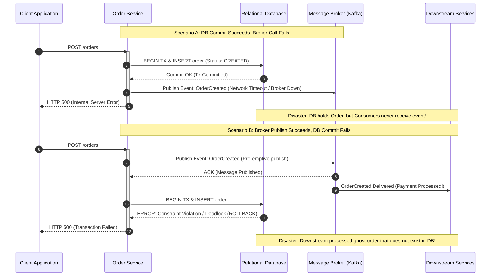
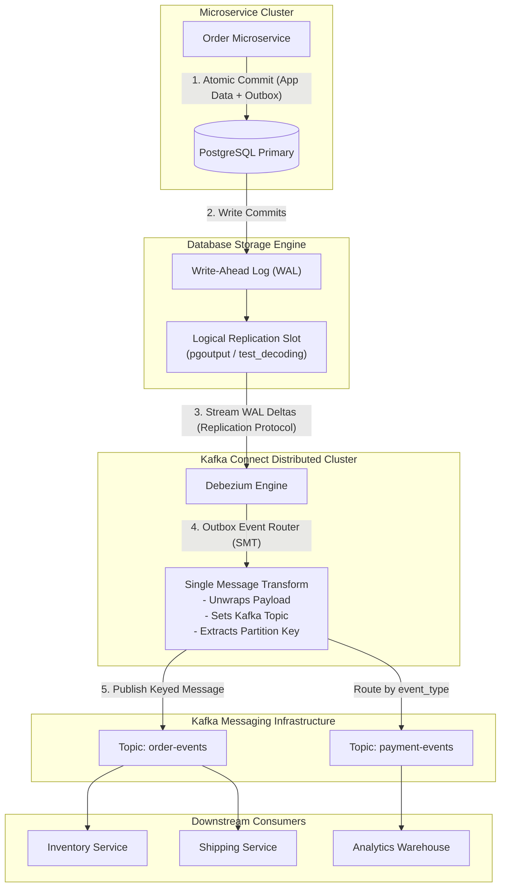
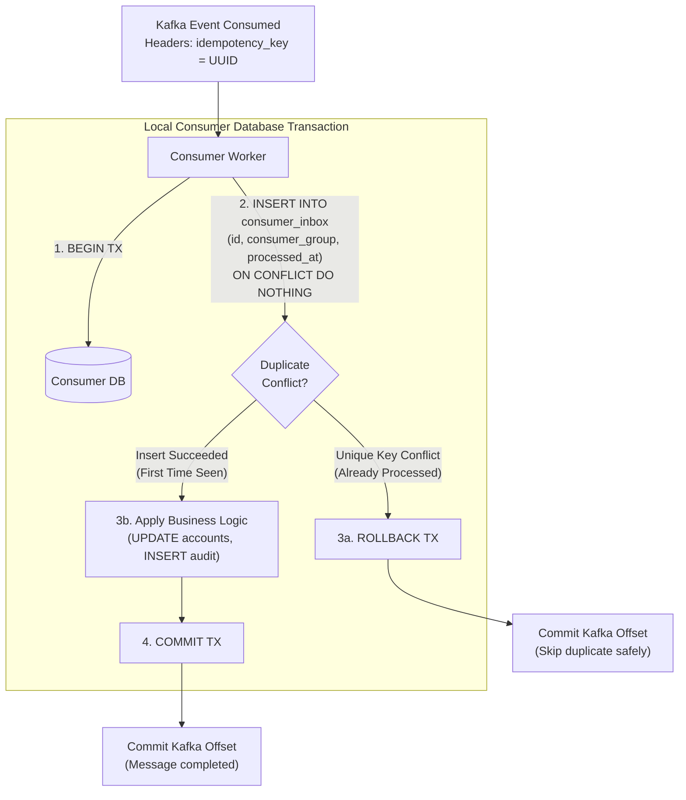
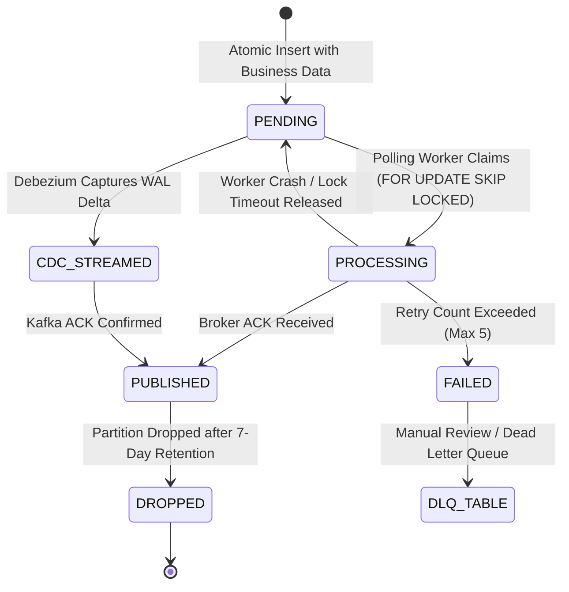
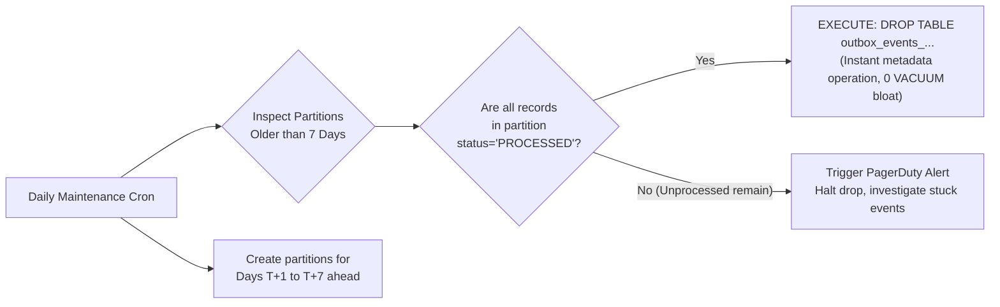

# Transactional Outbox Pattern: Production Architectural Guide

## 1. Deep Overview & Theoretical Foundations

In modern distributed systems and microservices architectures, business workflows rarely exist in isolation within a single database boundary. A single user interaction—such as placing an order, booking a flight, or processing a credit card charge—frequently requires two foundational actions:
1. **State Mutation:** Updating the application's internal persistent state in a relational or NoSQL database.
2. **Event Notification:** Publishing an event or message to a distributed message broker (e.g., Apache Kafka, RabbitMQ, AWS SQS) to trigger downstream processing, update search indexes, dispatch push notifications, or advance a distributed Saga.

This dual requirement exposes systems to one of the most notorious challenges in distributed computing: **The Dual-Write Problem**.

---

### The Dual-Write Problem

A "dual write" occurs whenever an application is responsible for modifying state in two distinct, autonomous distributed systems without a unified consensus protocol. 

```
               +--------------------------------------+
               |       Order Processing Service       |
               +--------------------------------------+
                       /                     \
                      /                       \
           Step 1: Write DB              Step 2: Publish Event
                    v                           v
         +--------------------+       +--------------------+
         |   PostgreSQL DB    |       |   Apache Kafka     |
         +--------------------+       +--------------------+
```

Because these two destinations do not share a single transaction manager, network failures, hardware crashes, thread terminations, or process restarts will inevitably cause one of the two writes to succeed while the other fails.

#### Failure Scenario A: Database First, Message Broker Second
1. The service executes `BEGIN TRANSACTION`, inserts the `order` record, and issues `COMMIT`. The database state is finalized.
2. The service attempts to send a `OrderCreated` message over the network to Apache Kafka.
3. The network partitions, the broker times out, or the service process experiences an Out-Of-Memory (OOM) kill before the TCP socket flush completes.
4. **Result:** The order exists in the database, but downstream inventory, billing, and fulfillment services are never notified. The system is left in a state of **silent state drift and phantom data**.

#### Failure Scenario B: Message Broker First, Database Second
1. The service publishes `OrderCreated` to Kafka. The broker confirms receipt (`ack=all`).
2. Downstream consumers immediately consume the event and initiate payment or inventory reservation.
3. The service attempts to commit the local database transaction, but encounters a foreign key violation, unique constraint conflict, database deadlock, or connection pool timeout. The database issues a `ROLLBACK`.
4. **Result:** A **ghost event** was broadcast to the entire enterprise. Downstream services reserve stock or bill cards for an order that does not legally exist in the system of record.

---

### Dual-Write Failure Sequences

The following sequence diagram illustrates the unavoidable failure points when an application attempts naive dual writes across system boundaries:



---

### Inadequacy of Two-Phase Commit (2PC / XA)

Historically, distributed transactions managed via the **Two-Phase Commit (2PC)** protocol and the **XA standard** were used to coordinate commits across databases and message queues (e.g., IBM MQ, Oracle Tuxedo). In cloud-native microservices, 2PC is fundamentally inadequate for the following reasons:

1. **Lack of Protocol Support:** Modern high-throughput brokers such as Apache Kafka, AWS Kinesis, AWS SQS, and Google Cloud Pub/Sub do not implement the XA protocol or act as XA-compliant resource managers.
2. **Blocking Coordinator Protocol:** 2PC is a synchronous, blocking protocol. If the transaction coordinator crashes during the `PREPARE` phase, all resource managers hold lock acquisitions on database rows and table pages indefinitely. This causes catastrophic connection pool exhaustion and database lock pileups.
3. **Availability Penalty (CAP Theorem):** 2PC prioritizes strict consistency ($C$) at the complete expense of availability ($A$). If any single downstream participant or network hop experiences latency or an outage, the entire transaction aborts or hangs.
4. **Throughput Collapse:** Coordinating network round-trips for `PREPARE`, `COMMIT`, and `ACKNOWLEDGEMENT` across distributed nodes introduces orders-of-magnitude latency spikes (from sub-millisecond database writes to hundreds of milliseconds), reducing transaction throughput by 90–99%.

---

### Intent & Core Guarantees of the Outbox Pattern

The **Transactional Outbox Pattern** circumvents the dual-write dilemma by strictly bounding all state changes within a **single local ACID database transaction**.

Instead of interacting with the message broker directly inside the business logic thread:
1. The service mutates business tables (e.g., `orders`, `line_items`).
2. In the **exact same database transaction**, the service appends an event record to a dedicated `outbox` table.
3. The database engine's Write-Ahead Log (WAL) and ACID guarantees ensure that **both the business state change and the event row are committed atomically or rolled back entirely**.
4. An independent, decoupled **Message Relay** engine extracts uncommitted or unpublished records from the `outbox` table and delivers them to the message broker.

```
+-----------------------------------------------------------------------------------------+
|                               LOCAL DATABASE TRANSACTION BOUNDARY                       |
|                                                                                         |
|   1. INSERT INTO orders (id, customer_id, total, status) VALUES (...);                 |
|   2. INSERT INTO outbox (id, aggregate_type, aggregate_id, payload) VALUES (...);       |
|   3. COMMIT;                                                                            |
+-----------------------------------------------------------------------------------------+
                                           |
                              Guaranteed Atomic Persistence
                                           v
+-----------------------------------------------------------------------------------------+
|                               ASYNCHRONOUS RELAY SUBSYSTEM                              |
|                                                                                         |
|   Polling Worker  OR  CDC Engine (Debezium/WAL)  -->  Publish to Message Broker (Kafka) |
+-----------------------------------------------------------------------------------------+
```

#### The Delivery Guarantee Contract: At-Least-Once Delivery
Because network operations between the Message Relay and the Message Broker are subject to crashes and latency timeouts, the Message Relay must retry until it receives an explicit acknowledgment from the broker. 
- If the relay publishes a message successfully, but crashes before recording the publish status back into the database or committing its replication offset, it will **re-publish** the message upon restart.
- Thus, the Outbox Pattern guarantees **At-Least-Once Delivery**.
- Downstream microservices **must implement consumer idempotency** to filter out duplicate deliveries.

---

## 2. Architectural Approaches & Variants

There are four primary architectural approaches to extracting events from an outbox table and relaying them to a message broker. Each approach offers distinct performance, operational, and latency trade-offs.

```
                           +-------------------------------+
                           | Transactional Outbox Pattern  |
                           +-------------------------------+
                                          |
        +-------------------+-------------+-------------+--------------------+
        |                   |                           |                    |
        v                   v                           v                    v
  [Approach 1]        [Approach 2]                [Approach 3]         [Approach 4]
Polling Publisher   Transaction Log             In-Database          Event Sourcing
  (SKIP LOCKED)      Tailing (CDC)           Notification Relay     (Implicit Outbox)
```

---

### Approach 1: Polling Publisher (`SELECT ... FOR UPDATE SKIP LOCKED`)

#### Conceptual Mechanics
The Polling Publisher utilizes a scheduled background worker pool executing inside the application cluster. These workers query the `outbox` table at regular intervals, process pending events, push them to the broker, and update or delete the processed rows.

Naive polling with `SELECT * FROM outbox WHERE status = 'PENDING' ORDER BY created_at LIMIT 100` creates severe concurrency bottlenecks when multiple service instances run in parallel. Every worker attempts to read the same rows, leading to transaction deadlocks, lock contention, or duplicate deliveries.

To scale the Polling Publisher horizontally across dozens of instances, modern relational database engines (PostgreSQL 9.5+, MySQL 8.0+, Oracle 11g+) support the concurrency clause:
```sql
SELECT * FROM outbox 
WHERE status = 'PENDING' 
ORDER BY created_at ASC 
LIMIT :batch_size 
FOR UPDATE SKIP LOCKED;
```

#### High-Level Design (HLD)
- **Application Instances:** Multiple stateless service containers run background polling threads.
- **Locking Semantics:** `SKIP LOCKED` instructs the database engine to acquire an exclusive row-level lock (`FOR UPDATE`) on matching records, but instantly skip any records already locked by another concurrent transaction.
- **Horizontal Scaling:** Adding more service pods dynamically distributes outbox rows across workers with zero row-lock waiting time and zero lock contention.
- **Broker Dispatch:** Workers publish their acquired batch to Kafka, wait for broker ACKs, and mark rows as `PROCESSED` or `DELETE` them within the same worker transaction.

#### Polling Architecture & Sequence Diagram

```mermaid
sequenceDiagram
    autonumber
    participant W1 as Polling Worker 1 (Pod A)
    participant W2 as Polling Worker 2 (Pod B)
    participant DB as PostgreSQL Database
    participant Broker as Kafka Cluster

    Note over W1, W2: Both workers trigger simultaneously
    W1->>DB: BEGIN TX;<br/>SELECT * FROM outbox WHERE status='PENDING'<br/>LIMIT 50 FOR UPDATE SKIP LOCKED;
    W2->>DB: BEGIN TX;<br/>SELECT * FROM outbox WHERE status='PENDING'<br/>LIMIT 50 FOR UPDATE SKIP LOCKED;
    
    DB-->>W1: Returns Rows [1..50] (Locked exclusively by W1)
    DB-->>W2: Returns Rows [51..100] (Rows 1..50 skipped! Locked by W2)

    par Parallel Broker Dispatch
        W1->>Broker: Producer.send(Rows 1..50)
        W2->>Broker: Producer.send(Rows 51..100)
    end

    Broker-->>W1: ACK All [1..50]
    Broker-->>W2: ACK All [51..100]

    W1->>DB: UPDATE outbox SET status='PROCESSED', processed_at=NOW()<br/>WHERE id IN (1..50);<br/>COMMIT;
    W2->>DB: UPDATE outbox SET status='PROCESSED', processed_at=NOW()<br/>WHERE id IN (51..100);<br/>COMMIT;
    
    DB-->>W1: OK (Locks Released)
    DB-->>W2: OK (Locks Released)
```

#### Low-Level Concurrency & Execution Pipeline
1. **Transaction Isolation:** Worker transactions run under `READ COMMITTED` isolation.
2. **Backoff Management:** If a query returns 0 rows, the worker applies exponential backoff with jitter (e.g., sleep between 200ms and 1500ms) to prevent empty query loops from saturating database CPU.
3. **Partition-Aware Sharding:** In multi-tenant systems, workers can append `AND tenant_id % :worker_count = :worker_id` to enforce deterministic partition affinity.
4. **Timeout Handling:** If a worker crashes mid-batch, its database connection drops, the database immediately aborts the transaction, and the row locks are automatically released. The next polling cycle allows another worker to claim the rows.

---

### Approach 2: Transaction Log Tailing / Change Data Capture (CDC)

#### Conceptual Mechanics
Instead of repeatedly polling the database with SQL queries, Change Data Capture (CDC) taps directly into the database engine’s internal replication and recovery mechanism: the **Write-Ahead Log (WAL)** in PostgreSQL, the **Binary Log (binlog)** in MySQL, or **DynamoDB Streams** in AWS DynamoDB.

When a transaction commits, the storage engine appends internal delta records to the transaction log on disk. A dedicated CDC daemon—most prominently **Debezium running on Apache Kafka Connect**—acts as an artificial database replica. It establishes a streaming replication protocol connection, decodes the binary log entries into structured logical events, and streams them directly into Kafka topics with sub-100-millisecond latency.

#### CDC Architecture Topology



#### Low-Level Design (LLD) & CDC Event Routing Pipeline
1. **Logical Decoding Plugins:** In PostgreSQL, the `pgoutput` plugin reads disk blocks from the WAL, filters changes targeting the `outbox` table, and transforms internal tuples into logical commit streams.
2. **Debezium Outbox Event Router (Single Message Transform - SMT):**
   - Out-of-the-box CDC streams raw database row representations (e.g., `{ before: null, after: { id: 1, payload: "..." } }`).
   - The Debezium Outbox SMT (`io.debezium.transforms.outbox.EventRouter`) inspects the outbox row fields:
     - Uses `aggregate_type` or `event_type` to dynamically determine the destination Kafka topic (e.g., `orders.events`).
     - Extracts `aggregate_id` and places it as the Kafka message **Key** (ensuring all events for the same order hash to the same Kafka partition).
     - Extracts the `payload` string and places it directly as the Kafka message **Value**.
     - Converts outbox metadata fields (such as `traceparent`, `schema_version`) into Kafka record **Headers**.
3. **Log Sequence Number (LSN) Commit Loop:**
   - The CDC connector processes messages in strict sequential LSN order.
   - Only after Kafka brokers confirm disk persistence of the published message batch does Kafka Connect commit the processed LSN back to the PostgreSQL replication slot.
   - If the Kafka Connect worker crashes, it resumes reading from the last acknowledged LSN, providing robust at-least-once streaming.

---

### Approach 3: In-Database Notification Relay (e.g., PostgreSQL `LISTEN` / `NOTIFY`)

#### Conceptual Mechanics
Relational databases such as PostgreSQL feature built-in asynchronous inter-process pub/sub mechanisms. Using the `LISTEN` and `NOTIFY` commands, an application trigger or stored procedure can emit a transient signal over the active client connection immediately upon transaction commit.

```
+-------------------------------------------------------------------------------+
| Client Transaction:                                                           |
| 1. INSERT INTO orders ...;                                                    |
| 2. INSERT INTO outbox (id, ...) RETURNING id;                                  |
| 3. PERFORM pg_notify('outbox_channel', id::text);                             |
| 4. COMMIT;  ---> Database emits notification signal to all listening backends |
+-------------------------------------------------------------------------------+
```

#### High-Level & Low-Level Design
1. **Trigger / Explicit Notify:** During transaction execution, the application executes `pg_notify('outbox_events', record_id)` or attaches an `AFTER INSERT` trigger on the outbox table.
2. **Notification Relay Daemon:** A dedicated Node.js, Go, or Java daemon maintains a persistent, dedicated connection to PostgreSQL and issues `LISTEN outbox_events;`.
3. **Reactive Fetch:** Upon receiving the signal containing the event ID, the daemon queries the specific row and immediately dispatches it to Kafka.
4. **The 8000-Byte Payload Barrier:** PostgreSQL limits `pg_notify` payload strings to 8000 bytes. The notification must **never** carry the full JSON event payload. Instead, it transmits only the primary key (`id`), functioning as a lightweight wake-up ping.
5. **Hybrid Fallback Loop (Critical Resiliency Requirement):**
   - PostgreSQL notifications are transient and memory-based. If the relay daemon disconnects, crashes, or is restarting during a `COMMIT`, the notification is **permanently lost**.
   - Therefore, a notification relay **must always be paired with a slow background polling job** (e.g., every 30–60 seconds) to sweep any missed rows that escaped notification delivery.

---

### Approach 4: Event Sourcing as an Implicit Outbox

#### Conceptual Mechanics
In an **Event Sourced** architecture, the application does not persist the current structural state of domain models (e.g., no classic `orders` table with status columns). Instead, every state transition is recorded as an immutable domain event in an append-only **Event Store** (e.g., EventStoreDB, Apache Kafka, or a relational event table).

```
                      Traditional Outbox Architecture
               +---------------------------------------------+
               |  App State Table (orders)                   |
               |  + Outbox Table (outbox_events)             |
               +---------------------------------------------+
                                      vs
                   Event Sourcing Implicit Outbox
               +---------------------------------------------+
               |  Domain Event Store (order_events)          |
               |  (Single Source of Truth + Outbox combined) |
               +---------------------------------------------+
```

#### High-Level & Low-Level Design
- **Elimination of Dual Tables:** The Event Store **is** the Outbox. There is no distinction between application state storage and event logging.
- **Append-Only Write Model:** Business commands load the event stream for an aggregate, replay history to rebuild internal state, evaluate business invariants, and atomically append new domain events with optimistic concurrency checks (`expected_version = 4`).
- **Subscription Engines:** Projections and event forwarders subscribe directly to the Event Store commit stream (via CDC or database tailing) to publish events downstream or update read-side CQRS views.
- **Architectural Trade-offs:** While eliminating outbox synchronization overhead, Event Sourcing introduces substantial complexity: eventual consistency in all read operations, complex schema evolution (event upcasting), and high cognitive load across engineering teams.

---

## 3. Production Data Models & Concrete Implementations

### Canonical Outbox Table Schema (PostgreSQL)

A production outbox table must be engineered for extreme write throughput, minimal read lock contention, and rapid archival. The schema below features optimized indexing, UUIDv7 primary keys for sequential B-tree ordering, and partial indexing.

```sql
-- Migration: Create Outbox Table and Associated Indexes
CREATE TABLE outbox_events (
    id UUID PRIMARY KEY,
    aggregate_type VARCHAR(128) NOT NULL,
    aggregate_id VARCHAR(128) NOT NULL,
    event_type VARCHAR(128) NOT NULL,
    payload JSONB NOT NULL,
    headers JSONB DEFAULT '{}'::jsonb NOT NULL,
    status VARCHAR(32) DEFAULT 'PENDING' NOT NULL,
    retry_count INT DEFAULT 0 NOT NULL,
    last_error TEXT,
    created_at TIMESTAMPTZ DEFAULT CURRENT_TIMESTAMP NOT NULL,
    processed_at TIMESTAMPTZ
);

-- Partial index: Essential for Polling Publishers.
-- Indexes ONLY pending rows, keeping the B-tree tiny (tens of KB instead of hundreds of MB).
CREATE INDEX idx_outbox_events_pending 
ON outbox_events (created_at ASC) 
WHERE status = 'PENDING';

-- Aggregate lookup index: Accelerates debugging, audits, and aggregate event replay.
CREATE INDEX idx_outbox_events_aggregate 
ON outbox_events (aggregate_type, aggregate_id, created_at ASC);
```

---

### Spring Boot Production Implementation: Atomic Transactional Commit

The following production-grade Java class demonstrates atomic business state persistence alongside outbox record generation, instrumented with distributed tracing propagation.

```java
package com.enterprise.order.service;

import com.enterprise.order.domain.Order;
import com.enterprise.order.domain.OutboxEvent;
import com.enterprise.order.repository.OrderRepository;
import com.enterprise.order.repository.OutboxRepository;
import com.fasterxml.jackson.databind.ObjectMapper;
import io.micrometer.tracing.Tracer;
import lombok.RequiredArgsConstructor;
import lombok.extern.slf4j.Slf4j;
import org.springframework.stereotype.Service;
import org.springframework.transaction.annotation.Isolation;
import org.springframework.transaction.annotation.Propagation;
import org.springframework.transaction.annotation.Transactional;

import java.time.Instant;
import java.util.Map;
import java.util.UUID;

@Slf4j
@Service
@RequiredArgsConstructor
public class OrderApplicationService {

    private final OrderRepository orderRepository;
    private final OutboxRepository outboxRepository;
    private final ObjectMapper objectMapper;
    private final Tracer tracer;

    /**
     * Executes order creation and outbox registration within a single,
     * atomic local relational database transaction.
     */
    @Transactional(propagation = Propagation.REQUIRED, isolation = Isolation.READ_COMMITTED)
    public Order createOrder(CreateOrderCommand command) {
        log.info("Processing order placement for customer: {}", command.customerId());

        // 1. Mutate domain state and persist entity
        Order order = Order.builder()
                .id(UUID.randomUUID())
                .customerId(command.customerId())
                .totalAmount(command.totalAmount())
                .currency(command.currency())
                .status(OrderStatus.CONFIRMED)
                .createdAt(Instant.now())
                .build();

        Order savedOrder = orderRepository.save(order);

        // 2. Assemble Domain Event Payload
        OrderCreatedDomainEvent event = new OrderCreatedDomainEvent(
                savedOrder.getId(),
                savedOrder.getCustomerId(),
                savedOrder.getTotalAmount(),
                savedOrder.getCurrency(),
                savedOrder.getCreatedAt()
        );

        // 3. Capture Distributed Tracing Context (W3C TraceContext)
        String traceId = tracer.currentSpan() != null ? tracer.currentSpan().context().traceId() : "none";
        String spanId = tracer.currentSpan() != null ? tracer.currentSpan().context().spanId() : "none";

        Map<String, String> headers = Map.of(
                "traceparent", String.format("00-%s-%s-01", traceId, spanId),
                "event_version", "v1.2",
                "producer_service", "order-command-service"
        );

        // 4. Create and persist Outbox entry in the same transaction
        try {
            OutboxEvent outboxRecord = OutboxEvent.builder()
                    .id(UUID.randomUUID())
                    .aggregateType("Order")
                    .aggregateId(savedOrder.getId().toString())
                    .eventType("OrderCreated")
                    .payload(objectMapper.writeValueAsString(event))
                    .headers(objectMapper.writeValueAsString(headers))
                    .status("PENDING")
                    .retryCount(0)
                    .createdAt(Instant.now())
                    .build();

            outboxRepository.save(outboxRecord);
        } catch (Exception e) {
            log.error("Failed to serialize outbox event for order ID: {}", savedOrder.getId(), e);
            throw new IllegalStateException("Outbox serialization failure. Transaction rolling back.", e);
        }

        // 5. Transaction commits here atomically.
        return savedOrder;
    }
}
```

---

### Spring Boot Production Polling Publisher with `SKIP LOCKED`

Below is an enterprise polling scheduler that processes batches using native row locking, dispatches to Kafka with asynchronous futures, and updates statuses transactionally.

```java
package com.enterprise.order.relay;

import lombok.RequiredArgsConstructor;
import lombok.extern.slf4j.Slf4j;
import org.apache.kafka.clients.producer.ProducerRecord;
import org.apache.kafka.common.header.internals.RecordHeader;
import org.springframework.jdbc.core.JdbcTemplate;
import org.springframework.kafka.core.KafkaTemplate;
import org.springframework.kafka.support.SendResult;
import org.springframework.scheduling.annotation.Scheduled;
import org.springframework.stereotype.Component;
import org.springframework.transaction.PlatformTransactionManager;
import org.springframework.transaction.TransactionDefinition;
import org.springframework.transaction.support.TransactionTemplate;

import java.nio.charset.StandardCharsets;
import java.sql.ResultSet;
import java.sql.SQLException;
import java.sql.Timestamp;
import java.time.Instant;
import java.util.*;
import java.util.concurrent.CompletableFuture;
import java.util.concurrent.TimeUnit;

@Slf4j
@Component
@RequiredArgsConstructor
public class PollingOutboxRelay {

    private final JdbcTemplate jdbcTemplate;
    private final KafkaTemplate<String, String> kafkaTemplate;
    private final PlatformTransactionManager transactionManager;

    private static final int BATCH_SIZE = 100;
    private static final String SELECT_PENDING_QUERY = """
        SELECT id, aggregate_type, aggregate_id, event_type, payload, headers, retry_count
        FROM outbox_events
        WHERE status = 'PENDING'
        ORDER BY created_at ASC
        LIMIT ?
        FOR UPDATE SKIP LOCKED
        """;

    private static final String UPDATE_SUCCESS_QUERY = """
        UPDATE outbox_events
        SET status = 'PROCESSED', processed_at = ?
        WHERE id = ?
        """;

    private static final String UPDATE_FAILURE_QUERY = """
        UPDATE outbox_events
        SET status = CASE WHEN retry_count >= 5 THEN 'FAILED' ELSE 'PENDING' END,
            retry_count = retry_count + 1,
            last_error = ?
        WHERE id = ?
        """;

    @Scheduled(fixedDelay = 500)
    public void pollAndPublish() {
        TransactionTemplate txTemplate = new TransactionTemplate(transactionManager);
        txTemplate.setPropagationBehavior(TransactionDefinition.PROPAGATION_REQUIRES_NEW);

        txTemplate.execute(status -> {
            List<OutboxRecord> records = jdbcTemplate.query(
                    SELECT_PENDING_QUERY,
                    (rs, rowNum) -> mapRow(rs),
                    BATCH_SIZE
            );

            if (records.isEmpty()) {
                return null;
            }

            log.debug("Acquired {} outbox rows via SKIP LOCKED", records.size());

            for (OutboxRecord record : records) {
                try {
                    String topic = determineTopic(record.aggregateType(), record.eventType());
                    ProducerRecord<String, String> kafkaRecord = new ProducerRecord<>(
                            topic,
                            record.aggregateId(), // Kafka Key: Guarantees partition ordering
                            record.payload()
                    );

                    // Attach headers
                    kafkaRecord.headers().add(new RecordHeader("idempotency_key", record.id().toString().getBytes(StandardCharsets.UTF_8)));
                    kafkaRecord.headers().add(new RecordHeader("event_type", record.eventType().getBytes(StandardCharsets.UTF_8)));

                    // Publish synchronously with bounded timeout to maintain transaction consistency
                    CompletableFuture<SendResult<String, String>> future = kafkaTemplate.send(kafkaRecord);
                    future.get(2000, TimeUnit.MILLISECONDS);

                    // Mark as processed
                    jdbcTemplate.update(UPDATE_SUCCESS_QUERY, Timestamp.from(Instant.now()), record.id());
                } catch (Exception ex) {
                    log.error("Failed to publish outbox event: {}", record.id(), ex);
                    jdbcTemplate.update(UPDATE_FAILURE_QUERY, ex.getMessage(), record.id());
                }
            }
            return null;
        });
    }

    private OutboxRecord mapRow(ResultSet rs) throws SQLException {
        return new OutboxRecord(
                (UUID) rs.getObject("id"),
                rs.getString("aggregate_type"),
                rs.getString("aggregate_id"),
                rs.getString("event_type"),
                rs.getString("payload"),
                rs.getString("headers"),
                rs.getInt("retry_count")
        );
    }

    private String determineTopic(String aggregateType, String eventType) {
        return String.format("%s.%s", aggregateType.toLowerCase(), eventType.toLowerCase());
    }

    private record OutboxRecord(
            UUID id,
            String aggregateType,
            String aggregateId,
            String eventType,
            String payload,
            String headers,
            int retryCount
    ) {}
}
```

---

### Node.js / TypeScript Atomic Transactional Insertion

For modern asynchronous backend microservices built with TypeScript and PostgreSQL (via `pg` or `knex`), the transaction ensures that domain updates and outbox events are coupled atomically.

```typescript
import { Pool, PoolClient } from 'pg';
import { v7 as uuidv7 } from 'uuid';

interface OrderCreationDTO {
  customerId: string;
  items: Array<{ productId: string; quantity: number; unitPrice: number }>;
  totalAmount: number;
}

export class OrderDomainService {
  constructor(private readonly dbPool: Pool) {}

  public async placeOrder(dto: OrderCreationDTO, traceparent: string): Promise<string> {
    const client: PoolClient = await this.dbPool.connect();

    try {
      await client.query('BEGIN TRANSACTION ISOLATION LEVEL READ COMMITTED;');

      const orderId = uuidv7();

      // 1. Insert Core Business State
      const insertOrderQuery = `
        INSERT INTO orders (id, customer_id, total_amount, status, created_at)
        VALUES ($1, $2, $3, $4, NOW())
        RETURNING id;
      `;
      await client.query(insertOrderQuery, [orderId, dto.customerId, dto.totalAmount, 'PLACED']);

      // 2. Format Domain Event Payload
      const eventPayload = {
        orderId,
        customerId: dto.customerId,
        totalAmount: dto.totalAmount,
        itemCount: dto.items.length,
        timestamp: new Date().toISOString()
      };

      const eventHeaders = {
        traceparent,
        source: 'order-service-node',
        schemaVersion: '1.0.0'
      };

      // 3. Insert Outbox Event in the SAME transaction
      const insertOutboxQuery = `
        INSERT INTO outbox_events (
          id, aggregate_type, aggregate_id, event_type, payload, headers, status, created_at
        ) VALUES ($1, $2, $3, $4, $5, $6, 'PENDING', NOW());
      `;

      await client.query(insertOutboxQuery, [
        uuidv7(),
        'Order',
        orderId,
        'OrderPlaced',
        JSON.stringify(eventPayload),
        JSON.stringify(eventHeaders)
      ]);

      // 4. Commit transaction atomically
      await client.query('COMMIT;');
      return orderId;
    } catch (error) {
      await client.query('ROLLBACK;');
      throw new Error(`Failed to place order atomically: ${(error as Error).message}`);
    } finally {
      client.release();
    }
  }
}
```

---

### Debezium PostgreSQL Connector JSON Configuration

When utilizing Change Data Capture, the Debezium engine runs inside Kafka Connect. The following configuration establishes logical replication via `pgoutput`, captures writes to `outbox_events`, and routes them dynamically using the Outbox Event Router SMT.

```json
{
  "name": "postgres-order-outbox-connector",
  "config": {
    "connector.class": "io.debezium.connector.postgresql.PostgresConnector",
    "tasks.max": "1",
    "plugin.name": "pgoutput",
    "database.hostname": "postgres-primary.internal",
    "database.port": "5432",
    "database.user": "debezium_cdc_user",
    "database.password": "${file:/secrets/db-credentials.properties:cdc_password}",
    "database.dbname": "order_db",
    "database.server.name": "order_postgres",
    "table.include.list": "public.outbox_events",
    "slot.name": "debezium_order_outbox_slot",
    "publication.name": "order_outbox_publication",
    "publication.autocreate.mode": "all_tables",
    "tombstones.on.delete": "false",
    "decimal.handling.mode": "double",
    
    "transforms": "outbox",
    "transforms.outbox.type": "io.debezium.transforms.outbox.EventRouter",
    "transforms.outbox.table.fields.additional.placement": "event_type:header:eventType,headers:header:tracingHeaders",
    "transforms.outbox.route.by.field": "aggregate_type",
    "transforms.outbox.route.topic.replacement": "${routedByValue}.events",
    "transforms.outbox.table.field.event.id": "id",
    "transforms.outbox.table.field.event.key": "aggregate_id",
    "transforms.outbox.table.field.event.payload": "payload",
    "transforms.outbox.table.field.event.timestamp": "created_at"
  }
}
```

---

## 4. Downstream Idempotency & Consumer Deduplication

Because the Outbox Pattern guarantees **At-Least-Once Delivery**, downstream consumers will inevitably receive duplicate messages whenever a relay worker, CDC connector, or network connection restarts after publishing but before recording the state change.

Downstream systems **must guarantee idempotent processing**. A consumer is idempotent if receiving message $M$ multiple times produces the identical side-effect as receiving message $M$ exactly once:

$$f(f(M)) = f(M)$$

### Consumer Inbox Pattern Architecture

The most robust technique for consumer idempotency in relational microservices is the **Inbox Pattern**. Just as the Outbox pattern wraps outgoing events in the producer's local transaction, the Inbox pattern wraps incoming event deduplication in the consumer's local transaction.



---

### Consumer Inbox DDL & Implementation

```sql
CREATE TABLE consumer_inbox (
    message_id VARCHAR(128) NOT NULL,
    consumer_group VARCHAR(128) NOT NULL,
    processed_at TIMESTAMPTZ DEFAULT CURRENT_TIMESTAMP NOT NULL,
    PRIMARY KEY (message_id, consumer_group)
);

-- Pruning index for automated cleanup of old inbox records
CREATE INDEX idx_consumer_inbox_cleanup 
ON consumer_inbox (processed_at ASC);
```

#### Consumer Idempotency Execution in Java / Spring Kafka

```java
package com.enterprise.inventory.consumer;

import lombok.RequiredArgsConstructor;
import lombok.extern.slf4j.Slf4j;
import org.apache.kafka.clients.consumer.ConsumerRecord;
import org.springframework.dao.DuplicateKeyException;
import org.springframework.jdbc.core.JdbcTemplate;
import org.springframework.kafka.annotation.KafkaListener;
import org.springframework.kafka.support.Acknowledgment;
import org.springframework.stereotype.Service;
import org.springframework.transaction.PlatformTransactionManager;
import org.springframework.transaction.support.TransactionTemplate;

import java.nio.charset.StandardCharsets;

@Slf4j
@Service
@RequiredArgsConstructor
public class IdempotentOrderConsumer {

    private final JdbcTemplate jdbcTemplate;
    private final PlatformTransactionManager transactionManager;
    private final InventoryAllocationService inventoryAllocationService;

    private static final String CONSUMER_GROUP = "inventory-allocation-group";
    private static final String INBOX_INSERT = """
        INSERT INTO consumer_inbox (message_id, consumer_group, processed_at)
        VALUES (?, ?, NOW())
        """;

    @KafkaListener(topics = "order.ordercreated", groupId = CONSUMER_GROUP, containerFactory = "manualAckFactory")
    public void onMessage(ConsumerRecord<String, String> record, Acknowledgment ack) {
        String messageId = extractHeader(record, "idempotency_key");
        if (messageId == null) {
            messageId = record.key() + "-" + record.offset(); // Fallback identifier
        }

        final String finalMessageId = messageId;
        TransactionTemplate txTemplate = new TransactionTemplate(transactionManager);

        try {
            txTemplate.execute(status -> {
                // 1. Attempt deduplication registration within transaction
                try {
                    jdbcTemplate.update(INBOX_INSERT, finalMessageId, CONSUMER_GROUP);
                } catch (DuplicateKeyException dke) {
                    log.warn("Duplicate message detected in inbox: {}. Skipping business logic execution.", finalMessageId);
                    return null; // Return without throwing to commit and let offset advance
                }

                // 2. Execute actual domain state modification
                inventoryAllocationService.allocateStockForOrder(record.value());
                return null;
            });

            // 3. Acknowledge offset to Kafka only after successful DB commit
            ack.acknowledge();
        } catch (Exception ex) {
            log.error("Fatal processing error for message ID: {}. Triggering Kafka retry.", finalMessageId, ex);
            throw ex; // Triggers Spring Kafka retry / Dead Letter Topic routing
        }
    }

    private String extractHeader(ConsumerRecord<String, String> record, String key) {
        var header = record.headers().lastHeader(key);
        return header != null ? new String(header.value(), StandardCharsets.UTF_8) : null;
    }
}
```

---

## 5. Storage Lifecycle, Table Bloat & Partition Pruning

In high-throughput microservices, an outbox table writing 2,000 events/second accumulates **172.8 million rows daily**. 

If records are merely updated to `status = 'PROCESSED'`, the outbox table quickly experiences:
1. **PostgreSQL MVCC Table Bloat:** Updates create dead tuples. Even with aggressive autovacuum, index bloat and dead space bloat degrade query performance.
2. **Vacuum Freezing Overhead:** Massive tables trigger transaction ID wraparound vacuums, causing massive storage I/O spikes.
3. **Massive DELETE Locking:** Executing `DELETE FROM outbox_events WHERE status = 'PROCESSED'` in large batches locks indexes and saturates disk write buffers.

---

### Declarative Table Partitioning (PostgreSQL)

The enterprise solution to outbox bloat is **Declarative Range Partitioning by `created_at`** (e.g., daily or hourly partitions). Instead of running row-level `DELETE` statements, an automated scheduler drops an entire partition table instantly with zero I/O cost (`DROP TABLE outbox_events_2026_10_14`).

#### Partitioned Outbox Schema DDL

```sql
-- Create base partitioned table
CREATE TABLE outbox_events (
    id UUID NOT NULL,
    aggregate_type VARCHAR(128) NOT NULL,
    aggregate_id VARCHAR(128) NOT NULL,
    event_type VARCHAR(128) NOT NULL,
    payload JSONB NOT NULL,
    headers JSONB DEFAULT '{}'::jsonb NOT NULL,
    status VARCHAR(32) DEFAULT 'PENDING' NOT NULL,
    created_at TIMESTAMPTZ NOT NULL,
    processed_at TIMESTAMPTZ,
    PRIMARY KEY (created_at, id)
) PARTITION BY RANGE (created_at);

-- Daily Partitions
CREATE TABLE outbox_events_y2026m10d14 PARTITION OF outbox_events
    FOR VALUES FROM ('2026-10-14 00:00:00+00') TO ('2026-10-15 00:00:00+00');

CREATE TABLE outbox_events_y2026m10d15 PARTITION OF outbox_events
    FOR VALUES FROM ('2026-10-15 00:00:00+00') TO ('2026-10-16 00:00:00+00');

-- Index created automatically on every child partition
CREATE INDEX idx_outbox_partition_pending 
ON outbox_events (created_at ASC) 
WHERE status = 'PENDING';
```

#### Outbox Lifecycle State Machine



#### Automated Partition Maintenance Architecture



---

## 6. Real-World Edge Cases, Failure Modes & Resiliency

Building a production-ready outbox implementation requires hardening against subtle distributed failure modes.

### 1. PostgreSQL Inactive Replication Slot Disk Exhaustion
* **Failure Mechanism:** When using CDC (Debezium), PostgreSQL allocates a **Logical Replication Slot**. The database engine is strictly forbidden from purging WAL segments that have not yet been consumed and acknowledged by that slot. If the Kafka Connect cluster crashes, experiences an outage, or loses network connectivity for several hours, WAL files accumulate in `pg_wal` continuously. If unmonitored, the database host disk reaches 100% capacity, causing the entire PostgreSQL cluster to abruptly crash and reject all writes.
* **Production Defense:**
  1. Configure `max_slot_wal_keep_size` (e.g., set to `50GB`). If the replication slot falls behind by more than 50GB of WAL data, PostgreSQL intentionally invalidates the replication slot to save the database server from disk exhaustion.
  2. Implement Prometheus alerts on the query:
     ```sql
     SELECT slot_name, active, pg_wal_lsn_diff(pg_current_wal_lsn(), confirmed_flush_lsn) AS lag_bytes 
     FROM pg_replication_slots;
     ```

### 2. Message Ordering Violations Across Distributed Kafka Partitions
* **Failure Mechanism:** A customer rapidly issues:
  1. `OrderCreated` ($t_0$)
  2. `OrderAddressUpdated` ($t_1$)
  3. `OrderCancelled` ($t_2$)
  If the outbox relay routes these events across different Kafka partitions or uses multi-threaded polling without strict key hashing, the downstream `OrderCancelled` event can arrive and be processed *before* `OrderCreated`.
* **Production Defense:**
  - **Deterministic Partition Key:** Every outbox record must assign `aggregate_id` (e.g., `order_id`) as the Kafka message key. Kafka strictly guarantees total ordering *within* a single partition.
  - **Consumer Concurrency:** Downstream consumer pods must never process messages from the same partition across unbound parallel worker threads unless maintaining partition-key affinity.

### 3. Thundering Herd on Database Connection Pools
* **Failure Mechanism:** If 100 service pods run polling threads executing every 200ms, the primary database is bombarded with 500 queries/second of `SELECT ... FOR UPDATE SKIP LOCKED`. This exhausts database CPU, consumes HikariCP connection pools, and starves user-facing transactions.
* **Production Defense:**
  - Dynamic Polling with Jitter: Workers sleep longer when 0 rows are returned (exponential backoff up to 2–5 seconds).
  - Leader Election: Use Kubernetes Leases or ShedLock to elect a single active Polling Relay pod per cluster, while standby pods remain idle.

### 4. Poison Pill Events & Infinite Loop Cascades
* **Failure Mechanism:** A corrupted outbox record contains an invalid payload (e.g., unparseable JSON, payload exceeding Kafka’s `max.request.size` of 1MB). The relay worker fetches the record, attempts to publish, fails, rolls back the transaction, and fetches the same record again, creating an infinite processing loop that blocks all subsequent pending events.
* **Production Defense:**
  - Track `retry_count` directly in the outbox table.
  - Implement a Dead-Letter Queue (DLQ) threshold: after 5 failed attempts, transition the status to `FAILED`, record the stack trace in `last_error`, emit a critical alert, and proceed to subsequent events.

---

## 7. Production Comparison & Trade-off Matrix

| Evaluation Dimension | Approach 1: Polling Publisher (`SKIP LOCKED`) | Approach 2: Transaction Log Tailing (Debezium CDC) | Approach 3: In-Database Notify (`LISTEN`/`NOTIFY`) | Approach 4: Event Sourcing |
| :--- | :--- | :--- | :--- | :--- |
| **End-to-End Latency** | Medium (500ms – 5s based on polling interval) | **Ultra Low (<50ms – 200ms)** | Low (<100ms) | Low (<100ms) |
| **Database Read IOPS Load** | High (Continuous polling queries against table) | **Zero (Reads directly from append-only WAL stream)** | Low (Only reads when notified) | Low (Append-only event writes) |
| **Operational Complexity** | **Very Low** (Pure SQL + Application code) | High (Requires Kafka Connect, Debezium, Zookeeper/KRaft) | Medium (Connection state management, reconnects) | **Very High** (CQRS, Event Store, Schema Evolution) |
| **Horizontal Scalability** | Excellent (via `SKIP LOCKED`) | Managed via Kafka Connect tasks | Poor (Single-connection listener bottleneck) | Excellent (Stream-based) |
| **Database Engine Support** | Postgres 9.5+, MySQL 8.0+, Oracle 11g+ | Postgres, MySQL, MongoDB, SQL Server, DynamoDB | Postgres specific | Technology agnostic |
| **Risk of Data Loss** | Zero | Zero (Backed by replication slots) | High if uncoupled from polling (Lost pings) | Zero |
| **Postgres Disk Fill Risk** | Low (Index/Table bloat risk) | **High (Inactive replication slots retain WAL)** | Low | Low |
| **Payload Size Flexibility** | Unlimited (PostgreSQL JSONB up to 1GB) | High (Bounded by Kafka `max.message.bytes`) | Limited (Notify payload max 8000 bytes) | High |

---

## 8. Real-World Case Studies

### 1. LinkedIn Databus: The Genesis of Transaction Log Mining
Long before Debezium existed, LinkedIn encountered severe cache inconsistency and distributed dual-write corruption between their Oracle primary databases and downstream search indexes (Search, Social Graph, Espresso distributed store).
- **Architecture:** LinkedIn developed **Databus**, an infrastructure system that crawled the Oracle Redo Log and transaction journals in real time without querying the database tables directly.
- **Impact:** Databus reduced event publishing latency from minutes to sub-second levels, eradicated dual-write inconsistency, and supported tens of thousands of downstream consumers while reducing database read query load to virtually zero.

### 2. Airbnb: Scaling CDC for Global Event Pipelines
As Airbnb scaled its microservices architecture from a monolithic Ruby on Rails application, maintaining search indices (Elasticsearch), analytics data lakes, and transactional caches via dual writes led to frequent data divergence.
- **Architecture:** Airbnb migrated to a Change Data Capture architecture leveraging MySQL binlog streaming into Apache Kafka via **SpinalTap** (Airbnb’s open-source CDC platform, later standardizing on Kafka Connect and Debezium).
- **Scale:** Captured billions of database mutations daily across hundreds of services. They standardized on an outbox pattern where services write explicitly to an `outbox` table, isolating internal schema changes from public API event contracts.

### 3. Financial Services (Stripe & Adyen): High-Reliability Payment Orchestration
Payment processing systems cannot tolerate missing events (which cause abandoned payouts) or duplicate events (which cause double charges).
- **Architecture:** Core payment services utilize the Transactional Outbox Pattern combined with partitioned outbox tables and the Consumer Inbox Pattern.
- **Idempotency Standards:** All external payment requests carry cryptographic UUIDv7 idempotency keys. The outbox processor uses PostgreSQL logical decoding to ensure ledger transactions and payment intent broadcasts are committed in absolute synchronization.

---

## 9. Architectural Decision Tree

Use this decision matrix when designing an event publication architecture for microservices:

```mermaid
flowchart TD
    Start["Does your service mutate DB state<br/>AND require external event publication?"] --> CheckDual{Can you tolerate<br/>occasional lost events<br/>(e.g., non-critical telemetry)?}
    
    CheckDual -- Yes --> Direct["Publish directly to Broker<br/>(Accept dual-write failure risk)"]
    CheckDual -- No --> CheckES{"Is your entire domain model<br/>architected using<br/>Event Sourcing?"}
    
    CheckES -- Yes --> ES["Approach 4: Event Sourcing<br/>Stream events directly from Event Store"]
    CheckES -- No --> CheckThroughput{"What is your throughput<br/>and latency SLA?"}
    
    CheckThroughput -- "Low/Medium (<500 writes/sec)<br/>Latency > 500ms acceptable" --> CheckInfra{"Do you have dedicated<br/>Kafka Connect / CDC ops teams?"}
    CheckThroughput -- "High (>1,000 writes/sec)<br/>Sub-second latency mandatory" --> CDC["Approach 2: CDC via Debezium<br/>(Tail WAL / Binlog)"]
    
    CheckInfra -- No (Keep it simple) --> Polling["Approach 1: Polling Publisher<br/>with SELECT ... FOR UPDATE SKIP LOCKED"]
    CheckInfra -- Yes --> CDC
```

---

## 10. System Design Interview Masterclass

### Question 1: How do you prevent outbox table bloat in a system processing 50,000 writes/second?
* **Detailed Answer:**
  At 50,000 writes/second, standard `UPDATE outbox SET status = 'PROCESSED'` coupled with periodic `DELETE` queries will destroy database performance due to PostgreSQL autovacuum saturation and index bloat.
  The architecture must adopt **Declarative Time-Range Partitioning**:
  1. The outbox table is partitioned by hour or day: `PARTITION BY RANGE (created_at)`.
  2. The CDC engine (Debezium) or Polling workers process rows sequentially.
  3. Once all records in an older partition are processed (or after a 48-hour retention SLA), an automated job issues `DROP TABLE outbox_events_2026_10_14_h12`. Dropping a partition is an instantaneous file system un-link and metadata operation in PostgreSQL, requiring zero row-level locking and generating zero vacuum overhead.
  4. For CDC specifically, we can configure Debezium to emit events from the table and run an aggressive, micro-batched cleanup using cursor-based keyset pagination:
     ```sql
     DELETE FROM outbox_events WHERE id IN (
         SELECT id FROM outbox_events WHERE status = 'PROCESSED' LIMIT 5000
     );
     ```

---

### Question 2: What happens if Debezium or Kafka Connect crashes? How does it resume without dropping or duplicating messages?
* **Detailed Answer:**
  Debezium tracks its exact position in the database transaction stream using the database engine's **Log Sequence Number (LSN)** in PostgreSQL or **Binlog filename + Position** in MySQL.
  1. Kafka Connect stores these acknowledged offsets in an internal, compacted Kafka topic (e.g., `connect-offsets`).
  2. While running, Debezium streams WAL changes to Kafka. Once the target Kafka topic sends back a persistence acknowledgment (`acks=all`), Kafka Connect periodically updates its offset topic with the highest processed LSN.
  3. When Debezium crashes and restarts, it reads its last committed LSN from the offset topic and connects to the PostgreSQL replication slot starting strictly from that LSN.
  4. Because a crash may happen between sending messages to Kafka and updating the offset topic, Debezium will re-read and re-publish a small window of WAL records upon restart. This ensures **At-Least-Once Delivery** and underscores why downstream consumers must be idempotent.

---

### Question 3: If Kafka guarantees partition ordering, why do outbox consumers still observe messages arriving out of order?
* **Detailed Answer:**
  Even if Kafka maintains strict FIFO order within a partition, three architectural defects can disrupt end-to-end ordering:
  1. **Multi-Threaded Consumer Pools:** If a consumer group instance pulls a batch of 100 messages from a single partition and dispatches them across a thread pool (e.g., 10 worker threads), Thread 2 processing message #2 might finish before Thread 1 processing message #1. Solution: Preserve partition-key affinity or process sequentially per partition.
  2. **Non-Deterministic Outbox Polling:** If multiple polling instances query with `FOR UPDATE SKIP LOCKED` using `ORDER BY created_at`, clock skew across multi-master database nodes or microsecond timestamp collisions can cause Worker B to claim an update event before Worker A claims a create event.
  3. **Producer Retries without Idempotence:** If a publisher encounters a network error on message #1, sends message #2, and then retries message #1, Kafka will write them out of order unless `enable.idempotence=true` and `max.in.flight.requests.per.connection <= 5` are configured on the Kafka producer.

---

### Question 4: Why not just use Two-Phase Commit (2PC / XA) between PostgreSQL and Kafka?
* **Detailed Answer:**
  1. **Lack of Protocol Support:** Apache Kafka does not implement the XA transaction specification; it provides its own transactional API designed exclusively for Kafka-to-Kafka stream processing (Read-Committed-Process-Write), not heterogeneous cross-system transactions.
  2. **Availability Degradation (CAP Theorem):** 2PC is a blocking protocol. If the coordinator or network fails during the commit phase, database row locks remain open indefinitely, causing connection pool exhaustion across the entire microservice fleet.
  3. **Latency and Throughput:** 2PC requires multiple synchronous network round-trips (`PREPARE`, `COMMIT`, `ACK`). This increases transaction latency from 2–5ms to 100–300ms, collapsing write throughput by over 90%.

---

### Question 5: How do you handle distributed tracing (W3C TraceContext) across the Outbox boundary?
* **Detailed Answer:**
  When a business transaction writes to the outbox, the original HTTP request/gRPC thread terminates. The subsequent relay worker is an asynchronous background process that lacks the original thread-local tracing context.
  - **Context Serialization:** In the original business thread, the service extracts the active OpenTelemetry / W3C TraceContext headers (`traceparent`, `tracestate`, `baggage`) and serializes them as JSON into the `headers` column of the `outbox_events` table.
  - **Context Re-injection:** When the Polling Worker or Debezium connector reads the outbox record, it unpacks the `traceparent` string and injects it into the Kafka Record Headers (`org.apache.kafka.common.header.Headers`).
  - **Propagation:** Downstream consumers extract the `traceparent` header upon consumption and initialize a child span, creating an unbroken, end-to-end distributed trace visible in Jaeger, Datadog, or Zipkin.

---

### Question 6: Can you implement the Outbox Pattern with NoSQL databases (e.g., MongoDB, DynamoDB, Cassandra)?
* **Detailed Answer:**
  Yes, but the implementation strategy depends heavily on the storage engine’s transactional model:
  - **MongoDB:** Supports multi-document ACID transactions within a replica set (since v4.0). Applications atomically insert the business document into the `orders` collection and an event document into an `outbox` collection. Alternatively, MongoDB **Change Streams** can tail the cluster's `oplog.rs` directly, eliminating the need for a separate outbox collection.
  - **AWS DynamoDB:** Features native **DynamoDB Streams**. Furthermore, `TransactWriteItems` supports atomic multi-item operations, allowing an application to write to the `Orders` table and an `Outbox` table atomically. In practice, tailing the DynamoDB Stream via AWS EventBridge Pipes or AWS Lambda acts as a native serverless outbox pattern without writing to a separate table.
  - **Apache Cassandra:** Cassandra lacks traditional ACID transactions. Lightweight Transactions (LWT / Paxos) are slow and not designed for multi-table transactions. The outbox pattern in Cassandra is typically implemented at the application level via compensating logs or by leveraging Change Data Capture (CDC) over Cassandra commitlogs.

---

### Question 7: What is the risk of an unmonitored PostgreSQL replication slot, and how do you mitigate it in production?
* **Detailed Answer:**
  - **The Risk:** When a logical replication slot is created for CDC (e.g., Debezium), PostgreSQL retains all WAL segments on disk until the slot acknowledges their consumption. If the CDC consumer fails or Kafka Connect halts, WAL files accumulate indefinitely in `pg_wal`. Once disk storage is 100% full, PostgreSQL abruptly shuts down into read-only crash-recovery mode, causing total application downtime.
  - **Mitigation Architecture:**
    1. **Safety Ceiling:** Configure `max_slot_wal_keep_size` (e.g., `50GB`). If lag exceeds this limit, Postgres invalidates the slot and resumes WAL deletion, sacrificing CDC replication to safeguard database availability.
    2. **Metric Monitoring:** Monitor `pg_replication_slots.pg_wal_lsn_diff(pg_current_wal_lsn(), confirmed_flush_lsn)` via Datadog or Prometheus. Alert on call when slot lag exceeds 10GB or slot `active` status flips to `false`.
    3. **Automated Heartbeats:** Configure Debezium's `heartbeat.interval.ms` to keep replication slot LSNs advancing even when no outbox writes occur.

---

### Question 8: How do you migrate an existing dual-write legacy application to the Outbox Pattern with zero downtime?
* **Detailed Answer:**
  A zero-downtime migration follows a structured 4-phase rollout:
  1. **Phase 1: Dual-Write & Shadow Outbox:** Deploy schema migration adding `outbox_events`. Update the application to write to both the business table and the outbox table in the same transaction, while continuing its existing direct Kafka publish call.
  2. **Phase 2: Shadow Relay & Verification:** Deploy Debezium or the Polling Publisher, routing events to a temporary shadow Kafka topic (`orders.events.shadow`). Run a reconciliation job comparing messages between the live topic and shadow topic to verify byte-level payload parity, partition key distribution, and latency.
  3. **Phase 3: Traffic Cutover:** Switch downstream consumers to consume from the Outbox-driven topic. Disable the legacy direct Kafka publish code in the producer service.
  4. **Phase 4: Decommission & Cleanup:** Remove legacy publishing dependencies, enforce outbox retention schedules, and establish replication slot alerting.
