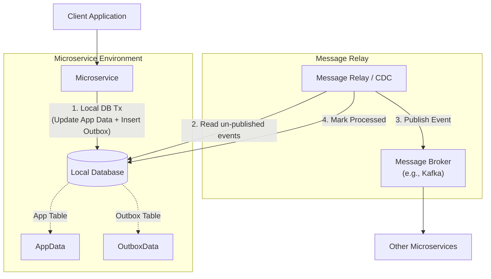

# Outbox Pattern

## 1. Pattern Overview and Intent

The **Outbox Pattern** (specifically, the Transactional Outbox pattern) solves a fundamental problem in distributed systems and microservices: **The Dual-Write Problem**. 

When a microservice needs to update its local database and simultaneously publish an event or message to a message broker (like Kafka or RabbitMQ) to notify other services of the change, it faces a dilemma. These two operations—updating the DB and sending the message—cannot easily be wrapped in a single distributed transaction (like 2PC), as 2PC is slow, poorly supported by modern message brokers, and reduces availability.

The intent of the Outbox Pattern is to guarantee that whenever a local database transaction commits, a corresponding event or message is reliably published to the message broker, achieving **at-least-once delivery** without distributed transactions.

---

## 2. Detailed Explanation of How It Works

Instead of trying to update the application tables and send a message over the network simultaneously, the service updates its application tables and inserts a record into a dedicated `outbox` table within the **same local database transaction**.

Since both the application tables and the `outbox` table are in the same database, the standard ACID properties of the database guarantee that either both updates succeed, or neither does.

Once the transaction commits, a separate process (the Message Relay or Polling Publisher) reads the records from the `outbox` table and publishes them to the message broker. After successful publication, the records in the `outbox` table are either deleted or marked as processed.

### Architecture Diagram



### Implementing the Message Relay
There are two primary ways to implement the process that reads the outbox and publishes the messages:
1. **Polling Publisher:** A background thread or cron job periodically polls the `outbox` table for unpublished messages (e.g., `SELECT * FROM outbox WHERE processed = false`).
2. **Change Data Capture (CDC):** A tool like **Debezium** tails the database's transaction log (e.g., MySQL binlog, Postgres WAL). When it detects an insert into the `outbox` table, it captures the event and publishes it to the broker. This approach is highly efficient and avoids polling overhead.

---

## 3. Real-World Example: Ride-Sharing System

Imagine a ride-sharing app where a passenger requests a ride. The `TripService` must create a trip record in its database and notify the `DriverMatchingService` to find a driver.

### Code Snippet (Pseudocode)

**Transactional DB Operations (Spring Boot / JPA):**
```java
@Service
public class TripService {

    @Autowired private TripRepository tripRepository;
    @Autowired private OutboxRepository outboxRepository;

    @Transactional
    public Trip requestTrip(Long passengerId, Location origin, Location dest) {
        // 1. Create and save the trip (Application state)
        Trip trip = new Trip(passengerId, origin, dest, TripStatus.REQUESTED);
        tripRepository.save(trip);

        // 2. Create and save the outbox event in the same transaction
        TripRequestedEvent eventPayload = new TripRequestedEvent(trip.getId(), origin, dest);
        OutboxEvent outboxEvent = new OutboxEvent(
            "TripRequested", 
            serializeToJson(eventPayload), 
            false // processed flag
        );
        outboxRepository.save(outboxEvent);

        // If anything fails, the entire transaction rolls back.
        return trip;
    }
}
```

**Polling Publisher:**
```java
@Scheduled(fixedDelay = 5000)
public void publishOutboxMessages() {
    List<OutboxEvent> events = outboxRepository.findByProcessedFalse();
    for (OutboxEvent event : events) {
        try {
            messageBroker.publish(event.getTopic(), event.getPayload());
            event.setProcessed(true);
            outboxRepository.save(event);
        } catch (Exception e) {
            // Log error, retry later
        }
    }
}
```

---

## 4. Detailed Pros and Cons

### Pros
- **Guaranteed Event Delivery:** Eliminates the dual-write problem. Ensures that if an action occurs in the system, the corresponding event is reliably published (at-least-once delivery).
- **Avoids Distributed Transactions:** Relies on local database transactions, keeping performance high and architecture relatively simple.
- **Resilience:** If the message broker is temporarily down, the system still functions; events simply accumulate in the outbox table and are processed when the broker returns.

### Cons
- **At-Least-Once Delivery:** The relay process might publish a message, but crash before marking it as processed in the database. When it restarts, it will publish the message again. Therefore, consumers **must be idempotent**.
- **Latency:** There is a slight delay between the database transaction committing and the message being published (especially with polling).
- **Overhead (Polling):** Polling the database table frequently can consume significant database resources.
- **Complexity (CDC):** Implementing CDC (e.g., setting up Debezium, Kafka Connect, managing binlog retention) introduces operational complexity to the infrastructure.

---

## 5. When to Use / When NOT to Use

### When to Use:
- Whenever a service must reliably publish an event as a direct result of a database state change.
- In Event-Driven Architectures and Saga Pattern implementations where lost events mean broken distributed transactions.
- When consistency between application state and published events is critical.

### When NOT to Use:
- For simple systems where dropping a message occasionally is acceptable (e.g., non-critical logging or analytics).
- When using event sourcing, where the event store itself acts as the single source of truth, rendering a separate outbox table unnecessary.

---

## 6. Common Interview Questions

1. **What is the Dual-Write Problem?**
   - *Answer:* It's the challenge of atomically updating a database and publishing a message to a broker without using distributed transactions. If one succeeds and the other fails, the system is left in an inconsistent state.

2. **How does the Outbox Pattern guarantee message delivery?**
   - *Answer:* It leverages the local database transaction to save the business data and the event payload together. A separate reliable process then reads the saved event and publishes it, retrying until successful.

3. **What is CDC (Change Data Capture) and how is it used with the Outbox Pattern?**
   - *Answer:* CDC is a technology that tails the database's transaction log (like Debezium for Postgres/MySQL) to detect changes. Instead of polling the outbox table, CDC streams the inserts from the outbox table directly to a message broker, providing near real-time, low-overhead event publishing.

4. **Why must consumers of Outbox messages be idempotent?**
   - *Answer:* Because the Outbox pattern guarantees *at-least-once* delivery. The relay might publish the message but crash before updating the outbox table to indicate success. On restart, it will republish the message, meaning the consumer might process the same event twice.

5. **Compare Polling vs. CDC for the message relay.**
   - *Answer:* Polling is easy to implement but adds load to the database and has higher latency. CDC is highly efficient, low latency, and doesn't strain the database queries, but requires complex infrastructure setup (like Debezium and Zookeeper/Kafka).
