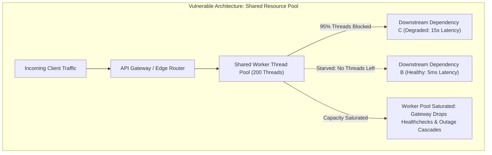
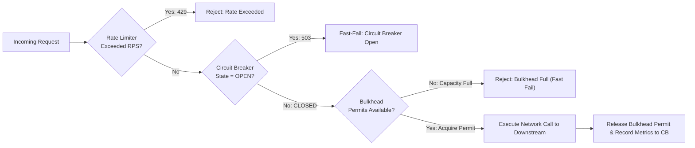
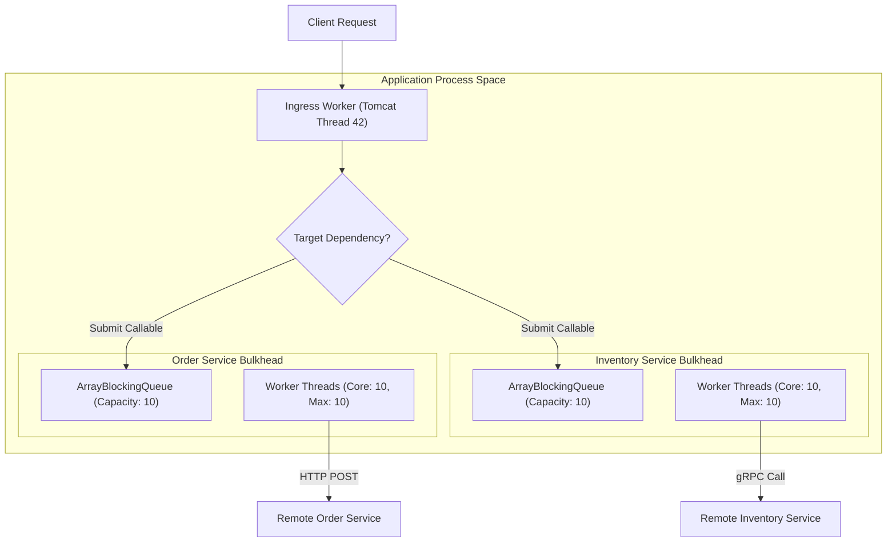
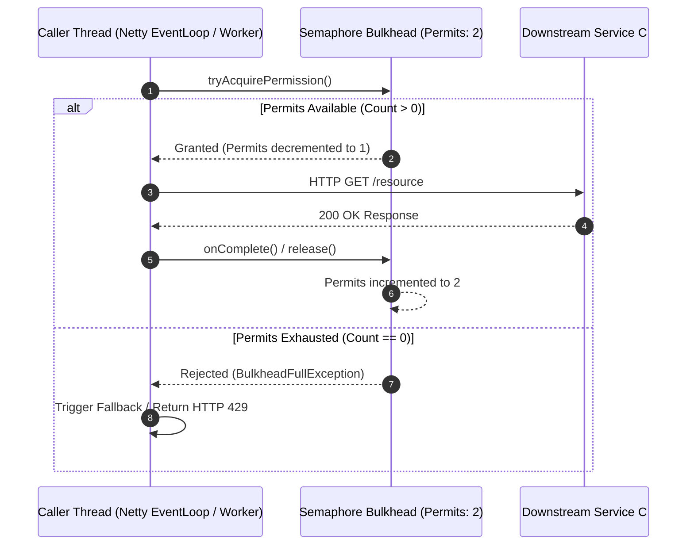
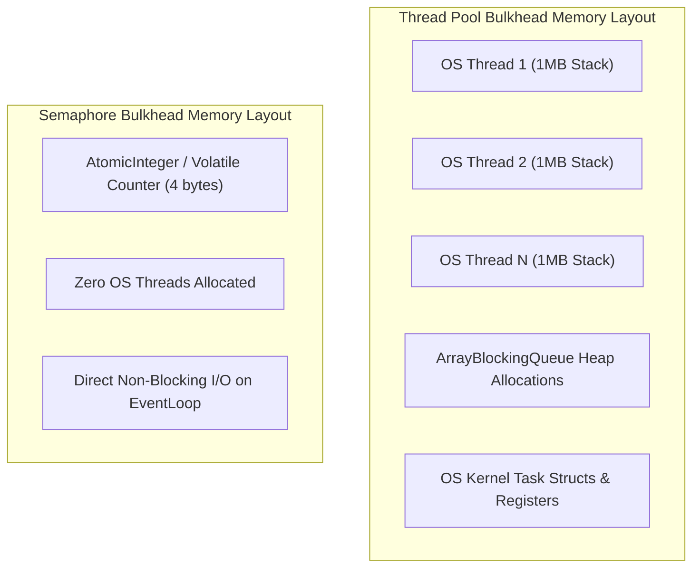
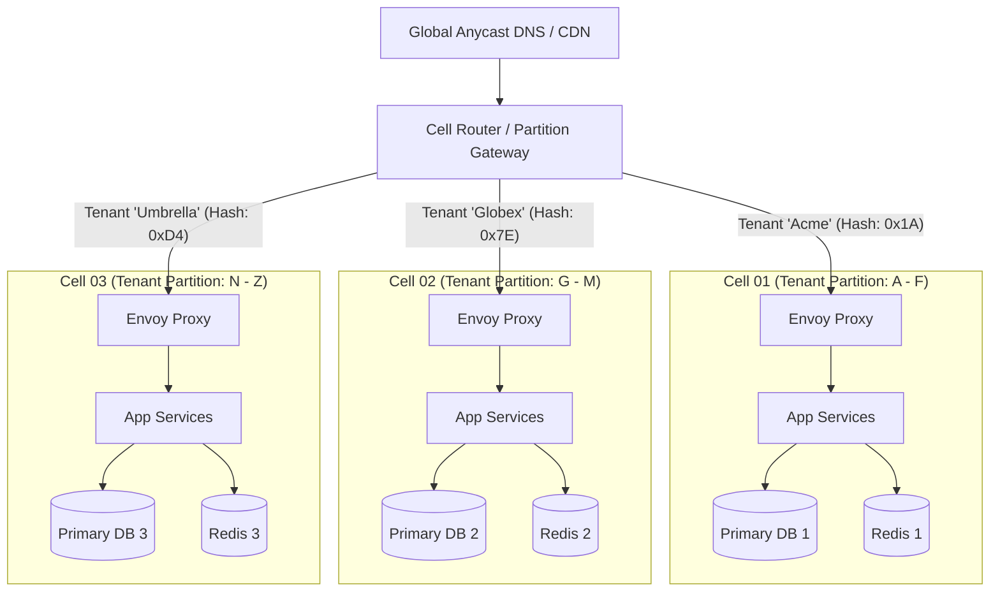
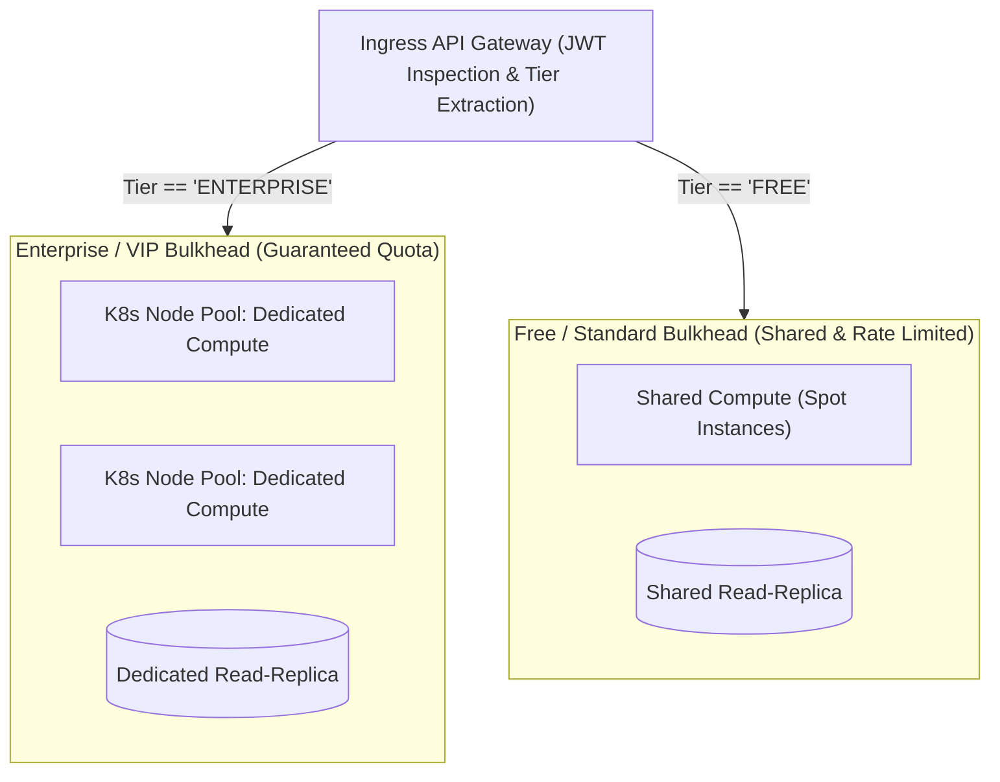
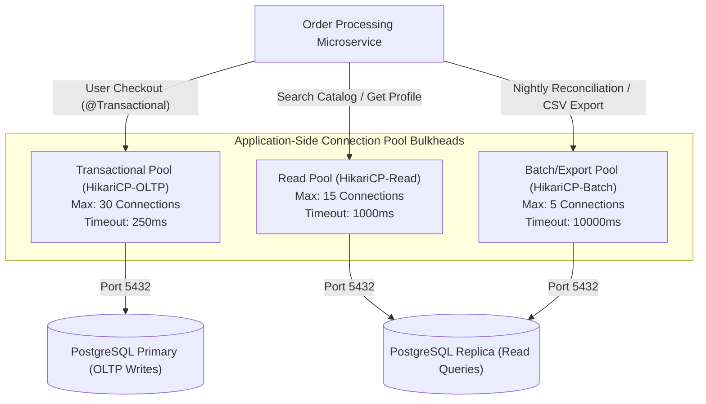
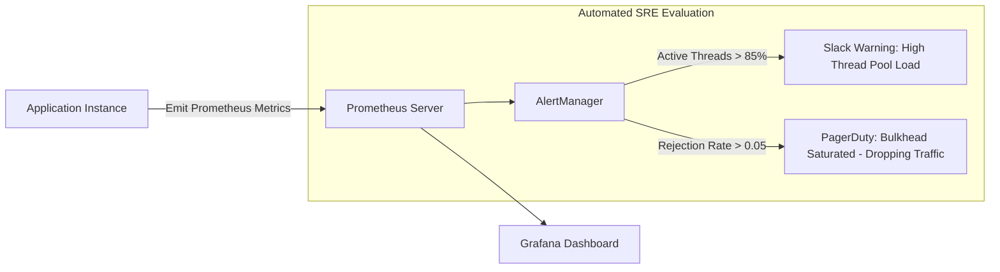

# The Bulkhead Pattern: Distributed System Isolation & Blast Radius Containment

The **Bulkhead Pattern** is an architectural resiliency pattern designed to isolate system resources into bounded, independent compartments. By preventing a failure, degradation, or resource exhaustion in one component from propagating to others, the bulkhead pattern preserves overall system availability and ensures that non-failing critical paths remain fully functional.

---

## 1. Pattern Overview & Theoretical Foundations

### 1.1 The Nautical Metaphor & Software Mapping
In naval architecture, a ship's hull is divided internally into watertight compartments separated by vertical partitions called **bulkheads**. If an exterior hull breach occurs (such as hitting an iceberg or striking a reef), water floods only the breached compartment. The watertight bulkhead doors contain the floodwater, maintaining the ship's buoyancy and preventing catastrophic sinking.

```
       NAUTICAL BULKHEAD (SHIP HULL)                    MICROSERVICES ARCHITECTURE
+-------------------------------------------+   +-------------------------------------------+
| Compartment 1 | Compartment 2 | Compartment 3 |   | Order Service | Catalog Serv. | Billing Serv. |
|  [ Watertight |  [ Watertight |  [ Watertight |   | [ Thread Pool | [ Thread Pool | [ Thread Pool |
|   Bulkhead ]  |   Bulkhead ]  |   Bulkhead ]  |   |   Max: 20 ]   |   Max: 20 ]   |   Max: 20 ]   |
|               |               |               |   |               |               |               |
|      OK       |   BREACHED!   |      OK       |   |      OK       |   DEGRADED!   |      OK       |
|               |  (Flooded)    |               |   |               | (Pool Sat.)   |               |
+---------------+---------------+---------------+   +---------------+---------------+---------------+
        Ship Remains Buoyant & Navigable                   Core Ordering & Billing Remain Operational
```

In distributed software systems, computing resources—such as **operating system threads, connection pools, CPU execution slots, memory buffers, and network sockets**—represent the ship's buoyancy. When a downstream microservice experiences elevated latency, a shared resource pool without bulkheads allows blocked requests to consume every available thread or socket. The entire application stalls, collapses, and sinks.

### 1.2 Cascading Resource Exhaustion: The "Slow Death"
Systems rarely fail cleanly with instant errors; they fail slowly through latent degradation:
1. **Downstream Degradation:** Service C introduces a 15-second database query lock.
2. **Upstream Contamination:** Service A calls Service C synchronously over HTTP using a shared thread pool of 200 threads.
3. **Queue Siphon:** Incoming traffic to Service C holds threads in Service A waiting on I/O. Within 3 seconds, all 200 threads in Service A are blocked waiting for Service C.
4. **Total Outage:** Requests arriving for Service B (which is 100% healthy and takes 5ms) cannot acquire a thread in Service A. Service A fails health checks and drops off the load balancer.
5. **Upstream Ripple:** The API Gateway calling Service A runs out of client connections. The failure cascades outward to mobile and web clients.



The Bulkhead Pattern prevents this dynamic by placing strict, unbreachable limits on the capacity allocated to any single dependency, feature, or tenant.

---

### 1.3 Mathematical Foundations: Little's Law and Queuing Theory

The necessity and sizing of bulkheads are governed directly by **Little's Law** and **Kingman's formula** from queuing theory.

#### Little's Law
In any stable queuing system, the average number of concurrent requests $L$ in the system equals the average arrival rate $\lambda$ multiplied by the average response time (wait time + service time) $W$:

$$L = \lambda \times W$$

Where:
- $L$ = Number of concurrent execution units (active threads or concurrent permits).
- $\lambda$ = Arrival rate of incoming requests (requests per second, RPS).
- $W$ = Average latency / duration spent in the system (seconds).

#### The Degradation Multiplier
Suppose an upstream service calls a downstream dependency running at normal operational parameters:
- Baseline arrival rate: $\lambda = 500\text{ RPS}$
- Baseline response time: $W = 0.020\text{ s}$ ($20\text{ ms}$)
- Concurrency required: $L = 500 \times 0.020 = 10\text{ concurrent threads}$

If the downstream dependency degrades and its response time increases to $W_{degraded} = 4.0\text{ s}$:
$$L_{degraded} = 500 \times 4.0 = 2,000\text{ concurrent threads}$$

A two-hundred-fold surge in required thread capacity occurs **without any increase in incoming traffic rate**. In an unbounded or shared thread model, this surge instantly consumes all CPU and memory resources. A bulkhead bounds $L$ to an absolute maximum ($L_{max}$), forcing fast failure once the threshold is crossed:

$$\text{Rejected RPS} = \lambda - \left(\frac{L_{max}}{W_{degraded}}\right)$$

#### Kingman's Formula for Queuing Delay
When a bulkhead includes a wait queue, queuing latency escalates non-linearly as utilization approaches 100%:

$$W_q \approx \left(\frac{\rho}{1-\rho}\right) \left(\frac{c_a^2 + c_s^2}{2}\right) \tau$$

Where $\rho$ is resource utilization ($\lambda / \mu$), $c_a$ is the coefficient of variation of arrivals, $c_s$ is the coefficient of variation of service times, and $\tau$ is mean service time. As utilization $\rho \to 1.0$, the multiplier $\frac{\rho}{1-\rho} \to \infty$. 

> [!CRITICAL]
> **Queue Bloat Hazard:** Large wait queues attached to bulkheads do not provide resiliency; they transform thread exhaustion into latency amplification, ensuring requests time out upstream before they are ever processed. Bulkhead wait queues must be tightly bounded or zero-capacity.

---

### 1.4 Defense-in-Depth: Bulkhead vs. Circuit Breaker vs. Rate Limiter

While often deployed together, these three stability patterns address fundamentally distinct failure modes:

| Dimension | Bulkhead Pattern | Circuit Breaker Pattern | Rate Limiter Pattern |
| :--- | :--- | :--- | :--- |
| **Primary Intent** | **Isolate capacity** to contain blast radius | **Halt requests** to an unhealthy dependency to enable recovery | **Throttle traffic** to protect own service from volume overloads |
| **Trigger Mechanism** | Current concurrent utilization ($L \ge L_{max}$) | Error rate or slow-call percentage over rolling time window | Request rate over time ($\lambda > \text{RPS}_{max}$) |
| **Statefulness** | Stateles or instantaneous resource counter | Stateful state machine (`CLOSED`, `OPEN`, `HALF_OPEN`) | Sliding window, token bucket, or leaky bucket counters |
| **Failure Point** | Rejects when instantaneous capacity is exhausted | Rejects when recent history indicates failure | Rejects when arrival rate exceeds contract limit |
| **Execution Point** | Client-side or Server-side | Client-side or Gateway-side | Ingress / Edge / In-process |



---

## 2. Taxonomy of Bulkhead Approaches

Bulkheading operates across multiple abstraction layers in distributed systems, ranging from low-level thread scheduling to physical geographic infrastructure:

```
+-----------------------------------------------------------------------------------+
| LAYER 4: GEOGRAPHIC & INFRASTRUCTURE BULKHEADS                                   |
| (Cell-Based Architecture, Multi-Region Deployments, K8s Node Pool Taints)        |
+-----------------------------------------------------------------------------------+
| LAYER 3: HARDWARE & OS PROCESS BULKHEADS                                         |
| (Linux cgroups v2, CPU Quotas, Memory Limits, Container Boundaries)               |
+-----------------------------------------------------------------------------------+
| LAYER 2: APPLICATION RUNTIME & CONNECTION POOL BULKHEADS                         |
| (HikariCP DB Pools, HTTP Client Connection Pools, Netty EventLoops)              |
+-----------------------------------------------------------------------------------+
| LAYER 1: IN-PROCESS EXECUTION CONCURRENCY BULKHEADS                              |
| (Thread Pool Isolation vs. Semaphore / Concurrency Limiter Isolation)           |
+-----------------------------------------------------------------------------------+
```

---

## 3. Approach 1: Thread Pool Isolation

### 3.1 Deep Conceptual Architecture
In Thread Pool Isolation, the calling application provisions dedicated, physically bounded thread pools for each distinct downstream service or operation type. The calling thread (e.g., the Tomcat/Netty request thread) does not execute the downstream I/O directly; instead, it wraps the call in a task and submits it to the dedicated pool.



### 3.2 High-Level Design (HLD)
- **Component Roles:**
  - **Task Dispatcher:** Receives work from ingress HTTP workers, translates parameters, and submits a `Callable` or `Runnable` to the target thread pool.
  - **Bounded Work Queue:** Stores tasks when all worker threads are active. Must be strictly bounded.
  - **Worker Threads:** Dedicated OS threads executing blocking or synchronous I/O against the target dependency.
  - **Rejection Handler:** Dictates behavior when both worker threads and the queue are completely saturated.
- **Asynchronous Execution Model:** Enables asynchronous fire-and-forget, fan-out parallel calls, and strict asynchronous timeouts via `Future.get(timeout)` or `CompletableFuture.orTimeout()`.

### 3.3 Low-Level Design (LLD): Sizing Formulas, Work Queues & Rejection

#### Mathematical Sizing Using Little's Law
To size a dedicated thread pool for a downstream service:

$$\text{Core Threads} = \left(\text{Peak Target RPS} \times \text{P99 Response Time in Seconds}\right) + \text{Headroom Buffer}$$

$$\text{Queue Capacity} = \text{Peak Target RPS} \times \text{Permissible Queue Dwell Time}$$

*Example Production Calculation:*
- Peak expected traffic to Service A: $\lambda = 800\text{ RPS}$
- Expected 99th percentile response time: $W_{p99} = 0.050\text{ s}$ ($50\text{ ms}$)
- Minimum thread requirement: $800 \times 0.050 = 40\text{ threads}$
- Headroom buffer for network jitter (25%): $40 \times 1.25 = 50\text{ threads}$
- Target maximum wait time in queue before timeout: $W_{queue} = 0.010\text{ s}$ ($10\text{ ms}$)
- Maximum queue capacity: $800 \times 0.010 = 8\text{ items}$

> [!WARNING]
> Do not size queues to accommodate seconds of latency. If downstream is dead, tasks queued for seconds will only be executed after the client has already cancelled the HTTP request, wasting CPU cycles on orphaned execution.

#### Work Queue Types & Trade-offs
1. **`SynchronousQueue` (Zero Hand-off):**
   - Holds no internal capacity. Each `put` must wait for a `take`.
   - Offers lowest latency and eliminates queue dwell time completely.
   - Ideal for strict fail-fast bulkheads.
2. **`ArrayBlockingQueue` (Bounded Pre-allocated Array):**
   - Fixed size, array-backed, cache-friendly.
   - Predictable memory footprint; does not allocate memory on task enqueue.
   - Recommended standard for microservice bulkheads.
3. **`LinkedBlockingQueue` (Linked Nodes):**
   - High risk of memory leak if constructed without explicit capacity (unbounded `Integer.MAX_VALUE`).
   - Allocates node objects dynamically on each enqueue, driving JVM garbage collection churn under load.

#### Saturation and Rejection Policies
When the thread pool hits `maxPoolSize` and the work queue is filled to capacity, the `RejectedExecutionHandler` is triggered:

```
[ Incoming Task ] ---> [ Thread Pool Active == Max? ] 
                               | Yes
                               v
                     [ Work Queue Full? ]
                               | Yes
                               v
              [ RejectedExecutionHandler Invoked ]
                               |
       +-----------------------+-----------------------+-----------------------+
       |                       |                       |                       |
       v                       v                       v                       v
 [ AbortPolicy ]      [ CallerRunsPolicy ]      [ DiscardPolicy ]   [ DiscardOldestPolicy ]
 Throws Exception     Executes on Ingress       Silently Drops      Drops Head of Queue,
 (Immediate 503/429)  Thread (DANGEROUS!)       Task (Data Loss)    Enqueues New Task
```

- **`ThreadPoolExecutor.AbortPolicy` (Default & Recommended):** Throws `RejectedExecutionException`. Enables the application to catch the failure immediately, trigger a graceful fallback (cached response, degraded payload), or return HTTP 429/503.
- **`ThreadPoolExecutor.CallerRunsPolicy` (Architectural Anti-Pattern for Bulkheads):** Executes the submitted task on the caller thread (e.g., Tomcat/Jetty worker).
  - *Why it breaks bulkheads:* If the downstream dependency is frozen, the calling thread blocks while running the task. As more caller threads run tasks, the entire web server thread pool becomes saturated, propagating the exact cascading failure the bulkhead was designed to contain!
- **`ThreadPoolExecutor.DiscardPolicy`:** Silently drops the task without throwing an error. Suitable only for loss-tolerant telemetry.
- **`ThreadPoolExecutor.DiscardOldestPolicy`:** Discards the unhandled task at the head of the queue and attempts to enqueue the new task.

### 3.4 Thread Context Switching Overhead & Memory Footprint
Thread pool bulkheads provide absolute hardware-level preemption and context isolation, but impose measurable operating system overhead:
- **Memory Footprint:** Each OS thread in Linux/JVM allocates a thread stack (default `-Xss1m` = 1 megabyte). 10 bulkheads with 50 threads each consume:
  $$10 \times 50 \times 1\text{ MB} = 500\text{ MB of off-heap RAM}$$
- **Context Switching Cost:** As active threads exceed the physical CPU core count, the Linux kernel scheduler (`sched_fair`) spends significant cycles swapping CPU registers, restoring thread stacks, and invalidating the CPU Translation Lookaside Buffer (TLB) and L1/L2 hardware caches.
  - Cost per voluntary context switch: $\approx 1.5 - 2.5\ \mu\text{s}$.
  - Cost per involuntary context switch (preemptive): $\approx 5 - 15\ \mu\text{s}$ due to cache line eviction.

---

## 4. Approach 2: Semaphore / Concurrency Limiter Isolation

### 4.1 Deep Conceptual Architecture
A **Semaphore Bulkhead** limits the number of concurrent executions without spinning up separate thread pools. It acts as a digital turnstile: executing threads must acquire a permit before dispatching a downstream call and must release that permit upon completion.



### 4.2 High-Level Design (HLD)
- **Single-Threaded & Reactive Compatibility:** Fits non-blocking runtimes (Project Reactor, Spring WebFlux, Vert.x, Node.js, and Go runtime schedulers) where blocking an OS thread is strictly prohibited.
- **In-Thread Execution:** The network call is initialized and managed directly on the calling thread, eliminating context switching overhead.
- **Zero Queue Buffering:** Typically configured with zero wait duration, delivering instantaneous fast-failure when capacity is reached.

### 4.3 Low-Level Design (LLD): Atomic Counters, CAS, and Memory Layout
Internally, a Semaphore Bulkhead does not create OS synchronization monitors. Instead, it relies on lock-free CPU instructions—specifically **Atomic Compare-And-Swap (CAS)** on memory locations.

```
+---------------------------------------------------------------+
| RESILIENCE4J SEMAPHORE BULKHEAD MEMORY MODEL                  |
|                                                               |
|  VarHandle / AtomicIntegerFieldUpdater                        |
|  +---------------------------------------------------------+  |
|  | volatile int availablePermits = 15;                     |  |
|  +---------------------------------------------------------+  |
|                                                               |
|  CAS Acquire Loop:                                            |
|    do {                                                       |
|        int current = availablePermits;                        |
|        if (current <= 0) throw BulkheadFullException;         |
|    } while (!compareAndSet(current, current - 1));            |
|                                                               |
+---------------------------------------------------------------+
```

#### Resilience4j Semaphore vs. ThreadPool Memory Comparison



- **Thread Pool Bulkhead:** Memory scale = $O(N)$ where $N$ is thread count ($\approx N \times 1\text{ MB}$).
- **Semaphore Bulkhead:** Memory scale = $O(1)$ ($\approx 32\text{ bytes}$ for state and atomic reference).

---

## 5. Approach 3: Hardware, Cluster & Cell-Based Bulkheading

When software-level thread and semaphore partitions fail due to host-wide resource exhaustion (such as kernel memory leaks, garbage collection stop-the-world pauses, or network interface card saturation), isolation must be enforced at the infrastructure tier.

### 5.1 Cell-Based Architecture (CBA)
In a Cell-Based Architecture, an entire microservices deployment (services, caches, databases) is replicated into isolated, self-contained units called **Cells**. Each cell processes a deterministic partition of the total customer base.



- **Blast Radius Boundary:** A catastrophic bug or poisoned payload sent by tenant `Acme` crashes only **Cell 01**. Tenants in Cells 02 and 03 experience zero degradation.
- **Maximum Scale Cap:** Systems are designed with hard limits on cell size to prevent unbounded scaling issues. Growth is achieved by adding new cells horizontally rather than scaling existing cells vertically.

### 5.2 Shuffle Sharding
Pioneered by Amazon Web Services (AWS) in Route 53 and DynamoDB, **Shuffle Sharding** combines virtual isolation with cell architectures to provide extraordinary fault isolation without requiring dedicated single-tenant clusters.

#### The Mathematical Blast Radius of Shuffle Sharding
Suppose a fleet consists of $N = 8$ physical service nodes. We allocate each customer a virtual cell consisting of $K = 4$ nodes chosen at random.

The number of unique combinations of nodes is given by the binomial coefficient:

$$\binom{N}{K} = \frac{N!}{K!(N - K)!} = \frac{8!}{4!(4)!} = \frac{40,320}{24 \times 24} = 70\text{ unique virtual cells}$$

```
PHYSICAL FLEET NODES: [Node 1] [Node 2] [Node 3] [Node 4] [Node 5] [Node 6] [Node 7] [Node 8]

Customer A Assignment:  [Node 1]   [Node 2]   [Node 3]   [Node 4]
Customer B Assignment:             [Node 2]   [Node 3]   [Node 4]   [Node 5]
Customer C Assignment:  [Node 1]                         [Node 4]   [Node 5]   [Node 6]
```

- If Customer A sends a **poison pill request** (a query that triggers a memory leak or crash loop), all 4 nodes assigned to Customer A crash (Nodes 1, 2, 3, and 4).
- Customer B shares Nodes 2, 3, and 4 with Customer A, but still retains **Node 5**. Node 5 continues to process Customer B's traffic with slight degradation, maintaining availability.
- Customer C loses Nodes 1 and 4, but **Nodes 5 and 6 remain fully healthy**.
- A customer whose assigned 4-node set is completely disjoint from Customer A's set (e.g., Nodes 5, 6, 7, 8) suffers **zero impact**.

The probability that another customer shares the exact same 4-node assignment and experiences an outage is:

$$P(\text{Correlated Outage}) = \frac{1}{\binom{N}{K}} = \frac{1}{70} \approx 1.4\%$$

If expanded to $N = 100$ nodes with $K = 5$ node assignments:
$$\binom{100}{5} = 75,287,520\text{ virtual cells}$$
The probability of a poisoned tenant affecting any other specific tenant drops to **1 in 75 million**.

### 5.3 Multi-Tenant Tier Isolation (VIP vs. Standard)
In SaaS architectures, bulkheading protects high-value enterprise clients from noisy-neighbor interference caused by lower-tier or free users:



---

## 6. Approach 4: Database Connection Pool Bulkheading

Database connection pools are one of the most common single points of failure in microservices. A single slow reporting query can exhaust the pool, starving latency-critical write transactions.

### 6.1 Split Connection Pool Topologies
Instead of maintaining a single monolithic database connection pool (e.g., HikariCP with 50 connections), the application partitions connections into dedicated pools classified by traffic SLA and execution profile:



### 6.2 Low-Level HikariCP Isolation Mechanics
- **Connection Leak Detection:** Configuring `leakDetectionThreshold = 2000` tracks any thread holding a connection longer than 2 seconds without returning it to the pool, emitting a stack trace exception.
- **Fast-Failing Acquisition:** Setting `connectionTimeout = 250` ensures that when the transactional pool fills up, waiting threads fail within 250 milliseconds rather than hanging indefinitely, triggering immediate fallback paths.

---

## 7. Production Code Implementations

### 7.1 Java / Spring Boot: Resilience4j Thread Pool & Semaphore Bulkheads

Below is a complete, production-grade Spring Boot service demonstrating programmatic and declarative bulkhead configurations, custom rejection handlers, fallback paths, and Micrometer metrics instrumentation.

#### Configuration (`application.yml`)
```yaml
resilience4j:
  thread-pool-bulkhead:
    instances:
      orderServiceThreadPool:
        maxThreadPoolSize: 20
        coreThreadPoolSize: 10
        queueCapacity: 5
        keepAliveDuration: 20ms
        writableStackTraceEnabled: false
  bulkhead:
    instances:
      inventoryServiceSemaphore:
        maxConcurrentCalls: 50
        maxWaitDuration: 10ms
        writableStackTraceEnabled: false
```

#### Production Java Service Implementation
```java
package com.architect.resilience.bulkhead;

import io.github.resilience4j.bulkhead.Bulkhead;
import io.github.resilience4j.bulkhead.BulkheadFullException;
import io.github.resilience4j.bulkhead.BulkheadRegistry;
import io.github.resilience4j.bulkhead.ThreadPoolBulkhead;
import io.github.resilience4j.bulkhead.ThreadPoolBulkheadRegistry;
import io.micrometer.core.instrument.MeterRegistry;
import io.micrometer.core.instrument.Tags;
import org.slf4j.Logger;
import org.slf4j.LoggerFactory;
import org.springframework.stereotype.Service;

import java.time.Duration;
import java.util.Collections;
import java.util.List;
import java.util.concurrent.CompletableFuture;
import java.util.concurrent.CompletionStage;
import java.util.function.Supplier;

@Service
public class ResilientCatalogService {

    private static final Logger log = LoggerFactory.getLogger(ResilientCatalogService.class);

    private final ThreadPoolBulkhead orderThreadPoolBulkhead;
    private final Bulkhead inventorySemaphoreBulkhead;
    private final RemoteOrderClient remoteOrderClient;
    private final RemoteInventoryClient remoteInventoryClient;

    public ResilientCatalogService(
            ThreadPoolBulkheadRegistry threadPoolBulkheadRegistry,
            BulkheadRegistry bulkheadRegistry,
            MeterRegistry meterRegistry,
            RemoteOrderClient remoteOrderClient,
            RemoteInventoryClient remoteInventoryClient) {

        this.remoteOrderClient = remoteOrderClient;
        this.remoteInventoryClient = remoteInventoryClient;

        // 1. Initialize Thread Pool Bulkhead for Orders (Isolated Thread Execution)
        this.orderThreadPoolBulkhead = threadPoolBulkheadRegistry.bulkhead("orderServiceThreadPool");

        // 2. Initialize Semaphore Bulkhead for Inventory (Non-blocking I/O Concurrency Limiter)
        this.inventorySemaphoreBulkhead = bulkheadRegistry.bulkhead("inventoryServiceSemaphore");

        // 3. Register Custom Observability Metrics
        registerBulkheadMetrics(meterRegistry);
    }

    /**
     * Executes asynchronous call using Thread Pool Bulkhead.
     * Prevents downstream order service latency from consuming web container threads.
     */
    public CompletionStage<OrderDetails> fetchOrderDetailsAsync(String orderId) {
        Supplier<OrderDetails> decoratedSupplier = ThreadPoolBulkhead.decorateSupplier(
                orderThreadPoolBulkhead,
                () -> remoteOrderClient.getOrder(orderId)
        );

        return CompletableFuture.supplyAsync(decoratedSupplier, orderThreadPoolBulkhead.getExecutorService())
                .exceptionally(throwable -> {
                    if (throwable.getCause() instanceof BulkheadFullException 
                            || throwable instanceof BulkheadFullException) {
                        log.warn("Order ThreadPool Bulkhead is saturated! Triggering fallback for order: {}", orderId);
                        return OrderDetails.degradedOrder(orderId, "Temporarily Unavailable");
                    }
                    log.error("Downstream call failed unexpectedly", throwable);
                    throw new RuntimeException("Downstream call failed", throwable);
                });
    }

    /**
     * Executes synchronous/reactive call wrapped in a Semaphore Bulkhead.
     * Restricts concurrency to 50 simultaneous permits on the current thread.
     */
    public List<InventoryItem> checkInventory(List<String> skuList) {
        Supplier<List<InventoryItem>> supplier = () -> remoteInventoryClient.getInventoryForSkus(skuList);
        Supplier<List<InventoryItem>> decorated = Bulkhead.decorateSupplier(inventorySemaphoreBulkhead, supplier);

        try {
            return decorated.get();
        } catch (BulkheadFullException ex) {
            log.warn("Inventory Semaphore Bulkhead permit exhausted. Fast-failing with cached inventory status.");
            return Collections.emptyList(); // Graceful degradation
        }
    }

    private void registerBulkheadMetrics(MeterRegistry registry) {
        registry.gauge("bulkhead.threadpool.active.threads", 
                Tags.of("name", "orderServiceThreadPool"), 
                orderThreadPoolBulkhead, 
                b -> b.getMetrics().getThreadPoolSize());

        registry.gauge("bulkhead.threadpool.queue.depth", 
                Tags.of("name", "orderServiceThreadPool"), 
                orderThreadPoolBulkhead, 
                b -> b.getMetrics().getQueueDepth());

        registry.gauge("bulkhead.semaphore.available.permits", 
                Tags.of("name", "inventoryServiceSemaphore"), 
                inventorySemaphoreBulkhead, 
                b -> b.getMetrics().getAvailableConcurrentCalls());
    }
}
```

---

### 7.2 Go: High-Throughput Semaphore Bulkhead with Dynamic Shedding

In Go, goroutines are extremely lightweight ($\approx 2\text{ KB}$ per stack). However, unconstrained goroutine creation under high network concurrency leads to garbage collection thrashing and memory exhaustion. The following implementation provides a production-grade, context-aware Semaphore Bulkhead with non-blocking permit acquisition, timeouts, and metrics.

```go
package bulkhead

import (
	"context"
	"errors"
	"sync"
	"sync/atomic"
	"time"
)

var (
	ErrBulkheadFull    = errors.New("bulkhead capacity reached: request rejected")
	ErrContextCanceled = errors.New("caller context canceled before acquiring permit")
)

// MetricsSnapshot exposes real-time bulkhead saturation statistics.
type MetricsSnapshot struct {
	Capacity        int32
	ActivePermits   int32
	TotalRejected   uint64
	TotalExecuted   uint64
}

// SemaphoreBulkhead isolates resources using channel-based permits.
type SemaphoreBulkhead struct {
	capacity      int32
	activePermits int32
	permits       chan struct{}
	rejectedCount uint64
	executedCount uint64
	mu            sync.RWMutex
}

// NewSemaphoreBulkhead initializes a bulkhead with a fixed permit capacity.
func NewSemaphoreBulkhead(capacity int32) *SemaphoreBulkhead {
	b := &SemaphoreBulkhead{
		capacity: capacity,
		permits:  make(chan struct{}, capacity),
	}
	// Fill token buffer with initial capacity
	for i := int32(0); i < capacity; i++ {
		b.permits <- struct{}{}
	}
	return b
}

// Execute wraps a protected function within the bulkhead lifecycle.
func (b *SemaphoreBulkhead) Execute(ctx context.Context, fn func() error) error {
	// 1. Attempt non-blocking fast acquisition
	select {
	case <-b.permits:
		// Permit acquired successfully
		atomic.AddInt32(&b.activePermits, 1)
		defer b.release()
		
		atomic.AddUint64(&b.executedCount, 1)
		return fn()

	default:
		// Channel buffer is empty, proceed to bounded wait or rejection
	}

	// 2. Bounded acquisition with context deadline
	select {
	case <-ctx.Done():
		atomic.AddUint64(&b.rejectedCount, 1)
		return ErrContextCanceled

	case <-b.permits:
		atomic.AddInt32(&b.activePermits, 1)
		defer b.release()

		atomic.AddUint64(&b.executedCount, 1)
		return fn()

	case <-time.After(5 * time.Millisecond): // Max wait threshold before fast-failing
		atomic.AddUint64(&b.rejectedCount, 1)
		return ErrBulkheadFull
	}
}

// release returns a permit to the pool and decrements the active count.
func (b *SemaphoreBulkhead) release() {
	atomic.AddInt32(&b.activePermits, -1)
	b.permits <- struct{}{}
}

// GetMetrics returns the current health and utilization snapshot.
func (b *SemaphoreBulkhead) GetMetrics() MetricsSnapshot {
	return MetricsSnapshot{
		Capacity:      b.capacity,
		ActivePermits: atomic.LoadInt32(&b.activePermits),
		TotalRejected: atomic.LoadUint64(&b.rejectedCount),
		TotalExecuted: atomic.LoadUint64(&b.executedCount),
	}
}
```

---

### 7.3 Multi-Tenant Database Connection Pool Bulkhead (Spring Dynamic Routing)

This Java configuration dynamically routes database queries to isolated HikariCP pools based on the incoming request's tenancy or execution tier.

```java
package com.architect.resilience.database;

import com.zaxxer.hikari.HikariConfig;
import com.zaxxer.hikari.HikariDataSource;
import org.springframework.jdbc.datasource.lookup.AbstractRoutingDataSource;

import javax.sql.DataSource;
import java.util.HashMap;
import java.util.Map;

public class TieredRoutingDataSource extends AbstractRoutingDataSource {

    public enum TenantTier {
        VIP_ENTERPRISE,
        STANDARD_FREE
    }

    private static final ThreadLocal<TenantTier> currentTier = 
            ThreadLocal.withInitial(() -> TenantTier.STANDARD_FREE);

    public static void setTier(TenantTier tier) {
        currentTier.set(tier);
    }

    public static void clear() {
        currentTier.remove();
    }

    @Override
    protected Object determineCurrentLookupKey() {
        return currentTier.get();
    }

    public static DataSource buildDynamicTieredDataSource(String jdbcUrl, String username, String password) {
        TieredRoutingDataSource routingDataSource = new TieredRoutingDataSource();

        // 1. Enterprise Pool Bulkhead (High Capacity, Short Timeout, Dedicated Connections)
        HikariConfig vipConfig = new HikariConfig();
        vipConfig.setPoolName("Hikari-VIP-Enterprise");
        vipConfig.setJdbcUrl(jdbcUrl);
        vipConfig.setUsername(username);
        vipConfig.setPassword(password);
        vipConfig.setMaximumPoolSize(40);
        vipConfig.setMinimumIdle(10);
        vipConfig.setConnectionTimeout(250); // Fast failure for VIP
        vipConfig.setLeakDetectionThreshold(2000);
        HikariDataSource vipDataSource = new HikariDataSource(vipConfig);

        // 2. Standard Pool Bulkhead (Constrained Capacity to Protect DB from Overload)
        HikariConfig stdConfig = new HikariConfig();
        stdConfig.setPoolName("Hikari-Standard-Free");
        stdConfig.setJdbcUrl(jdbcUrl);
        stdConfig.setUsername(username);
        stdConfig.setPassword(password);
        stdConfig.setMaximumPoolSize(10);
        stdConfig.setMinimumIdle(2);
        stdConfig.setConnectionTimeout(1000);
        stdConfig.setLeakDetectionThreshold(5000);
        HikariDataSource stdDataSource = new HikariDataSource(stdConfig);

        Map<Object, Object> targetDataSources = new HashMap<>();
        targetDataSources.put(TenantTier.VIP_ENTERPRISE, vipDataSource);
        targetDataSources.put(TenantTier.STANDARD_FREE, stdDataSource);

        routingDataSource.setTargetDataSources(targetDataSources);
        routingDataSource.setDefaultTargetDataSource(stdDataSource);
        routingDataSource.afterPropertiesSet();

        return routingDataSource;
    }
}
```

---

## 8. Telemetry, Metrics Instrumentation & Dynamic Tuning

Monitoring bulkhead health is vital for detecting capacity exhaustion before it results in customer-facing outages.

### 8.1 Critical Metrics Matrix

| Metric Name | Prometheus Type | Description | Alerting Threshold |
| :--- | :--- | :--- | :--- |
| `bulkhead_active_threads` | Gauge | Instantaneous count of active worker threads | $> 80\%$ of pool capacity |
| `bulkhead_queue_depth` | Gauge | Count of tasks waiting in queue | $> 50\%$ of queue capacity |
| `bulkhead_queue_wait_seconds` | Histogram | Latency spent dwelling in queue prior to execution | P99 $> 15\text{ ms}$ |
| `bulkhead_rejection_total` | Counter | Cumulative rejected executions due to full pool/queue | Rate $> 0$ for $> 30\text{ seconds}$ |
| `bulkhead_semaphore_permits_available` | Gauge | Unused permits remaining in semaphore | $< 10\%$ available |
| `process_context_switches_total` | Counter | Voluntary and involuntary OS context switches | Spike $> 300\%$ over baseline |



### 8.2 Adaptive Dynamic Bulkheading (AIMD Feedback Loops)
Hardcoded bulkhead limits often degrade during traffic spikes or downstream infrastructure scaling. Advanced distributed runtimes implement **Adaptive Concurrency Limiting** using the **Additive Increase / Multiplicative Decrease (AIMD)** algorithm (similar to TCP congestion control):

```
       AIMD DYNAMIC CONCURRENCY LIMIT REGULATION
Capacity
   ^
   |                     /|                 /|
   |       /\           / |   /\           / |
   |      /  \  <------+--+--+--\         /  |
   |     /    \ |      |  |  |   \       /   |  Limit drops 50%
   |    /      \|      |  |  |    \     /    |  on latency/error
   |   /               |  |  |     \   /     |
   |  /                |  |  |      \ /      |
   | /                 |  |  |       V       |
   +---------------------------------------------> Time
                       Observed Latency > RTT_gradient
```

1. **Continuous Sampling:** Measure the round-trip time (RTT) of downstream calls across a sliding window.
2. **Gradient Calculation:**
   $$\text{Gradient} = \frac{\text{RTT}_{baseline}}{\text{RTT}_{current}}$$
3. **Limit Adjustment:**
   - If $\text{Gradient} \ge 1.0$ (latency is healthy): $\text{Limit}_{new} = \text{Limit}_{current} + \text{Increment}$ (Additive Increase).
   - If $\text{Gradient} < 1.0$ (latency is rising): $\text{Limit}_{new} = \text{Limit}_{current} \times \text{Gradient}$ (Multiplicative Decrease).

---

## 9. Real-World Edge Cases, Failure Modes & Resiliency Traps

### 9.1 Trap 1: The "CallerRunsPolicy" Catastrophe
When engineering teams encounter rejected execution exceptions in thread pools, an intuitive but dangerous reaction is configuring:
```java
executor.setRejectedExecutionHandler(new ThreadPoolExecutor.CallerRunsPolicy());
```
**Why this causes total system collapse:**
- In an HTTP servlet container (e.g., Tomcat), worker threads accept connections from clients.
- If the downstream payment service hangs, the 20 threads in the `PaymentBulkhead` saturate.
- The 21st task is rejected by the pool. `CallerRunsPolicy` directs the **Tomcat worker thread** to execute the slow payment call itself.
- Within seconds, all 200 Tomcat worker threads are executing slow payment calls.
- Ingress health checks fail, the load balancer removes the entire container instance, and traffic redistributes to remaining instances, triggering a cluster-wide death spiral.

> [!CAUTION]
> Never use `CallerRunsPolicy` for bulkheads defending against slow or untrusted downstream dependencies. Always use `AbortPolicy` combined with an explicit application fallback.

### 9.2 Trap 2: Queue Bloat (The Bufferbloat Illusion)
Engineers frequently configure large queues to "smooth out" temporary load spikes:
```java
// DANGEROUS CONFIGURATION
new ThreadPoolExecutor(10, 10, 0L, TimeUnit.MILLISECONDS, new LinkedBlockingQueue<>(5000));
```
**The Failure Sequence:**
1. Downstream service response time degrades from $20\text{ ms}$ to $2\text{ seconds}$.
2. The 10 worker threads can process only 5 requests per second ($10 / 2\text{s} = 5\text{ RPS}$).
3. A queue of 5,000 tasks will take:
   $$\text{Dwell Time} = \frac{5,000}{5\text{ RPS}} = 1,000\text{ seconds} \approx 16.6\text{ minutes}$$
4. Upstream clients and API gateways have HTTP timeouts of 3 to 5 seconds.
5. Every single task waiting in the queue has **already been aborted by the client**. The worker threads spend 100% of their CPU capacity executing stale, useless requests for clients that have already disconnected!

### 9.3 Trap 3: ThreadLocal Leakage & Trace Context Erasure
Thread pool bulkheads decouple execution from the ingress request thread. In frameworks relying on `ThreadLocal` storage (e.g., Spring Security Context, OpenTelemetry `Tracer`, SLF4J `MDC` correlation IDs), child threads in the bulkhead pool will **not inherit the parent thread's context**:

```java
// BUG: MDC correlation ID is lost when dispatched to another thread pool
MDC.put("traceId", "abc-123");
CompletableFuture.runAsync(() -> {
    // Inside the bulkhead thread: MDC.get("traceId") returns NULL!
    log.info("Processing order"); 
}, bulkheadExecutor);
```

**Remediation:** Context must be propagated explicitly using decorator tasks or wrappers such as `TaskDecorator` in Spring, OpenTelemetry `Context.current().wrap()`, or Java 21 Scoped Values.

### 9.4 Trap 4: Circular Deadlocks in Nested Bulkheads
If Service A contains Bulkhead 1 (for Order Processing) which calls Bulkhead 2 (for Payment) on the same machine, and Bulkhead 2 makes a synchronous callback into Bulkhead 1, circular wait conditions emerge under load. When both pools saturate, threads in Pool 1 wait for Pool 2, while Pool 2 is blocked waiting for Pool 1, resulting in permanent deadlocks.

---

## 10. Comprehensive Comparison Matrix

| Architectural Dimension | Thread Pool Bulkhead | Semaphore Bulkhead | Cell-Based Architecture | Connection Pool Bulkhead |
| :--- | :--- | :--- | :--- | :--- |
| **Isolation Layer** | In-Process OS Thread | In-Process Counter / CAS | Infrastructure / Network | Application / DB Client |
| **Preemption Support** | **Yes** (Thread interrupts) | **No** (Relies on non-blocking I/O) | **Yes** (Node termination) | **No** (Socket timeout dependent) |
| **Context Switch Overhead** | **High** ($\mu\text{s}$ per switch) | **Zero** (Same thread) | **Zero In-Process** | **Low to Medium** |
| **Memory Footprint** | **Heavy** ($\sim 1\text{ MB}$ per thread) | **Negligible** (Bytes) | **Very High** (Duplicated infra) | **Moderate** (Connection memory) |
| **Reactive / Async Fit** | Poor (Blocks worker) | **Native / Ideal** | Independent | Moderate |
| **Blast Radius Boundary** | Single downstream service | Single downstream service | Complete cell / tenant group | Database engine / queries |
| **Complexity to Tune** | High (Pool size + Queue size) | Low (Max permits only) | Extremely High (Routing/Data) | Moderate (Pool size + Timeout) |
| **Failure Latency** | Instant on queue full | Instant on permit exhaustion | Fast fail at cell router | Fast fail on connection timeout |

---

## 11. Real-World Case Studies at Hyper-Scale

### 11.1 Netflix: The Evolution from Hystrix Thread Pools to Non-Blocking Bulkheads
- **Context:** During Netflix's migration from monolithic data centers to AWS microservices, downstream failures frequently cascaded through shared Tomcat thread pools, taking down the streaming homepage.
- **Implementation:** Netflix developed **Hystrix**, enforcing strict Thread Pool Bulkheads on every network client. Each downstream service (Personalization, Recommendations, User Profiles) was assigned an isolated pool of 10 to 20 threads with small queues (5 to 10 items).
- **The Evolution:** At massive scale (tens of millions of concurrent streams), maintaining thousands of threads across hundreds of dependencies created catastrophic OS thread context switching and memory overhead. Netflix subsequently deprecated Hystrix, migrating to non-blocking reactive architectures (RxJava, Mantis, Netty) governed by **Semaphore / Concurrency Limiter Bulkheads** through libraries like Resilience4j and Envoy proxy filters.

### 11.2 AWS Route 53 & DynamoDB: Shuffle Sharded Cells
- **Context:** AWS Route 53 DNS serves trillions of queries daily. A distributed Denial of Service (DDoS) attack or poisoned lookup against a single customer could potentially take down shared DNS name servers.
- **Implementation:** AWS implemented **Shuffle Sharding** across thousands of name servers. Rather than assigning a customer to a single name server or an entire shared fleet, Route 53 assigns each hosted zone 4 virtual name servers selected from distinct shuffle shards across the global fleet.
- **Result:** Even when a customer experiences a massive multi-terabit volumetric attack that completely incapacitates their 4 assigned name servers, the remaining 99.999% of customers on different shard combinations continue operating without experiencing packet loss or resolution failures.

### 11.3 Slack: Enterprise Grid Workspace Isolation
- **Context:** Slack connects hundreds of thousands of independent small companies alongside massive enterprise organizations (e.g., IBM with 300,000+ users). Large enterprises generate immense message fan-out load that overwhelmed shared Redis clusters and database shards.
- **Implementation:** Slack introduced **Enterprise Grid Bulkheads**. Workspaces are classified into tiered execution cells:
  - Small and medium workspaces share horizontally scaled multi-tenant clusters governed by strict semaphore rate limiters.
  - Large enterprise workspaces are provisioned into **dedicated physical cells** with isolated MySQL databases (Vitess), dedicated Redis instances, and segregated message dispatch pipelines.
- **Result:** A sudden surge in messaging volume or an all-hands event at a Fortune 500 company has zero performance impact on standard SMB workspaces.

---

## 12. System Design Interview Masterclass: 7 In-Depth Scenarios

### Q1: "How would you size thread pool bulkheads for an API gateway communicating with five downstream services with drastically different SLAs?"

#### Expert Answer:
1. **Gather Performance Metrics:** For each downstream service ($i$), identify its peak arrival rate ($\lambda_i$) and its 99th percentile response time ($W_{p99_i}$).
2. **Apply Little's Law:** Calculate baseline concurrency:
   $$L_i = \lambda_i \times W_{p99_i}$$
3. **Calculate Safety Headroom:**
   $$\text{CorePoolSize}_i = \lceil L_i \times 1.25 \rceil$$
   $$\text{MaxPoolSize}_i = \lceil L_i \times 1.50 \rceil$$
4. **Queue Sizing Calculation:** Ensure the work queue does not buffer stale requests:
   $$\text{QueueCapacity}_i = \lambda_i \times \text{MaxTolerableQueueDelay}$$
   Where $\text{MaxTolerableQueueDelay} \le 10\text{ ms} - 25\text{ ms}$. If queue delay exceeds this, client upstream timeouts will trigger, rendering execution wasteful.
5. **Enforce Hard Limits on Ingress:** Sum all maximum pool threads across all bulkheads:
   $$\text{Total Bulkhead Threads} = \sum_{i=1}^{5} \text{MaxPoolSize}_i$$
   Ensure that the host operating system has sufficient physical cores and memory to avoid thrashing. If total threads exceed $3 \times \text{Available CPU Cores}$ for CPU-bound tasks or available RAM, convert non-blocking network calls to **Semaphore Bulkheads** instead.

---

### Q2: "Why is `CallerRunsPolicy` considered an architectural hazard when used with bulkheads in microservices?"

#### Expert Answer:
`CallerRunsPolicy` violates the primary invariant of the Bulkhead Pattern: **Blast Radius Containment**. 
- When an executor's work queue and threads are exhausted, `CallerRunsPolicy` forces the thread attempting to submit the task to execute it directly.
- In a web application, the calling thread is an **ingress container thread** (e.g., Netty or Tomcat worker) responsible for reading incoming HTTP requests from the network socket and serving health checks.
- If the downstream dependency is degraded (e.g., hanging on 30-second timeouts), the ingress thread becomes blocked running that downstream call.
- As new requests arrive, more ingress threads are redirected into running slow tasks.
- Within seconds, the web server runs out of ingress threads. It can no longer respond to `/healthz` or `/readyz` probes from Kubernetes or AWS ALB.
- The orchestrator marks the pod unhealthy, kills it, and routes all traffic to adjacent pods, triggering a cascading crash across the entire fleet.
- **Correct approach:** Use `AbortPolicy` to fail fast, catch `RejectedExecutionException`, and return a fallback response or HTTP 429/503.

---

### Q3: "When should you choose a Semaphore Bulkhead over a Thread Pool Bulkhead, and what are the trade-offs regarding timeout enforcement?"

#### Expert Answer:
- **Choose Semaphore Bulkhead when:**
  - Using reactive, asynchronous, or non-blocking I/O frameworks (e.g., Netty, Spring WebFlux, Go, Node.js).
  - The application manages hundreds of distinct external dependencies where provisioning hundreds of thread pools would exhaust system memory.
  - Minimizing CPU latency and avoiding kernel context switching overhead is critical.
- **Choose Thread Pool Bulkhead when:**
  - Calling legacy, synchronous blocking clients (e.g., traditional JDBC drivers, blocking third-party SDKs) that cannot be interrupted cooperatively.
  - You require absolute isolation of execution contexts.
- **The Timeout Enforcement Trade-off:**
  - **Thread Pool:** Can enforce strict, preemptive timeouts. The caller can invoke `Future.get(timeout)` and, upon timeout, issue a hard `Thread.interrupt()` to the worker thread.
  - **Semaphore:** Cannot preemptively stop a running operation on its own. The permit remains occupied until the underlying I/O library's socket timeout or context cancellation fires. If the underlying network client fails to configure a socket read timeout, a Semaphore permit can remain locked permanently ("permit leak"), eventually reducing available capacity to zero.

---

### Q4: "Explain the mathematics of Shuffle Sharding in Cell-Based Architecture and how it bounds the blast radius of a poisoned request."

#### Expert Answer:
In a standard multi-tenant architecture with $N$ shared nodes, a poisoned request (e.g., a query causing a kernel panic or out-of-memory crash) dispatched to any node can take down all nodes sequentially as the load balancer fails over, causing a 100% outage for all tenants.

With **Shuffle Sharding**:
1. The infrastructure consists of $N$ physical worker nodes.
2. Each tenant is assigned an overlapping subset of $K$ nodes ($K < N$).
3. The total number of unique virtual shards is:
   $$S = \binom{N}{K} = \frac{N!}{K!(N-K)!}$$
4. If a malicious or poisoned payload crashes all $K$ nodes assigned to Tenant Alpha, only those $K$ nodes fail.
5. For another tenant (Tenant Beta) to also suffer a total outage, Tenant Beta's assigned $K$ nodes must be the **exact identical subset** as Tenant Alpha.
6. The mathematical probability of another tenant experiencing a complete outage is:
   $$P(\text{Complete Failure}) = \frac{1}{\binom{N}{K}}$$
7. For $N = 20$ nodes and $K = 4$ nodes:
   $$\binom{20}{4} = \frac{20 \times 19 \times 18 \times 17}{4 \times 3 \times 2 \times 1} = 4,845\text{ virtual shards}$$
   The blast radius of a total crash for any other given tenant is reduced to $\frac{1}{4845} \approx 0.02\%$. For all other tenants sharing 1, 2, or 3 nodes, the remaining healthy nodes continue serving traffic with minor degradation.

---

### Q5: "How do you handle Distributed Tracing (`TraceId`, `SpanId`) and `ThreadLocal` context when using Thread Pool Bulkheads?"

#### Expert Answer:
When a task is passed from an ingress request thread to a bulkhead thread pool, the execution crosses a thread boundary, breaking standard `ThreadLocal` storage mechanisms.

**Three Production Strategies:**
1. **Context Snapshot & Decorator Pattern:**
   Capture the tracing context on the submitting thread and restore it inside the worker thread execution:
   ```java
   public static <T> Callable<T> wrapWithContext(Callable<T> task) {
       Map<String, String> contextMap = MDC.getCopyOfContextMap();
       return () -> {
           Map<String, String> previous = MDC.getCopyOfContextMap();
           if (contextMap != null) MDC.setContextMap(contextMap);
           try {
               return task.call();
           } finally {
               if (previous != null) MDC.setContextMap(previous);
               else MDC.clear();
           }
       };
   }
   ```
2. **Spring TaskDecorator:**
   Implement `org.springframework.core.task.TaskDecorator` and bind it to the executor:
   ```java
   executor.setTaskDecorator(runnable -> {
       SecurityContext securityContext = SecurityContextHolder.getContext();
       Map<String, String> mdcContext = MDC.getCopyOfContextMap();
       return () -> {
           try {
               SecurityContextHolder.setContext(securityContext);
               if (mdcContext != null) MDC.setContextMap(mdcContext);
               runnable.run();
           } finally {
               SecurityContextHolder.clearContext();
               MDC.clear();
           }
       };
   });
   ```
3. **Java 21 Scoped Values:**
   Migrate from legacy `ThreadLocal` to modern Java 21 `ScopedValue`, which can be shared cleanly across virtual thread boundaries with zero copying overhead.

---

### Q6: "How do you design a database connection pool bulkhead to ensure batch reporting jobs never starve checkout transactions?"

#### Expert Answer:
A single shared connection pool allows high-latency batch queries to consume all physical connections, resulting in connection starvation for checkout operations.

**Architectural Blueprint:**
1. **Physical Separation via Dynamic Routing:**
   Configure a Spring `AbstractRoutingDataSource` managing two distinct HikariCP connection pools:
   - **`OLTP_Pool`:** Allocated 30 connections, `connectionTimeout = 250ms`, `maxLifetime = 30min`. Dedicated exclusively to critical write/checkout paths.
   - **`Batch_Pool`:** Allocated 5 connections, `connectionTimeout = 5000ms`, `maxLifetime = 2hr`. Dedicated to reporting and asynchronous export jobs.
2. **Database Engine Bulkheading (PostgreSQL):**
   Application-side connection pools do not protect against backend database resource saturation (CPU/IOPS). Enforce engine-level bulkheads:
   - Route `Batch_Pool` queries to a **Read-Only Replica** or dedicated analytic replica using streaming replication.
   - Assign batch connections a dedicated database role with strict resource limits:
     ```sql
     ALTER ROLE reporting_user SET statement_timeout = '30s';
     ALTER ROLE reporting_user SET work_mem = '64MB';
     ```
3. **Fast-Failure Boundary:**
   If `Batch_Pool` is fully saturated, subsequent reporting queries throw connection timeout exceptions immediately, leaving `OLTP_Pool` connections untouched.

---

### Q7: "How would you implement an Adaptive Bulkhead that dynamically adjusts its concurrency limits without redeploying the service?"

#### Expert Answer:
Static limits become obsolete as traffic patterns fluctuate or downstream dependencies scale horizontally. An **Adaptive Bulkhead** continuously recalibrates capacity using feedback control theory:

1. **Algorithm Selection (Netflix Concurrency-Limits / TCP Vegas):**
   Monitor the moving minimum round-trip time ($RTT_{min}$) representing the unloaded downstream latency, and the current exponentially weighted moving average ($RTT_{ewma}$).
2. **Control Loop Mechanics:**
   - On every request completion, compute the queue gradient:
     $$\text{Gradient} = \frac{RTT_{min}}{RTT_{ewma}}$$
   - **Underloaded Condition ($Gradient \ge 1.0$):**
     Downstream is healthy and latency is stable. Gradually expand capacity:
     $$\text{Limit}_{t+1} = \text{Limit}_t + \beta \quad (\text{where } \beta = 1)$$
   - **Overloaded Condition ($Gradient < 1.0$):**
     Downstream latency is inflating, indicating queuing delay at the remote server. Immediately contract capacity:
     $$\text{Limit}_{t+1} = \max(\text{MinLimit}, \lfloor \text{Limit}_t \times \text{Gradient} \rfloor)$$
3. **Thread-Safe Runtime Updates:**
   Expose the concurrency permit limit via an `AtomicInteger` or dynamic semaphore. As the adaptive engine recalculates `Limit`, it adjusts the maximum available permits in real time.
4. **Guard Rails:**
   Always clamp dynamic values within hard operational bounds ($\text{Floor} = 5\text{ permits}$, $\text{Ceiling} = 200\text{ permits}$) to prevent oscillation or runaway degradation during network anomalies.
