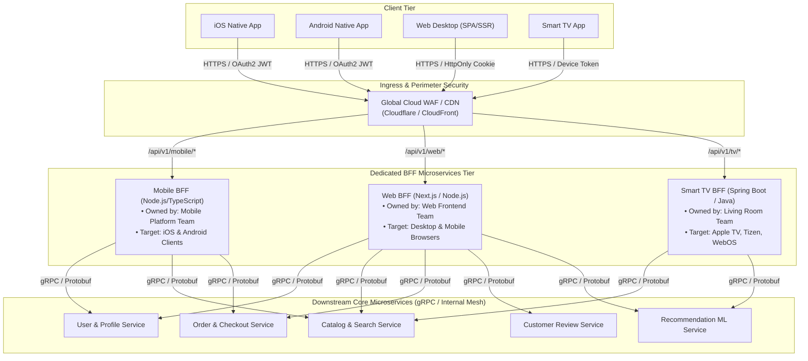
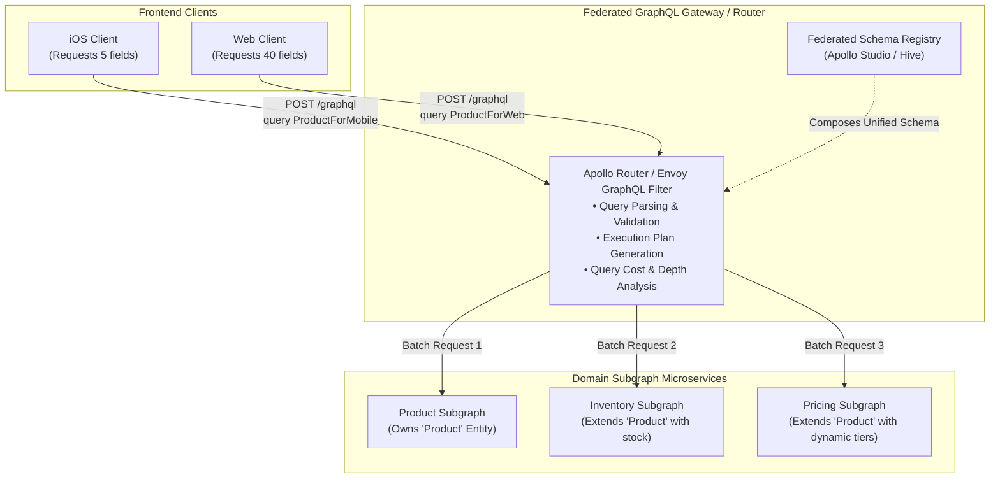
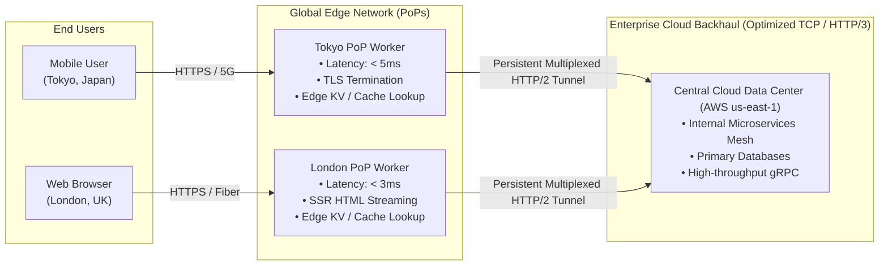
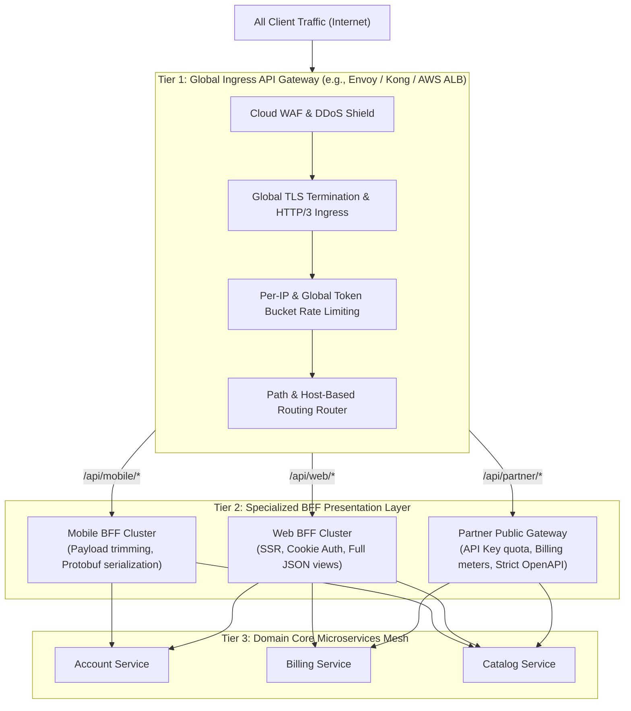
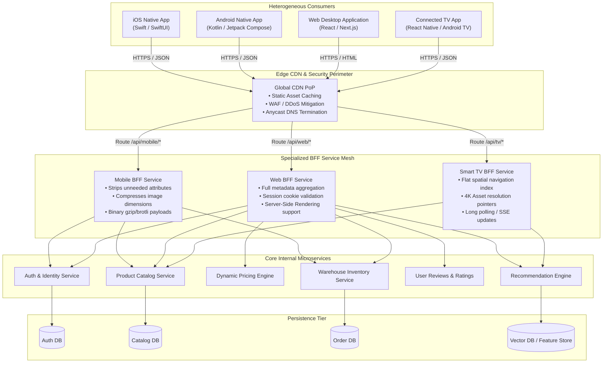
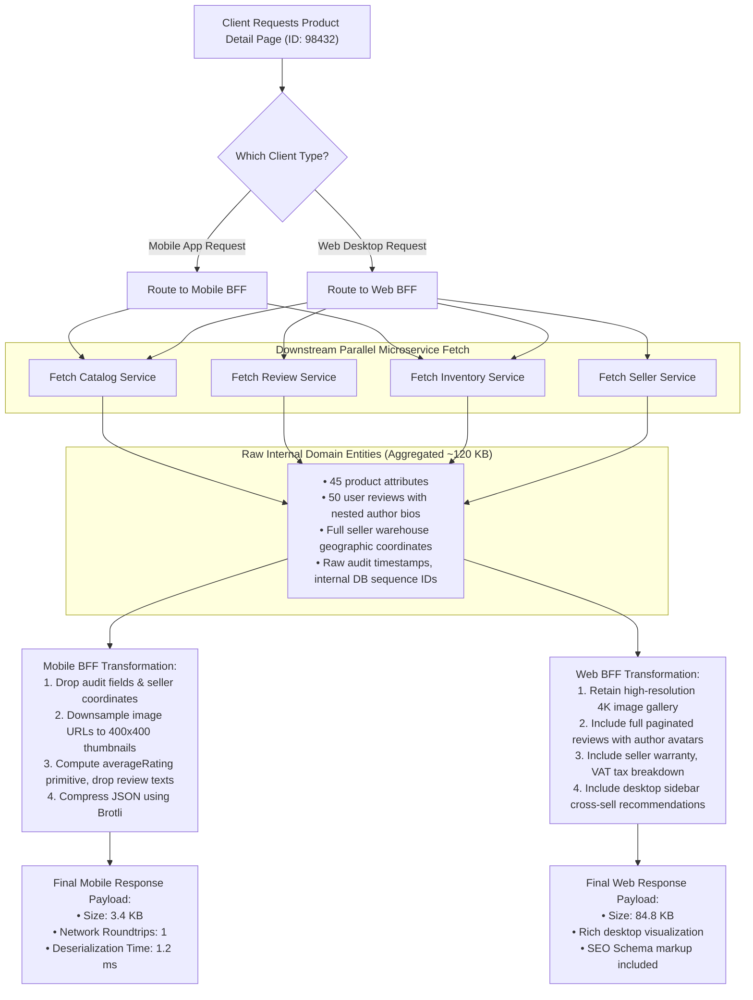
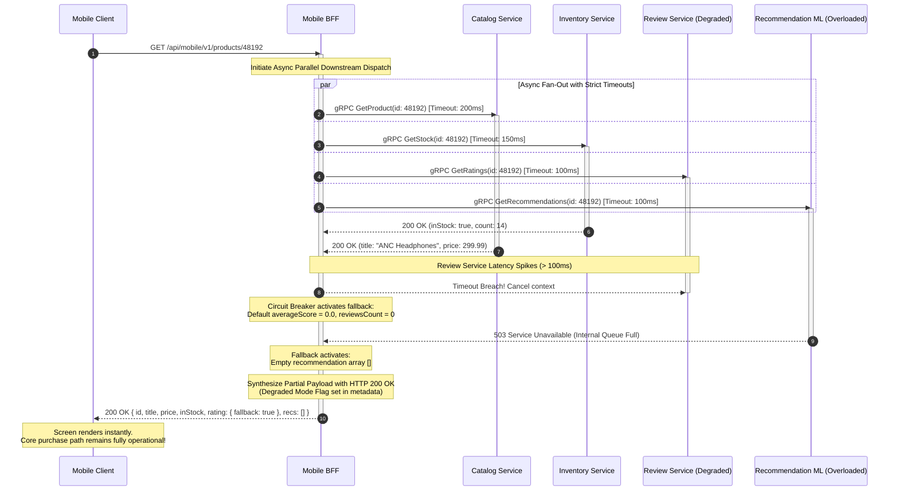
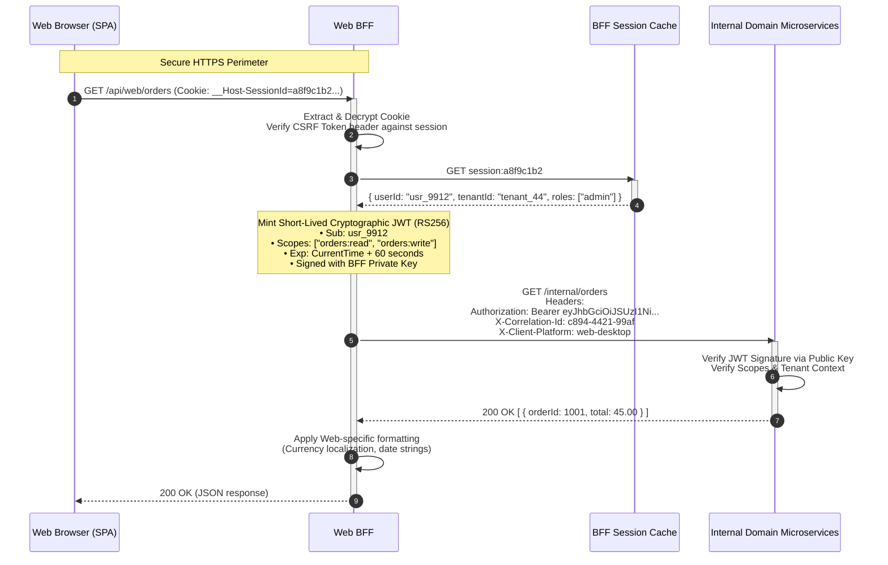
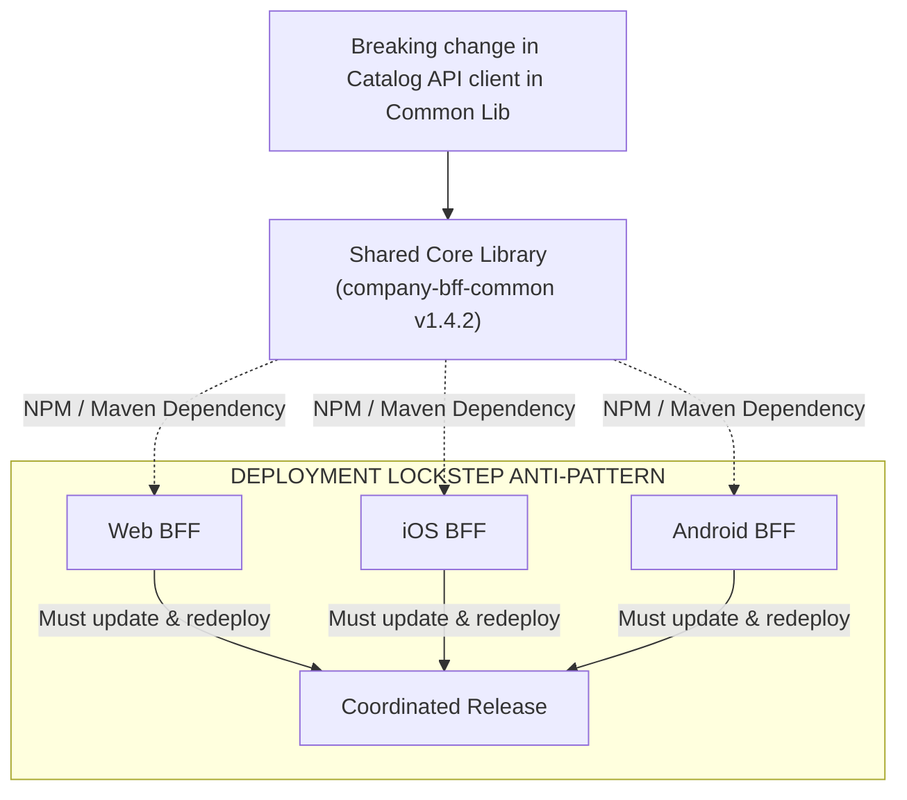
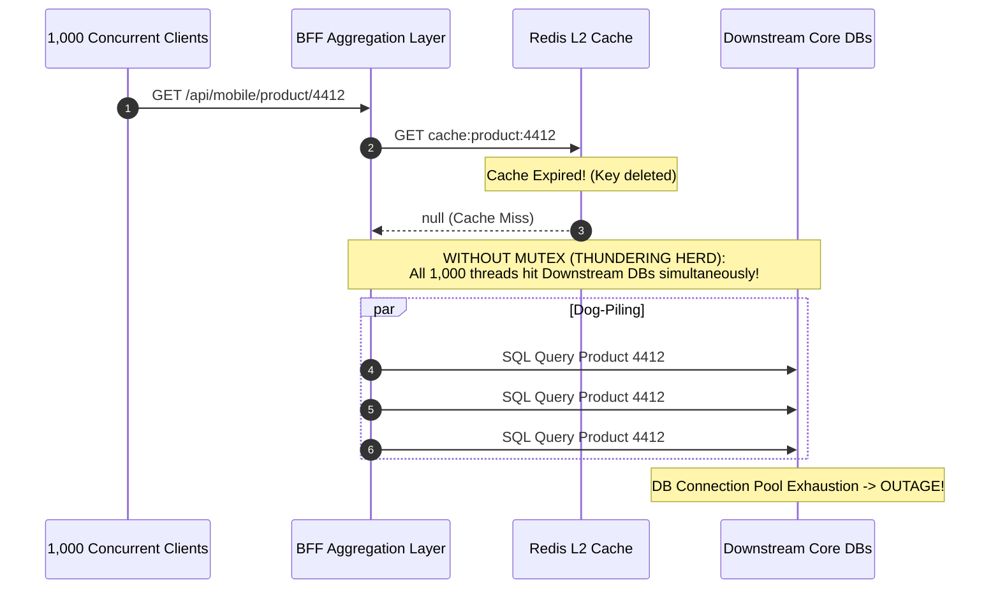

# Backends for Frontends (BFF) Pattern

## 1. Pattern Overview & Architectural Intent

The **Backends for Frontends (BFF)** pattern is an architectural design where dedicated backend services are developed, deployed, and maintained specifically to satisfy the technical and domain requirements of individual frontend client platforms (e.g., iOS, Android, Web Desktop, Smart TV, Voice Assistants). 

Originally formalized by **Sam Newman** and pioneered in large-scale production by engineering teams at **SoundCloud**, **Netflix**, and **Spotify**, the BFF pattern arose directly as a corrective countermeasure against the systemic organizational and operational failures of the **"One-Size-Fits-All" General Purpose API Gateway**.

```
+----------------------------------------------------------------------------------------------------+
|                                    TRADITIONAL MONOLITHIC API                                      |
|                                                                                                    |
|   [ Web Client ]       [ iOS Client ]      [ Android Client ]      [ Smart TV ]    [ 3rd Party ]   |
|         │                     │                    │                     │               │         |
|         └─────────────────────┼────────────────────┼─────────────────────┴───────────────┘         |
|                               ▼                                                                    |
|                  ┌───────────────────────────────┐                                                 |
|                  │  Single Generic API Gateway   │  <--- Organizational Bottleneck                 |
|                  │  (Over-fetching, Chattiness)  │  <--- Bloated Payload Compromises               |
|                  └───────────────┬───────────────┘  <--- Fragile Shared Release Cycles             |
|                                  │                                                                 |
|         ┌────────────────────────┼────────────────────────┐                                        |
|         ▼                        ▼                        ▼                                        |
|   [ User Service ]      [ Catalog Service ]     [ Order Service ]                                  |
+----------------------------------------------------------------------------------------------------+
                                                VS
+----------------------------------------------------------------------------------------------------+
|                                   BACKENDS FOR FRONTENDS (BFF)                                     |
|                                                                                                    |
|   [ Web Desktop ]         [ Native Mobile ]           [ Smart TV / IoT ]        [ Public APIs ]    |
|          │                        │                           │                        │           |
|          ▼                        ▼                           ▼                        ▼           |
|   ┌─────────────┐          ┌─────────────┐             ┌─────────────┐          ┌─────────────┐    |
|   │   Web BFF   │          │ Mobile BFF  │             │   TV BFF    │          │ Public GW   │    |
|   │ (Rich data, │          │ (Trimmed,   │             │ (Aggregated,│          │ (Standard   │    |
|   │  Cookies)   │          │  Protobuf)  │             │  D-Pad Nav) │          │  REST/Auth) │    |
|   └──────┬──────┘          └──────┬──────┘             └──────┬──────┘          └──────┬──────┘    |
|          │                        │                           │                        │           |
|          └────────────────────────┴─────────────┬─────────────┴────────────────────────┘           |
|                                                 ▼                                                  |
|                        ┌─────────────────────────────────────────────────┐                         |
|                        │      Downstream Internal Microservice Mesh      │                         |
|                        │  [ Identity ]   [ Catalog ]   [ Billing ] etc.  │                         |
|                        └─────────────────────────────────────────────────┘                         |
+----------------------------------------------------------------------------------------------------+
```

### 1.1 The "One-Size-Fits-All" API Antipattern

In the early phases of microservice adoption, organizations typically introduced a single API Gateway layer (e.g., Kong, Netflix Zuul, Apigee) positioned between all consumer devices and internal microservices. While effective for centralized cross-cutting ingress concerns (TLS termination, IP rate limiting, geo-routing), using a single gateway for response shaping quickly collapses under real-world constraints:

1. **Over-Fetching (Bandwidth & Memory Bloat):**
   - A desktop browser with a Gigabit fiber connection and 32 GB of RAM can easily process a 1.5 MB JSON payload containing deep entity graphs, nested relational collections, audit metadata, and full localized description strings.
   - The same 1.5 MB payload sent to an entry-level Android smartphone operating on a congested 3G/LTE cellular network triggers severe cellular radio battery drain (prolonging the high-power Radio Resource Control state), risks out-of-memory (OOM) app crashes during JSON deserialization, and degrades UI frame rates.
2. **Under-Fetching & Excessive Chattiness:**
   - When a generic API returns only basic, normalized domain entities, client devices are forced to execute multiple sequential and parallel round-trips to assemble a single visual view (e.g., fetching a product, then fetching reviews, then fetching seller status, then fetching inventory).
   - Over cellular networks where round-trip latency ($RTT$) fluctuates between 80ms and 300ms, five round-trips consume over a second of latency purely in packet transit, completely independent of server-side execution time.
3. **Conflicting Protocol Requirements:**
   - Web applications heavily utilize HTTP/2 or HTTP/3 with Secure, `HttpOnly`, `SameSite=Strict` cookie-based sessions to prevent Cross-Site Scripting (XSS) token exfiltration.
   - Mobile and embedded clients lack browser cookie jars and DOM sandbox constraints; they favor header-based OAuth2 Bearer tokens (with PKCE), mutual TLS (mTLS), or binary-serialized framing protocols (Protocol Buffers, gRPC, or WebSockets).
4. **Organizational Coupling & Deployment Bottlenecks:**
   - When the iOS team requires an additional field `is_favorite` on the product payload, they must submit a pull request to the centralized API Gateway repository or file a ticket with a centralized Gateway platform team.
   - Changes must be regression-tested against the Web app, Android app, desktop client, and third-party partners. Deployment velocity slows to the pace of the most conservative client release schedule.

### 1.2 Client Divergence Matrix

| Client Platform | Network Profile | Compute & Memory | Primary Input / UI Model | Session / Auth Mechanism | Optimal Payload Strategy |
| :--- | :--- | :--- | :--- | :--- | :--- |
| **Web Desktop (Chrome, Safari, Edge)** | Low latency, high bandwidth (Broadband, Wi-Fi 6) | High compute, large heap, hardware acceleration | Mouse, keyboard, multi-monitor, deep nested grids | `HttpOnly`, `Secure` Session Cookies, CSRF tokens | Rich nested JSON, deferred streaming, pre-rendered SSR HTML |
| **Native Mobile (iOS / Android)** | Highly variable latency, packet loss, cellular radio transitions | Constrained battery, limited heap, aggressive OS memory limits | Touch, swipe, small viewport, dynamic form factors | Ephemeral OAuth2 JWT in Keychain/Keystore + Refresh Token | Hyper-lean, trimmed payloads, flat models, client-side caching keys |
| **Smart TV / Consoles (Tizen, WebOS, AppleTV)** | Stable bandwidth (Ethernet/Wi-Fi), high latency variability | Highly constrained CPU (low-power ARM), minimal RAM | 5-way D-pad remote control, large 4K display viewed from 10 feet | Device-activation code pairing, long-lived hardware tokens | Hero-banner imagery focus, spatial navigation index, flat shallow arrays |
| **Voice & IoT (Alexa, WatchOS, Automotive)** | Intermittent, low bandwidth, metering constraints | Extremely minimal CPU, zero GPU, battery preservation | Audio speech synthesis, watch complication, head unit | Cryptographic device certificate (mTLS), BLE token exchange | Single-value primitive answers, SSML text strings, tiny binary payloads |

### 1.3 Sam Newman's Pattern & Conway's Law

The BFF pattern directly enforces **Conway’s Law**: *"Any organization that designs a system will produce a design whose structure is a copy of the organization's communication structure."*

Instead of forcing cross-functional frontend teams (iOS, Android, React Web) to negotiate API schemas with a siloed, centralized backend API team, the BFF pattern establishes an alignment of ownership:
- The **Web Frontend Team** owns and operates the **Web BFF**.
- The **Mobile Frontend Team** owns and operates the **Mobile BFF**.
- The **Platform / Core Domain Teams** own and operate downstream domain microservices (`AccountService`, `BillingService`, `InventoryService`).

The BFF acts as a translation adapter belonging to the *client presentation tier*, even though it executes within the server-side cloud perimeter.

---

## 2. Comprehensive Architectural Approaches & Topologies

There are four primary architectural approaches to implementing the BFF pattern. Each represents distinct trade-offs between developer ergonomics, operational complexity, network topology, and execution performance.

```
+──────────────────────────────────────────────────────────────────────────────────────────────────+
|                                    BFF ARCHITECTURAL APPROACHES                                  |
+──────────────────────────────────────────────────────────────────────────────────────────────────+
|  Approach 1: Dedicated Single-Client Services  |  Approach 2: Federated GraphQL BFF             |
|                                                |                                                |
|   [ iOS / Android ]          [ Web App ]       |   [ Mobile Client ]         [ Web Client ]     |
|          │                        │            |           │                        │           |
|          ▼                        ▼            |           ▼                        ▼           |
|   ┌─────────────┐          ┌─────────────┐     |   ┌────────────────────────────────────────┐   |
|   │ Mobile BFF  │          │   Web BFF   │     |   │       Unified GraphQL Gateway          |   |
|   │ (Node/Java) │          │ (Node/Java) │     |   │  (Dynamic query shaping per client)    |   |
|   └──────┬──────┘          └──────┬──────┘     |   └───────────────────┬────────────────────┘   |
|          │                        │            |                       │                        |
|          ▼                        ▼            |                       ▼                        |
|   [ Downstream Microservices via gRPC/REST ]   |   [ Subgraph Microservices via Federation ]    |
+────────────────────────────────────────────────┼────────────────────────────────────────────────+
|  Approach 3: Serverless Edge BFF               |  Approach 4: Layered Gateway + BFF Mesh        |
|                                                |                                                |
|   [ Global Clients: US, EU, APAC ]             |   [ Global Anycast IP: Traffic Ingress ]       |
|          │                                     |                       │                        |
|          ▼                                     |                       ▼                        |
|   ┌────────────────────────────────────────┐   |   ┌────────────────────────────────────────┐   |
|   │   Cloudflare Workers / Next.js Edge    │   |   │ Global API Gateway (WAF, DDoS, TLS)    │   |
|   │   (V8 Isolates running at 300+ PoPs)   │   |   └───────┬────────────────────────┬───────┘   |
|   └──────────────────┬─────────────────────┘   |           │                        │           |
|                      ▼                         |           ▼                        ▼           |
|   [ Origin Core Services over Fast Backhaul]   |     ┌───────────┐            ┌───────────┐     |
|                                                |     │ MobileBFF │            │  Web BFF  │     |
+────────────────────────────────────────────────+────────────────────────────────────────────────+
```

---

### Approach 1: Dedicated Single-Client BFFs (Per-Platform Microservices)

In this classic topology, a completely separate backend microservice is deployed for each distinct client category.



#### High-Level Design (HLD)
- **Client Routing:** The global CDN/WAF inspects the URI prefix (e.g., `/api/v1/mobile/...` vs `/api/v1/web/...`) or incoming host headers (`mobile-api.domain.com` vs `web-api.domain.com`) and routes directly to the respective BFF cluster.
- **Service Isolation:** Each BFF is an independent deployment artifact (Docker container on Kubernetes / Amazon ECS). A memory leak or runaway CPU loop caused by an unoptimized web scraper hitting the Web BFF has **zero blast radius** on the Mobile BFF.
- **Downstream Communication:** BFFs communicate with core internal microservices using high-speed internal protocols such as **gRPC over HTTP/2 with Protocol Buffers** or highly optimized internal HTTP REST over persistent keep-alive connection pools.

#### Low-Level Design (LLD)
1. **Payload Shaping & Trimming:** Downstream services return canonical domain representations containing 50+ attributes. The Mobile BFF constructs an internal view model, retaining only the 8 attributes necessary for rendering the mobile view, stripping unused metadata, nested arrays, and redundant timestamps.
2. **Response Orchestration & Fan-Out:** The BFF acts as an orchestrator. It receives a single ingress request, fans out asynchronously to multiple downstream services in parallel, applies strict per-service timeouts, handles partial failures gracefully, and synthesizes the unified payload.
3. **Session Translation:** The Web BFF handles browser cookies, validates anti-CSRF double-submit tokens, and injects downstream identity headers. The Mobile BFF validates short-lived OAuth2 bearer tokens and attaches verified cryptographic identity claims (`X-User-Id`, `X-User-Roles`) to downstream calls.
4. **Multi-Tier Caching:**
   - **L1 In-Memory LRU Cache:** Holds highly ephemeral, hot data (e.g., feature flags, global banners) with TTLs of 5–30 seconds.
   - **L2 Distributed Redis Cache:** Shared across all replicas of that specific BFF for caching aggregated screen views with cache tags and Stale-While-Revalidate headers.

---

### Approach 2: GraphQL-Powered BFF (Schema Federation)

Rather than maintaining distinct custom REST endpoints per client, this approach uses **GraphQL** (often via **Apollo Federation** or **GraphQL Mesh**) as a flexible, client-driven BFF.



#### High-Level Design (HLD)
- Instead of the backend engineering team writing custom controller endpoints for each screen, the client issues a declarative GraphQL query specifying precisely the fields, sub-resources, and mutations required.
- **Federated Architecture:** Core domain services expose their own domain models as **subgraphs**. The Federated Router composes these into a unified supergraph. To the client, the supergraph looks like a single unified BFF, while execution is decomposed into parallel downstream calls.

#### Low-Level Design (LLD)
1. **Execution Plan & DataLoader N+1 Prevention:** When resolving complex nested queries (e.g., `user -> orders -> orderItems -> product`), the GraphQL engine utilizes the **DataLoader pattern** (batching and memoization) to collapse what would otherwise be hundreds of sequential downstream network calls into a single batched RPC call (e.g., `GetProductsByIds([101, 102, 103])`).
2. **Query Complexity & Depth Limiting:** To prevent malicious or poorly written queries from causing Denial of Service (DoS) across downstream services, the GraphQL BFF enforces strict limits on query depth (e.g., maximum 6 nested levels) and cost analysis algorithms before executing any downstream requests.
3. **Persisted Queries (APQ):** Mobile clients pre-compile their queries during the build phase. At runtime, the client sends only a 32-byte SHA-256 hash over HTTP `GET` instead of a 4 KB query string over `POST`. This enables standard HTTP edge caching (CDN) for GraphQL reads.

---

### Approach 3: Edge BFF (Serverless & Edge Compute)

With modern Edge compute platforms (Cloudflare Workers, Fastly Compute@Edge, AWS Lambda@Edge, Vercel Edge Runtime), the BFF code runs within **V8 Isolates** physically distributed across hundreds of Point of Presence (PoP) data centers worldwide.



#### High-Level Design (HLD)
- **Ultra-Low Latency Ingress:** The client performs DNS resolution to an Anycast IP address, connecting to an Edge PoP located within 10–20 milliseconds of the physical device.
- **TLS Handshake Offload:** Cryptographic handshakes, session resumption, and HTTP/3 QUIC connection negotiation terminate at the Edge node, shielding the central origin data center from connection storms.
- **Streaming SSR & Micro-Frontends:** For Web clients, the Edge BFF can stream React/HTML chunks directly to the browser using HTTP `Transfer-Encoding: chunked` (e.g., Next.js App Router streaming) while asynchronously fetching slower personalized widgets from core microservices.

#### Low-Level Design (LLD)
- **V8 Isolates vs Containers:** Edge BFFs utilize lightweight V8 Isolates instead of containerized Linux processes. Memory footprints are single-digit megabytes with **cold starts under 5 milliseconds** (compared to 500ms–2s for Docker/JVM cold starts).
- **Edge Key-Value (KV) & Stale-While-Revalidate:** Public and semi-private user fragments are cached at the Edge using the `stale-while-revalidate` HTTP cache-control directive. When a request arrives, the Edge BFF returns cached content immediately to the client while simultaneously triggering a non-blocking asynchronous fetch to the origin microservice to refresh the cache.

---

### Approach 4: Layered Gateway vs Independent BFF Services

A critical architectural decision is whether the BFF should serve as the perimeter entrance or sit behind a centralized API Gateway. In enterprise systems, the **Two-Tier Layered Architecture** is the industry standard.



#### Demarcation of Responsibilities

| Responsibility Dimension | Tier 1: Global Central Gateway | Tier 2: Dedicated Client BFF | Tier 3: Core Domain Services |
| :--- | :--- | :--- | :--- |
| **Team Ownership** | Central Infrastructure / SRE / SecOps | Respective Client Frontend Team | Respective Domain Product Teams |
| **Primary Focus** | Transport, Security, Routing, Network Health | Presentation, Shaping, Aggregation, Auth mapping | Business Invariants, Transactional Consistency |
| **Deployment Cadence** | Infrequent (Monthly/Quarterly infrastructure updates) | Very Frequent (Multiple deploys/day aligned with UI) | Moderate (Independent per business domain) |
| **Authentication** | TLS termination, IP blocking, basic OAuth2 validation | Cookie-to-JWT translation, User Session hydration | Cryptographic JWT verification, Fine-grained RBAC |
| **Data Awareness** | Purely byte/packet-level; zero business schema knowledge | Deeply schema-aware; knows exact screen layouts | Deeply domain-aware; owns database entities |

---

## 3. Deep Architectural Diagrams

### 3.1 Dedicated Multi-Client BFF Architecture HLD



---

### 3.2 Mobile vs Web Desktop Payload Shaping & Filtering Flowchart



---

### 3.3 Async Parallel Aggregation & Partial Fallback Sequence Diagram



---

### 3.4 Authentication Cookie-to-JWT Translation Flow



---

## 4. Concrete Production-Grade Implementations

### 4.1 Production Node.js / TypeScript (NestJS) Resilient BFF Controller

Below is an enterprise-grade BFF orchestrator implementation built with TypeScript. It demonstrates **parallel asynchronous downstream dispatch**, **circuit breaker wrapping**, **strict timeout bounds**, **graceful partial degradation**, and **payload trimming**.

```typescript
// src/bff/mobile-product.controller.ts
import { Controller, Get, Param, HttpStatus, HttpException, Logger } from '@nestjs/common';
import axios, { AxiosInstance } from 'axios';
import CircuitBreaker from 'opossum';

// ==========================================
// Domain Response Models (Internal Services)
// ==========================================
interface CatalogItemDTO {
  id: string;
  sku: string;
  name: string;
  internalCost: number; // Sensitive: must be stripped!
  description: string;  // 5 KB text: mobile drops this for overview
  highResGallery: string[];
  thumbnailUrl: string;
  vendorId: string;
  createdTimestamp: number;
}

interface InventoryDTO {
  sku: string;
  availableQuantity: number;
  warehouseLocation: string; // Internal: must be stripped!
  isBackorderAllowed: boolean;
}

interface ReviewSummaryDTO {
  productId: string;
  averageScore: number;
  totalReviews: number;
  featuredReviews: Array<{ author: string; comment: string; date: string }>;
}

// ==========================================
// Targeted Mobile Client Payload (Lean)
// ==========================================
export interface MobileProductViewDTO {
  id: string;
  title: string;
  imageUrl: string;
  inStock: boolean;
  pricing: {
    displayPrice: string;
    currency: string;
  };
  rating: {
    score: number;
    reviewCount: number;
    isDegraded: boolean;
  };
}

@Controller('api/v1/mobile/products')
export class MobileProductBffController {
  private readonly logger = new Logger(MobileProductBffController.name);
  private readonly httpClient: AxiosInstance;
  private readonly reviewCircuitBreaker: CircuitBreaker;

  constructor() {
    this.httpClient = axios.create({
      baseURL: process.env.INTERNAL_SERVICE_MESH_URL || 'http://internal.mesh.local',
      timeout: 1000, // Global maximum HTTP socket timeout
    });

    // Configure Circuit Breaker for volatile non-critical dependency (Review Service)
    const breakerOptions = {
      timeout: 250,              // Trigger timeout error if execution exceeds 250ms
      errorThresholdPercentage: 50, // Open circuit if 50% of requests fail
      resetTimeout: 10000,       // Attempt recovery after 10 seconds
      volumeThreshold: 10,       // Minimum 10 requests within statistical window
    };

    this.reviewCircuitBreaker = new CircuitBreaker(
      (productId: string) => this.fetchReviews(productId),
      breakerOptions
    );

    this.reviewCircuitBreaker.fallback((productId: string) => {
      this.logger.warn(`Review circuit OPEN or timed out for ID: ${productId}. Returning fallback.`);
      return {
        productId,
        averageScore: 0.0,
        totalReviews: 0,
        featuredReviews: [],
      } as ReviewSummaryDTO;
    });

    this.reviewCircuitBreaker.on('open', () =>
      this.logger.error('Circuit Breaker status: OPEN for ReviewService')
    );
    this.reviewCircuitBreaker.on('halfOpen', () =>
      this.logger.log('Circuit Breaker status: HALF-OPEN for ReviewService')
    );
  }

  private async fetchReviews(productId: string): Promise<ReviewSummaryDTO> {
    const res = await this.httpClient.get<ReviewSummaryDTO>(`/reviews/summary/${productId}`, {
      timeout: 250, // Per-call strict deadline
    });
    return res.data;
  }

  @Get(':id')
  async getMobileProductDetail(@Param('id') productId: string): Promise<MobileProductViewDTO> {
    const startTime = Date.now();

    try {
      // Parallel Async Fan-out using Promise.allSettled to prevent single-call cascading crashes
      const [catalogResult, inventoryResult, reviewResult] = await Promise.allSettled([
        this.httpClient.get<CatalogItemDTO>(`/catalog/items/${productId}`, { timeout: 200 }),
        this.httpClient.get<InventoryDTO>(`/inventory/items/${productId}`, { timeout: 150 }),
        this.reviewCircuitBreaker.fire(productId),
      ]);

      // 1. Critical Dependency Verification (Catalog is mandatory)
      if (catalogResult.status === 'rejected') {
        this.logger.error(`Critical failure: Catalog service unreachable for ID: ${productId}`, catalogResult.reason);
        throw new HttpException('Product details unavailable', HttpStatus.SERVICE_UNAVAILABLE);
      }

      const catalogData = catalogResult.value.data;

      // 2. Non-Critical Dependency Handling: Inventory
      let inStock = false;
      if (inventoryResult.status === 'fulfilled') {
        inStock = inventoryResult.value.data.availableQuantity > 0;
      } else {
        this.logger.warn(`Inventory service failed for ${productId}. Defaulting inStock to false.`);
        inStock = false; // Safe fallback: prevent overselling
      }

      // 3. Non-Critical Dependency Handling: Reviews (Handled via Circuit Breaker)
      let reviews: ReviewSummaryDTO;
      let reviewDegraded = false;

      if (reviewResult.status === 'fulfilled') {
        reviews = reviewResult.value as ReviewSummaryDTO;
        // If averageScore is 0 and reviews count is 0 from fallback, mark degraded
        if (reviews.totalReviews === 0 && reviews.featuredReviews.length === 0) {
          reviewDegraded = true;
        }
      } else {
        reviews = { productId, averageScore: 0.0, totalReviews: 0, featuredReviews: [] };
        reviewDegraded = true;
      }

      // 4. Data Trimming, Field Selection & Payload Shaping
      // Drops: internalCost, description (5KB), highResGallery (4MB), warehouseLocation, vendorId
      const mobilePayload: MobileProductViewDTO = {
        id: catalogData.id,
        title: catalogData.name,
        imageUrl: catalogData.thumbnailUrl, // Single downscaled thumbnail
        inStock: inStock,
        pricing: {
          displayPrice: '$199.99', // Currency formatted directly by BFF for native text display
          currency: 'USD',
        },
        rating: {
          score: reviews.averageScore,
          reviewCount: reviews.totalReviews,
          isDegraded: reviewDegraded,
        },
      };

      const durationMs = Date.now() - startTime;
      this.logger.log(`Aggregated mobile product payload for ${productId} in ${durationMs}ms`);

      return mobilePayload;
    } catch (error) {
      if (error instanceof HttpException) throw error;
      this.logger.error(`Unexpected exception in Mobile BFF: ${error.message}`, error.stack);
      throw new HttpException('Internal Aggregation Error', HttpStatus.INTERNAL_SERVER_ERROR);
    }
  }
}
```

---

### 4.2 Production Java / Spring Boot 3 WebFlux (Reactive Non-Blocking BFF)

For ultra-high-throughput architectures handling hundreds of thousands of concurrent requests, reactive non-blocking I/O prevents thread pool exhaustion. Below is a Spring Boot 3 WebFlux reactive BFF service.

```java
package com.enterprise.bff.mobile.controller;

import com.enterprise.bff.mobile.dto.*;
import org.slf4j.Logger;
import org.slf4j.LoggerFactory;
import org.springframework.beans.factory.annotation.Value;
import org.springframework.http.MediaType;
import org.springframework.web.bind.annotation.*;
import org.springframework.web.reactive.function.client.WebClient;
import reactor.core.publisher.Mono;
import io.github.resilience4j.circuitbreaker.annotation.CircuitBreaker;

import java.time.Duration;

@RestController
@RequestMapping("/api/v1/mobile/products")
public class ReactiveMobileBffController {

    private static final Logger log = LoggerFactory.getLogger(ReactiveMobileBffController.class);

    private final WebClient webClient;

    public ReactiveMobileBffController(WebClient.Builder webClientBuilder,
                                       @Value("${internal.services.gateway}") String gatewayUrl) {
        this.webClient = webClientBuilder
                .baseUrl(gatewayUrl)
                .build();
    }

    @GetMapping(value = "/{id}", produces = MediaType.APPLICATION_JSON_VALUE)
    public Mono<MobileProductResponse> getProductDetail(@PathVariable("id") String productId) {

        // 1. Mandatory Call: Catalog Service (Must succeed within 250ms)
        Mono<CatalogDto> catalogMono = webClient.get()
                .uri("/catalog/items/{id}", productId)
                .retrieve()
                .bodyToMono(CatalogDto.class)
                .timeout(Duration.ofMillis(250))
                .doOnError(e -> log.error("Catalog retrieval failed for id: {}", productId, e));

        // 2. Resilient Call: Inventory Service (Timeout 150ms -> Fallback: Out of Stock)
        Mono<InventoryDto> inventoryMono = webClient.get()
                .uri("/inventory/items/{id}", productId)
                .retrieve()
                .bodyToMono(InventoryDto.class)
                .timeout(Duration.ofMillis(150))
                .onErrorResume(ex -> {
                    log.warn("Inventory failed for {}. Using fallback (availableQuantity = 0)", productId);
                    return Mono.just(new InventoryDto(productId, 0));
                });

        // 3. Resilient Call: Ratings Service (Timeout 120ms -> Fallback: 0.0 Rating)
        Mono<RatingDto> ratingMono = webClient.get()
                .uri("/ratings/{id}", productId)
                .retrieve()
                .bodyToMono(RatingDto.class)
                .timeout(Duration.ofMillis(120))
                .onErrorResume(ex -> {
                    log.warn("Ratings service timed out for {}. Using fallback rating.", productId);
                    return Mono.just(new RatingDto(productId, 0.0, 0, true)); // isFallback = true
                });

        // 4. Non-blocking Reactive Zip: Execute all 3 in parallel and merge
        return Mono.zip(catalogMono, inventoryMono, ratingMono)
                .map(tuple -> {
                    CatalogDto catalog = tuple.getT1();
                    InventoryDto inventory = tuple.getT2();
                    RatingDto rating = tuple.getT3();

                    // Shape and trim specifically for Mobile UI constraints
                    return new MobileProductResponse(
                            catalog.getId(),
                            catalog.getDisplayName(),
                            catalog.getThumbnailUrl(),
                            catalog.getRetailPrice(),
                            inventory.getAvailableQuantity() > 0,
                            new MobileRating(rating.getScore(), rating.getTotalCount(), rating.isFallback())
                    );
                });
    }
}
```

---

### 4.3 Production Session-to-JWT Translation Middleware (Node.js)

This middleware illustrates how a Web BFF accepts an encrypted browser cookie, verifies the session in Redis, and mints a short-lived internal JWT with cryptographically signed identity claims for downstream consumption.

```typescript
// src/middleware/auth-translation.middleware.ts
import { Injectable, NestMiddleware, UnauthorizedException, Logger } from '@nestjs/common';
import { Request, Response, NextFunction } from 'express';
import Redis from 'ioredis';
import * as jwt from 'jsonwebtoken';
import * as fs from 'fs';

@Injectable()
export class SessionToInternalJwtMiddleware implements NestMiddleware {
  private readonly logger = new Logger(SessionToInternalJwtMiddleware.name);
  private readonly redisClient: Redis;
  private readonly privateRsaKey: string;

  constructor() {
    this.redisClient = new Redis(process.env.REDIS_SESSION_URL || 'redis://localhost:6379');
    // Load RSA Private Key for RS256 signing of internal microservice tokens
    this.privateRsaKey = fs.readFileSync(process.env.INTERNAL_JWT_PRIVATE_KEY_PATH || './keys/jwt-private.pem', 'utf8');
  }

  async use(req: Request, res: Response, next: NextFunction) {
    const sessionCookie = req.cookies['__Host-SessionId'];

    if (!sessionCookie) {
      throw new UnauthorizedException('Authentication required: Missing session cookie');
    }

    // Double-Submit CSRF check for state-mutating HTTP methods
    if (['POST', 'PUT', 'DELETE', 'PATCH'].includes(req.method)) {
      const csrfHeader = req.headers['x-csrf-token'];
      if (!csrfHeader) {
        throw new UnauthorizedException('CSRF Token missing');
      }
    }

    try {
      // 1. Fetch user session state from distributed Redis store
      const sessionRaw = await this.redisClient.get(`session:${sessionCookie}`);
      if (!sessionRaw) {
        throw new UnauthorizedException('Session expired or invalid');
      }

      const session = JSON.parse(sessionRaw);

      // 2. Mint short-lived (60s) internal RS256 JWT
      const internalToken = jwt.sign(
        {
          sub: session.userId,
          tenant: session.tenantId,
          roles: session.roles,
          originatingClient: 'web-desktop',
          iat: Math.floor(Date.now() / 1000),
        },
        this.privateRsaKey,
        {
          algorithm: 'RS256',
          expiresIn: '60s', // Ephemeral token minimizes replay window
          issuer: 'bff-web-service',
          audience: 'internal-microservice-mesh',
        }
      );

      // 3. Inject internal headers into downstream request pipeline
      req.headers['authorization'] = `Bearer ${internalToken}`;
      req.headers['x-correlation-id'] = req.headers['x-correlation-id'] || `corr-${Date.now()}-${Math.random().toString(36).substr(2, 9)}`;
      req.headers['x-user-id'] = session.userId;

      next();
    } catch (err) {
      this.logger.error(`Session translation failed: ${err.message}`, err.stack);
      throw new UnauthorizedException('Invalid user context');
    }
  }
}
```

---

## 5. Critical Edge Cases, Failure Modes & Resiliency Engineering

Deploying multiple BFF instances introduces failure modes that do not exist in monolithic gateways. Engineering teams must design defensive guardrails against these risks.

```
+──────────────────────────────────────────────────────────────────────────────────────────────────+
|                                    CRITICAL BFF FAILURE MODES                                    |
+──────────────────────────────────────────────────────────────────────────────────────────────────+
|  1. Bloated BFF Monolith                       |  2. Downstream Cascading Latency Explosion      |
|     (Domain logic accreted in BFF)             |     (Tail latency amplification across 15 calls)|
|                                                |                                                 |
|     BFF starts updating database directly!     |     Client Latency = MAX(Service1 ... ServiceN) |
|     Violates Single Responsibility Principle   |     P99 latency cascades to 1500ms              |
+────────────────────────────────────────────────┼────────────────────────────────────────────────+
|  3. The "Shared Library" Dependency Trap       |  4. Aggregation Cache Stampede (Dog-Piling)     |
|     (Tight coupling across all BFFs)           |     (TTL expiry triggers identical backend calls|
|                                                |                                                 |
|     Common.jar updated -> ALL BFFs must build  |     10,000 req/sec hit DB simultaneously        |
|     Destroys deployment autonomy               |     Requires Single-Flight / Mutex Locking      |
+────────────────────────────────────────────────+────────────────────────────────────────────────+
```

### 5.1 The "Bloated Monolith" Trap (Accretion of Domain Logic)

The most insidious anti-pattern in BFF architectures is the gradual migration of core business domain logic into the BFF service.

#### How It Happens:
A frontend engineer is tasked with implementing a promotion: *"If a user has been active for 3 years, give them 15% off at checkout."* Instead of waiting for the `PricingEngineService` team to update their domain models, the frontend engineer writes an `if-else` block inside the Web BFF controller.
Within 12 months:
- The Web BFF contains promotional pricing logic.
- The Mobile BFF contains a slightly different version of promotional pricing logic.
- The iOS client and Web browser show different final prices for the exact same shopping cart!

#### Architectural Enforcement:
1. **The Purity Rule:** A BFF must contain **Presentation Logic Only**.
   - *Presentation Logic:* Formatting dates into `"3 hours ago"`, rounding currency to 2 decimals, dropping descriptions, merging reviews with products, filtering tags.
   - *Domain Logic:* Price calculation, credit validation, inventory reservation, authorization rules.
2. **Persistence Prohibition:** A BFF must **never have its own persistent business database**. A BFF may own a Redis instance for screen caching or session stores, but never an SQL/NoSQL transactional database containing domain entities. If a BFF needs to alter persistent state, it *must* dispatch a command or REST/gRPC mutation to a core domain microservice.

---

### 5.2 The "Shared Library" Dependency Hell (DRY vs. Decoupling)

When an engineering team builds an iOS BFF, an Android BFF, and a Web BFF, they quickly notice duplication: *both BFFs format dates identically, both parse auth tokens identically, and both call the Catalog service.*

Engineers instinctively attempt to eliminate duplication by creating a shared library: `company-bff-common.jar` or `@corp/bff-core`.



#### Why Shared Libraries Kill the BFF Pattern:
- **Lockstep Releases:** If a change to `common` breaks the Android BFF, the Web BFF deployment is delayed. The autonomy gained by introducing BFFs is lost.
- **Language Lock-in:** A shared library forces all BFFs to be written in the same language runtime (e.g., all TypeScript or all Java), preventing teams from choosing the best runtime for their frontend stack (e.g., Next.js for Web SSR vs. Kotlin for Android BFF).

> [!IMPORTANT]
> **Architectural Guardrail:** Prefer **Duplication over the Wrong Abstraction**. Duplicate mapping boilerplate across BFFs is vastly cheaper than the coupling introduced by a shared monolith library. Limit shared libraries strictly to non-business infrastructure primitives (e.g., standard logging wrappers, OpenTelemetry tracing exporters).

---

### 5.3 Downstream Cascading Timeouts & Fan-Out Latency Math

When a single ingress request to a BFF fans out to $N$ downstream microservices in parallel, the total latency experienced by the client is determined by the **maximum** latency of all downstream calls, not the average:

$$\text{Latency}_{\text{Client}} = \max(L_{\text{Service}_1}, L_{\text{Service}_2}, \dots, L_{\text{Service}_N}) + L_{\text{BFF Processing}}$$

If a BFF calls 10 microservices, each with an independent 99th percentile ($p99$) latency of 500ms, the probability that the client experiences a delay $\ge 500\text{ms}$ is:

$$P(\ge 1 \text{ slow service}) = 1 - (0.99)^{10} = 1 - 0.9044 \approx 9.56\%$$

Nearly **1 out of every 10 requests** will suffer worst-case latency.

#### Production Resiliency Mitigations:
1. **Aggressive Per-Call Timeouts:** Never use a global gateway timeout. Downstream calls must be configured with aggressive per-service timeouts based on their observed $p95$ SLAs (e.g., 80ms for Redis cache lookups, 150ms for Catalog, 200ms for Reviews).
2. **Non-Blocking Hedged Requests:** If an internal call does not respond within its $p95$ threshold (e.g., 100ms), the BFF can immediately fire an identical duplicate request to a different replica of the service, taking whichever response arrives first (hedging against GC pauses).
3. **Graceful Fallbacks & Degraded UI Flags:** If the recommendation engine times out, return an empty array `[]` and allow the UI to hide that carousel rather than displaying an error page.

---

### 5.4 Cache Stampede / Thundering Herd at the BFF Layer

When a popular product page's cache expires in Redis, thousands of concurrent requests arriving at the BFF simultaneously observe a cache miss. All thousands of requests proceed to fire identical downstream fan-out calls to core microservices, triggering a **downstream outage**.



#### Production Solution: Single-Flight (Request Coalescing)

Using the **Single-Flight pattern** (e.g., `golang.org/x/sync/singleflight` in Go, or an in-memory Promise cache in Node.js), the BFF ensures that only **one** downstream fetch executes for a given key at any instant. All other concurrent requests wait for that single Promise to resolve:

```typescript
// Production Request Coalescer (Single-Flight) for BFF Aggregators
class SingleFlightGroup {
  private inFlight = new Map<string, Promise<any>>();

  async do<T>(key: string, fetcher: () => Promise<T>): Promise<T> {
    if (this.inFlight.has(key)) {
      // Coalesce: Return existing in-flight promise to duplicate callers
      return this.inFlight.get(key) as Promise<T>;
    }

    const promise = fetcher()
      .finally(() => {
        this.inFlight.delete(key);
      });

    this.inFlight.set(key, promise);
    return promise;
  }
}
```

---

### 5.5 Distributed Transactions & Idempotency Hazards

A common antipattern is attempting to coordinate distributed state changes across multiple microservices from within a BFF.

```
       WRONG: BFF as a Distributed Transaction Coordinator
  ┌─────────────────────────────────────────────────────────┐
  │                         BFF                             │
  └─────┬───────────────────┬─────────────────────┬─────────┘
        │ 1. ChargeCard()   │ 2. DeductStock()    │ 3. CreateOrder()
        ▼                   ▼                     ▼
  [ Payment Svc ]     [ Inventory Svc ]     [ Order Svc ]
  (Card Charged)      (NETWORK TIMEOUT!)    (Never Called)
```

If the inventory call times out after the payment service has charged the credit card, the BFF cannot easily roll back the payment without complex two-phase commit (2PC) logic.

> [!CAUTION]
> **BFF Transaction Invariant:** A BFF must **NEVER** orchestrate distributed transactions or multi-phase writes across domain boundaries. Write operations must target a single domain command service or an asynchronous **Saga Orchestrator**, which manages transactional compensation and event publishing reliably.

---

## 6. Comprehensive Technology & Strategy Comparison Matrix

| Evaluation Dimension | Dedicated Per-Client BFFs | General Purpose API Gateway | Federated GraphQL (Apollo/Mesh) | Edge Serverless BFF | Direct Client-to-Service |
| :--- | :--- | :--- | :--- | :--- | :--- |
| **Payload Optimization** | **Maximum** (Custom tailor-made DTOs per client) | **Poor** (Generalized one-size-fits-all payload) | **Very High** (Client selects exact schema fields) | **Very High** (Shaped at edge before egress) | **Worst** (Exposes raw internal database models) |
| **Network Chattiness** | **Minimal** (1 aggregated roundtrip over WAN) | **Moderate** (Requires multiple calls if unaggregated) | **Minimal** (1 complex query over WAN) | **Minimal** (Aggregated at closest geographical PoP) | **Maximum** (Client makes 10+ calls across Internet) |
| **Blast Radius Isolation** | **Complete** (Web crash does not impact Mobile) | **Zero** (Gateway failure brings down all platforms) | **Moderate** (Router bug affects all clients) | **Isolated** (PoP or isolate failure is localized) | **High** (Per-service isolation, but client handles fail) |
| **Team Autonomy** | **High** (Frontend teams deploy their own BFF) | **Very Low** (Centralized gateway bottleneck) | **High** (Teams own subgraphs; frontend queries) | **High** (Full edge code ownership by frontend) | **High** (Frontend negotiates per domain team) |
| **Operational Overhead** | **High** ($N$ independent microservices to deploy) | **Low** (Single managed cluster or cloud service) | **Very High** (Supergraph registry, schema checks) | **Low to Moderate** (Zero server patching, vendor lock-in) | **Low** (No intermediate gateway tier) |
| **Latency Profile** | Low (Internal high-speed mesh aggregation) | Very Low (Pass-through routing, no aggregation) | Low to Moderate (Execution plan overhead, N+1 risk) | **Lowest** (Terminates TLS & caches within 10ms of user) | High (Multiple sequential high-latency WAN hops) |
| **Caching Granularity** | HTTP Edge + Redis L2 tailored per screen | General HTTP URL path caching | Complex (Requires Persisted Queries for CDN) | **Maximum** (Native Edge KV + Stale-While-Revalidate) | Fragmented (Client-side cache only) |
| **Protocol Support** | HTTP/2, HTTP/3, Protobuf, WebSockets, gRPC | Standard HTTP REST / WebSockets | GraphQL over HTTP POST/GET | HTTP/1.1, HTTP/2, HTTP/3, Edge WebSockets | Heterogeneous (gRPC-Web, REST, AMQP) |

---

## 7. Real-World Enterprise Case Studies

```
+──────────────────────────────────────────────────────────────────────────────────────────────────+
|                                  ENTERPRISE CASE STUDY EVOLUTIONS                                |
+──────────────────────────────────────────────────────────────────────────────────────────────────+
|  SoundCloud (2013-2015)        |  Netflix (2012-Present)        |  Spotify (2015-Present)        |
|  • From: Monolithic Rails      |  • From: Generic REST API      |  • From: Monolithic Desktop API |
|  • To: Dedicated Mobile &      |  • To: Dynamic Groovy Zuul     |  • To: "Hermit" Architecture    |
|    Web BFFs (Invented pattern) |    BFFs -> Federated GraphQL   |    Client-specific Gateways     |
+──────────────────────────────────────────────────────────────────────────────────────────────────+
```

### 7.1 SoundCloud: The Genesis of the BFF Pattern

In 2013, SoundCloud operated a monolithic Ruby on Rails application referred to internally as "The Mothership". As user numbers surged, SoundCloud embarked on a microservices migration. 

#### The Problem:
Initially, they built a single, public-facing API Gateway to sit between their newly extracted Scala and Clojure microservices and their client applications. However, their new mobile applications (iOS and Android) were severely impaired:
- The mobile apps suffered from sluggish performance over cellular networks due to chatty REST calls.
- The mobile team was blocked waiting for the centralized API team to create specialized composite endpoints.

#### The BFF Solution:
Led by **Phil Calçado** and the SoundCloud infrastructure team, they deprecated the monolithic API Gateway and introduced **Backends for Frontends**. 
- They empowered the iOS team to build and operate a specialized **iOS BFF**, and the Android team to build an **Android BFF**.
- Both BFFs were written in **Node.js** (and later Finagle/Scala), enabling the frontend engineers to define endpoints matching their screen lifecycles.
- Payload sizes dropped by up to **70%**, cellular battery consumption dropped measurably, and team deployment velocity increased fourfold because changes no longer required cross-team approval.

---

### 7.2 Netflix: The Evolution of Client-Driven Orchestration

Netflix streams content to thousands of distinct device profiles: from high-end Web browsers and PlayStation consoles to low-power Smart TVs and smart displays.

```
       Netflix Evolution of Edge Orchestration
  ┌─────────────────────────┐
  │ 2010: Generic REST API  │  <- Massive chattiness, TV apps failed to boot
  └────────────┬────────────┘
               ▼
  ┌─────────────────────────┐
  │ 2013: Groovy Scripts    │  <- UI teams uploaded custom Groovy aggregation
  │       running on Zuul   │     scripts directly to the running Gateway
  └────────────┬────────────┘
               ▼
  ┌─────────────────────────┐
  │ 2020: Federated GraphQL │  <- Migrated to Federated GraphQL Supergraph,
  │       Supergraph (BFF)  │     enabling declarative data fetching at scale
  └─────────────────────────┘
```

#### Phase 1: Generic REST (Failure at Scale)
In 2010, Netflix’s single generic REST API forced devices to make dozens of requests just to render the home screen. Low-end Smart TVs ran out of memory attempting to parse massive JSON responses.

#### Phase 2: Dynamic Groovy Scripts on Zuul
Netflix introduced dynamic scripting capabilities into its **Zuul Gateway**. Each client engineering team was allowed to write custom **Groovy scripts** that ran within the gateway JVM. The Groovy script acted as a dynamic, client-specific BFF, executing internal calls in parallel using Netflix Hystrix for circuit breaking.
*Failure Mode Encountered:* Because all Groovy scripts ran within the same shared JVM clusters, an infinite loop in a script written by the TV team exhausted the CPU for the entire streaming gateway, degrading the iOS app.

#### Phase 3: Apollo Federation Supergraph
To solve shared JVM instability, Netflix evolved its edge architecture into a **Federated GraphQL platform**. Domain teams own subgraphs, while UI teams define declarative queries that the GraphQL Router decomposes into efficient parallel RPC requests, achieving the flexibility of BFFs with declarative schema validation.

---

### 7.3 Spotify: The "Hermit" Client-Gateway Topology

Spotify supports desktop clients, web players, native iOS and Android apps, smart speakers, smart refrigerators, and automotive infotainment systems (Apple CarPlay, Android Auto).

#### Architecture:
Spotify adopted a variant of the BFF pattern known internally as **Hermit Gateways**:
- Rather than a single mobile BFF, Spotify created separate presentation backend layers for different product spaces (e.g., Search, Browse, Player, Library).
- Dedicated client platform teams deploy specialized aggregation proxies using **Apollo Router** and internal gRPC services.
- If a low-end automotive head unit connects over an unstable cellular link, its requests route through a specialized **Car BFF** that transcodes audio metadata into tiny binary Protobuf packets, drops all album artwork metadata, and formats playback state specifically for low-distraction driver displays.

---

## 8. Deep-Dive System Design Interview Guide

### Q1: How do you prevent the BFF layer from turning into an unmaintainable "monolithic frontend backend" full of duplicated business logic?

**Answer:**
Preventing the BFF from becoming a bloated monolith requires strict architectural boundaries, automated linters, and clear organizational rules:
1. **The Presentation-Only Constraint:** The BFF is strictly an adapter for the UI. It may perform:
   - Data transformation (e.g., date formatting, currency rounding, string localization).
   - Aggregation and fan-out (calling Services A, B, and C in parallel).
   - Data pruning (stripping fields not displayed on the screen).
   - Protocol translation (converting gRPC to REST/JSON).
2. **Prohibition of Core Invariants:** Any logic that enforces business invariants (e.g., *"Cannot purchase item if stock < 1"*, *"Calculate sales tax based on ZIP code"*) must reside exclusively in downstream domain microservices. If an invariant rule is duplicated across the Web BFF and Mobile BFF, the domain service API is insufficiently abstract and should be refactored to provide a higher-level composite API.
3. **Database Guardrail:** A BFF must never have a persistent SQL/NoSQL transactional database. It is stateless. If a developer attempts to add a database ORM to a BFF repository, it fails architecture review immediately.

---

### Q2: Under a severe downstream failure where 2 out of 5 microservices fail or breach their p99 latency SLAs, how should the BFF handle aggregation without failing the entire client request?

**Answer:**
A production BFF must implement **Graceful Partial Degradation** via the following mechanics:
1. **Classify Dependencies:** Categorize downstream calls into **Mandatory** vs. **Non-Critical**:
   - *Mandatory:* Catalog Service (if loading a product page). If this fails, the BFF returns an HTTP 503 or 404 because the page cannot be rendered meaningfully.
   - *Non-Critical:* Review Service, Recommendation Engine, Related Items, Social Shares.
2. **Asynchronous Non-Blocking Execution:** Dispatch all calls concurrently using `Promise.allSettled()` (Node.js) or `Mono.zip()` (Spring WebFlux).
3. **Per-Call Timeout Envelopes:** Assign aggressive deadlines (e.g., 150ms) to non-critical services.
4. **Circuit Breakers with Default Fallbacks:** Wrap non-critical calls in circuit breakers (e.g., Resilience4j, Opossum). When open or timed out:
   - Ratings Service $\rightarrow$ Return `{ score: 0.0, totalCount: 0, isDegraded: true }`.
   - Recommendations $\rightarrow$ Return empty collection `[]`.
5. **UI Contract Coordination:** The frontend client must be coded to inspect metadata flags (or empty collections) and hide the corresponding UI component (e.g., collapsing the recommendation carousel) without showing an error popup to the user.

---

### Q3: How do you design authentication and token management in a BFF when Web clients use HttpOnly Cookies and Mobile clients use OAuth2 Refresh/Access Tokens?

```
Web Browser:                Mobile Native App:
[ HttpOnly Secure Cookie ]  [ OAuth2 Access Token in Keychain ]
         │                               │
         ▼                               ▼
  ┌─────────────┐                 ┌─────────────┐
  │   Web BFF   │                 │ Mobile BFF  │
  └──────┬──────┘                 └──────┬──────┘
         │                               │
         └───────────────┬───────────────┘
                         ▼
        Mint Ephemeral Internal Signed JWT
        (RS256, 60s TTL, downstream claims)
                         │
                         ▼
        [ Internal Core Microservices ]
```

**Answer:**
The BFF acts as an **Authentication Termination & Translation Layer**:
- **For Web Clients:** 
  - To prevent token theft via Cross-Site Scripting (XSS), the Web client never stores raw JWTs in `localStorage` or `sessionStorage`.
  - The Web BFF issues an encrypted, `HttpOnly`, `Secure`, `SameSite=Strict` session cookie.
  - On incoming requests, the Web BFF extracts the cookie, validates the anti-CSRF token, looks up the session in Redis, and mints an ephemeral, cryptographically signed internal JWT (signed with the BFF's private RSA key, valid for 60 seconds).
  - This internal JWT is injected into the downstream gRPC/HTTP metadata as `Authorization: Bearer <internal_jwt>`.
- **For Mobile Clients:**
  - Mobile apps store an OAuth2 access and refresh token inside the secure hardware enclave (iOS Keychain or Android Keystore).
  - The Mobile app transmits the Bearer token in the standard HTTP `Authorization` header.
  - The Mobile BFF validates the token signature against the central Identity Provider (IdP) public JWKS endpoint.
  - Once validated, the Mobile BFF translates it into the internal downscoped service token before forwarding to downstream microservices.

---

### Q4: Mobile devices frequently transition across cellular radio states (4G, 5G, Wi-Fi, dead zones). How does the Mobile BFF optimize transport and connection lifecycles compared to the Web BFF?

**Answer:**
Mobile devices are severely impacted by the **Radio Resource Control (RRC)** state machine. When a mobile radio is idle, transmitting a single packet forces the radio into high-power mode, incurring a 100ms–2500ms state transition latency penalty and draining battery life.
1. **Aggressive Request Consolidation:** The Mobile BFF ensures that launching the app or loading a screen requires **exactly one HTTP request**. Multiple visual components are coalesced into a single response payload.
2. **Payload Compression (Brotli vs. Gzip):** The Mobile BFF compresses all JSON payloads using **Brotli** (level 4–6 for dynamic responses), yielding 20–30% smaller payloads than standard Gzip, directly reducing the radio transmission duration.
3. **HTTP/3 QUIC Support at Ingress:** The Mobile BFF terminates connections via an edge proxy supporting HTTP/3 (QUIC over UDP). When a user transitions from Wi-Fi to cellular LTE while walking out of their house, QUIC’s **Connection ID** feature prevents connection dropping, eliminating the TCP 3-way handshake and TLS renegotiation penalty.
4. **Binary Serialization (Optional Protobuf):** For extreme low-bandwidth environments, the Mobile BFF can negotiate `Accept: application/x-protobuf`, serializing responses into binary Protocol Buffers to reduce byte size and eliminate JSON CPU parsing overhead on budget mobile processors.

---

### Q5: Why shouldn't multiple frontend teams share a single monolithic repository and shared utility library for their BFFs? Where should the line between DRY and independence be drawn?

**Answer:**
Sharing a single monolithic repository or a heavy shared utility library across multiple BFFs re-introduces the exact problem the pattern was designed to eliminate: **organizational coupling and deployment bottlenecks**.
- **The Shared Library Trap:** If Team Web, Team iOS, and Team Android all depend on `bff-common-utils.jar`, any update to a core model forces all three teams to recompile, test, and synchronize deployments. A bug introduced by the Web team in the shared library can break the Mobile BFF build.
- **The Rule of Abstraction (Sandi Metz Principle):** *"Duplication is far cheaper than the wrong abstraction."* In a BFF architecture, duplicating 50 lines of boilerplate HTTP mapping code across three services is vastly preferable to coupling their release cycles through a shared dependency.
- **Where to Draw the Line:**
  - *Allowed as Shared Libraries:* Pure cross-cutting infrastructure concerns that change rarely (e.g., structured logging formats, OpenTelemetry distributed tracing interceptors, standard metrics exporters).
  - *Strictly Forbidden as Shared Libraries:* Downstream domain client DTOs, business transformation functions, API response view models, or routing logic.

---

### Q6: In high-throughput architectures, how does the BFF prevent downstream cache stampedes (thundering herd) during flash sales or cold cache restarts?

**Answer:**
A cache stampede occurs when a high-traffic cache entry expires, causing thousands of concurrent BFF requests to experience a cache miss simultaneously and hammer the downstream database with identical queries.
The BFF prevents this using three complementary strategies:
1. **Single-Flight (Request Coalescing):** The BFF maintains an in-process synchronization group (e.g., Go’s `singleflight` or Java’s `ConcurrentHashMap` with `CompletableFuture`). If 500 threads request product `ID: 981` at the exact same millisecond, only the first thread executes the downstream call. The other 499 threads wait and bind to the identical promise/future result.
2. **Probabilistic Early Expiration (XFetch Algorithm):** Rather than waiting for the hard TTL to expire, the BFF calculates an early refresh probability based on request rate and compute time:
   $$\Delta \beta \ln(\text{rand}()) \le \text{Expiry} - \text{CurrentTime}$$
   Under heavy read traffic, a background thread proactively recalculates and warms the cache *before* it officially expires.
3. **Stale-While-Revalidate Caching:** The BFF serves slightly stale data from Redis immediately while asynchronously dispatching a single background task to re-populate the cache with fresh data from downstream microservices.

---

### Q7: How do you handle schema versioning and backward compatibility when native mobile apps cannot be forcefully upgraded immediately?

**Answer:**
Native mobile clients represent a unique architectural challenge: unlike web browsers where a new deployment forces all users to download the latest JavaScript bundle immediately, **mobile users may run native app versions that are 12 to 24 months old** due to disabled auto-updates or unsupported OS versions.
1. **Additive Schema Evolution:** The Mobile BFF must never remove fields, rename keys, or alter data types on existing endpoints. All changes must be strictly additive.
2. **Explicit URI Route Versioning:** The Mobile BFF exposes versioned URI paths:
   - `/api/mobile/v1/checkout` (Serves legacy apps built in 2024)
   - `/api/mobile/v2/checkout` (Serves modern apps with redesigned checkout flows)
3. **Deprecation & Sunset Headers:** When an old API version is marked for retirement, the BFF returns standard RFC 8594 HTTP headers:
   - `Sunset: Wed, 11 Nov 2026 00:00:00 GMT`
   - `Deprecation: @1762819200`
4. **App Force-Upgrade Check Endpoint:** During app launch, the native mobile app calls an initial bootstrap endpoint on the Mobile BFF (`/api/mobile/bootstrap`). If the client’s build number is below a critical security threshold, the BFF returns a `426 Upgrade Required` response containing a deep-link to the Apple App Store or Google Play Store, preventing the app from executing incompatible downstream operations.

---

### Q8: When would you choose Apollo Federation / GraphQL over dedicated REST BFFs, and what are the hidden production trade-offs?

**Answer:**
The choice between dedicated REST BFFs and GraphQL Federation depends on organizational structure and client requirements:

#### When to Choose GraphQL Federation:
- You have dozens of distinct consumer platforms (iOS, Android, Web, iPad, Apple Watch, Apple TV, Partner Portals) all demanding different subsets of the same core enterprise data graph.
- Your frontend engineers are proficient with GraphQL and prefer declarative client-driven data fetching.
- Core domain teams have mature engineering capacity to build and operate robust subgraph services.

#### Hidden Production Trade-Offs of GraphQL:
1. **CDN Caching Complexity:** Standard REST BFF endpoints leverage ubiquitous HTTP `GET` caching at edge CDNs using standard URL paths and `Cache-Control` headers. GraphQL queries are predominantly HTTP `POST` requests with dynamic query bodies, bypassing standard CDN edge caches unless complex tooling like **Automatic Persisted Queries (APQ)** is implemented.
2. **Runaway Query DoS Vulnerabilities:** A client can write a deeply nested circular query (e.g., `author { books { author { books { ... } } } }`) that paralyzes downstream databases. The GraphQL gateway must incorporate query complexity calculators, depth limiters, and cost analyzers.
3. **N+1 Downstream Fan-out:** Without rigorous usage of the **DataLoader** pattern across all subgraph resolvers, resolving a list of 100 items can accidentally trigger 100 sequential downstream RPC calls, creating severe internal network congestion.
4. **Operational Complexity:** Operating a federated supergraph requires schema registries (Apollo Studio, Hive), automated schema composition CI/CD pipelines, and breaking change detection tools. Dedicated REST BFFs use standard HTTP microservice infrastructure without extra tooling layers.
