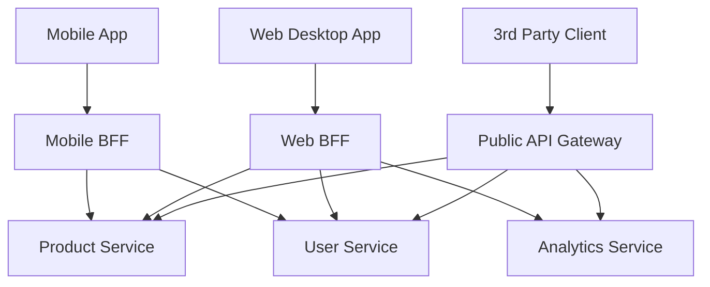

# Backends for Frontends (BFF) Pattern

## 1. Pattern Overview and Intent

The **Backends for Frontends (BFF)** pattern is an architectural design where a dedicated backend service is created specifically to serve a particular frontend client (or user interface). 

In a traditional microservices architecture, multiple client types (e.g., Web App, iOS App, Android App, Smart TV) might communicate with a single general-purpose API Gateway or directly with microservices. However, different clients have vastly different needs. A mobile app requires small payloads, minimal network requests, and specific data formats due to bandwidth constraints and screen size. A rich desktop web application might require large, complex datasets and multiple parallel aggregations.

The intent of the BFF pattern is to:
- **Tailor the API:** Provide an API that perfectly matches the needs of a specific client.
- **Offload Frontend Logic:** Move data aggregation, formatting, and complex logic away from the client device and into a specialized backend service.
- **Optimize Performance:** Reduce the number of network hops over the internet (between client and server) by doing the heavy lifting in the data center.

---

## 2. Detailed Explanation of How It Works

Instead of a one-size-fits-all API, the architecture introduces multiple BFFs. Each UI development team typically owns both their frontend client and their corresponding BFF.

When a client makes a request, it calls its specific BFF. The BFF then makes multiple downstream calls to various internal microservices, aggregates the data, filters out unnecessary fields, formats it exactly as the UI requires, and returns a single, optimized payload to the client.

### Architecture Diagram



### Key Responsibilities of a BFF
- **Data Aggregation:** Combining data from multiple microservices into a single response.
- **Data Trimming:** Removing fields that the specific client doesn't need to reduce payload size.
- **Protocol Translation:** Converting internal protocols (e.g., gRPC, AMQP) into client-friendly protocols (REST, GraphQL).
- **Authentication/Authorization Translation:** Validating client tokens and converting them into internal identity tokens for downstream services.
- **Caching:** Caching frequent requests specific to that client type.

---

## 3. Real-World Example: Streaming Media Platform

Consider a streaming service like Netflix or Hulu. They have a Web UI, an iOS App, and an Apple TV App.

- **The Web App** has plenty of screen real estate. It needs detailed descriptions, high-res poster images, user reviews, cast lists, and social sharing links.
- **The iOS App** has limited screen space and relies on cellular data. It needs basic movie info, lower-res images, and minimal metadata.
- **The Apple TV App** is heavily focused on categories, large banner images, and remote-control navigation. It doesn't need social sharing links or text-heavy reviews.

### Code Snippet (Node.js/Express BFF for Mobile)

```javascript
// Mobile BFF - mobile-bff.js
const express = require('express');
const axios = require('axios');
const app = express();

app.get('/api/mobile/movie-details/:id', async (req, res) => {
    try {
        const movieId = req.params.id;
        
        // Parallel downstream calls to internal microservices
        const [movieRes, ratingRes] = await Promise.all([
            axios.get(`http://internal-movie-service/movies/${movieId}`),
            axios.get(`http://internal-rating-service/ratings/${movieId}`)
        ]);

        // Aggregate and Trim data specifically for mobile
        const mobilePayload = {
            id: movieRes.data.id,
            title: movieRes.data.title,
            thumbnailUrl: movieRes.data.images.small, // Mobile gets small image
            averageRating: ratingRes.data.averageScore,
            // Notice: We intentionally drop large text fields like 'synopsis' 
            // and 'castList' to save bandwidth on mobile.
        };

        res.json(mobilePayload);
    } catch (error) {
        res.status(500).json({ error: 'Failed to fetch mobile movie details' });
    }
});
```

---

## 4. Detailed Pros and Cons

### Pros
- **Optimized Client Experience:** Clients get exactly the data they need in exactly the format they want, reducing latency, bandwidth, and battery consumption.
- **Team Autonomy:** The mobile team can update their UI and their BFF simultaneously without waiting for a centralized backend team to update a shared API.
- **Separation of Concerns:** The core domain microservices don't get polluted with frontend-specific formatting logic (e.g., formatting dates differently for iOS vs. Android).
- **Resilience:** If the Web BFF crashes due to a bad deployment, the Mobile App remains unaffected because it uses its own BFF.

### Cons
- **Code Duplication:** Multiple BFFs might end up writing similar aggregation logic, leading to duplicated effort across teams.
- **Increased Maintenance:** More services to deploy, monitor, scale, and maintain.
- **Organizational Friction:** Requires cross-functional teams where frontend developers are comfortable maintaining a backend service (often written in Node.js or Kotlin).
- **Risk of Scope Creep:** BFFs can accidentally absorb business logic that belongs in the core microservices. A BFF should only contain *presentation logic*, not *domain logic*.

---

## 5. When to Use / When NOT to Use

### When to Use:
- When you have multiple significantly different UIs or client types (Web, Mobile, Voice Assistant, Smart Watch) consuming the same underlying data.
- When the frontend teams are autonomous and want control over how data is shaped and delivered.
- When client devices are resource-constrained and require highly optimized network payloads.

### When NOT to Use:
- If you only have one type of client (e.g., only a web application). In this case, a standard API Gateway or direct service communication is sufficient.
- If the needs of your different clients are virtually identical.
- If your organization does not have the operational capacity to manage many additional backend services.

---

## 6. Common Interview Questions

1. **What is the difference between an API Gateway and a BFF?**
   - *Answer:* An API Gateway is a single entry point for all clients, often handling cross-cutting concerns like rate limiting, routing, and generic authentication. A BFF is an API Gateway tailored for a *specific* client. Often, they are used together: requests hit the API Gateway first (for routing and security), which then routes to the appropriate BFF.

2. **Can GraphQL replace the BFF pattern?**
   - *Answer:* Yes, in many cases. GraphQL allows the client to specify exactly what data it needs in a single request. A single GraphQL server can act as a universal BFF, as it dynamically shapes the response payload based on the client's query, eliminating the need for separate Mobile, Web, and TV BFFs.

3. **Where should business logic reside in a BFF architecture?**
   - *Answer:* Business/Domain logic should *never* reside in the BFF. It must stay in the core downstream microservices. The BFF should only contain presentation logic, data aggregation, formatting, and translation logic.

4. **Why is it beneficial for frontend teams to own the BFF?**
   - *Answer:* It aligns with the principle of team autonomy. When a frontend team needs a new field or a reshaped payload to support a UI change, they can make the change in their BFF immediately, rather than filing a ticket with a centralized backend team and waiting for their sprint cycle.

5. **What happens if multiple BFFs need the exact same aggregation logic?**
   - *Answer:* If duplication becomes a significant problem, it might indicate that the core microservices are too granular. The aggregation logic could be pushed down into a new, higher-level domain service that the BFFs can call, or the organization might consider transitioning to GraphQL.
