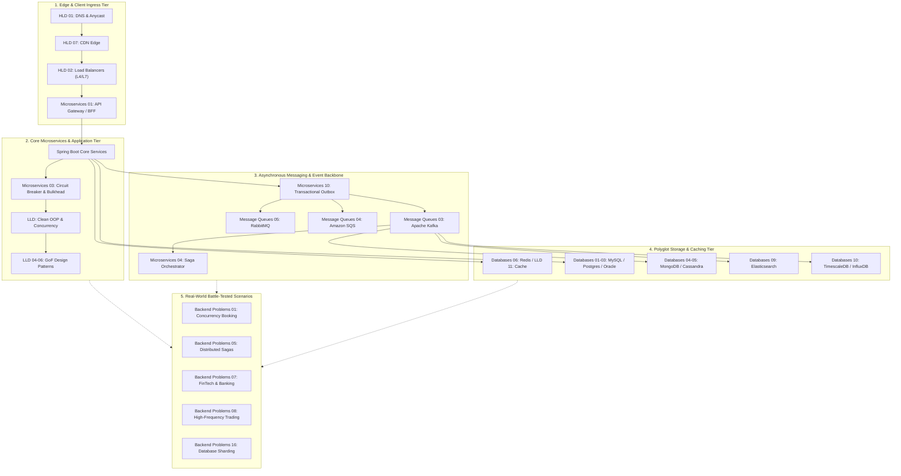
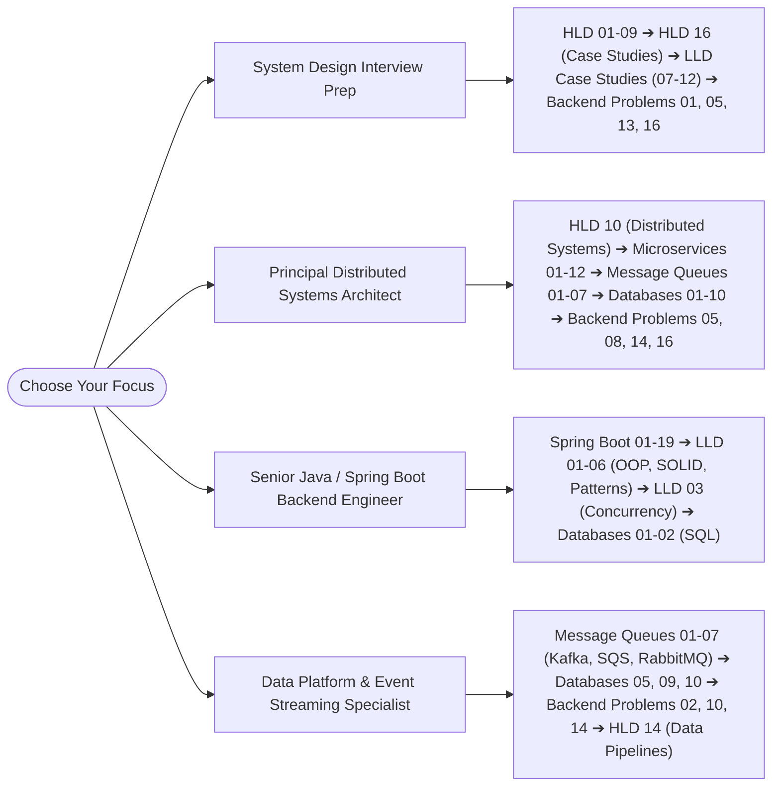

# System Design Series: Complete Master Curriculum & Reference

Welcome to the **System Design Series** repository. This project is a comprehensive, production-grade encyclopedia for software engineers, backend architects, and technical leaders preparing for high-scale system design, enterprise Java development, and senior/staff-level engineering interviews.

The curriculum covers end-to-end software architecture across **7 core tracks** spanning **100+ deep-dive guides**, complete runnable code implementations, Big Tech post-mortems, and trade-off analyses.

---

## 🗺️ Master Architecture Ecosystem

---

## 📂 Master Module Directory

### 1. [Backend Problems](./Backend%20Problems/00-index.md)
*Deep-dive architectural analyses of real-world backend engineering challenges, production failure post-mortems from top-tier tech companies (YouTube, Instagram, Netflix, Uber, Stripe, Discord, Pinterest), and production-grade code implementations.*

* [00 Index](./Backend%20Problems/00-index.md) — Module overview, table of contents, and cross-curriculum matrix
* [01 Concurrency Control & Resource Booking](./Backend%20Problems/01-concurrency-resource-booking.md) — Flash sales, lost updates, pessimistic locking (`FOR UPDATE`), and distributed Redis mutexes
* [02 High Throughput Counters & Volatile Entities](./Backend%20Problems/02-high-throughput-counters.md) — YouTube 301+ view count freeze, Vitess, HyperLogLog, sharded counters, and Count-Min Sketch
* [03 Handling Burst Traffic & Resiliency](./Backend%20Problems/03-handling-burst-traffic-and-resiliency.md) — Flash crowds, circuit breakers, bulkhead isolation, load shedding, and exponential jitter
* [04 Real-Time Location Tracking & Logistics](./Backend%20Problems/04-real-time-location-tracking.md) — Uber H3 hexagonal spatial indexing, Google S2, Geohashing, and high-velocity GPS ingestion
* [05 Distributed Transactions & Consistencies](./Backend%20Problems/05-distributed-transactions-sagas.md) — Two-Phase Commit (2PC), Saga patterns, Transactional Outbox, CDC, and TCC
* [06 Heavy Read Workloads & Social Feeds](./Backend%20Problems/06-heavy-read-workloads-social-feeds.md) — Fan-out on write vs read, hybrid dynamic tiering, Snowflake IDs, and timeline ranking
* [07 FinTech & Banking Systems](./Backend%20Problems/07-fintech-and-banking-systems.md) — Double-entry bookkeeping, strict idempotency keys, reconciliation engines, and zero-loss ledgers
* [08 High-Frequency Trading & Capital Markets](./Backend%20Problems/08-high-frequency-trading.md) — Nanosecond hierarchy, kernel bypass (DPDK/Solarflare), LMAX Disruptor, branchless risk checks, and PTP timestamping
* [09 Gaming & Real-Time Collaboration](./Backend%20Problems/09-gaming-and-collaboration.md) — Authoritative game servers, client prediction, server reconciliation, OT vs CRDTs
* [10 IoT & Telemetry Streaming](./Backend%20Problems/10-iot-and-telemetry.md) — MQTT 5.0 vs CoAP, Flink watermarking/windowing, Gorilla XOR compression, and Digital Twins
* [11 Healthcare & Telemedicine](./Backend%20Problems/11-healthcare-and-telemedicine.md) — HIPAA Safe Harbor, envelope encryption, dynamic ABAC, HL7 v2 to FHIR R4 ETL, and WebRTC SFU
* [12 Search & Indexing Systems](./Backend%20Problems/12-search-and-indexing-systems.md) — Inverted indexes, BM25 scoring, Debezium CDC, in-memory Trie autocomplete, and HNSW vector search
* [13 Rate Limiting & Throttling at Scale](./Backend%20Problems/13-rate-limiting-and-throttling.md) — Token Bucket, Leaky Bucket, Sliding Window Log/Counter, Redis Lua scripts, and RFC 6585
* [14 Event-Driven Architecture Patterns](./Backend%20Problems/14-event-driven-architecture-patterns.md) — Outbox with Debezium CDC, Saga Orchestration (Temporal) vs Choreography, and CQRS
* [15 Caching Strategies Deep Dive](./Backend%20Problems/15-caching-strategies-deep-dive.md) — Amdahl's Law, LRU/LFU/W-TinyLFU, Stampede/Penetration/Avalanche defense, and RESP3 client tracking
* [16 Database Sharding Strategies](./Backend%20Problems/16-database-sharding-strategies.md) — Range/Hash/Directory sharding, Consistent Hashing with virtual nodes, and zero-downtime resharding
* [17 Real-Time Notifications & Push Systems](./Backend%20Problems/17-real-time-notifications-and-push.md) — 10M-connection WebSocket gateways, Redis session registries, Apple APNs/FCM, and celebrity fanout

---

### 2. [High-Level Design (HLD)](./HLD/00-index.md)
*Foundational concepts, architecture patterns, and infrastructure components for architecting distributed systems at massive scale.*

* [00 Index](./HLD/00-index.md) — Quick topic index and cross-references
* [00 README](./HLD/00_README.md) — Full curriculum guide, learning paths, technology coverage maps, and Big Tech stories
* [01 DNS and Networking Fundamentals](./HLD/01_DNS_and_Networking_Fundamentals.md) — Resolution mechanics, Anycast, GeoDNS, BGP routing, and Netflix Route 53 failover
* [02 Load Balancers](./HLD/02_Load_Balancers.md) — L4 vs L7, consistent hashing, health checks, Maglev, and GitHub DDoS mitigation
* [03 Caching](./HLD/03_Caching.md) — Cache-aside, write-through, write-back, Redis internals, stampede defense, and Facebook TAO
* [04 Databases](./HLD/04_Databases.md) — ACID, isolation levels, B-Trees vs LSM, replication, sharding, and Discord's ScyllaDB migration
* [05 Message Queues & Event-Driven Architecture](./HLD/05_Message_Queues_and_Event_Driven_Architecture.md) — Kafka internals, Saga, CQRS, Transactional Outbox, and LinkedIn Kafka origin
* [06 API Design](./HLD/06_API_Design.md) — REST, GraphQL Federation, gRPC, WebSockets, SSE, and Netflix API evolution
* [07 Content Delivery Networks (CDN)](./HLD/07_CDN.md) — Edge caching, PoP topologies, Cache-Control headers, and Cloudflare BGP hijacking
* [08 Microservices Architecture](./HLD/08_Microservices.md) — Domain-Driven Design, Circuit Breakers, Service Mesh, Envoy, and Amazon Two-Pizza Teams
* [09 Scalability Patterns](./HLD/09_Scalability_Patterns.md) — Consistent hashing, auto-scaling, cell-based architectures, and WhatsApp 900M users
* [10 Distributed Systems Fundamentals](./HLD/10_Distributed_Systems_Fundamentals.md) — CAP, PACELC, Raft consensus, Paxos, Vector Clocks, 2PC, and Google Chubby
* [11 Storage Systems](./HLD/11_Storage_Systems.md) — Block, file, object storage, S3 architecture, LSM vs B-Tree, and Facebook Haystack
* [12 Security](./HLD/12_Security.md) — OAuth 2.0, OpenID Connect, JWT, Zero Trust, HashiCorp Vault, mTLS, and Uber breach postmortem
* [13 Observability](./HLD/13_Observability.md) — Metrics (Prometheus), logs (ELK/Loki), distributed tracing (OpenTelemetry), and Chaos Monkey
* [14 Data Pipelines & Analytics](./HLD/14_Data_Pipelines.md) — Batch vs streaming, Spark, Flink, Lambda/Kappa, Delta Lake, and Uber analytics
* [15 High Availability & Disaster Recovery](./HLD/15_High_Availability_and_Disaster_Recovery.md) — RTO/RPO, multi-region active-active, split-brain mitigation, and AWS outages
* [16 System Design Case Studies](./HLD/16_System_Design_Case_Studies.md) — Complete end-to-end designs: URL Shortener, Twitter, YouTube, Uber, WhatsApp
* [17 Algorithms and Data Structures](./HLD/17_Algorithms_and_Data_Structures.md) — Rate limiting, Bloom filters, Count-Min Sketch, HyperLogLog, Trie, Geohash, Merkle trees
* [18 Scaling From Zero to Billions](./HLD/18_Scaling_From_Zero_to_Billions.md) — Evolution roadmap from 1 server to global multi-region fleet (Instagram & Stack Overflow)

---

### 3. [Low-Level Design (LLD)](./LLD/00-index.md)
*Object-oriented principles, design patterns, Java memory model, multithreading, and production-grade case study implementations in Java.*

* [00 Index](./LLD/00-index.md) — Complete LLD master index and study curriculum
* [01 LLD Approaches and Architectures](./LLD/01-lld-approaches-and-architectures.md) — OOAD, Clean Architecture, Hexagonal/Ports & Adapters, DDD, and UML modeling
* [02 SOLID Principles Deep Dive](./LLD/02-solid-principles.md) — SRP, OCP, LSP, ISP, DIP with side-by-side BAD vs GOOD Java code refactorings
* [03 Concurrency & Thread Safety in Java](./LLD/03-thread-safety-and-concurrency.md) — JMM, `volatile`, `synchronized` lock inflation, Explicit Locks, CAS, and Thread Pools
* [04 Creational Design Patterns](./LLD/04-creational-design-patterns.md) — Singleton (DCL/Enum), Factory Method, Abstract Factory, Builder, Prototype, Object Pool
* [05 Structural Design Patterns](./LLD/05-structural-design-patterns.md) — Adapter, Bridge, Composite, Decorator, Facade, Flyweight, Proxy (Dynamic Proxy & AOP)
* [06 Behavioral Design Patterns](./LLD/06-behavioral-design-patterns.md) — Chain of Responsibility, Command, Interpreter, Iterator, Mediator, Memento, Observer, State, Strategy, Template Method, Visitor
* [07 Problem: Multi-Floor Parking Lot](./LLD/07-problem-parking-lot.md) — Multi-floor parking, vehicle hierarchy, spot allocation strategies, and per-floor lock striping
* [08 Problem: Multi-Car Elevator System](./LLD/08-problem-elevator-system.md) — Multi-car elevator dispatcher, LOOK/SCAN algorithm, state machine, and condition signaling
* [09 Problem: High-Performance Rate Limiter](./LLD/09-problem-rate-limiter.md) — Lock-free Token Bucket, Leaky Bucket, Sliding Window Counter, and multi-tenant manager
* [10 Problem: Splitwise Expense Sharing](./LLD/10-problem-splitwise-expense-sharing.md) — Expense splits (Equal, Exact, %), balance sheets, and Min Cash Flow graph debt simplification
* [11 Problem: In-Memory Cache (LRU/LFU/TTL)](./LLD/11-problem-in-memory-cache.md) — Thread-safe segmented cache, $O(1)$ LRU & LFU eviction, lazy/proactive TTL sweepers
* [12 Problem: Movie Ticket Booking (BookMyShow)](./LLD/12-problem-movie-ticket-booking.md) — Cinema seat locking with TTL hold, race-condition immunity, and canonical deadlock avoidance

---

### 4. [Message Queues & Distributed Event Streaming](./Message%20Queues/00-index.md)
*Exhaustive guides on asynchronous messaging infrastructure, distributed logs, task queues, and message brokers.*

* [00 Index](./Message%20Queues/00-index.md) — Module curriculum, reading paths, and quick comparison matrix
* [01 Introduction to Message Queues](./Message%20Queues/01_Introduction_to_Message_Queues.md) — Messaging paradigms, push vs pull, point-to-point vs pub-sub, delivery semantics, and thread-safe queue engine
* [02 Messaging Patterns and Architecture](./Message%20Queues/02_Messaging_Patterns_and_Architecture.md) — Competing consumers, pub-sub, async RPC, Outbox CDC, Sagas, DLQs, Claim Check, and Priority Queues
* [03 Apache Kafka Deep Dive](./Message%20Queues/03_Apache_Kafka_Deep_Dive.md) — Append-only commit log, KRaft consensus quorum, zero-copy `sendfile()`, consumer groups, and partition replication
* [04 Amazon SQS Deep Dive](./Message%20Queues/04_Amazon_SQS_Deep_Dive.md) — Distributed cloud queue architecture, visibility timeout lease state machine, FIFO deduplication, and S3 Claim Check
* [05 RabbitMQ Deep Dive](./Message%20Queues/05_RabbitMQ_Deep_Dive.md) — Erlang BEAM architecture, AMQP 0-9-1 frame layout, exchange routing trie, and Quorum Queues (Raft)
* [06 Redis Streams and PubSub Deep Dive](./Message%20Queues/06_Redis_Streams_and_PubSub_Deep_Dive.md) — Radix Tree (`rax`) with `listpack`, Pending Entries List (PEL), `XREADGROUP`, `XCLAIM`, and memory trimming
* [07 Message Queue Comparison and Decision Guide](./Message%20Queues/07_Message_Queue_Comparison_and_Decision_Guide.md) — 25+ dimension comparison across Kafka, SQS, RabbitMQ, and Redis Streams, decision flowcharts, and migration playbooks

---

### 5. [Microservices Design Patterns](./Microservices%20Design/00-index.md)
*Design patterns, fault isolation strategies, and architectural blueprints for robust microservice ecosystems.*

* [00 Index](./Microservices%20Design/00-index.md) — Executive overview, 5-tier architecture blueprint, classification matrix, and interview guide
* [01 API Gateway Pattern](./Microservices%20Design/01_API_Gateway_Pattern.md) — Unified edge ingress, protocol translation, rate limiting, and edge security
* [02 Service Discovery Pattern](./Microservices%20Design/02_Service_Discovery_Pattern.md) — Dynamic endpoint registries (Consul, Eureka, K8s DNS) and health-aware routing
* [03 Circuit Breaker Pattern](./Microservices%20Design/03_Circuit_Breaker_Pattern.md) — Closed/Open/Half-Open state machines, fail-fast resilience, and Resilience4j
* [04 Saga Pattern](./Microservices%20Design/04_Saga_Pattern.md) — Orchestration vs Choreography, compensating transactions, and pivot steps
* [05 Event Sourcing Pattern](./Microservices%20Design/05_Event_Sourcing_Pattern.md) — Immutable append-only event streams, aggregate reconstruction, and event versioning
* [06 CQRS Pattern](./Microservices%20Design/06_CQRS_Pattern.md) — Command Query Responsibility Segregation, asynchronous projectors, and read materialized views
* [07 Strangler Fig Pattern](./Microservices%20Design/07_Strangler_Fig_Pattern.md) — Zero-downtime evolutionary migration from monoliths, interceptor proxies, and dark shadowing
* [08 Sidecar Pattern](./Microservices%20Design/08_Sidecar_Pattern.md) — Container pod co-location, transparent Envoy proxying, mTLS zero-trust, and distributed tracing
* [09 Database Per Service Pattern](./Microservices%20Design/09_Database_Per_Service_Pattern.md) — Enforcing strict domain boundary encapsulation and eliminating shared database coupling
* [10 Outbox Pattern](./Microservices%20Design/10_Outbox_Pattern.md) — Eliminating dual-write vulnerabilities with atomic DB writes and Debezium CDC log streaming
* [11 Bulkhead Pattern](./Microservices%20Design/11_Bulkhead_Pattern.md) — Compartmentalizing CPU, thread, and connection resource pools to isolate failure blast radius
* [12 Backends For Frontends (BFF)](./Microservices%20Design/12_Backends_For_Frontends_Pattern.md) — Dedicated backend layers tailored to diverse frontend experiences (Web, Mobile, IoT)

---

### 6. [Spring Boot Deep-Dive Course](./Spring%20Boot/00-course-index.md)
*Framework-specific engineering guides for building enterprise-grade backend microservices with Java and Spring Boot 3.x.*

* [00 Course Index](./Spring%20Boot/00-course-index.md) — Syllabus, learning roadmap, and dependency quick-start
* [01 Fundamentals](./Spring%20Boot/01-fundamentals.md) — IoC container, Dependency Injection, ApplicationContext, and Bean lifecycle
* [02 Annotations Complete Reference](./Spring%20Boot/02-annotations.md) — Stereotypes, Web, Data, Configuration, and annotation traps
* [03 REST API & Web Layer](./Spring%20Boot/03-rest-api.md) — DispatcherServlet, Controllers, Filters vs Interceptors vs AOP, and CORS
* [04 Exception Handling](./Spring%20Boot/04-exception-handling.md) — `@ControllerAdvice`, RFC 7807 `ProblemDetail`, and global exception hierarchies
* [05 Database JPA & Hibernate](./Spring%20Boot/05-database-jpa.md) — Hibernate internals, transaction boundaries, lazy loading, and N+1 query solutions
* [06 Concurrency & Race Conditions](./Spring%20Boot/06-concurrency.md) — Spring singleton thread-safety, `@Async`, ThreadPoolTaskExecutor, and race conditions
* [07 Scheduling & Background Jobs](./Spring%20Boot/07-scheduling.md) — `@Scheduled`, Quartz, distributed locking with ShedLock, and thread pool sizing
* [08 Caching Strategies](./Spring%20Boot/08-caching.md) — Spring Cache abstraction, Redis, Caffeine, cache invalidation, and stampede prevention
* [09 Rate Limiting & Traffic Management](./Spring%20Boot/09-rate-limiting.md) — Bucket4j, algorithm selection, distributed rate limits, and Spring Web filters
* [10 Security & JWT](./Spring%20Boot/10-security.md) — SecurityFilterChain, JWT authentication, OAuth2 Resource Server, and RBAC
* [11 File Management](./Spring%20Boot/11-file-management.md) — Multipart upload, streaming, Amazon S3 integration, and virus scanning
* [12 Interview Traps & Gotchas](./Spring%20Boot/12-interview-traps.md) — Tricky interview questions, AOP proxy self-invocation gotchas, and `@Transactional` pitfalls
* [13 Advanced Databases](./Spring%20Boot/13-advanced-databases.md) — Spring Data JDBC, R2DBC reactive SQL, Spring Data MongoDB, and MyBatis
* [14 Messaging & Event-Driven](./Spring%20Boot/14-message-queues.md) — Spring Kafka listeners, RabbitTemplate, Transactional Outbox, and dead-letter topics
* [15 Observability, Monitoring & Actuator](./Spring%20Boot/15-observability.md) — Micrometer, Prometheus metrics, Grafana, and distributed tracing with OpenTelemetry
* [16 Testing Strategies](./Spring%20Boot/16-testing.md) — Unit testing, `@WebMvcTest`, Testcontainers, WireMock, and slice tests
* [17 Reactive Programming with WebFlux](./Spring%20Boot/17-reactive-webflux.md) — Project Reactor, Mono/Flux, event loop concurrency, backpressure, and BlockHound
* [18 Deployment, Docker & GraalVM](./Spring%20Boot/18-deployment-docker-graalvm.md) — Layered Docker images, Kubernetes probes, and GraalVM AOT native compilation
* [19 GraphQL, WebSockets & SSE](./Spring%20Boot/19-graphql-websockets.md) — Spring for GraphQL, real-time WebSockets, STOMP messaging, and Server-Sent Events

---

### 7. [Databases: SQL, NoSQL & Specialized Engines](./Databases/00-index.md)
*Deep-dive guides on SQL, NoSQL, Search, Graph, and Time-Series storage engines, their internals, and real-world failure post-mortems.*

* [00 Index](./Databases/00-index.md) — Module overview, selection matrix, and cross-curriculum synergies
* [01 MySQL: The Web's Relational Workhorse](./Databases/01-MySQL.md) — InnoDB buffer pool, WAL Redo/Undo logs, clustered B+ Trees, Uber Schemaless, and Vitess sharding
* [02 PostgreSQL: The Object-Relational Titan](./Databases/02-PostgreSQL.md) — MVCC append-only tuples, VACUUM engine, HOT optimization, Instagram sharding, and JSONB indexing
* [03 Oracle Database: The Enterprise Transaction Giant](./Databases/03-Oracle.md) — SGA/PGA architecture, SCN undo consistency, Oracle RAC Cache Fusion, and Flashback queries
* [04 MongoDB: The Document Database Giant](./Databases/04-MongoDB.md) — WiredTiger storage engine, document locking, aggregation pipelines, and multi-document ACID transactions
* [05 Apache Cassandra: The Masterless Wide-Column Behemoth](./Databases/05-Cassandra.md) — Consistent hashing token ring, LSM-Tree write path (CommitLog/Memtable/SSTable), and Discord ScyllaDB migration
* [06 Redis: The In-Memory Speed Demon](./Databases/06-Redis.md) — Single-threaded event loop, RDB/AOF persistence, memory eviction algorithms, and exhaustive data structure guide
* [07 Amazon DynamoDB: Serverless Cloud-Native NoSQL Engine](./Databases/07-DynamoDB.md) — Multi-Paxos storage partitions, partition capacity limits, RCU/WCU math, and Global Tables
* [08 Neo4j: The Native Graph Database Powerhouse](./Databases/08-Neo4j.md) — Index-Free Adjacency ($O(1)$ traversals), Causal Clustering Raft, Panama Papers analysis, and Cypher syntax
* [09 Elasticsearch: Distributed Search & Analytics Engine](./Databases/09-Elasticsearch.md) — Lucene inverted indexes, FST dictionaries, immutable segments, Doc Values vs Fielddata, and Query DSL
* [10 TimescaleDB & InfluxDB: Time-Series Databases](./Databases/10-TimescaleDB-and-InfluxDB.md) — Hypertables & chunk exclusion, TSM engines, Tesla telemetry, and Robinhood market tick charts

---

## 🎯 Recommended Curriculum Learning Paths

| Profile / Objective | Recommended Reading Sequence | Key Mastery Goals |
| :--- | :--- | :--- |
| **System Design Interview Prep** (FAANG / Tier-1) | `HLD 01-09` ➔ `HLD 16 (Case Studies)` ➔ `LLD 07-12` ➔ `Backend Problems 01, 05, 13, 16` | Back-of-envelope calculations, trade-off communication, high-level diagrams, and concurrency-safe code |
| **Principal Distributed Architect** | `HLD 10 (Distributed Systems)` ➔ `Microservices 00-12` ➔ `Message Queues 01-07` ➔ `Databases 01-10` | Consensus algorithms, blast radius containment, multi-region active-active, and disaster recovery |
| **Enterprise Java / Backend Engineer** | `Spring Boot 01-19` ➔ `LLD 01-06 (SOLID & Patterns)` ➔ `LLD 03 (Concurrency)` ➔ `Databases 01-02 (Postgres/MySQL)` | Thread-safe singletons, JPA transaction boundaries, clean architecture, and reactive WebFlux |
| **Data Platform & Streaming Engineer** | `Message Queues 01-07 (Kafka Focus)` ➔ `Databases 05, 09, 10` ➔ `Backend Problems 02, 10, 14` ➔ `HLD 14` | Commit log internals, zero-copy I/O, Flink watermarks, time-series compression, and CDC pipelines |

---

## 🔗 Cross-Domain Concept Matrix

The following matrix illustrates how foundational concepts span across multiple modules in this curriculum:

| Architectural Concept | High-Level Design (HLD) | Low-Level Design (LLD) | Microservices Design | Backend Problems | Databases & Messaging | Spring Boot Framework |
| :--- | :--- | :--- | :--- | :--- | :--- | :--- |
| **Concurrency & Thread Safety** | [HLD 10: Distributed Systems](./HLD/10_Distributed_Systems_Fundamentals.md) | [LLD 03: Java Concurrency](./LLD/03-thread-safety-and-concurrency.md) | [Microservices 11: Bulkhead](./Microservices%20Design/11_Bulkhead_Pattern.md) | [BP 01: Resource Booking](./Backend%20Problems/01-concurrency-resource-booking.md) | [Databases 06: Redis Locks](./Databases/06-Redis.md) | [Spring Boot 06: Concurrency](./Spring%20Boot/06-concurrency.md) |
| **Caching & In-Memory Stores** | [HLD 03: Caching](./HLD/03_Caching.md) | [LLD 11: In-Memory Cache](./LLD/11-problem-in-memory-cache.md) | [Microservices 06: CQRS](./Microservices%20Design/06_CQRS_Pattern.md) | [BP 15: Caching Strategies](./Backend%20Problems/15-caching-strategies-deep-dive.md) | [Databases 06: Redis](./Databases/06-Redis.md) | [Spring Boot 08: Caching](./Spring%20Boot/08-caching.md) |
| **Rate Limiting & Throttling** | [HLD 17: Algorithms](./HLD/17_Algorithms_and_Data_Structures.md) | [LLD 09: Rate Limiter](./LLD/09-problem-rate-limiter.md) | [Microservices 01: API Gateway](./Microservices%20Design/01_API_Gateway_Pattern.md) | [BP 13: Rate Limiting at Scale](./Backend%20Problems/13-rate-limiting-and-throttling.md) | [Databases 06: Redis Lua](./Databases/06-Redis.md) | [Spring Boot 09: Rate Limiting](./Spring%20Boot/09-rate-limiting.md) |
| **Event-Driven & Outbox** | [HLD 05: Message Queues](./HLD/05_Message_Queues_and_Event_Driven_Architecture.md) | [LLD 06: Observer Pattern](./LLD/06-behavioral-design-patterns.md) | [Microservices 10: Outbox](./Microservices%20Design/10_Outbox_Pattern.md) | [BP 14: Event-Driven Patterns](./Backend%20Problems/14-event-driven-architecture-patterns.md) | [MQ 03: Apache Kafka](./Message%20Queues/03_Apache_Kafka_Deep_Dive.md) | [Spring Boot 14: Messaging](./Spring%20Boot/14-message-queues.md) |
| **Distributed Transactions & Sagas** | [HLD 10: Distributed Consensus](./HLD/10_Distributed_Systems_Fundamentals.md) | [LLD 06: Command Pattern](./LLD/06-behavioral-design-patterns.md) | [Microservices 04: Saga Pattern](./Microservices%20Design/04_Saga_Pattern.md) | [BP 05: Distributed Sagas](./Backend%20Problems/05-distributed-transactions-sagas.md) | [MQ 02: Messaging Patterns](./Message%20Queues/02_Messaging_Patterns_and_Architecture.md) | [Spring Boot 05: Transactions](./Spring%20Boot/05-database-jpa.md) |
| **Observability & Health** | [HLD 13: Observability](./HLD/13_Observability.md) | [LLD 05: Decorator / Proxy](./LLD/05-structural-design-patterns.md) | [Microservices 08: Sidecar](./Microservices%20Design/08_Sidecar_Pattern.md) | [BP 03: Burst Traffic & Resiliency](./Backend%20Problems/03-handling-burst-traffic-and-resiliency.md) | [Databases 10: InfluxDB/TSDB](./Databases/10-TimescaleDB-and-InfluxDB.md) | [Spring Boot 15: Actuator](./Spring%20Boot/15-observability.md) |
| **Database Sharding & Scale** | [HLD 04: Databases](./HLD/04_Databases.md), [HLD 09: Scalability](./HLD/09_Scalability_Patterns.md) | [LLD 01: LLD Approaches](./LLD/01-lld-approaches-and-architectures.md) | [Microservices 09: DB Per Service](./Microservices%20Design/09_Database_Per_Service_Pattern.md) | [BP 16: Database Sharding](./Backend%20Problems/16-database-sharding-strategies.md) | [Databases 01: MySQL Vitess](./Databases/01-MySQL.md) | [Spring Boot 13: Advanced DBs](./Spring%20Boot/13-advanced-databases.md) |

---

## 📊 Repository Statistics

| Metric | Count | Details |
| :--- | :--- | :--- |
| **Curriculum Modules** | 7 Modules | Backend Problems, HLD, LLD, Message Queues, Microservices Design, Spring Boot, Databases |
| **Total Deep-Dive Guides** | 100 Documents | Complete, production-grade technical analyses |
| **Index & Navigation Files** | 8 Files | Root `README.md`, plus dedicated index files in all 7 modules |
| **Case Studies & Production Scenarios** | 25+ Full Scenarios | YouTube, Instagram, Netflix, Uber, WhatsApp, Twitter, Discord, Stripe, Pinterest, Stack Overflow |
| **Code Implementations** | 50+ Runnable Files | Production Java 17+, Go, Python, and SQL scripts |
| **Architecture Diagrams** | 120+ Diagrams | Mermaid flowcharts, sequence traces, state machines, and ASCII topologies |

---

*System Design Series — Crafted for Principal Engineers, Software Architects, and High-Scale Backend Developers.*
