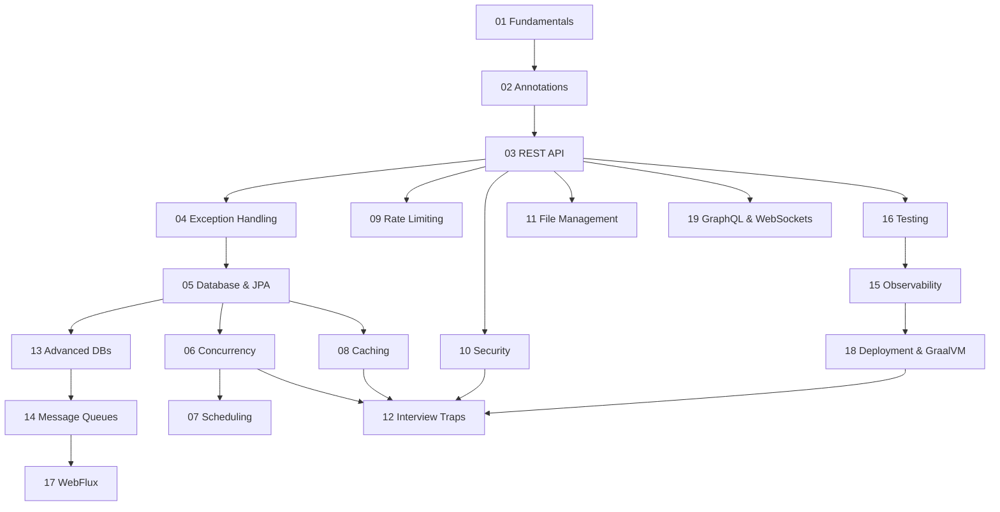

# Spring Boot Deep-Dive Course

[🏠 Master Index](../README.md) | [🏛️ High-Level Design (HLD)](../HLD/00-index.md) | [🧱 Low-Level Design (LLD)](../LLD/00-index.md) | [⚡ Backend Problems](../Backend%20Problems/00-index.md) | [📬 Message Queues](../Message%20Queues/00-index.md) | [🧩 Microservices](../Microservices%20Design/00-index.md) | [💾 Databases](../Databases/00-index.md)

---

Welcome to the **Spring Boot Deep-Dive Course**! This course provides an engineering-level exploration of Spring Boot 3.x, Spring Framework 6.x, and Java 17/21+. It bridges practical application development with deep architectural internals, concurrency models, performance optimizations, and technical interview mastery.

---

## 🌟 The Spring Boot 3.x Architecture & Paradigm Shift

Spring Boot is an **opinionated layer built on top of the Spring Framework**. Rather than replacing Spring, it eliminates the historical burden of manual XML configuration, brittle dependency version management, and explicit component wiring.

### Key Architectural Pillars in Spring Boot 3.x:
1. **Java 17/21 Baseline & Jakarta EE 10**: Complete transition from legacy `javax.*` packages to `jakarta.*` packages (Servlet 6.0, JPA 3.1, Bean Validation 3.0).
2. **Ahead-of-Time (AOT) & GraalVM Native Compilation**: Native image generation reducing startup time from seconds to milliseconds and cutting memory footprints drastically.
3. **Project Loom & Virtual Threads**: First-class support for lightweight virtual threads via `spring.threads.virtual.enabled=true`, delivering high-throughput I/O without the complexity of reactive programming.
4. **Unified Observability via Micrometer**: Unified metrics, tracing, and logging via `ObservationRegistry` and OpenTelemetry export.
5. **Modern HTTP Clients**: Introduction of the synchronous, fluent `RestClient` and declarative `@HttpExchange` interfaces alongside `WebClient` and legacy `RestTemplate`.

```
┌────────────────────────────────────────────────────────────────────────┐
│                   Spring Boot 3.x Application Stack                    │
├────────────────────────────────────────────────────────────────────────┤
│ REST Controllers │ GraphQL / WebSockets │ Actuator & Observability     │
├────────────────────────────────────────────────────────────────────────┤
│ Declarative Services (Transactions, Caching, Security, Scheduling)     │
├────────────────────────────────────────────────────────────────────────┤
│ Spring Data (JPA, JDBC, Redis, MongoDB, R2DBC)                         │
├────────────────────────────────────────────────────────────────────────┤
│ Spring IoC Container & Bean Lifecycle (CGLIB Proxies, BPPs, BFPPs)     │
├────────────────────────────────────────────────────────────────────────┤
│ Auto-Configuration Engine (imports, @ConditionalOn*, Relaxed Binding)  │
├────────────────────────────────────────────────────────────────────────┤
│ Embedded Web Server (Tomcat / Jetty / Undertow) OR Reactive Netty      │
├────────────────────────────────────────────────────────────────────────┤
│ JVM Runtime: OpenJDK 17/21+ (HotSpot / GraalVM Native Image)           │
└────────────────────────────────────────────────────────────────────────┘
```

---

## 🗺️ Course Modules (Table of Contents)

### Part 1: Core Spring & Web Architecture
1. [Module 1: Spring Boot Fundamentals](./01-fundamentals.md) — Inversion of Control (IoC), Dependency Injection (DI) paradigms, ApplicationContext hierarchy, 8-phase Bean Lifecycle, and Bean Scopes.
2. [Module 2: Annotations Deep-Dive](./02-annotations.md) — Stereotypes, Configuration mechanics, Lite vs Full mode, AOP proxies, self-invocation bypasses, and validation constraints.
3. [Module 3: REST API & Web Layer](./03-rest-api.md) — DispatcherServlet pipeline, Filters vs Interceptors vs Aspects, REST clients (RestClient, WebClient, RestTemplate, HTTP Interfaces), and API versioning.
4. [Module 4: Exception Handling](./04-exception-handling.md) — ControllerAdvice, RFC 7807 ProblemDetail, ErrorAttributes customization, async errors, and transaction rollback rules.

### Part 2: Data & State Management
5. [Module 5: Database & JPA](./05-database-jpa.md) — Hibernate internals, HikariCP sizing, `@Transactional` boundaries, Lazy Loading, and N+1 query resolutions.
6. [Module 6: Concurrency & Race Conditions](./06-concurrency.md) — Singleton thread safety, `@Async` execution pools, distributed race conditions, and optimistic vs pessimistic locking.
7. [Module 7: Scheduling & Background Jobs](./07-scheduling.md) — `@Scheduled`, ShedLock distributed locking, Quartz scheduler, and thread-pool isolation.
8. [Module 8: Caching Strategies](./08-caching.md) — Multi-tier caching with Caffeine and Redis, cache stamping mitigation, invalidation patterns, and `@Cacheable` gotchas.
13. [Module 13: Advanced Databases](./13-advanced-databases.md) — Spring Data JDBC, R2DBC reactive data access, MongoDB clustering, and multi-tenancy schemas.

### Part 3: Architecture & Scale
9. [Module 9: Rate Limiting & Traffic Management](./09-rate-limiting.md) — Token Bucket, Leaky Bucket, Redis-backed distributed rate limits with Bucket4j.
10. [Module 10: Security & JWT](./10-security.md) — SecurityFilterChain DSL, stateless JWT authentication, RBAC, OAuth2 Resource Server, and CSRF protection.
11. [Module 11: File Management](./11-file-management.md) — Multipart upload streaming, AWS S3 / MinIO integration, chunked upload pipelines, and async disk writing.
14. [Module 14: Messaging & Event-Driven Architecture](./14-message-queues.md) — Kafka producers/consumers, RabbitMQ topologies, the Transactional Outbox pattern, and Saga orchestration.
19. [Module 19: GraphQL & WebSockets](./19-graphql-websockets.md) — Spring for GraphQL, real-time STOMP WebSockets, and DataLoader batching to eliminate N+1 queries.

### Part 4: Production, Testing & Observability
15. [Module 15: Observability & Actuator](./15-observability.md) — Micrometer metrics, Prometheus scraping, OpenTelemetry distributed tracing, and custom health indicators.
16. [Module 16: Testing Strategies](./16-testing.md) — Unit testing with JUnit 5 & Mockito, slice testing (`@WebMvcTest`, `@DataJpaTest`), Testcontainers for real databases, and WireMock.
17. [Module 17: Reactive WebFlux](./17-reactive-webflux.md) — Project Reactor, Mono/Flux streams, Netty event loops, backpressure regulation, and BlockHound thread monitoring.
18. [Module 18: Deployment & GraalVM](./18-deployment-docker-graalvm.md) — Layered Docker containers, Kubernetes probes (Liveness/Readiness), and GraalVM AOT native compilation.

### Part 5: Interview Preparation
12. [Module 12: Interview Traps & Gotchas](./12-interview-traps.md) — High-frequency FAANG and tier-1 interview questions, AOP proxy pitfalls, lifecycle corner cases, and memory leaks.

---

## 🚀 Recommended Learning Path



---

## 🛠️ Bootstrapping a Spring Boot Application: Multi-Approach Guide

When starting a new Spring Boot project, several approaches exist depending on team requirements, build tooling, and automation pipelines.

---

### Approach 1: Spring Initializr Web Interface (`start.spring.io`)

#### Scenario
- Exploratory development, prototyping, or starting a greenfield project manually.
- Ideal when you want a visual representation of all dependencies and compatibility matrices.

#### Use-Case
A software engineer setting up a new service who wants to verify dependency compatibility between Spring Boot 3.3.x, Java 21, and starters like Spring Web, Spring Data JPA, and Actuator before writing any code.

#### Benefits Over Other Approaches
- Visual dependency search with instant compatibility checking.
- Previews the exact `pom.xml` or `build.gradle` directly in the browser.
- Generates a clean archive with wrapper scripts (`mvnw`, `gradlew`) pre-configured.

#### Implementation Steps
1. Navigate to [start.spring.io](https://start.spring.io/).
2. Select **Project**: Maven or Gradle (Groovy/Kotlin).
3. Select **Language**: Java.
4. Select **Spring Boot**: Latest production release (e.g., `3.3.x`).
5. Select **Java**: `17` or `21`.
6. Add Starters: `Spring Web`, `Spring Data JPA`, `Validation`, `Actuator`, `Lombok`.
7. Click **Generate** (`Ctrl + Enter`), extract the archive, and open in an IDE.

---

### Approach 2: Scriptable CLI & cURL Scaffolding

#### Scenario
- Internal Developer Platforms (IDP), command-line automation, microservice template generators, or CI/CD pipelines.

#### Use-Case
Platform engineering teams creating a shell command (`scaffold-service.sh`) that provisions standardized microservices according to organizational guidelines.

#### Benefits Over Other Approaches
- Fully automatable without manual UI interaction.
- Can be version-controlled inside shell scripts, GitHub Actions, or Makefiles.
- Fast, reproducible, and headless.

#### Documented Code Example

```bash
#!/usr/bin/env bash
# scaffold-microservice.sh
# Scaffolds a production-ready Spring Boot 3.x project using the cURL Initializr API

SERVICE_NAME="payment-service"
PACKAGE_NAME="com.enterprise.billing"
JAVA_VERSION="21"
BOOT_VERSION="3.3.2"

echo "Scaffolding ${SERVICE_NAME} with Java ${JAVA_VERSION} and Spring Boot ${BOOT_VERSION}..."

curl https://start.spring.io/starter.zip \
  -d type=maven-project \
  -d language=java \
  -d bootVersion=${BOOT_VERSION} \
  -d baseDir=${SERVICE_NAME} \
  -d groupId=${PACKAGE_NAME} \
  -d artifactId=${SERVICE_NAME} \
  -d name=${SERVICE_NAME} \
  -d description="Enterprise Payment Processing Service" \
  -d packageName=${PACKAGE_NAME}.${SERVICE_NAME//-/} \
  -d packaging=jar \
  -d javaVersion=${JAVA_VERSION} \
  -d dependencies=web,data-jpa,validation,actuator,prometheus,postgresql \
  -o ${SERVICE_NAME}.zip

unzip -q ${SERVICE_NAME}.zip
rm ${SERVICE_NAME}.zip
cd ${SERVICE_NAME}

echo "Project scaffolded successfully. Initializing git repository..."
git init
git add .
git commit -m "Initial scaffold from Spring Initializr API"
```

---

### Approach 3: IDE Integrated Wizards (IntelliJ IDEA Ultimate / VS Code)

#### Scenario
- Standard day-to-day developer workflow inside established IDEs.

#### Use-Case
Developers working on complex multi-repository setups who want the IDE to inspect available local JDKs, configure project SDK paths, and set up run configurations automatically.

#### Benefits Over Other Approaches
- Seamless integration with existing local JDK installations.
- Automatically creates IDE-specific run configurations and build tool imports.
- Direct code navigation from wizard to editor without archive extraction.

#### Configuration Steps
- **IntelliJ IDEA**: `File -> New -> Project -> Spring Initializr -> Select Server URL (https://start.spring.io) -> Select Java SDK -> Choose Starters -> Create`.
- **VS Code**: Install `Spring Boot Extension Pack` -> Open Command Palette (`Ctrl+Shift+P`) -> `Spring Initializr: Create a Maven Project` -> Choose version and dependencies.

---

### Approach 4: Declarative Build File Setup (Maven Parent vs Multi-Module BOM)

#### Scenario
- Enterprise monorepos or multi-module projects where microservices inherit from an enterprise corporate root POM rather than `spring-boot-starter-parent`.

#### Use-Case
A multi-module Maven project where all sub-projects must inherit enterprise-wide corporate plugins, security compliance rules, and licensing headers from `com.corporate:corporate-super-pom`, preventing the use of Spring Boot as the parent POM.

#### Benefits & Trade-Offs

| Approach | Parent POM (`spring-boot-starter-parent`) | Dependency Management BOM (`spring-boot-dependencies`) |
|---|---|---|
| **Primary Use-Case** | Standalone applications, fast setup | Enterprise multi-module projects, custom corporate parent POMs |
| **Plugin Management** | Auto-configures compiler, surefire, and repackage goals | Plugins must be declared explicitly in `<build>` |
| **Resource Filtering** | Pre-configures `@..@` placeholders in `application.yml` | Must configure `maven-resources-plugin` manually |
| **Flexibility** | Rigid — occupies the single Java/Maven parent slot | High — multiple BOMs can be combined in `<dependencyManagement>` |

#### Documented Code Examples

##### 4A: Standalone Maven Project (`spring-boot-starter-parent`)
```xml
<?xml version="1.0" encoding="UTF-8"?>
<project xmlns="http://maven.apache.org/POM/4.0.0"
         xmlns:xsi="http://www.w3.org/2001/XMLSchema-instance"
         xsi:schemaLocation="http://maven.apache.org/POM/4.0.0 
         https://maven.apache.org/xsd/maven-4.0.0.xsd">
    <modelVersion>4.0.0</modelVersion>

    <!-- Inheriting from Spring Boot Parent gives default plugin configs and Java version defaults -->
    <parent>
        <groupId>org.springframework.boot</groupId>
        <artifactId>spring-boot-starter-parent</artifactId>
        <version>3.3.2</version>
        <relativePath/> <!-- lookup parent from repository -->
    </parent>

    <groupId>com.example</groupId>
    <artifactId>standalone-service</artifactId>
    <version>1.0.0-SNAPSHOT</version>
    <name>standalone-service</name>
    <description>Standard Spring Boot service using starter parent</description>

    <properties>
        <java.version>21</java.version>
    </properties>

    <dependencies>
        <!-- No version tag required: inherited from parent dependencyManagement -->
        <dependency>
            <groupId>org.springframework.boot</groupId>
            <artifactId>spring-boot-starter-web</artifactId>
        </dependency>
        <dependency>
            <groupId>org.springframework.boot</groupId>
            <artifactId>spring-boot-starter-validation</artifactId>
        </dependency>
        <dependency>
            <groupId>org.springframework.boot</groupId>
            <artifactId>spring-boot-starter-test</artifactId>
            <scope>test</scope>
        </dependency>
    </dependencies>

    <build>
        <plugins>
            <!-- Repackages the application into an executable fat JAR with embedded server -->
            <plugin>
                <groupId>org.springframework.boot</groupId>
                <artifactId>spring-boot-maven-plugin</artifactId>
            </plugin>
        </plugins>
    </build>
</project>
```

##### 4B: Enterprise Maven Project with Custom Parent & Spring Boot BOM
```xml
<?xml version="1.0" encoding="UTF-8"?>
<project xmlns="http://maven.apache.org/POM/4.0.0"
         xmlns:xsi="http://www.w3.org/2001/XMLSchema-instance"
         xsi:schemaLocation="http://maven.apache.org/POM/4.0.0 
         https://maven.apache.org/xsd/maven-4.0.0.xsd">
    <modelVersion>4.0.0</modelVersion>

    <!-- Corporate super-pom handles internal company compliance and repositories -->
    <parent>
        <groupId>com.enterprise.framework</groupId>
        <artifactId>enterprise-parent-pom</artifactId>
        <version>2.5.0</version>
    </parent>

    <groupId>com.enterprise.billing</groupId>
    <artifactId>invoice-service</artifactId>
    <version>1.0.0-SNAPSHOT</version>

    <properties>
        <maven.compiler.source>21</maven.compiler.source>
        <maven.compiler.target>21</maven.compiler.target>
        <spring.boot.version>3.3.2</spring.boot.version>
    </properties>

    <!-- Import Spring Boot BOM without inheriting from spring-boot-starter-parent -->
    <dependencyManagement>
        <dependencies>
            <dependency>
                <groupId>org.springframework.boot</groupId>
                <artifactId>spring-boot-dependencies</artifactId>
                <version>${spring.boot.version}</version>
                <type>pom</type>
                <scope>import</scope>
            </dependency>
        </dependencies>
    </dependencyManagement>

    <dependencies>
        <dependency>
            <groupId>org.springframework.boot</groupId>
            <artifactId>spring-boot-starter-web</artifactId>
        </dependency>
        <dependency>
            <groupId>org.springframework.boot</groupId>
            <artifactId>spring-boot-starter-actuator</artifactId>
        </dependency>
    </dependencies>

    <build>
        <plugins>
            <!-- Note: When not using starter-parent, the repackage goal must be declared explicitly -->
            <plugin>
                <groupId>org.springframework.boot</groupId>
                <artifactId>spring-boot-maven-plugin</artifactId>
                <version>${spring.boot.version}</version>
                <executions>
                    <execution>
                        <goals>
                            <goal>repackage</goal>
                        </goals>
                    </execution>
                </executions>
            </plugin>
        </plugins>
    </build>
</project>
```

##### 4C: Modern Gradle Build (`build.gradle.kts` - Kotlin DSL)
```kotlin
// build.gradle.kts
plugins {
    java
    id("org.springframework.boot") version "3.3.2"
    id("io.spring.dependency-management") version "1.1.6"
}

group = "com.enterprise.billing"
version = "1.0.0-SNAPSHOT"

java {
    toolchain {
        languageVersion.set(JavaLanguageVersion.of(21))
    }
}

configurations {
    compileOnly {
        extendsFrom(configurations.annotationProcessor.get())
    }
}

repositories {
    mavenCentral()
}

dependencies {
    implementation("org.springframework.boot:spring-boot-starter-web")
    implementation("org.springframework.boot:spring-boot-starter-validation")
    implementation("org.springframework.boot:spring-boot-starter-actuator")
    
    // Lombok support
    compileOnly("org.projectlombok:lombok")
    annotationProcessor("org.projectlombok:lombok")
    
    testImplementation("org.springframework.boot:spring-boot-starter-test")
    testRuntimeOnly("org.junit.platform:junit-platform-launcher")
}

tasks.withType<Test> {
    useJUnitPlatform()
}

// Enable Docker layer indexing for optimized OCI container builds
tasks.bootJar {
    layered {
        enabled.set(true)
    }
}
```

---

## ⚡ Execution Models: Choosing the Right Spring Boot Architecture

Modern Spring Boot 3.x applications support three primary runtime execution models:

```
1. Classic Servlet (Thread-per-request)
   ├── Client Request → Dedicated OS Thread from Tomcat ThreadPool (200 threads)
   └── Blocking I/O: Thread blocks during DB/HTTP calls

2. Virtual Threads (Java 21 Project Loom)
   ├── Client Request → Lightweight Virtual Thread (Millions possible)
   └── Non-blocking Carrier Thread: OS thread unmounts on blocking I/O

3. Reactive WebFlux (Event Loop)
   ├── Client Request → Handled by minimal Event Loop threads (Netty)
   └── Fully Asynchronous Reactive Streams (Mono/Flux)
```

| Execution Model | Configuration Flag / Starter | Throughput Scaling | Memory Overhead | Complexity / Debuggability |
|---|---|---|---|---|
| **Standard Thread-Per-Request** | `spring-boot-starter-web` | Limited by OS thread pool limit (e.g. 200 Tomcat threads) | High (~1MB per thread stack) | Low (linear stack traces, standard `ThreadLocal`) |
| **Virtual Threads (Loom)** | `spring.threads.virtual.enabled=true` | Very High (unbounded concurrent I/O operations) | Ultra-Low (~few KB per virtual thread) | Low (identical imperative code, standard debugging) |
| **Reactive WebFlux** | `spring-boot-starter-webflux` | Very High (event-driven, non-blocking pipeline) | Ultra-Low (small thread pool) | High (functional reactive operators, difficult stack traces) |

---

## 🔗 Cross-Curriculum References & Synergies

| Spring Boot Module | Foundational Architecture (HLD) | Code & Low-Level Design (LLD) | Database & Messaging Systems |
| :--- | :--- | :--- | :--- |
| **01-02 Fundamentals & Annotations** | [HLD 08: Microservices](../HLD/08_Microservices.md) | [LLD 01: Clean Arch](../LLD/01-lld-approaches-and-architectures.md), [LLD 02: SOLID](../LLD/02-solid-principles.md) | — |
| **03 REST API & Web Layer** | [HLD 06: API Design](../HLD/06_API_Design.md) | [LLD 05: Facade & Adapter](../LLD/05-structural-design-patterns.md) | [Microservices 01: API Gateway](../Microservices%20Design/01_API_Gateway_Pattern.md) |
| **04 Exception Handling** | [HLD 06: API Design](../HLD/06_API_Design.md) | [LLD 07: Chain of Responsibility](../LLD/06-behavioral-design-patterns.md) | — |
| **05 Database & JPA** | [HLD 04: Databases](../HLD/04_Databases.md) | [LLD 03: Concurrency](../LLD/03-thread-safety-and-concurrency.md) | [MySQL](../Databases/01-MySQL.md), [PostgreSQL](../Databases/02-PostgreSQL.md) |
| **06 Concurrency & Race Conditions** | [HLD 10: Distributed Systems](../HLD/10_Distributed_Systems_Fundamentals.md) | [LLD 03: Thread Safety & Concurrency](../LLD/03-thread-safety-and-concurrency.md) | [Backend Problems 01: Concurrency Booking](../Backend%20Problems/01-concurrency-resource-booking.md) |
| **07 Scheduling & Background Jobs** | [HLD 09: Scalability Patterns](../HLD/09_Scalability_Patterns.md) | [LLD 08: Elevator Dispatcher](../LLD/08-problem-elevator-system.md) | [Backend Problems 02: Counters](../Backend%20Problems/02-high-throughput-counters.md) |
| **08 Caching Strategies** | [HLD 03: Caching](../HLD/03_Caching.md) | [LLD 11: In-Memory Cache (LRU/LFU)](../LLD/11-problem-in-memory-cache.md) | [Redis](../Databases/06-Redis.md), [Backend Problems 15: Caching](../Backend%20Problems/15-caching-strategies-deep-dive.md) |
| **09 Rate Limiting** | [HLD 17: Algorithms](../HLD/17_Algorithms_and_Data_Structures.md) | [LLD 09: Rate Limiter](../LLD/09-problem-rate-limiter.md) | [Backend Problems 13: Rate Limiting at Scale](../Backend%20Problems/13-rate-limiting-and-throttling.md) |
| **10 Security & JWT** | [HLD 12: Security](../HLD/12_Security.md) | [LLD 05: Proxy Pattern](../LLD/05-structural-design-patterns.md) | [Backend Problems 11: HIPAA Security](../Backend%20Problems/11-healthcare-and-telemedicine.md) |
| **11 File Management** | [HLD 11: Storage Systems](../HLD/11_Storage_Systems.md) | [LLD 05: Decorator Pattern](../LLD/05-structural-design-patterns.md) | — |
| **13 Advanced Databases** | [HLD 04: Databases](../HLD/04_Databases.md), [HLD 11: Storage](../HLD/11_Storage_Systems.md) | — | [MongoDB](../Databases/04-MongoDB.md), [Cassandra](../Databases/05-Cassandra.md) |
| **14 Messaging & Event-Driven** | [HLD 05: Message Queues](../HLD/05_Message_Queues_and_Event_Driven_Architecture.md) | [LLD 06: Observer Pattern](../LLD/06-behavioral-design-patterns.md) | [Kafka Deep Dive](../Message%20Queues/03_Apache_Kafka_Deep_Dive.md), [RabbitMQ](../Message%20Queues/05_RabbitMQ_Deep_Dive.md) |
| **15 Observability & Actuator** | [HLD 13: Observability](../HLD/13_Observability.md) | [LLD 05: Decorator Pattern](../LLD/05-structural-design-patterns.md) | [Microservices 08: Sidecar](../Microservices%20Design/08_Sidecar_Pattern.md) |
| **16 Testing Strategies** | — | [LLD 02: Dependency Inversion](../LLD/02-solid-principles.md) | — |
| **17 Reactive WebFlux** | [HLD 09: Scalability Patterns](../HLD/09_Scalability_Patterns.md) | [LLD 03: Lock-Free & CAS](../LLD/03-thread-safety-and-concurrency.md) | [Message Queues 06: Redis Streams](../Message%20Queues/06_Redis_Streams_and_PubSub_Deep_Dive.md) |
| **18 Deployment & GraalVM** | [HLD 08: Microservices](../HLD/08_Microservices.md) | — | [Microservices 07: Strangler Fig](../Microservices%20Design/07_Strangler_Fig_Pattern.md) |
| **19 GraphQL & WebSockets** | [HLD 06: API Design](../HLD/06_API_Design.md) | [LLD 06: Mediator & Observer](../LLD/06-behavioral-design-patterns.md) | [Backend Problems 17: Real-Time Notifications](../Backend%20Problems/17-real-time-notifications-and-push.md) |

---

Ready to begin? Start with [Module 1: Spring Boot Fundamentals](./01-fundamentals.md)!
