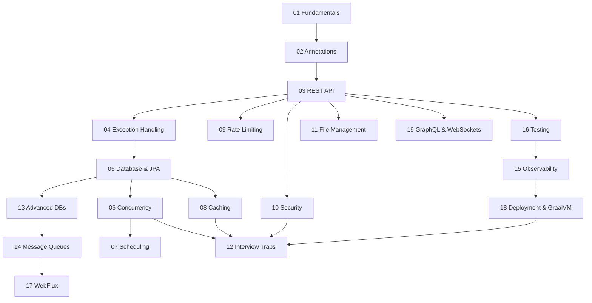

# Spring Boot Deep-Dive Course

[🏠 Master Index](../README.md) | [🏛️ High-Level Design (HLD)](../HLD/00-index.md) | [🧱 Low-Level Design (LLD)](../LLD/00-index.md) | [⚡ Backend Problems](../Backend%20Problems/00-index.md) | [📬 Message Queues](../Message%20Queues/00-index.md) | [🧩 Microservices](../Microservices%20Design/00-index.md) | [💾 Databases](../Databases/00-index.md)

---

Welcome to the ultimate Spring Boot Deep-Dive Course! This course is designed to take you from a basic understanding of Spring to an expert level, ready to tackle complex system design problems, production scenarios, and rigorous technical interviews.

## 🌟 Why Spring Boot?
Spring Boot simplifies the development of production-ready Spring applications. It eliminates boilerplate configuration, provides sensible defaults, and embeds a web server so you can simply run your application. In the modern backend ecosystem, Spring Boot is the de facto standard for building Java microservices.

## 📚 Prerequisites
To get the most out of this course, you should have:
- Solid understanding of Core Java (Java 8+ features, especially Java 17)
- Basic understanding of Maven or Gradle
- Familiarity with basic REST concepts (HTTP methods, status codes)

## 🗺️ Course Modules (Table of Contents)

### Part 1: Core Spring & Web
1. [Module 1: Spring Boot Fundamentals](./01-fundamentals.md) - IoC, DI, Application Context, Bean Lifecycle
2. [Module 2: Annotations Deep-Dive](./02-annotations.md) - Stereotypes, Web, Data, Configuration, and Traps
3. [Module 3: REST API & Web Layer](./03-rest-api.md) - Controllers, Filters, Interceptors, DispatcherServlet
4. [Module 4: Exception Handling](./04-exception-handling.md) - @ControllerAdvice, ProblemDetail, Error Hierarchies

### Part 2: Data & State Management
5. [Module 5: Database & JPA](./05-database-jpa.md) - Hibernate, Transactions, Lazy Loading, N+1 Problem
6. [Module 6: Concurrency & Race Conditions](./06-concurrency.md) - Singletons, @Async, Thread Pools, Synchronization
7. [Module 7: Scheduling & Background Jobs](./07-scheduling.md) - @Scheduled, Quartz, ShedLock, Threading Traps
8. [Module 8: Caching Strategies](./08-caching.md) - Cacheable, Redis, Caffeine, Invalidation, Stampede
13. [Module 13: Advanced Databases](./13-advanced-databases.md) - Spring Data JDBC, R2DBC, MongoDB, MyBatis

### Part 3: Architecture & Scale
9. [Module 9: Rate Limiting & Traffic Management](./09-rate-limiting.md) - Bucket4j, Algorithms, Distributed Limits
10. [Module 10: Security & JWT](./10-security.md) - Filter Chains, Authentication, Authorization, OAuth2
11. [Module 11: File Management](./11-file-management.md) - Multipart, S3, Streaming, Async Processing
14. [Module 14: Messaging & Event-Driven](./14-message-queues.md) - Kafka, RabbitMQ, Outbox Pattern, Saga
19. [Module 19: GraphQL & WebSockets](./19-graphql-websockets.md) - Alternative APIs, Real-time, DataLoader N+1 Fix

### Part 4: Production, Testing & Observability
15. [Module 15: Observability & Actuator](./15-observability.md) - Micrometer, Grafana, Distributed Tracing (Sleuth/OpenTelemetry)
16. [Module 16: Testing Strategies](./16-testing.md) - Testcontainers, @WebMvcTest, Mocking, WireMock
17. [Module 17: Reactive WebFlux](./17-reactive-webflux.md) - Event Loop, Mono/Flux, Backpressure, BlockHound
18. [Module 18: Deployment & GraalVM](./18-deployment-docker-graalvm.md) - Docker, Layered JARs, Kubernetes Probes, AOT Native Images

### Part 5: Interview Preparation
12. [Module 12: Interview Traps & Gotchas](./12-interview-traps.md) - Tricky questions, AOP proxy issues, top misconceptions

## 🚀 Recommended Learning Path

## 🛠️ Quick Start & Setup

To follow along with the code examples:
1. Go to [Spring Initializr](https://start.spring.io/)
2. Select:
   - Project: Maven or Gradle
   - Language: Java
   - Spring Boot: 3.x (latest stable)
   - Java: 17+
   - Dependencies: Spring Web, Spring Data JPA, H2 Database (for quick local testing), Validation
3. Generate, extract, and open in your favorite IDE (IntelliJ IDEA, Eclipse, VS Code).
4. Run `mvn spring-boot:run` or `./gradlew bootRun`.

Let's get started with [Module 1: Fundamentals](./01-fundamentals.md)!

---

## 🔗 Cross-Curriculum References & Synergies

| Spring Boot Module | Foundational Architecture (HLD) | Code & Low-Level Design (LLD) | Database & Messaging Systems |
| :--- | :--- | :--- | :--- |
| **01-02 Fundamentals & Annotations** | [HLD 08: Microservices](../HLD/08_Microservices.md) | [LLD 01: Clean Arch](../LLD/01-lld-approaches-and-architectures.md), [LLD 02: SOLID](../LLD/02-solid-principles.md) | — |
| **03 REST API & Web Layer** | [HLD 06: API Design](../HLD/06_API_Design.md) | [LLD 05: Facade & Adapter](../LLD/05-structural-design-patterns.md) | [Microservices 01: API Gateway](../Microservices%20Design/01_API_Gateway_Pattern.md) |
| **05 Database & JPA** | [HLD 04: Databases](../HLD/04_Databases.md) | [LLD 03: Concurrency](../LLD/03-thread-safety-and-concurrency.md) | [MySQL](../Databases/01-MySQL.md), [PostgreSQL](../Databases/02-PostgreSQL.md) |
| **06 Concurrency & Race Conditions** | [HLD 10: Distributed Systems](../HLD/10_Distributed_Systems_Fundamentals.md) | [LLD 03: Thread Safety & Concurrency](../LLD/03-thread-safety-and-concurrency.md) | [Backend Problems 01: Concurrency Booking](../Backend%20Problems/01-concurrency-resource-booking.md) |
| **07 Scheduling & Background Jobs** | [HLD 09: Scalability Patterns](../HLD/09_Scalability_Patterns.md) | [LLD 08: Elevator Dispatcher](../LLD/08-problem-elevator-system.md) | [Backend Problems 02: Counters](../Backend%20Problems/02-high-throughput-counters.md) |
| **08 Caching Strategies** | [HLD 03: Caching](../HLD/03_Caching.md) | [LLD 11: In-Memory Cache (LRU/LFU)](../LLD/11-problem-in-memory-cache.md) | [Redis](../Databases/06-Redis.md), [Backend Problems 15: Caching](../Backend%20Problems/15-caching-strategies-deep-dive.md) |
| **09 Rate Limiting** | [HLD 17: Algorithms](../HLD/17_Algorithms_and_Data_Structures.md) | [LLD 09: Rate Limiter](../LLD/09-problem-rate-limiter.md) | [Backend Problems 13: Rate Limiting at Scale](../Backend%20Problems/13-rate-limiting-and-throttling.md) |
| **10 Security & JWT** | [HLD 12: Security](../HLD/12_Security.md) | [LLD 05: Proxy Pattern](../LLD/05-structural-design-patterns.md) | [Backend Problems 11: HIPAA Security](../Backend%20Problems/11-healthcare-and-telemedicine.md) |
| **13 Advanced Databases** | [HLD 04: Databases](../HLD/04_Databases.md), [HLD 11: Storage](../HLD/11_Storage_Systems.md) | — | [MongoDB](../Databases/04-MongoDB.md), [Cassandra](../Databases/05-Cassandra.md) |
| **14 Messaging & Event-Driven** | [HLD 05: Message Queues](../HLD/05_Message_Queues_and_Event_Driven_Architecture.md) | [LLD 06: Observer Pattern](../LLD/06-behavioral-design-patterns.md) | [Kafka Deep Dive](../Message%20Queues/03_Apache_Kafka_Deep_Dive.md), [RabbitMQ](../Message%20Queues/05_RabbitMQ_Deep_Dive.md) |
| **15 Observability & Actuator** | [HLD 13: Observability](../HLD/13_Observability.md) | [LLD 05: Decorator Pattern](../LLD/05-structural-design-patterns.md) | [Microservices 08: Sidecar](../Microservices%20Design/08_Sidecar_Pattern.md) |
| **17 Reactive WebFlux** | [HLD 09: Scalability Patterns](../HLD/09_Scalability_Patterns.md) | [LLD 03: Lock-Free & CAS](../LLD/03-thread-safety-and-concurrency.md) | [Message Queues 06: Redis Streams](../Message%20Queues/06_Redis_Streams_and_PubSub_Deep_Dive.md) |
| **18 Deployment & GraalVM** | [HLD 08: Microservices](../HLD/08_Microservices.md) | — | [Microservices 07: Strangler Fig](../Microservices%20Design/07_Strangler_Fig_Pattern.md) |
| **19 GraphQL & WebSockets** | [HLD 06: API Design](../HLD/06_API_Design.md) | [LLD 06: Mediator & Observer](../LLD/06-behavioral-design-patterns.md) | [Backend Problems 17: Real-Time Notifications](../Backend%20Problems/17-real-time-notifications-and-push.md) |

