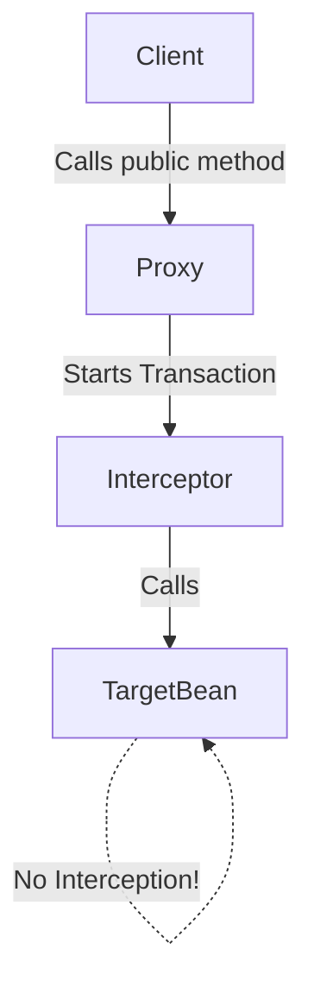

# 🧨 Spring Boot Interview Traps & Gotchas: The Ultimate Guide

Welcome to the definitive guide on Spring Boot interview traps and advanced gotchas. This module is the "crown jewel" designed to elevate your understanding from an intermediate level to a senior engineer level by exploring the dark corners, the counter-intuitive behaviors, and the nuanced inner workings of the Spring Framework.

---

## Category 1: Spring AOP Proxy Traps

### Why `@Transactional` Doesn't Work on Private Methods

**The Trap:** You annotate a `private` method with `@Transactional`, but if an exception is thrown, the transaction doesn't roll back.

**The Explanation:**
Spring relies on proxy-based Aspect-Oriented Programming (AOP). When you annotate a bean, Spring doesn't inject the actual bean; it injects a *proxy* wrapper. This proxy intercepts calls to apply behaviors (like starting a transaction).

However, proxies can only intercept calls originating from *outside* the bean, and they can only override or implement `public` (or package-private in CGLIB) methods. JDK dynamic proxies require interfaces (all methods are public), and CGLIB creates a subclass (cannot override `private` or `final` methods).



> [!WARNING] **Interview Trap**
> An interviewer might ask: "If I call a public `@Transactional` method from another public method in the same class, does the transaction apply?"
> **Answer:** No. This is the **self-invocation** problem. The internal call does not go through the proxy.

### Self-Invocation Problem - 5 Different Solutions

When a method in a class calls another method in the *same* class, AOP interceptors (`@Transactional`, `@Async`, `@Cacheable`) are completely ignored because the call happens on the target object `this`, not on the proxy.

**Solutions:**
1. **Self-Injection:** Inject the bean into itself.
   ```java
   @Service
   public class MyService {
       @Autowired
       private MyService self;
       
       public void methodA() { self.methodB(); } // Goes through proxy!
       @Transactional public void methodB() {}
   }
   ```
2. **Refactor to another class:** The cleanest approach. Move `methodB` to another bean and inject it.
3. **ApplicationContext / BeanFactory:** Fetch the bean programmatically.
   ```java
   MyService proxy = applicationContext.getBean(MyService.class);
   proxy.methodB();
   ```
4. **`AopContext.currentProxy()`:** Expose the proxy. Requires `@EnableAspectJAutoProxy(exposeProxy = true)`.
   ```java
   ((MyService) AopContext.currentProxy()).methodB();
   ```
5. **AspectJ Weaving (Compile-time/Load-time):** Ditch Spring's proxy-based AOP and use true byte-code modification.

### Why `@Async` Doesn't Work on Same-Class Calls
Just like `@Transactional`, `@Async` relies on AOP. If you call an `@Async` method from within the same class, the code runs synchronously on the same thread because the call bypasses the proxy that submits the task to a thread pool.

### Why `@Cacheable` Doesn't Work on Same-Class Calls
Same AOP proxy limitation. If `methodA()` calls `@Cacheable methodB()`, the cache is ignored.

### Why `@Scheduled` Doesn't Work Without `@EnableScheduling`
`@Scheduled` is ignored unless a bean post-processor is registered to scan for it. `@EnableScheduling` registers the `ScheduledAnnotationBeanPostProcessor`. Without it, Spring parses the annotation but does nothing.

### CGLIB vs JDK Dynamic Proxy
- **JDK Dynamic Proxy:** Used when a class implements an interface. It proxies the interface.
- **CGLIB Proxy:** Used when a class does not implement an interface. It creates a subclass dynamically.

> [!NOTE]
> As of Spring Boot 2.0, **CGLIB is the default** for all AOP proxies (configured via `spring.aop.proxy-target-class=true`).

---

## Category 2: Bean & DI Traps

### Injecting Prototype Bean into Singleton
**The Trap:** You want a new instance of a bean every time, so you annotate it with `@Scope("prototype")`. You inject it into a `@Service` (which is a singleton). 
**Gotcha:** You only get *one* instance! The injection happens *once* at startup when the singleton is created.

**Solutions:**
1. **`@Lookup` Method Injection:** 
   ```java
   @Component
   public class MySingleton {
       @Lookup
       public MyPrototype getPrototype() { return null; } // Spring overrides this!
   }
   ```
2. **ObjectFactory / ObjectProvider:**
   ```java
   @Autowired private ObjectProvider<MyPrototype> provider;
   public void doWork() { MyPrototype p = provider.getObject(); }
   ```
3. **ApplicationContext:** `context.getBean(MyPrototype.class);`

### `@Autowired` on Static Fields
**The Trap:**
```java
@Component
public class Utils {
    @Autowired
    private static MyService myService; // ALWAYS NULL!
}
```
**Why it fails:** Spring injects dependencies into *instances* (objects). Static fields belong to the *class*. Spring does not scan static fields for injection by default.
**Solution:** Autowire the setter method and remove the `static` modifier from the method.
```java
private static MyService myService;
@Autowired
public void setMyService(MyService service) {
    Utils.myService = service;
}
```

### Circular Dependencies
**The Trap:** Bean A depends on Bean B, and Bean B depends on Bean A.
- **Field/Setter Injection:** Spring *can* resolve this natively by creating A, caching it early, then creating B and injecting early-A, then finishing A.
- **Constructor Injection:** Spring *cannot* resolve this natively because it needs a fully constructed B to call A's constructor, and vice-versa. (Exception: `BeanCurrentlyInCreationException`).

**Spring Boot 2.6+ Changes:** Circular dependencies are now **prohibited by default**. You must explicitly set `spring.main.allow-circular-references=true`.
**Solution:** Use `@Lazy` on one of the constructor parameters.

### Multiple Beans of Same Type: `@Primary` vs `@Qualifier`
If you have multiple implementations of an interface:
- `@Primary`: Default fallback. If multiple exist, pick this one unless otherwise specified.
- `@Qualifier`: Explicit targeting. "Give me the bean named 'redisCache'".
> [!IMPORTANT]
> If a bean has `@Primary` and the injection point has `@Qualifier("otherBean")`, `@Qualifier` wins. Explicit beats implicit.

### `@Component` on Inner Class
Inner classes must be `static` to be instantiated by Spring independently. Non-static inner classes require an instance of the outer class, which Spring's container cannot easily provide out-of-the-box.

### BeanNotFound vs NoUniqueBeanDefinitionException
- `NoSuchBeanDefinitionException`: No bean of that type exists.
- `NoUniqueBeanDefinitionException`: Multiple exist, but Spring doesn't know which one to pick (missing `@Qualifier` or `@Primary`).

---

## Category 3: Transaction Traps

### `@Transactional` on Checked Exceptions
**The Biggest Trap:**
```java
@Transactional
public void doWork() throws IOException {
    db.save(entity);
    throw new IOException("Failed!"); // TRANSACTION COMMITS!
}
```
**Explanation:** By default, Spring only rolls back on **Unchecked Exceptions** (`RuntimeException` and `Error`). It does NOT roll back on Checked Exceptions.
**Solution:** `@Transactional(rollbackFor = Exception.class)`

### Nested `@Transactional` Methods
If `ServiceA.methodA()` calls `ServiceB.methodB()`, and both are `@Transactional`, they share the **same** physical transaction by default (`Propagation.REQUIRED`). If B fails, the *entire* transaction is marked for rollback. 
Even if A catches B's exception, the commit at the end of A will fail with `UnexpectedRollbackException`.

### `@Transactional(readOnly = true)`
- **What it does:** Sets JDBC connection to read-only, optimizing performance. JPA/Hibernate won't flush changes automatically, and doesn't keep dirty-checking snapshots (huge memory save).
- **What it doesn't do:** It does NOT guarantee that the database will block writes (depends on the DB driver).

### `REQUIRES_NEW` Creating a New Transaction in Same Thread
`Propagation.REQUIRES_NEW` suspends the current transaction, acquires a **new database connection** from the pool, starts a new transaction, completes it, and then resumes the old one.
**Gotcha:** If you use this heavily, you can easily exhaust your HikariCP connection pool, leading to deadlocks.

### Transaction Lost in `@Async` Method
Transactions are bound to `ThreadLocal`. If an `@Transactional` method calls an `@Async` method, the async method runs on a *different thread*. The transaction context is NOT propagated. The async method will run without a transaction (or start a new one).

### LazyInitializationException after Transaction Closes
When you load a JPA entity with lazy relationships, and you try to access the relationship *after* the `@Transactional` method has finished, Hibernate throws `LazyInitializationException` because the session is closed.
**Fixes:** EntityGraphs, `JOIN FETCH`, or DTO projections. Do not use `OpenSessionInView` in production.

---

## Category 4: JPA/Database Traps

### N+1 Select Problem
You load 100 Authors. Then you iterate through them and get their Books. 
Result: 1 query for authors, 100 queries for books (101 queries total).
**Solution:** Use `@EntityGraph` or `JOIN FETCH` in your JPQL repository method.

### `CascadeType.ALL` Dangers on `@ManyToMany`
If you put `CascadeType.REMOVE` on a `@ManyToMany` relationship, deleting one entity will delete all associated entities, which might delete entities associated with *other* parents! 
**Gotcha:** Never use `CascadeType.ALL` on `@ManyToMany`. Use `CascadeType.PERSIST` and `MERGE`.

### Owning Side of Bidirectional Relationship
In a bidirectional relationship, the side with `mappedBy` is the **inverse side**. The other is the **owning side**. 
**Trap:** If you only add the entity to the collection on the inverse side and save, the foreign key in the database will be `NULL`. You must update the owning side!

### `SEQUENCE` vs `IDENTITY` for Batch Inserts
If you use `@GeneratedValue(strategy = GenerationType.IDENTITY)`, Hibernate **disables batch inserts**. Why? Because it needs the ID immediately after the insert statement, forcing a round-trip per row.
**Solution:** Use `GenerationType.SEQUENCE` for batching.

### FetchType.EAGER Causes Extra Queries
Even if you don't access an `@ManyToOne` field, `FetchType.EAGER` forces Hibernate to fetch it. If you load 100 entities, it might spawn 100 extra queries if you aren't careful, overriding your main query logic.

### `@Transient` Field Not Ignored by Jackson
JPA's `@Transient` ignores the field for database mapping. However, Jackson (JSON serializer) will **still include it in the JSON response**. 
**Solution:** Use `@JsonIgnore` as well.

### `EntityManager` Not Thread-Safe
While the Spring-injected `EntityManager` looks like a singleton, it is actually a proxy that delegates to a thread-bound `EntityManager` associated with the current transaction. Never manually share an unproxied `EntityManager` across threads.

---

## Category 5: Concurrency Traps

### Spring Singletons are NOT Thread-Safe
Spring guarantees only one instance of the bean exists. It does **not** make that instance thread-safe.

### Instance Variables in `@RestController`
**The Trap:**
```java
@RestController
public class UserController {
    private int counter = 0; // DEADLY TRAP
    
    @GetMapping("/count")
    public int count() { return ++counter; }
}
```
**Why:** Hundreds of threads are hitting this singleton simultaneously. `++counter` is not atomic. You will lose updates. Use stateless beans, or `AtomicInteger`.

### `@Async` Uses `SimpleAsyncTaskExecutor` by Default
If you use `@EnableAsync` without defining a `TaskExecutor` bean, Spring uses `SimpleAsyncTaskExecutor`.
**Gotcha:** This executor **does not pool threads**. It creates a *brand new thread* for every single `@Async` call. Under load, you will hit OutOfMemoryError. Always define a `ThreadPoolTaskExecutor`.

### ThreadLocal in `@Async` (Lost!)
`ThreadLocal` variables (MDC context for logging, custom tenant IDs) are lost when control moves to the `@Async` thread. 

### SecurityContext in `@Async`
Spring Security's context is also stored in a `ThreadLocal`. By default, it is lost in `@Async`.
**Solution:** Use `DelegatingSecurityContextExecutor` or set `@EnableAsync` and context holder strategies appropriately.

### `CompletableFuture.get()` Blocking the Thread
If you return a `CompletableFuture` from an `@Async` method, and then immediately call `.get()` in the calling thread, you have defeated the purpose of async. The calling thread is now completely blocked waiting for the result.

---

## Category 6: Security Traps

### `ROLE_` Prefix with `hasRole` vs `hasAuthority`
- `hasAuthority("ADMIN")` checks for an authority literally named "ADMIN".
- `hasRole("ADMIN")` automatically appends `ROLE_` and checks for "ROLE_ADMIN".
**Gotcha:** Mixing these up will cause unexpected 403 Forbidden errors.

### CSRF Disabled with Stateless Sessions
If you have a stateless REST API (using JWTs, no sessions), CSRF protection is generally unnecessary and can block requests. However, you must explicitly disable it (`csrf().disable()`), or Spring Security will block POST/PUT requests by default.

### JWT `alg:none` Vulnerability
If you implement custom JWT parsing, ensure you validate the algorithm. Attackers can change the header to `alg:none` and strip the signature, and poorly written parsers will accept it. Always use well-vetted libraries (e.g., JJWT) and enforce the expected algorithm.

### Method Security on Private Methods
Like `@Transactional`, `@PreAuthorize` relies on AOP. It **does not work** on private methods or self-invocations.

### `permitAll()` But Spring Security Still Processes OPTIONS
CORS preflight requests (OPTIONS) must be explicitly allowed. Even if an endpoint is `permitAll()`, an OPTIONS request might be blocked if cors configuration isn't properly wired into the security chain.
**Fix:** `http.cors()` and `requestMatchers(HttpMethod.OPTIONS, "/**").permitAll()`

---

## Category 7: Configuration Traps

### `@Value` with SpEL in `@Configuration`
Using `@Value("${my.prop}")` is common. But what if it's a list?
`@Value("#{'${my.list}'.split(',')}")` uses Spring Expression Language (SpEL) to parse it. 
**Gotcha:** If `my.list` is not defined, this throws a nasty startup error. Use default values: `@Value("${my.list:default}")`.

### `@ConfigurationProperties` Not Working
You created a class annotated with `@ConfigurationProperties("app")`, but the fields are null.
**Trap 1:** You forgot `@Component` or `@EnableConfigurationProperties`.
**Trap 2:** You forgot standard getters and setters (Spring binds via setters).

### Profiles Not Activating
Setting `spring.profiles.active=prod` in `application-dev.yml` does nothing if you are running the `dev` profile. The active profile must be provided via JVM args (`-Dspring.profiles.active=prod`) or OS environment variables (`SPRING_PROFILES_ACTIVE`).

### `application.properties` vs `application.yml` Precedence
If you have both in the same directory, which wins?
In Spring Boot 2.4.0+, `.properties` and `.yml` are processed in a unified way, but if they define the exact same key, `.properties` generally overrides `.yml` due to alphabetical file loading, but rely on document order. Better rule: **never mix them in the same project**.

### Environment Variable Override Precedence
Spring Boot has a strict property overriding order. 
Command line args > `SPRING_APPLICATION_JSON` > OS Environment Variables > application.properties.
**Trap:** To override `spring.datasource.url` via environment variable, you must use `SPRING_DATASOURCE_URL`.

---

## Category 8: Scheduling Traps

### Default Single-Threaded Scheduler
By default, all `@Scheduled` tasks in a Spring Boot application run on a **single thread pool with size 1**.
**The Trap:** If `TaskA` takes 10 minutes to run, `TaskB` (scheduled for every minute) will be blocked and will not run for 10 minutes!
**Solution:** Configure a `ThreadPoolTaskScheduler` bean with a larger pool size.

### Task Killed by Exception Permanently
If a `@Scheduled` method throws an unhandled exception, that specific execution stops. Fortunately, in Spring, subsequent executions *will* still fire (unlike some older raw TimerTasks). But the current run's remaining logic is lost.

### `fixedRate` vs `fixedDelay` Task Overlap
- `fixedDelay`: Starts counting the delay *after* the previous execution completes. Never overlaps.
- `fixedRate`: Starts counting from the *start* of the previous execution.
**Gotcha:** If `fixedRate=5000` (5s), but the task takes 10s, will they overlap? 
**NO**. By default, Spring `@Scheduled` tasks are synchronous and do not run concurrently on the same method. The second task will queue up and wait for the first to finish. To make them overlap, you must *also* add `@Async`.

### `@Scheduled` in Multi-Instance Deployment
If you deploy 5 instances of your Spring Boot app to Kubernetes, your `@Scheduled` task will run **5 times concurrently**!
**Solution:** Use ShedLock, Quartz, or a distributed message queue to ensure only one instance executes the task.

---

## Category 9: Web Layer Traps

### Filter Exception Not Caught by `@ControllerAdvice`
**The Trap:** You have an `@ExceptionHandler` in your `@ControllerAdvice`. You throw a custom exception from a `Filter` (e.g., JwtAuthenticationFilter). The advice never catches it, and the user gets an ugly Tomcat 500 error page.
**Why:** `@ControllerAdvice` wraps the DispatcherServlet. Filters sit *outside* the DispatcherServlet in the Servlet Container chain.
**Solution:** Catch the exception in the filter and use `HandlerExceptionResolver` to forward it to the DispatcherServlet, or write it directly to the response.

### `@PathVariable` Type Mismatch
If you map `@GetMapping("/users/{id}")` where `id` is an `Integer`, and the user sends `/users/abc`, Spring throws a `MethodArgumentTypeMismatchException`. 

### `@RequestBody` required=true Default
`@RequestBody` is required by default. If the client sends an empty body, Spring throws `HttpMessageNotReadableException` (400 Bad Request). If you want to accept empty bodies, use `@RequestBody(required = false)`.

### Content Negotiation Issues
If a client sends `Accept: application/xml` but you only have Jackson JSON on the classpath, Spring returns a `406 Not Acceptable`. Ensure `jackson-dataformat-xml` is included if you need XML support.

### Tomcat Default Thread Pool Limits
Spring Boot's embedded Tomcat defaults to 200 maximum threads (`server.tomcat.threads.max=200`). If you have a slow blocking API, you can easily exhaust these 200 threads, causing subsequent requests to hang or be rejected.

### Max Request Size Exceptions
If a user uploads a file larger than 1MB, Spring Boot rejects it by default with `MaxUploadSizeExceededException`. 
**Fix:** Configure `spring.servlet.multipart.max-file-size` and `max-request-size`.

---

## Category 10: Testing Traps

### `@SpringBootTest` Loads Full Context (Slow!)
**The Trap:** Using `@SpringBootTest` on every unit test.
**Why it's bad:** It boots the entire Spring application context, starts Tomcat (if web is enabled), connects to DBs, etc. If you have 500 tests, your build will take 30 minutes.
**Solution:** Use standard JUnit with Mockito (`@ExtendWith(MockitoExtension.class)`) for unit tests. Save `@SpringBootTest` for integration tests.

### `@MockBean` vs `@Mock` - Which creates a Spring bean?
- `@Mock` (Mockito): Creates a pure Java mock object. Spring doesn't know about it.
- `@MockBean` (Spring Boot): Creates a mock AND places it into the Spring Application Context, overriding any existing bean of the same type.
**Gotcha:** Every time you use `@MockBean` in a test class, Spring might have to **dirty the context and reload it**, slowing down your test suite massively. 

### `@Transactional` in Tests Auto-Rollback
If you annotate a test method with `@Transactional`, Spring will execute the test and then **automatically roll back** the transaction at the end. This is great for keeping the DB clean.
**Trap:** If you test code that creates a transaction with `REQUIRES_NEW`, that sub-transaction commits to the DB permanently, breaking test isolation!

### `@WebMvcTest` Doesn't Load `@Service` Beans
`@WebMvcTest(UserController.class)` only loads the Web layer (Controllers, Filters, ControllerAdvice). It completely ignores `@Service` and `@Repository` beans. You MUST use `@MockBean` to mock the dependencies of the controller.

### `@DataJpaTest` Uses Embedded H2 by Default
Even if your `application.yml` points to PostgreSQL, `@DataJpaTest` will attempt to auto-configure an in-memory H2 database. If you don't have H2 in your POM, the test crashes.
**Solution:** To test against your real DB (or Testcontainers), use `@AutoConfigureTestDatabase(replace = AutoConfigureTestDatabase.Replace.NONE)`.

---

## 🔝 Top 50 Spring Boot Interview Questions

<details>
<summary><b>1. What is the difference between Spring and Spring Boot?</b></summary>
Spring is a dependency injection framework providing core AOP, transaction, and web MVC support. It requires massive XML/Java configuration. Spring Boot is an extension that provides auto-configuration, starter POMs, embedded servers, and opinionated defaults to get apps running quickly.
</details>

<details>
<summary><b>2. How does Spring Boot Auto-Configuration work?</b></summary>
It works via the `@EnableAutoConfiguration` annotation. Spring uses `SpringFactoriesLoader` to look for `META-INF/spring.factories` (or `META-INF/spring/org.springframework.boot.autoconfigure.AutoConfiguration.imports` in Boot 3.x). It loads configuration classes and applies them based on `@Conditional` annotations (e.g., `@ConditionalOnClass`, `@ConditionalOnMissingBean`).
</details>

<details>
<summary><b>3. What are Spring Boot Starters?</b></summary>
They are dependency descriptors you include in your application to get a curated list of dependencies. For example, `spring-boot-starter-web` pulls in Spring MVC, Jackson, and embedded Tomcat.
</details>

<details>
<summary><b>4. What is the difference between `@Component`, `@Service`, `@Repository`, and `@Controller`?</b></summary>
`@Component` is the generic stereotype. The others are specializations. `@Repository` translates persistence exceptions into Spring's DataAccessException. `@Controller` is meant for web endpoints. `@Service` currently has no additional behavior but serves as a marker for the business layer.
</details>

<details>
<summary><b>5. Explain the Spring Bean Lifecycle.</b></summary>
Instantiation -> Populate Properties (DI) -> `BeanNameAware` -> `BeanFactoryAware` -> `ApplicationContextAware` -> `BeanPostProcessor.postProcessBeforeInitialization` -> `@PostConstruct` / `InitializingBean.afterPropertiesSet` -> Custom init method -> `BeanPostProcessor.postProcessAfterInitialization` -> Bean is Ready for Use -> `@PreDestroy` / `DisposableBean.destroy` -> Custom destroy method.
</details>

<details>
<summary><b>6. What are the Bean Scopes in Spring?</b></summary>
Singleton (default), Prototype, Request, Session, Application, Websocket.
</details>

<details>
<summary><b>7. How do you resolve Circular Dependencies?</b></summary>
By redesigning the architecture to remove the cycle, or by using `@Lazy` injection on one of the dependencies to inject a proxy instead of the fully initialized bean.
</details>

<details>
<summary><b>8. What is the difference between `@Autowired` and `@Inject`?</b></summary>
`@Autowired` is Spring-specific. `@Inject` is part of the Java CDI (Contexts and Dependency Injection) standard (JSR-330). They function identically in Spring.
</details>

<details>
<summary><b>9. What is `@Qualifier` used for?</b></summary>
When multiple beans of the same type exist in the context, `@Qualifier` specifies exactly which bean to inject by its name.
</details>

<details>
<summary><b>10. Can you inject a bean into a static field?</b></summary>
Not directly with `@Autowired` on the field. You must use `@Autowired` on a non-static setter method that sets the static field.
</details>

<details>
<summary><b>11. What is Spring AOP? How does it differ from AspectJ?</b></summary>
Spring AOP is proxy-based and only works on Spring-managed beans. It only supports method execution join points. AspectJ is a full-fledged AOP framework that modifies byte-code (weaving) and supports field interception, constructor interception, and works on non-Spring objects.
</details>

<details>
<summary><b>12. Why doesn't `@Transactional` work on private methods?</b></summary>
Because Spring AOP uses proxies (JDK dynamic or CGLIB). Proxies wrap the object and intercept public methods. They cannot intercept private methods.
</details>

<details>
<summary><b>13. Explain the Self-Invocation Problem.</b></summary>
When a method calls another method within the same class, the call is made on the `this` reference, bypassing the AOP proxy completely. Annotations like `@Transactional` on the second method will be ignored.
</details>

<details>
<summary><b>14. What are the `@Transactional` Propagation types?</b></summary>
`REQUIRED` (default), `REQUIRES_NEW`, `SUPPORTS`, `NOT_SUPPORTED`, `MANDATORY`, `NEVER`, `NESTED`.
</details>

<details>
<summary><b>15. Does `@Transactional` rollback on checked exceptions?</b></summary>
No. By default, it only rolls back on `RuntimeException` and `Error`. You must configure `rollbackFor = Exception.class` to include checked exceptions.
</details>

<details>
<summary><b>16. How does `@RestController` differ from `@Controller`?</b></summary>
`@RestController` is a meta-annotation composed of `@Controller` and `@ResponseBody`. It automatically serializes the return object to JSON/XML instead of resolving to a view template (like JSP/Thymeleaf).
</details>

<details>
<summary><b>17. What is `@ControllerAdvice`?</b></summary>
It is an interceptor that surrounds the logic in your Controllers. It is primarily used with `@ExceptionHandler` to provide global, centralized exception handling across the whole application.
</details>

<details>
<summary><b>18. How do you handle exceptions thrown in a Filter?</b></summary>
Exceptions in Filters occur before the DispatcherServlet, so `@ControllerAdvice` won't catch them. You must catch them in the filter and use a `HandlerExceptionResolver` to route them, or manually write to the `HttpServletResponse`.
</details>

<details>
<summary><b>19. Explain Spring Security architecture.</b></summary>
It revolves around a chain of `Filter`s (`FilterChainProxy`). Key components include `AuthenticationManager`, `ProviderManager`, `AuthenticationProvider`, `UserDetailsService`, and `SecurityContextHolder`.
</details>

<details>
<summary><b>20. How is `SecurityContext` managed?</b></summary>
By default, it is stored in a `ThreadLocal` using `SecurityContextHolder.setStrategyName(SecurityContextHolder.MODE_THREADLOCAL)`.
</details>

<details>
<summary><b>21. How do you pass `SecurityContext` to `@Async` methods?</b></summary>
Use `MODE_INHERITABLETHREADLOCAL`, or configure the `TaskExecutor` with a `DelegatingSecurityContextExecutor`.
</details>

<details>
<summary><b>22. What is CSRF and how does Spring Boot handle it?</b></summary>
Cross-Site Request Forgery. Spring Security enables it by default, expecting a CSRF token in state-changing requests (POST/PUT). In stateless JWT/API architectures, it is usually disabled.
</details>

<details>
<summary><b>23. Spring Data JPA: Difference between `save()` and `saveAndFlush()`?</b></summary>
`save()` schedules the entity for insertion/update in the persistence context. The actual SQL is fired at flush time (usually before commit). `saveAndFlush()` forces the SQL statement to execute immediately.
</details>

<details>
<summary><b>24. What is the N+1 Select Problem?</b></summary>
When loading a list of N entities and then iterating through them to access a lazy-loaded collection, JPA executes 1 query for the list, plus N extra queries for each collection.
</details>

<details>
<summary><b>25. How do you fix N+1?</b></summary>
Using `JOIN FETCH` in JPQL, or `@EntityGraph` to instruct Hibernate to eagerly fetch the relationship in a single SQL join.
</details>

<details>
<summary><b>26. Difference between `FetchType.LAZY` and `EAGER`?</b></summary>
`LAZY` means the relationship is replaced by a proxy and loaded only when first accessed. `EAGER` means it is loaded immediately with the parent entity.
</details>

<details>
<summary><b>27. What is `LazyInitializationException`?</b></summary>
Occurs when you try to access a `LAZY` collection on a detached entity (an entity outside an active Hibernate Session/Transaction).
</details>

<details>
<summary><b>28. Why should you avoid `@Data` (Lombok) on JPA Entities?</b></summary>
`@Data` generates `equals()`, `hashCode()`, and `toString()` that include all fields. This can trigger lazy loading, causing `LazyInitializationException` or infinite recursion with bidirectional relationships.
</details>

<details>
<summary><b>29. What is Spring Boot Actuator?</b></summary>
It provides production-ready features like health checks, metrics, thread dumps, and environment property exposure via HTTP endpoints (`/actuator/health`).
</details>

<details>
<summary><b>30. How do you secure Actuator endpoints?</b></summary>
By default, only `/health` and `/info` are exposed. Others are secured. Use Spring Security to restrict access to the `/actuator/**` paths.
</details>

<details>
<summary><b>31. What are profiles in Spring Boot?</b></summary>
Profiles allow you to segregate parts of your configuration and make it available only in certain environments (e.g., `dev`, `test`, `prod`).
</details>

<details>
<summary><b>32. How do you configure properties in Spring Boot?</b></summary>
Via `application.properties`/`yml`, command line arguments, environment variables, or `@PropertySource`.
</details>

<details>
<summary><b>33. What is `@ConfigurationProperties`?</b></summary>
A way to bind external configuration properties directly to strongly-typed Java POJOs, allowing validation and type safety.
</details>

<details>
<summary><b>34. How do you schedule tasks in Spring Boot?</b></summary>
Annotate the main class with `@EnableScheduling` and use `@Scheduled(cron="...")` or `fixedRate` on a method.
</details>

<details>
<summary><b>35. Is `@Scheduled` thread-safe and concurrent?</b></summary>
No. By default, Spring uses a single thread to execute all `@Scheduled` tasks. If one blocks, others wait. You must define a `TaskScheduler` pool.
</details>

<details>
<summary><b>36. What is the difference between `@Mock` and `@MockBean`?</b></summary>
`@Mock` is pure Mockito. `@MockBean` is a Spring Boot test annotation that injects the mock directly into the ApplicationContext, replacing any real bean.
</details>

<details>
<summary><b>37. Why is `@SpringBootTest` slow?</b></summary>
Because it bootstraps the entire application context. Use slicing annotations like `@WebMvcTest` or `@DataJpaTest` instead for faster tests.
</details>

<details>
<summary><b>38. What does `@WebMvcTest` do?</b></summary>
It configures only the Web MVC layer (Controllers, Filters, etc.) and ignores Services and Repositories. You must mock dependencies with `@MockBean`.
</details>

<details>
<summary><b>39. How do you test asynchronous code in Spring?</b></summary>
Use `Awaitility` to poll for completion, or return a `CompletableFuture` and use `.get()` in the test.
</details>

<details>
<summary><b>40. What is an `EntityManager`?</b></summary>
It is the JPA interface used to interact with the persistence context. In Spring, it is proxied and bound to the current thread's transaction.
</details>

<details>
<summary><b>41. How does Spring Boot manage database migrations?</b></summary>
By integrating with Flyway or Liquibase. If their dependencies are on the classpath and scripts are in standard locations (e.g., `db/migration`), Spring Boot runs them automatically on startup.
</details>

<details>
<summary><b>42. What is HikariCP?</b></summary>
The default, extremely fast, lightweight JDBC connection pool used by Spring Boot.
</details>

<details>
<summary><b>43. How do you handle CORS in Spring Boot?</b></summary>
Using the `@CrossOrigin` annotation on controllers, or by registering a `CorsFilter` bean globally.
</details>

<details>
<summary><b>44. What happens if you return a `ResponseEntity` from a Controller?</b></summary>
It allows you to fully configure the HTTP response, including the HTTP status code, headers, and the response body.
</details>

<details>
<summary><b>45. What is the difference between `@PathVariable` and `@RequestParam`?</b></summary>
`@PathVariable` extracts values from the URI path (e.g., `/users/1`). `@RequestParam` extracts values from query parameters (e.g., `/users?id=1`).
</details>

<details>
<summary><b>46. Can you have multiple `@SpringBootApplication` annotations?</b></summary>
No. It is intended to be used on a single main class. It encapsulates `@Configuration`, `@EnableAutoConfiguration`, and `@ComponentScan`.
</details>

<details>
<summary><b>47. How do you map exceptions to HTTP status codes?</b></summary>
Using `@ResponseStatus(HttpStatus.NOT_FOUND)` on the Exception class, or handling it in `@ControllerAdvice`.
</details>

<details>
<summary><b>48. What is `RestTemplate` vs `WebClient`?</b></summary>
`RestTemplate` is the old, synchronous HTTP client. `WebClient` is the modern, non-blocking, reactive HTTP client introduced in Spring WebFlux.
</details>

<details>
<summary><b>49. How does Spring know which profile to load?</b></summary>
It looks at the `spring.profiles.active` property in the environment, command line, or `application.properties`.
</details>

<details>
<summary><b>50. What is `@Conditional`?</b></summary>
An annotation used mostly in auto-configuration to register a bean only if a certain condition is met (e.g., a class is present, a property is set).
</details>

---

## 🚫 20 Common Misconceptions

1. **Misconception:** Spring Boot generates code behind the scenes.
   **Reality:** It uses standard Java, reflection, and proxying. There is no code generation (unless using GraalVM AOT compilation in Boot 3).
2. **Misconception:** `@Transactional` makes your method thread-safe.
   **Reality:** It only provides ACID properties for the database transaction. Concurrent Java threads still share state.
3. **Misconception:** `@Autowired` is the best way to inject dependencies.
   **Reality:** Constructor injection is highly preferred. It allows `final` fields, prevents circular dependencies from hiding, and makes testing easier.
4. **Misconception:** `@Async` runs in the background efficiently by default.
   **Reality:** Without a configured Executor, it spawns a new unmanaged thread per request, leading to potential out-of-memory errors.
5. **Misconception:** `@Component` and `@Service` behave differently.
   **Reality:** Functionally, they are identical in the Spring container. `@Service` is purely a semantic marker.
6. **Misconception:** `@Cacheable` caches based on the object reference.
   **Reality:** It caches based on the method parameters using their `hashCode()` and `equals()`.
7. **Misconception:** Hibernate saves data the moment you call `repo.save()`.
   **Reality:** It stores it in the Persistence Context. The actual `INSERT/UPDATE` SQL is delayed until flush (usually end of transaction).
8. **Misconception:** `@RestController` is secure by default.
   **Reality:** Endpoints are completely open unless Spring Security is in the classpath and configured.
9. **Misconception:** You can catch any exception globally with `@ControllerAdvice`.
   **Reality:** Exceptions thrown in Filters or during the request mapping phase (before the DispatcherServlet delegates) will bypass it.
10. **Misconception:** ApplicationContext is just a Map.
    **Reality:** It's a complex factory interface with lifecycle management, environment abstraction, event publishing, and hierarchical contexts.
11. **Misconception:** Spring Boot requires Tomcat.
    **Reality:** You can swap it for Jetty, Undertow, or run reactive with Netty (WebFlux).
12. **Misconception:** A bean with `@Scope("prototype")` injected into a singleton creates a new instance on every method call.
    **Reality:** It is injected only once at startup. The singleton holds a single instance of the prototype.
13. **Misconception:** `@Transactional(readOnly = true)` prevents modifications at the application level.
    **Reality:** It sets an optimization flag. The database or JDBC driver handles the read-only enforcement.
14. **Misconception:** The main thread waits for `@Async` methods to complete before shutting down.
    **Reality:** If the Executor is not configured properly or shutdown hooks are missing, the JVM can terminate while async tasks are running.
15. **Misconception:** `CascadeType.ALL` is safe to use everywhere.
    **Reality:** On `@ManyToMany` relationships, it can cause catastrophic deletions of shared entities.
16. **Misconception:** A new Transaction is always started with `@Transactional`.
    **Reality:** By default (`REQUIRED`), it joins an existing transaction if one is present on the calling thread.
17. **Misconception:** SecurityContextHolder is globally accessible across all threads.
    **Reality:** It uses `ThreadLocal` and is isolated to the specific HTTP request thread.
18. **Misconception:** `@Value` always parses strings.
    **Reality:** It can parse lists, maps, booleans, and run complex SpEL logic.
19. **Misconception:** `@DataJpaTest` tests against your actual configured database.
    **Reality:** It swaps it for an embedded in-memory database (H2/Derby) by default.
20. **Misconception:** OpenSessionInView is a good pattern.
    **Reality:** It's enabled by default in Boot but is an anti-pattern that keeps database connections open during the entire view-rendering phase (or JSON serialization), heavily degrading performance under load.

---

## 📝 Summary & Key Takeaways

1. **Beware the Proxy:** Understand that Spring heavily relies on AOP Proxies. Private methods, self-invocations, and final classes break proxy behaviors.
2. **Understand ThreadBound Contexts:** Transactions and Security rely on `ThreadLocal`. Moving execution to another thread (`@Async` or reactive streams) loses this context.
3. **Database Illusions:** JPA is an abstraction. Underneath, N+1 issues, batching behaviors, and flush modes dictate performance. The persistence context delays queries.
4. **Defaults are Dangerous:** Unconfigured `@Async` thread pools, OpenSessionInView, and H2 testing fallbacks can ruin production deployments.

## ❓ Practice Questions

1. Write a code snippet demonstrating the self-invocation problem with `@Transactional` and fix it using self-injection.
2. Design a `@RestController` that safely maintains a running counter of requests in a thread-safe manner.
3. Analyze a failing test where `@SpringBootTest` takes 10 minutes to run, and refactor it to run in 500ms using `@ExtendWith(MockitoExtension.class)`.

*End of Module 12*
