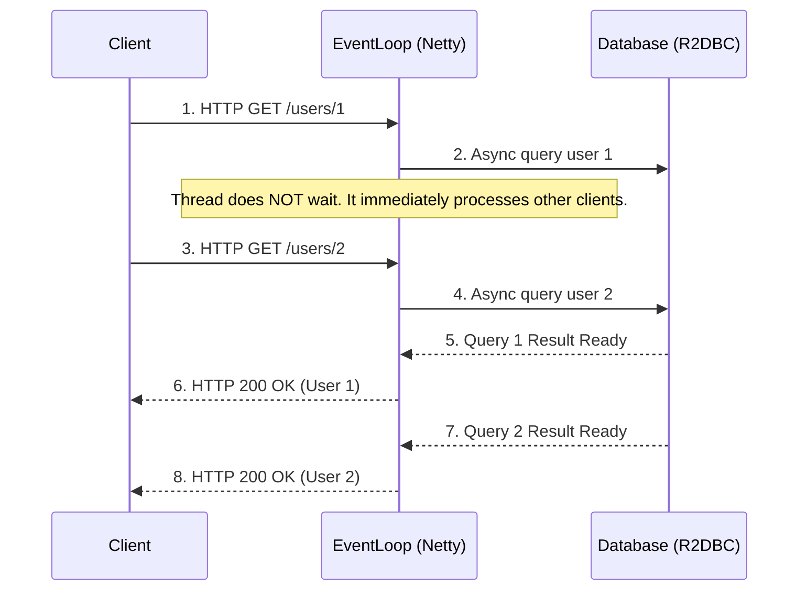

# Module 17: Reactive Programming with Spring WebFlux

Reactive programming fundamentally changes how we think about system architecture and request processing. In the modern era of microservices, cloud-native applications, and the demand for high scalability, traditional synchronous programming models often hit structural limitations. Spring WebFlux, introduced in Spring Framework 5, is Spring's fully non-blocking, reactive web framework built on Project Reactor.

This comprehensive guide will take you from the conceptual foundations of reactive programming all the way to production-grade WebFlux implementation.

---

## 1. Imperative vs Reactive

To understand why we need WebFlux, we first need to understand the limitations of the traditional model it replaces.

### The Thread-Per-Request Model (Imperative)

Traditional Java web applications (like Spring MVC running on Apache Tomcat) use a **Thread-Per-Request** model. 

1. A client sends an HTTP request.
2. The servlet container (Tomcat) allocates a dedicated thread from its thread pool to handle this request.
3. The thread processes the request sequentially. If it needs to make a database call or an external API HTTP call, the thread **blocks** (waits) until the response arrives.
4. Once the response is formed, it is sent back to the client, and the thread is returned to the pool.

> [!WARNING] The Bottleneck
> When an application is highly I/O bound (e.g., waiting for slow databases, third-party APIs), threads spend most of their time doing absolutely nothing—just waiting. If thousands of concurrent requests hit the server, the thread pool (default 200 in Tomcat) depletes rapidly. The server must either queue requests or reject them, leading to latency spikes and cascading failures.

### The Event Loop Model (Reactive)

Spring WebFlux (running on servers like Netty) uses an **Event Loop** model, similar to Node.js, but highly optimized for the JVM.

1. A small number of threads (typically one per CPU core) handle all incoming requests in a continuous loop.
2. When a request arrives, the event loop takes it and routes it to the appropriate handler.
3. If the handler needs to perform an I/O operation (like querying a DB), it **does not block**. Instead, it delegates the I/O operation to an asynchronous worker and immediately returns to the event loop to pick up the next incoming request.
4. When the I/O operation completes, an event is fired. The event loop picks up this event and resumes processing the original request, eventually sending the response to the client.



### Why Reactive? 

| Feature | Imperative (Spring MVC) | Reactive (Spring WebFlux) |
|---------|-------------------------|---------------------------|
| **Execution Model** | Thread-per-request | Event Loop |
| **I/O** | Blocking (Synchronous) | Non-blocking (Asynchronous) |
| **Best For** | CPU-bound tasks, simple CRUD | I/O-bound tasks, streaming, microservices |
| **Scalability** | Limited by Thread Pool | Limited by CPU / Memory |
| **Complexity** | Low (Straightforward debugging) | High (Steep learning curve, hard debugging) |

**Key Drivers for Reactive:**
1. **The C10K Problem:** Handling 10,000+ concurrent connections. Blocking architectures fail here due to memory overhead (each thread takes ~1MB of RAM stack size). 10,000 threads = 10GB of RAM just for thread stacks! Reactive handles this with a handful of threads.
2. **Microservices & API Gateways:** Gateways (like Spring Cloud Gateway) route requests to dozens of downstream services. If they blocked on every downstream call, they would collapse under load.
3. **Resource Efficiency:** Do more with less hardware. Reactive systems can handle higher throughput on smaller instances.

### Backpressure Explained

Backpressure is a core concept of the Reactive Streams specification. It is a feedback mechanism that allows a **Subscriber** (consumer) to tell a **Publisher** (producer) how much data it can handle, preventing the subscriber from being overwhelmed by a fast producer (OutOfMemory errors).

In the imperative world, if a DB returns 1 million rows, they are loaded into RAM. In reactive, the subscriber requests data in chunks (e.g., "Give me 10 items"). The publisher sends 10 items. The subscriber processes them and says, "Give me 10 more."

> [!NOTE] Reactive Streams Interfaces
> The JVM Reactive Streams API consists of four interfaces: `Publisher`, `Subscriber`, `Subscription` (where backpressure is controlled via `request(long n)`), and `Processor`.

---

## 2. Project Reactor Basics

Spring WebFlux is built on **Project Reactor**, a Reactive Streams implementation by Pivotal (VMware). You must master Reactor to use WebFlux effectively.

Reactor introduces two core `Publisher` implementations: **Mono** and **Flux**.

### Mono (0 or 1 item)
A `Mono<T>` is a publisher that emits at most one item, and then terminates successfully (or with an error). It is the reactive equivalent of `Optional<T>` or a single object return type.

```java
import reactor.core.publisher.Mono;

public class MonoExamples {
    public void demo() {
        // Create a Mono containing a string
        Mono<String> monoString = Mono.just("Hello WebFlux");
        
        // Empty Mono
        Mono<Void> emptyMono = Mono.empty();
        
        // Mono from an error
        Mono<String> errorMono = Mono.error(new RuntimeException("Oops"));
        
        // Defer execution until subscription (lazy evaluation)
        Mono<String> deferredMono = Mono.defer(() -> Mono.just(heavyComputation()));
    }
    
    private String heavyComputation() {
        return "Result";
    }
}
```

### Flux (0 to N items)
A `Flux<T>` is a publisher that emits 0 to N items, and then terminates successfully or with an error. It is the reactive equivalent of a `List<T>` or a stream of data.

```java
import reactor.core.publisher.Flux;
import java.util.Arrays;
import java.time.Duration;

public class FluxExamples {
    public void demo() {
        // Create a Flux of static elements
        Flux<String> colors = Flux.just("Red", "Green", "Blue");
        
        // From an Iterable
        Flux<String> fromList = Flux.fromIterable(Arrays.asList("A", "B", "C"));
        
        // Emitting numbers periodically (e.g., every 1 second)
        Flux<Long> ticker = Flux.interval(Duration.ofSeconds(1));
    }
}
```

### Essential Operators

Reactor provides hundreds of operators. Here are the most critical ones:

#### 1. `map` (Synchronous Transformation)
Transforms the items emitted by a Publisher by applying a synchronous function.

```java
Flux.just("spring", "boot", "reactive")
    .map(String::toUpperCase)
    .subscribe(System.out::println); 
// Output: SPRING, BOOT, REACTIVE
```

#### 2. `flatMap` (Asynchronous Transformation)
Transforms the items emitted into other Publishers, and then flattens them back into a single Publisher. Crucial for chaining non-blocking asynchronous calls.

```java
// Suppose getUserDetails is a reactive call returning Mono<UserDetails>
public Flux<UserDetails> getDetailsForUsers(Flux<String> userIds) {
    return userIds.flatMap(userId -> fetchUserDetailsAsync(userId)); 
}

private Mono<UserDetails> fetchUserDetailsAsync(String userId) {
    // Non-blocking network call here
    return Mono.just(new UserDetails(userId));
}
```

#### 3. `filter`
Filters items based on a Predicate.

```java
Flux.range(1, 10)
    .filter(i -> i % 2 == 0)
    .subscribe(System.out::println); // 2, 4, 6, 8, 10
```

#### 4. `zip`
Combines multiple Publishers together, waiting for all of them to emit an item, and combines those items into a Tuple.

```java
Mono<String> firstName = Mono.just("John");
Mono<String> lastName = Mono.just("Doe");

Mono.zip(firstName, lastName)
    .map(tuple -> tuple.getT1() + " " + tuple.getT2())
    .subscribe(System.out::println); // Output: John Doe
```

#### 5. `merge`
Interleaves elements from multiple Publishers as they arrive. Order is not guaranteed.

```java
Flux<Integer> flux1 = Flux.just(1, 2).delayElements(Duration.ofMillis(100));
Flux<Integer> flux2 = Flux.just(3, 4).delayElements(Duration.ofMillis(50));

Flux.merge(flux1, flux2)
    .subscribe(System.out::println); // Might output 3, 1, 4, 2 based on timing
```

### 🔍 Deep Dive: The Golden Rule - Subscribe and Execution

> [!IMPORTANT] Nothing Happens Until You Subscribe
> In Project Reactor, building a chain of operators (like `Flux.just().map().filter()`) does **not** execute anything. It merely builds a blueprint (the execution pipeline). 
> The pipeline is only materialized and data only begins to flow when a terminal `.subscribe()` method is called.

```java
// This prints absolutely NOTHING. No operations are executed.
Flux<String> pipeline = Flux.just("A", "B", "C")
    .map(s -> {
        System.out.println("Processing " + s);
        return s.toLowerCase();
    });

// To trigger execution, you must subscribe:
pipeline.subscribe(); // Now "Processing A", "Processing B"... is printed.
```
*Note: In Spring WebFlux, the framework itself acts as the ultimate subscriber. You return a `Mono` or `Flux` from your controller, and Spring handles the subscription when writing to the HTTP response.*

---

## 3. Spring WebFlux

Spring provides two distinct programming models for WebFlux:
1. **Annotated Controllers:** Identical to Spring MVC (`@RestController`, `@GetMapping`).
2. **Functional Endpoints:** A newer, lambda-based routing approach.

### Annotated Controllers

The transition from Spring MVC to WebFlux is syntactically seamless. The main difference is the return types.

```java
import org.springframework.web.bind.annotation.*;
import reactor.core.publisher.Flux;
import reactor.core.publisher.Mono;

@RestController
@RequestMapping("/api/products")
public class ProductController {

    private final ProductReactiveRepository repository;

    public ProductController(ProductReactiveRepository repository) {
        this.repository = repository;
    }

    // Return a single item using Mono
    @GetMapping("/{id}")
    public Mono<Product> getProduct(@PathVariable String id) {
        return repository.findById(id);
    }

    // Return multiple items using Flux
    @GetMapping
    public Flux<Product> getAllProducts() {
        return repository.findAll();
    }

    // Accept reactive bodies
    @PostMapping
    public Mono<Product> createProduct(@RequestBody Mono<Product> productMono) {
        return productMono.flatMap(repository::save);
    }
}
```

### Functional Endpoints

Instead of using annotations, you can define routes using `RouterFunction` and handle them using `HandlerFunction`. This model is preferred by developers who want explicit, immutable, programmatic route configuration.

```java
import org.springframework.context.annotation.Bean;
import org.springframework.context.annotation.Configuration;
import org.springframework.web.reactive.function.server.RouterFunction;
import org.springframework.web.reactive.function.server.ServerResponse;
import static org.springframework.web.reactive.function.server.RequestPredicates.*;
import static org.springframework.web.reactive.function.server.RouterFunctions.route;

@Configuration
public class ProductRouter {

    @Bean
    public RouterFunction<ServerResponse> routes(ProductHandler handler) {
        return route(GET("/fn/products"), handler::getAll)
            .andRoute(GET("/fn/products/{id}"), handler::getById)
            .andRoute(POST("/fn/products"), handler::create);
    }
}
```

The Handler class:

```java
import org.springframework.stereotype.Component;
import org.springframework.web.reactive.function.server.ServerRequest;
import org.springframework.web.reactive.function.server.ServerResponse;
import reactor.core.publisher.Mono;

@Component
public class ProductHandler {
    private final ProductReactiveRepository repository;

    public ProductHandler(ProductReactiveRepository repository) {
        this.repository = repository;
    }

    public Mono<ServerResponse> getAll(ServerRequest request) {
        return ServerResponse.ok().body(repository.findAll(), Product.class);
    }

    public Mono<ServerResponse> getById(ServerRequest request) {
        String id = request.pathVariable("id");
        return repository.findById(id)
            .flatMap(product -> ServerResponse.ok().bodyValue(product))
            .switchIfEmpty(ServerResponse.notFound().build());
    }

    public Mono<ServerResponse> create(ServerRequest request) {
        Mono<Product> productMono = request.bodyToMono(Product.class);
        return productMono.flatMap(repository::save)
            .flatMap(p -> ServerResponse.ok().bodyValue(p));
    }
}
```

### WebClient: The Reactive Alternative to RestTemplate

`RestTemplate` is a blocking API. If you use it inside a WebFlux application, **you will block the event loop**, completely defeating the purpose of WebFlux.

Spring introduced `WebClient` as a non-blocking, reactive HTTP client.

```java
import org.springframework.stereotype.Service;
import org.springframework.web.reactive.function.client.WebClient;
import reactor.core.publisher.Flux;
import reactor.core.publisher.Mono;

@Service
public class ExternalApiService {

    private final WebClient webClient;

    public ExternalApiService(WebClient.Builder webClientBuilder) {
        this.webClient = webClientBuilder.baseUrl("https://api.example.com").build();
    }

    // Reactive GET Request
    public Flux<User> fetchActiveUsers() {
        return this.webClient.get()
            .uri("/users?status=active")
            .retrieve() // Initiates the request
            .bodyToFlux(User.class); // Deserializes JSON array to Flux<User>
    }

    // Reactive POST Request
    public Mono<User> createUser(User newUser) {
        return this.webClient.post()
            .uri("/users")
            .bodyValue(newUser)
            .retrieve()
            .bodyToMono(User.class);
    }
}
```

> [!TIP] Advanced WebClient configuration
> You can configure WebClient timeouts, connection pooling, and filters to handle authentication tokens or tracing IDs across reactive boundaries.

---

## 4. Reactive Data Access

An application is only as non-blocking as its most blocking component. If you use standard JDBC/Hibernate in a WebFlux app, database calls will block the Netty threads. We must use Reactive Data Access libraries.

### R2DBC (Reactive Relational Database Connectivity)

R2DBC provides non-blocking APIs to relational databases (PostgreSQL, MySQL, SQL Server, etc.).

**Maven Dependency:**
```xml
<dependency>
    <groupId>org.springframework.boot</groupId>
    <artifactId>spring-boot-starter-data-r2dbc</artifactId>
</dependency>
<dependency>
    <groupId>io.r2dbc</groupId>
    <artifactId>r2dbc-postgresql</artifactId>
</dependency>
```

**Repository Interface:**
```java
import org.springframework.data.repository.reactive.ReactiveCrudRepository;
import reactor.core.publisher.Flux;

public interface UserRepository extends ReactiveCrudRepository<User, Long> {
    
    // Custom non-blocking query method
    Flux<User> findByLastName(String lastName);
    
    // Custom query using @Query
    @Query("SELECT * FROM users WHERE age > :age")
    Flux<User> findAdults(int age);
}
```

### Reactive NoSQL (MongoDB, Redis)

Spring provides reactive templates and repositories for modern NoSQL databases.

```java
// Reactive Mongo Repository
import org.springframework.data.mongodb.repository.ReactiveMongoRepository;

public interface DocumentRepository extends ReactiveMongoRepository<Document, String> {
    Flux<Document> findByStatus(String status);
}
```

### Transaction Management in WebFlux

Transactions in Spring MVC heavily rely on `ThreadLocal` to bind the DB connection to the current thread. **In reactive programming, a single request can jump across multiple threads.** Therefore, `ThreadLocal` does not work.

Spring provides Reactive Transaction Management using Reactor's `Context` to propagate the transaction context. You can still use the `@Transactional` annotation!

```java
import org.springframework.transaction.annotation.Transactional;
import org.springframework.stereotype.Service;
import reactor.core.publisher.Mono;

@Service
public class OrderService {

    private final OrderRepository orderRepo;
    private final PaymentRepository paymentRepo;

    public OrderService(OrderRepository orderRepo, PaymentRepository paymentRepo) {
        this.orderRepo = orderRepo;
        this.paymentRepo = paymentRepo;
    }

    @Transactional
    public Mono<Void> placeOrder(Order order, Payment payment) {
        return orderRepo.save(order)
            .then(paymentRepo.save(payment))
            .then(); // Emits Mono<Void> on success, rolls back on error.
    }
}
```

---

## 5. Error Handling in WebFlux

Because errors occur asynchronously in a reactive pipeline, `try-catch` blocks don't work. Project Reactor provides specific operators for error handling.

### Reactor Error Operators

```java
public Flux<Integer> getNumbers() {
    return fetchDangerousData() // Might throw an exception
        
        // 1. Return a fallback value
        .onErrorReturn(-1) 
        
        // 2. Execute a fallback publisher
        .onErrorResume(e -> {
            log.error("Failed, switching to cache", e);
            return fetchFromCache();
        })
        
        // 3. Translate the exception
        .onErrorMap(e -> new CustomDomainException("Data fetch failed", e))
        
        // 4. Side effect only (e.g., logging), without swallowing the error
        .doOnError(e -> log.error("An error occurred", e));
}
```

### Global Exception Handling

In WebFlux, you can use the standard `@ControllerAdvice` and `@ExceptionHandler` for annotated controllers.

```java
import org.springframework.http.ResponseEntity;
import org.springframework.web.bind.annotation.ExceptionHandler;
import org.springframework.web.bind.annotation.RestControllerAdvice;
import org.springframework.http.HttpStatus;

@RestControllerAdvice
public class GlobalExceptionHandler {

    @ExceptionHandler(CustomDomainException.class)
    public ResponseEntity<ErrorResponse> handleDomainException(CustomDomainException ex) {
        ErrorResponse response = new ErrorResponse("ERR_01", ex.getMessage());
        return new ResponseEntity<>(response, HttpStatus.BAD_REQUEST);
    }
}
```

For functional endpoints, you implement `ErrorWebExceptionHandler` to handle errors globally.

---

## 6. ⚠️ Interview Traps & Gotchas

Reactive programming is notorious for its steep learning curve. Interviewers frequently test your understanding of these specific pitfalls.

### 1. Blocking the Event Loop (The Deadliest Sin)
**The Trap:** Calling a blocking API (like `Thread.sleep()`, synchronous `RestTemplate`, `java.io` File reading, or JDBC) directly inside a WebFlux pipeline. Because Netty only has a few threads, blocking even a single thread severely degrades application performance.
**The Fix:** If you *must* use a blocking library, you have to offload it to a dedicated thread pool using `subscribeOn(Schedulers.boundedElastic())`.

```java
// WRONG: Blocks the Netty event loop thread
public Mono<String> badApproach() {
    return Mono.fromCallable(() -> blockingDatabaseCall.get()); 
}

// RIGHT: Offloads execution to a specialized elastic thread pool
public Mono<String> goodApproach() {
    return Mono.fromCallable(() -> blockingDatabaseCall.get())
               .subscribeOn(Schedulers.boundedElastic());
}
```

### 2. Using BlockHound
**The Tool:** How do you guarantee no one on your team blocks the event loop? Enter **BlockHound**, a Java agent developed by the Reactor team. It instruments JVM classes to throw a runtime exception if a blocking call is made from a non-blocking thread.
**Usage:** Add it to your tests or development environment. Interviewers love asking how to detect blocking code in reactive apps.

```java
// In your main method or test setup:
BlockHound.install();
```

### 3. map vs flatMap (Synchronous vs Asynchronous Mapping)
**The Trap:** Not knowing when to use which. 
- Use `map` when the transformation is synchronous (e.g., String to Integer).
- Use `flatMap` when the transformation returns another Publisher (e.g., calling an external API or DB).
**The Gotcha:** If you use `map` to call an API returning a `Mono`, you end up with `Mono<Mono<String>>` (nested publishers), which is useless in a pipeline.

### 4. ThreadLocal Does Not Work
**The Trap:** Relying on `ThreadLocal` for passing security contexts, transaction IDs, or MDC (Mapped Diagnostic Context) logging. In Reactor, a single pipeline can switch threads (e.g., jumping from Netty to a bounded elastic thread back to Netty).
**The Fix:** Use Project Reactor's `Context` API (specifically `ContextView`). Spring Security WebFlux handles this automatically, but custom state needs manual management.

```java
// Example of writing to Reactor Context
Mono.just("Hello")
    .flatMap(s -> Mono.deferContextual(ctx -> {
        String user = ctx.get("username");
        return Mono.just(s + " " + user);
    }))
    .contextWrite(Context.of("username", "admin"));
```

### 5. Calling `.block()` on a Mono/Flux
**The Trap:** Desperately trying to extract the value out of a `Mono` by calling `.block()`.
**The Gotcha:** If you call `.block()` inside a WebFlux thread (Netty thread), Spring WebFlux detects it and deliberately throws an `IllegalStateException: block()/blockFirst()/blockLast() are blocking, which is not supported in thread reactor-http-nio`.
**The Rule:** Stay reactive all the way down. Return the `Mono` to the framework.

---

## 🔍 Deep Dive: How the Netty Event Loop Works Under the Hood

When a Spring WebFlux app starts on Netty, it provisions a small number of "Boss" threads (to accept incoming TCP connections) and "Worker" threads (to handle the actual I/O). The number of worker threads defaults to the number of available CPU cores.

Netty uses the OS's native non-blocking multiplexing APIs (`epoll` on Linux, `kqueue` on macOS, `select` on Windows).
1. The thread calls `epoll_wait`. It asks the OS: "Tell me which of these thousands of open connections has data ready to read."
2. The OS returns a list of file descriptors that are ready.
3. The thread processes the data for those specific connections.
4. If an application makes an outward call (e.g., via `WebClient`), it registers a callback and goes back to `epoll_wait`.

This architecture is why blocking a thread is fatal. If the Netty thread is busy waiting on a JDBC database lock, it cannot call `epoll_wait`, meaning *no other client connections can be processed by that thread*.

---

## 7. 📝 Summary & Key Takeaways

1. **Reactive != Fast:** WebFlux does not make a single request faster. In fact, due to the overhead of the Reactor framework, a single request might be slightly slower. WebFlux is about **Concurrency and Scale**—processing vastly more requests concurrently with fewer resources.
2. **All or Nothing:** To truly benefit from WebFlux, your entire stack must be reactive. Reactive Web layer + WebClient + R2DBC + Reactive NoSQL. A single blocking component forces you into complex thread-pool offloading.
3. **Immutability:** Reactor pipelines are immutable definitions. They execute only upon subscription.
4. **Backpressure:** System stability is guaranteed by the subscriber controlling the rate of data emission.

---

## 8. ❓ Practice Questions

1. Explain the C10K problem and how the Event Loop architecture solves it compared to the Thread-Per-Request model.
2. You have a `Flux<Long> userIds`. For each ID, you need to call a reactive `UserService.getUser(Long id)` that returns a `Mono<User>`. Should you use `map` or `flatMap`? Why?
3. What is BlockHound, and why is it critical in a Spring WebFlux project?
4. A junior developer added a call to a legacy SOAP service using `java.net.HttpURLConnection` inside a WebFlux controller. What happens to the application under load? How do you correctly isolate this legacy call?
5. Why does `@Transactional` work differently in WebFlux compared to Spring MVC? How is the transaction context passed if `ThreadLocal` cannot be used?


---

## 9. Hot vs Cold Publishers

Understanding the difference between hot and cold publishers is fundamental to mastering Project Reactor and debugging subtle subscription bugs.

### 9.1 Cold Publishers — Each Subscriber Gets Its Own Stream

A **cold** publisher is like a movie on demand: every subscriber gets the full sequence from the beginning, independently of other subscribers.

```java
package com.example.ecommerce.reactive;

import reactor.core.publisher.Flux;
import java.time.Duration;

public class ColdPublisherExample {

    public void demonstrateCold() {
        // Flux.just() is COLD — each subscription gets a fresh iteration
        Flux<Integer> coldFlux = Flux.just(1, 2, 3, 4, 5);

        // First subscriber gets 1, 2, 3, 4, 5
        coldFlux.subscribe(val -> System.out.println("Subscriber 1: " + val));

        // Second subscriber ALSO gets 1, 2, 3, 4, 5 — completely independent
        coldFlux.subscribe(val -> System.out.println("Subscriber 2: " + val));

        // HTTP calls are cold — each subscription triggers a NEW HTTP request
        Flux<Product> productFlux = Flux.defer(() ->
            Flux.fromIterable(productRepository.findAll())  // DB query runs per subscription
        );
    }
}
```

### 9.2 Hot Publishers — Shared Stream, Subscribers Get Only Future Events

A **hot** publisher is like a live TV broadcast: subscribers only receive events that occur AFTER they subscribe.

```java
package com.example.ecommerce.reactive;

import reactor.core.publisher.ConnectableFlux;
import reactor.core.publisher.Flux;
import java.time.Duration;

public class HotPublisherExample {

    public void demonstrateHot() {
        // publish() converts a cold Flux into a ConnectableFlux (hot, but not yet running)
        ConnectableFlux<Long> hotFlux = Flux.interval(Duration.ofSeconds(1))
            .publish();  // does NOT start emitting yet

        // connect() starts the upstream source — emissions begin NOW
        // Any subscriber that subscribes AFTER connect() misses earlier elements
        hotFlux.connect();

        // Subscriber A joins at t=0, receives 0, 1, 2, 3, ...
        hotFlux.subscribe(val -> System.out.println("Sub A: " + val));

        Thread.sleep(2500);  // 2.5 seconds pass — values 0, 1, 2 emitted

        // Subscriber B joins at t=2.5s — only receives 2, 3, 4, ... (misses 0 and 1)
        hotFlux.subscribe(val -> System.out.println("Sub B: " + val));
    }
}
```

### 9.3 autoConnect() and refCount()

```java
package com.example.ecommerce.reactive;

import reactor.core.publisher.Flux;

public class ConnectableFluxExample {

    public void demonstrateAutoConnect() {
        // autoConnect(2): automatically connects when 2 subscribers have subscribed
        // No need to manually call connect()
        Flux<Long> shared = Flux.interval(Duration.ofMillis(500))
            .publish()
            .autoConnect(2);  // upstream starts when 2nd subscriber subscribes

        shared.subscribe(v -> System.out.println("Sub 1: " + v));
        // Stream hasn't started yet — waiting for 2nd subscriber

        shared.subscribe(v -> System.out.println("Sub 2: " + v));
        // Now both subscribers are connected — upstream starts emitting
    }

    public void demonstrateRefCount() {
        // refCount() is like autoConnect(1) BUT also disconnects when all subscribers cancel
        // This is the foundation of Flux.share()
        Flux<Long> refCounted = Flux.interval(Duration.ofMillis(500))
            .publish()
            .refCount(1);  // starts when 1 subscriber connects, STOPS when all unsubscribe

        // Flux.share() = publish().refCount(1) — the most common multicast operator
        Flux<Long> sharedFlux = Flux.interval(Duration.ofMillis(500)).share();
    }
}
```

> [!NOTE]
> `Flux.share()` = `.publish().refCount(1)`. It automatically starts when the first subscriber connects and stops when the last subscriber cancels. Use it to avoid duplicate expensive operations (like database queries or HTTP calls) when multiple downstream operators consume the same source.

---

## 10. TestPublisher — Controlled Emission in Tests

`TestPublisher` lets you programmatically control when elements, errors, and completion signals are emitted. It's ideal for testing operators that react to specific signal sequences.

```java
package com.example.ecommerce.reactive;

import org.junit.jupiter.api.Test;
import reactor.core.publisher.Flux;
import reactor.test.StepVerifier;
import reactor.test.publisher.TestPublisher;

class InventoryStreamProcessorTest {

    @Test
    void inventoryProcessor_completesWhenSourceCompletes() {
        // TestPublisher.create() gives you full control over emissions
        TestPublisher<InventoryUpdate> testPublisher = TestPublisher.create();

        // The processor under test subscribes to the testPublisher's Flux
        Flux<AlertEvent> alertStream = inventoryProcessor.processUpdates(testPublisher.flux());

        StepVerifier.create(alertStream)
            // Trigger emissions from the TestPublisher during verification
            .then(() -> testPublisher.next(new InventoryUpdate("PROD-1", 5)))   // emit first update
            .expectNextMatches(alert -> alert.getProductId().equals("PROD-1"))
            .then(() -> testPublisher.next(new InventoryUpdate("PROD-1", 0)))   // emit low-stock update
            .expectNextMatches(alert -> alert.getSeverity() == AlertSeverity.LOW_STOCK)
            .then(testPublisher::complete)  // signal completion
            .verifyComplete();
    }

    @Test
    void inventoryProcessor_propagatesError() {
        TestPublisher<InventoryUpdate> testPublisher = TestPublisher.create();

        Flux<AlertEvent> alertStream = inventoryProcessor.processUpdates(testPublisher.flux());

        StepVerifier.create(alertStream)
            .then(() -> testPublisher.next(new InventoryUpdate("PROD-1", 5)))
            .expectNextCount(1)
            .then(() -> testPublisher.error(new RuntimeException("Upstream failure")))
            .expectErrorMessage("Upstream failure")
            .verify();
    }
}
```

---

## 11. publishOn() vs subscribeOn()

These two operators control **which thread** executes which part of a reactive pipeline. They are frequently misunderstood and misused.

```java
package com.example.ecommerce.reactive;

import reactor.core.publisher.Flux;
import reactor.core.publisher.Mono;
import reactor.core.scheduler.Schedulers;

public class ThreadSchedulingExample {

    public void demonstratePublishOn() {
        // publishOn() changes the thread for DOWNSTREAM operators (after publishOn)
        Flux.just("A", "B", "C")
            .map(s -> {
                System.out.println("map 1 on: " + Thread.currentThread().getName()); // main thread
                return s.toLowerCase();
            })
            .publishOn(Schedulers.boundedElastic())  // switch thread HERE
            .map(s -> {
                System.out.println("map 2 on: " + Thread.currentThread().getName()); // boundedElastic thread
                return s + "!";
            })
            .subscribe(s -> System.out.println("received: " + s + " on: " + Thread.currentThread().getName()));
        // Output: map 1 on: main, map 2 on: boundedElastic-1
    }

    public void demonstrateSubscribeOn() {
        // subscribeOn() changes the thread for UPSTREAM operators (the source)
        // It doesn't matter WHERE in the chain you put subscribeOn — it affects the source
        Flux.just("A", "B", "C")
            .map(s -> {
                System.out.println("map 1 on: " + Thread.currentThread().getName()); // boundedElastic
                return s.toLowerCase();
            })
            .map(s -> {
                System.out.println("map 2 on: " + Thread.currentThread().getName()); // boundedElastic
                return s + "!";
            })
            .subscribeOn(Schedulers.boundedElastic())  // affects the ENTIRE upstream
            .subscribe();
        // All operators run on boundedElastic regardless of where subscribeOn is placed
    }

    // PRACTICAL PATTERN: wrapping blocking I/O in reactive
    public Mono<User> fetchUserFromLegacySystem(String userId) {
        return Mono.fromCallable(() -> {
                // This is a BLOCKING call (old JDBC, legacy API, etc.)
                return legacyUserRepository.findById(userId);  // blocks the thread
            })
            // subscribeOn(boundedElastic): run the blocking call on a thread pool
            // designed for blocking I/O (elastic = grows as needed, bounded = has a cap)
            // This frees the Netty event loop thread to handle other requests
            .subscribeOn(Schedulers.boundedElastic());
    }
}
```

### Scheduler Types Reference

| Scheduler | Use Case | Thread Count |
|-----------|----------|-------------|
| `Schedulers.parallel()` | CPU-intensive, non-blocking work | `Runtime.availableProcessors()` |
| `Schedulers.boundedElastic()` | Blocking I/O (DB calls, file I/O) | 10x CPU count, max 100,000 queued tasks |
| `Schedulers.single()` | Single-threaded, ordered processing | 1 |
| `Schedulers.immediate()` | No scheduling (run on current thread) | Caller's thread |
| `Schedulers.fromExecutor(exec)` | Custom thread pool | Configurable |

> [!CAUTION]
> Never block on the event loop thread (the default thread in a reactive pipeline). Operations like `Thread.sleep()`, blocking JDBC calls, or `.block()` inside a reactive chain will starve the event loop and cause the entire server to freeze. Always use `subscribeOn(Schedulers.boundedElastic())` to offload blocking work.

---

## 12. Error Handling Patterns

Reactive error handling operators provide composable fallback strategies:

```java
package com.example.ecommerce.service;

import reactor.core.publisher.Flux;
import reactor.core.publisher.Mono;
import reactor.util.retry.Retry;
import java.time.Duration;

public class ReactivePricingService {

    // =============================================
    // onErrorReturn — static fallback value
    // =============================================
    public Mono<Price> getPriceWithFallback(String productId) {
        return pricingRepository.findByProductId(productId)
            // If the DB is unavailable, return a default price instead of propagating the error
            .onErrorReturn(DataAccessException.class, Price.defaultPrice(productId));
    }

    // =============================================
    // onErrorResume — fallback publisher
    // =============================================
    public Mono<Price> getPriceWithCacheFallback(String productId) {
        return pricingRepository.findByProductId(productId)
            // If primary DB fails, fall back to the cache (another Mono)
            .onErrorResume(DataAccessException.class,
                ex -> priceCache.get(productId)   // try the cache
                    .switchIfEmpty(Mono.error(ex)) // propagate original error if cache also misses
            );
    }

    // =============================================
    // onErrorMap — transform exception type
    // =============================================
    public Mono<Price> getPriceOrThrowBusinessException(String productId) {
        return pricingRepository.findByProductId(productId)
            // Transform infrastructure exceptions into business exceptions
            // so the web layer doesn't leak database error details
            .onErrorMap(DataAccessException.class,
                ex -> new PricingServiceException("Failed to retrieve price", ex));
    }

    // =============================================
    // retry() — simple fixed retry
    // =============================================
    public Flux<InventoryUpdate> streamInventory() {
        return inventoryService.stream()
            .retry(3);  // retry up to 3 times on ANY error (use carefully — can cause thundering herd)
    }

    // =============================================
    // retryWhen() — exponential backoff with jitter
    // =============================================
    public Mono<OrderConfirmation> submitOrderWithRetry(OrderRequest request) {
        return orderGateway.submit(request)
            .retryWhen(
                Retry.backoff(3, Duration.ofMillis(500))  // start with 500ms delay
                    .maxBackoff(Duration.ofSeconds(10))    // cap at 10 seconds
                    .jitter(0.5)                           // add 50% random jitter to prevent thundering herd
                    .filter(ex -> ex instanceof TransientException)  // only retry transient errors
                    .onRetryExhaustedThrow((spec, signal) ->         // custom exception after all retries fail
                        new OrderSubmissionFailedException("Order submission failed after retries", signal.failure()))
            );
    }
}
```

---

## 13. Backpressure Strategies

Backpressure is what prevents a fast producer from overwhelming a slow consumer in reactive streams:

```java
package com.example.ecommerce.reactive;

import reactor.core.publisher.Flux;
import reactor.core.publisher.FluxSink;

public class BackpressureExample {

    // =============================================
    // onBackpressureBuffer — queue elements
    // =============================================
    public Flux<SensorReading> bufferedSensorStream() {
        return sensorHardware.readingsFlux()
            // Buffer up to 1000 elements; if buffer fills, apply DROP_OLDEST strategy
            .onBackpressureBuffer(
                1000,                                    // max buffer size
                dropped -> log.warn("Dropped reading: {}", dropped),  // callback on drop
                BufferOverflowStrategy.DROP_OLDEST       // drop oldest when full
            );
    }

    // =============================================
    // onBackpressureDrop — silently drop excess elements
    // =============================================
    public Flux<LogEntry> sampledLogStream() {
        return logProducer.stream()
            // If the downstream is slow, simply drop excess log entries
            // Appropriate for metrics/monitoring where losing some data is acceptable
            .onBackpressureDrop(dropped -> droppedLogsCounter.increment());
    }

    // =============================================
    // onBackpressureLatest — keep only the most recent element
    // =============================================
    public Flux<StockPrice> latestPriceStream() {
        return stockFeed.stream()
            // Only the latest price matters — if downstream is busy, skip intermediate prices
            .onBackpressureLatest();
    }

    // =============================================
    // limitRate — cooperative scheduling
    // =============================================
    public Flux<Product> paginatedProductStream() {
        return productRepository.findAllAsFlux()
            // limitRate(32) tells the upstream to fetch at most 32 elements at a time
            // This avoids fetching millions of records into memory at once
            .limitRate(32);  // upstream fetches 32, then 24 (75% refill threshold), then 24...
    }
}
```

---

## 14. ParallelFlux — CPU-Bound Parallel Processing

```java
package com.example.ecommerce.service;

import reactor.core.publisher.Flux;
import reactor.core.publisher.ParallelFlux;
import reactor.core.scheduler.Schedulers;

public class ImageProcessingService {

    public Flux<ProcessedImage> processImages(List<String> imageUrls) {
        return Flux.fromIterable(imageUrls)
            // parallel(4) splits the stream into 4 "rails" for parallel processing
            .parallel(4)
            // runOn() specifies which Scheduler to use for each rail
            // Schedulers.parallel() uses a thread pool sized to CPU core count
            .runOn(Schedulers.parallel())
            .map(url -> {
                // This map() runs in parallel across 4 threads simultaneously
                // Each rail processes its assigned subset of URLs
                byte[] raw = downloadImage(url);         // blocking download (bad practice here — for demo only)
                return imageProcessor.compress(raw);      // CPU-intensive operation
            })
            .filter(ProcessedImage::isValid)
            // sequential() merges the 4 rails back into a single sequential Flux
            // Order is NOT guaranteed — elements arrive in completion order
            .sequential();
    }

    // ParallelFlux with error handling per rail
    public Flux<Report> generateReportsInParallel(List<ReportRequest> requests) {
        return Flux.fromIterable(requests)
            .parallel()  // default: one rail per CPU core
            .runOn(Schedulers.boundedElastic())  // boundedElastic for I/O-bound work
            .flatMap(request ->
                Mono.fromCallable(() -> reportEngine.generate(request))
                    .subscribeOn(Schedulers.boundedElastic())
                    .onErrorResume(ex -> {
                        log.error("Failed to generate report {}", request.getId(), ex);
                        return Mono.empty();  // skip failed reports, continue processing others
                    })
            )
            .sequential();
    }
}
```

---

## 15. Reactive Security

Spring Security provides first-class reactive support through its `spring-security-webflux` module:

```java
package com.example.ecommerce.security;

import org.springframework.context.annotation.Bean;
import org.springframework.context.annotation.Configuration;
import org.springframework.security.config.annotation.method.configuration.EnableReactiveMethodSecurity;
import org.springframework.security.config.web.server.ServerHttpSecurity;
import org.springframework.security.web.server.SecurityWebFilterChain;
import org.springframework.security.core.userdetails.ReactiveUserDetailsService;
import org.springframework.security.authentication.ReactiveAuthenticationManager;

@Configuration
@EnableReactiveMethodSecurity  // enables @PreAuthorize on reactive controller methods
public class ReactiveSecurityConfig {

    @Bean
    public SecurityWebFilterChain securityWebFilterChain(ServerHttpSecurity http) {
        return http
            // ServerHttpSecurity is the reactive equivalent of HttpSecurity
            .csrf(csrf -> csrf.disable())  // disable CSRF for stateless REST APIs
            .authorizeExchange(exchanges -> exchanges
                .pathMatchers("/actuator/health/**").permitAll()
                .pathMatchers("/api/public/**").permitAll()
                .pathMatchers("/api/admin/**").hasRole("ADMIN")
                .anyExchange().authenticated()
            )
            .oauth2ResourceServer(oauth2 -> oauth2
                .jwt(jwt -> jwt.jwtAuthenticationConverter(jwtConverter()))
            )
            .build();
    }

    // ReactiveUserDetailsService: reactive equivalent of UserDetailsService
    @Bean
    public ReactiveUserDetailsService userDetailsService() {
        return username ->
            // Returns Mono<UserDetails> — non-blocking lookup
            userRepository.findByUsername(username)
                .map(user -> org.springframework.security.core.userdetails.User
                    .withUsername(user.getUsername())
                    .password(user.getPasswordHash())
                    .roles(user.getRoles().toArray(String[]::new))
                    .build()
                );
    }
}
```

```java
package com.example.ecommerce.web;

import org.springframework.security.access.prepost.PreAuthorize;
import org.springframework.security.core.annotation.AuthenticationPrincipal;
import org.springframework.security.oauth2.jwt.Jwt;
import org.springframework.web.bind.annotation.*;
import reactor.core.publisher.Flux;
import reactor.core.publisher.Mono;

@RestController
@RequestMapping("/api/orders")
public class ReactiveOrderController {

    // @PreAuthorize works in reactive context with @EnableReactiveMethodSecurity
    // Spring evaluates this AFTER the SecurityContext is populated (non-blocking)
    @PreAuthorize("hasRole('CUSTOMER')")
    @GetMapping
    public Flux<OrderDto> getMyOrders(
            @AuthenticationPrincipal Jwt jwt) {  // inject the JWT token
        String userId = jwt.getSubject();
        return orderService.findByCustomerId(userId);
    }

    // Manual SecurityContext access in reactive pipeline
    @GetMapping("/admin/all")
    public Flux<OrderDto> getAllOrders() {
        return ReactiveSecurityContextHolder.getContext()
            .map(ctx -> ctx.getAuthentication().getName())
            .flatMapMany(adminName -> {
                log.info("Admin {} is listing all orders", adminName);
                return orderService.findAll();
            });
    }
}
```

---

## 16. Flux.create() with FluxSink — Bridging Callback APIs

`Flux.create()` is the escape hatch for integrating non-reactive (callback/listener-based) APIs into the reactive pipeline:

```java
package com.example.ecommerce.reactive;

import reactor.core.publisher.Flux;
import reactor.core.publisher.FluxSink;

public class WebSocketMessageBridge {

    // Bridges a WebSocket session's onMessage callbacks to a reactive Flux
    public Flux<String> streamMessages(WebSocketSession session) {
        return Flux.create(sink -> {
            // sink gives you .next(), .complete(), and .error() methods
            // Call these in response to external events

            // Register our reactive bridge as the WebSocket message handler
            session.setMessageHandler(message -> {
                if (sink.isCancelled()) {
                    // If the subscriber has cancelled (e.g., client disconnected),
                    // stop feeding elements — prevents memory leaks
                    session.close();
                    return;
                }
                sink.next(message.getPayload());  // push message into the Flux
            });

            session.setErrorHandler(error -> sink.error(error));  // propagate errors
            session.setCloseHandler(() -> sink.complete());        // signal completion on close

            // SinkDisposable: cleanup when subscriber cancels (e.g., HTTP client disconnects)
            sink.onCancel(() -> {
                log.info("Subscriber cancelled — closing WebSocket session");
                session.close();
            });

            // FluxSink.OverflowStrategy.BUFFER: buffer excess elements if subscriber is slow
            // Other options: DROP, LATEST, ERROR, IGNORE
        }, FluxSink.OverflowStrategy.BUFFER);
    }
}
```

---

## 17. @Tailable for MongoDB Reactive Streaming

MongoDB supports **tailable cursors** on capped collections — a cursor that never closes, delivering new documents as they are inserted in real-time:

```java
package com.example.ecommerce.repository;

import org.springframework.data.mongodb.repository.ReactiveMongoRepository;
import org.springframework.data.mongodb.repository.Tailable;
import org.springframework.data.mongodb.repository.Query;
import reactor.core.publisher.Flux;

public interface OrderEventRepository extends ReactiveMongoRepository<OrderEvent, String> {

    // @Tailable creates an infinite, non-closing cursor on a capped collection
    // Returns a Flux that NEVER completes — it emits new events as they are inserted
    // The collection MUST be a capped collection (fixed-size, circular buffer)
    @Tailable
    Flux<OrderEvent> findByOrderId(String orderId);

    // Stream ALL new events across all orders — real-time event feed
    @Tailable
    @Query("{}")  // match all documents
    Flux<OrderEvent> streamAllEvents();

    // Stream only high-priority events
    @Tailable
    @Query("{ priority: { $gte: ?0 } }")
    Flux<OrderEvent> streamEventsByMinPriority(int minPriority);
}
```

```java
package com.example.ecommerce.service;

import org.springframework.stereotype.Service;
import reactor.core.publisher.Flux;

@Service
public class RealTimeOrderEventService {

    private final OrderEventRepository repository;

    public RealTimeOrderEventService(OrderEventRepository repository) {
        this.repository = repository;
    }

    // This Flux is infinite — it emits events as they arrive from MongoDB
    // Downstream can subscribe and receive real-time notifications
    public Flux<OrderEvent> streamOrderUpdates(String orderId) {
        return repository.findByOrderId(orderId)
            .filter(event -> event.isSignificant())     // filter noise
            .map(event -> enrichWithMetadata(event))    // add computed fields
            .onErrorResume(ex -> {
                log.error("MongoDB tailable cursor error", ex);
                // On error, reconnect after 1 second (tailable cursors can disconnect)
                return Flux.defer(() -> streamOrderUpdates(orderId))
                    .delaySubscription(Duration.ofSeconds(1));
            });
    }

    // Expose as Server-Sent Events from a WebFlux controller
    // GET /orders/{orderId}/stream — streams events as SSE
    public Flux<ServerSentEvent<OrderEvent>> streamAsSSE(String orderId) {
        return streamOrderUpdates(orderId)
            .map(event -> ServerSentEvent.<OrderEvent>builder()
                .id(event.getId())
                .event(event.getType().name())
                .data(event)
                .build()
            );
    }
}
```

> [!IMPORTANT]
> Tailable cursors require the MongoDB collection to be **capped**. Create it with:
> ```javascript
> db.createCollection("orderEvents", { capped: true, size: 104857600, max: 100000 })
> // size: 100MB max, max: 100,000 documents
> ```
> When the collection is full, oldest documents are automatically overwritten.

---

## 18. Reactive Testing — Complete StepVerifier Guide

```java
package com.example.ecommerce.reactive;

import org.junit.jupiter.api.Test;
import reactor.core.publisher.Flux;
import reactor.core.publisher.Mono;
import reactor.test.StepVerifier;
import reactor.test.publisher.TestPublisher;
import java.time.Duration;

class CompleteStepVerifierGuideTest {

    @Test
    void expectSubscription_thenElements_thenComplete() {
        StepVerifier.create(Flux.just("a", "b", "c"))
            .expectSubscription()     // first always comes the subscription signal
            .expectNext("a")          // exact value match
            .expectNext("b", "c")    // multiple exact matches in one call
            .expectComplete()         // stream completes without error
            .verify();                // MUST call — this actually subscribes and runs
    }

    @Test
    void expectNextMatches_forPredicateBasedAssertion() {
        StepVerifier.create(orderService.findRecentOrders())
            .expectNextMatches(order -> order.getStatus() == OrderStatus.PENDING)  // predicate
            .expectNextMatches(order -> order.getTotalCents() > 1000)
            .verifyComplete();  // combines expectComplete() + verify()
    }

    @Test
    void assertNext_forComplexObjectAssertion() {
        StepVerifier.create(productService.findById("PROD-42"))
            .assertNext(product -> {
                // Use AssertJ assertions inside assertNext for rich error messages
                assertThat(product.getId()).isEqualTo("PROD-42");
                assertThat(product.getName()).isNotBlank();
                assertThat(product.getPriceCents()).isPositive();
            })
            .verifyComplete();
    }

    @Test
    void expectError_withExactExceptionType() {
        StepVerifier.create(orderService.findById("NON-EXISTENT"))
            .expectError(OrderNotFoundException.class)  // exact type check
            .verify();
    }

    @Test
    void verifyError_withPredicate() {
        StepVerifier.create(paymentService.charge(invalidRequest))
            .verifyErrorMatches(ex ->
                ex instanceof PaymentException &&
                ex.getMessage().contains("insufficient funds")
            );
    }

    @Test
    void virtualTime_forTimedStreams() {
        // withVirtualTime() MUST receive a Supplier — the Flux must be created lazily
        StepVerifier.withVirtualTime(() ->
                Flux.interval(Duration.ofHours(1)).take(3)
            )
            .expectSubscription()
            .expectNoEvent(Duration.ofMinutes(59))  // assert nothing emitted before 59 minutes
            .thenAwait(Duration.ofMinutes(1))        // advance clock by 1 minute (total: 60 min)
            .expectNext(0L)                          // first tick
            .thenAwait(Duration.ofHours(1))          // advance 1 hour
            .expectNext(1L)                          // second tick
            .thenAwait(Duration.ofHours(1))          // advance 1 hour
            .expectNext(2L)                          // third tick
            .verifyComplete();
    }
}
```
