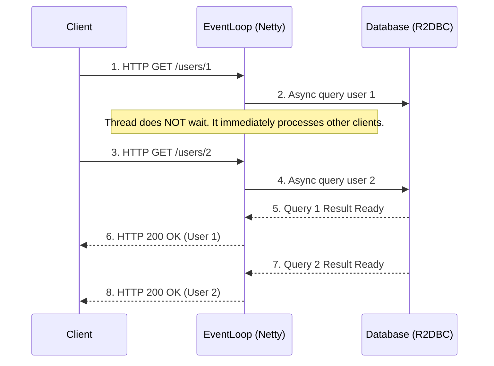

# Module 17: Reactive Programming with Spring WebFlux

Reactive programming fundamentally changes how we think about system architecture and request processing. In the modern era of microservices, cloud-native applications, and the demand for high scalability, traditional synchronous programming models often hit structural limitations. Spring WebFlux, introduced in Spring Framework 5, is Spring's fully non-blocking, reactive web framework built on Project Reactor.

This comprehensive guide will take you from the conceptual foundations of reactive programming all the way to production-grade WebFlux implementation.

---

## 1. Imperative vs Reactive

To understand why we need WebFlux, we first need to understand the limitations of the traditional model it replaces.

### The Thread-Per-Request Model (Imperative)

Traditional Java web applications (like Spring MVC running on Apache Tomcat) use a **Thread-Per-Request** model. 

1. A client sends an HTTP request.
2. The servlet container (Tomcat) allocates a dedicated thread from its thread pool to handle this request.
3. The thread processes the request sequentially. If it needs to make a database call or an external API HTTP call, the thread **blocks** (waits) until the response arrives.
4. Once the response is formed, it is sent back to the client, and the thread is returned to the pool.

> [!WARNING] The Bottleneck
> When an application is highly I/O bound (e.g., waiting for slow databases, third-party APIs), threads spend most of their time doing absolutely nothing—just waiting. If thousands of concurrent requests hit the server, the thread pool (default 200 in Tomcat) depletes rapidly. The server must either queue requests or reject them, leading to latency spikes and cascading failures.

### The Event Loop Model (Reactive)

Spring WebFlux (running on servers like Netty) uses an **Event Loop** model, similar to Node.js, but highly optimized for the JVM.

1. A small number of threads (typically one per CPU core) handle all incoming requests in a continuous loop.
2. When a request arrives, the event loop takes it and routes it to the appropriate handler.
3. If the handler needs to perform an I/O operation (like querying a DB), it **does not block**. Instead, it delegates the I/O operation to an asynchronous worker and immediately returns to the event loop to pick up the next incoming request.
4. When the I/O operation completes, an event is fired. The event loop picks up this event and resumes processing the original request, eventually sending the response to the client.



### Why Reactive? 

| Feature | Imperative (Spring MVC) | Reactive (Spring WebFlux) |
|---------|-------------------------|---------------------------|
| **Execution Model** | Thread-per-request | Event Loop |
| **I/O** | Blocking (Synchronous) | Non-blocking (Asynchronous) |
| **Best For** | CPU-bound tasks, simple CRUD | I/O-bound tasks, streaming, microservices |
| **Scalability** | Limited by Thread Pool | Limited by CPU / Memory |
| **Complexity** | Low (Straightforward debugging) | High (Steep learning curve, hard debugging) |

**Key Drivers for Reactive:**
1. **The C10K Problem:** Handling 10,000+ concurrent connections. Blocking architectures fail here due to memory overhead (each thread takes ~1MB of RAM stack size). 10,000 threads = 10GB of RAM just for thread stacks! Reactive handles this with a handful of threads.
2. **Microservices & API Gateways:** Gateways (like Spring Cloud Gateway) route requests to dozens of downstream services. If they blocked on every downstream call, they would collapse under load.
3. **Resource Efficiency:** Do more with less hardware. Reactive systems can handle higher throughput on smaller instances.

### Backpressure Explained

Backpressure is a core concept of the Reactive Streams specification. It is a feedback mechanism that allows a **Subscriber** (consumer) to tell a **Publisher** (producer) how much data it can handle, preventing the subscriber from being overwhelmed by a fast producer (OutOfMemory errors).

In the imperative world, if a DB returns 1 million rows, they are loaded into RAM. In reactive, the subscriber requests data in chunks (e.g., "Give me 10 items"). The publisher sends 10 items. The subscriber processes them and says, "Give me 10 more."

> [!NOTE] Reactive Streams Interfaces
> The JVM Reactive Streams API consists of four interfaces: `Publisher`, `Subscriber`, `Subscription` (where backpressure is controlled via `request(long n)`), and `Processor`.

---

## 2. Project Reactor Basics

Spring WebFlux is built on **Project Reactor**, a Reactive Streams implementation by Pivotal (VMware). You must master Reactor to use WebFlux effectively.

Reactor introduces two core `Publisher` implementations: **Mono** and **Flux**.

### Mono (0 or 1 item)
A `Mono<T>` is a publisher that emits at most one item, and then terminates successfully (or with an error). It is the reactive equivalent of `Optional<T>` or a single object return type.

```java
import reactor.core.publisher.Mono;

public class MonoExamples {
    public void demo() {
        // Create a Mono containing a string
        Mono<String> monoString = Mono.just("Hello WebFlux");
        
        // Empty Mono
        Mono<Void> emptyMono = Mono.empty();
        
        // Mono from an error
        Mono<String> errorMono = Mono.error(new RuntimeException("Oops"));
        
        // Defer execution until subscription (lazy evaluation)
        Mono<String> deferredMono = Mono.defer(() -> Mono.just(heavyComputation()));
    }
    
    private String heavyComputation() {
        return "Result";
    }
}
```

### Flux (0 to N items)
A `Flux<T>` is a publisher that emits 0 to N items, and then terminates successfully or with an error. It is the reactive equivalent of a `List<T>` or a stream of data.

```java
import reactor.core.publisher.Flux;
import java.util.Arrays;
import java.time.Duration;

public class FluxExamples {
    public void demo() {
        // Create a Flux of static elements
        Flux<String> colors = Flux.just("Red", "Green", "Blue");
        
        // From an Iterable
        Flux<String> fromList = Flux.fromIterable(Arrays.asList("A", "B", "C"));
        
        // Emitting numbers periodically (e.g., every 1 second)
        Flux<Long> ticker = Flux.interval(Duration.ofSeconds(1));
    }
}
```

### Essential Operators

Reactor provides hundreds of operators. Here are the most critical ones:

#### 1. `map` (Synchronous Transformation)
Transforms the items emitted by a Publisher by applying a synchronous function.

```java
Flux.just("spring", "boot", "reactive")
    .map(String::toUpperCase)
    .subscribe(System.out::println); 
// Output: SPRING, BOOT, REACTIVE
```

#### 2. `flatMap` (Asynchronous Transformation)
Transforms the items emitted into other Publishers, and then flattens them back into a single Publisher. Crucial for chaining non-blocking asynchronous calls.

```java
// Suppose getUserDetails is a reactive call returning Mono<UserDetails>
public Flux<UserDetails> getDetailsForUsers(Flux<String> userIds) {
    return userIds.flatMap(userId -> fetchUserDetailsAsync(userId)); 
}

private Mono<UserDetails> fetchUserDetailsAsync(String userId) {
    // Non-blocking network call here
    return Mono.just(new UserDetails(userId));
}
```

#### 3. `filter`
Filters items based on a Predicate.

```java
Flux.range(1, 10)
    .filter(i -> i % 2 == 0)
    .subscribe(System.out::println); // 2, 4, 6, 8, 10
```

#### 4. `zip`
Combines multiple Publishers together, waiting for all of them to emit an item, and combines those items into a Tuple.

```java
Mono<String> firstName = Mono.just("John");
Mono<String> lastName = Mono.just("Doe");

Mono.zip(firstName, lastName)
    .map(tuple -> tuple.getT1() + " " + tuple.getT2())
    .subscribe(System.out::println); // Output: John Doe
```

#### 5. `merge`
Interleaves elements from multiple Publishers as they arrive. Order is not guaranteed.

```java
Flux<Integer> flux1 = Flux.just(1, 2).delayElements(Duration.ofMillis(100));
Flux<Integer> flux2 = Flux.just(3, 4).delayElements(Duration.ofMillis(50));

Flux.merge(flux1, flux2)
    .subscribe(System.out::println); // Might output 3, 1, 4, 2 based on timing
```

### 🔍 Deep Dive: The Golden Rule - Subscribe and Execution

> [!IMPORTANT] Nothing Happens Until You Subscribe
> In Project Reactor, building a chain of operators (like `Flux.just().map().filter()`) does **not** execute anything. It merely builds a blueprint (the execution pipeline). 
> The pipeline is only materialized and data only begins to flow when a terminal `.subscribe()` method is called.

```java
// This prints absolutely NOTHING. No operations are executed.
Flux<String> pipeline = Flux.just("A", "B", "C")
    .map(s -> {
        System.out.println("Processing " + s);
        return s.toLowerCase();
    });

// To trigger execution, you must subscribe:
pipeline.subscribe(); // Now "Processing A", "Processing B"... is printed.
```
*Note: In Spring WebFlux, the framework itself acts as the ultimate subscriber. You return a `Mono` or `Flux` from your controller, and Spring handles the subscription when writing to the HTTP response.*

---

## 3. Spring WebFlux

Spring provides two distinct programming models for WebFlux:
1. **Annotated Controllers:** Identical to Spring MVC (`@RestController`, `@GetMapping`).
2. **Functional Endpoints:** A newer, lambda-based routing approach.

### Annotated Controllers

The transition from Spring MVC to WebFlux is syntactically seamless. The main difference is the return types.

```java
import org.springframework.web.bind.annotation.*;
import reactor.core.publisher.Flux;
import reactor.core.publisher.Mono;

@RestController
@RequestMapping("/api/products")
public class ProductController {

    private final ProductReactiveRepository repository;

    public ProductController(ProductReactiveRepository repository) {
        this.repository = repository;
    }

    // Return a single item using Mono
    @GetMapping("/{id}")
    public Mono<Product> getProduct(@PathVariable String id) {
        return repository.findById(id);
    }

    // Return multiple items using Flux
    @GetMapping
    public Flux<Product> getAllProducts() {
        return repository.findAll();
    }

    // Accept reactive bodies
    @PostMapping
    public Mono<Product> createProduct(@RequestBody Mono<Product> productMono) {
        return productMono.flatMap(repository::save);
    }
}
```

### Functional Endpoints

Instead of using annotations, you can define routes using `RouterFunction` and handle them using `HandlerFunction`. This model is preferred by developers who want explicit, immutable, programmatic route configuration.

```java
import org.springframework.context.annotation.Bean;
import org.springframework.context.annotation.Configuration;
import org.springframework.web.reactive.function.server.RouterFunction;
import org.springframework.web.reactive.function.server.ServerResponse;
import static org.springframework.web.reactive.function.server.RequestPredicates.*;
import static org.springframework.web.reactive.function.server.RouterFunctions.route;

@Configuration
public class ProductRouter {

    @Bean
    public RouterFunction<ServerResponse> routes(ProductHandler handler) {
        return route(GET("/fn/products"), handler::getAll)
            .andRoute(GET("/fn/products/{id}"), handler::getById)
            .andRoute(POST("/fn/products"), handler::create);
    }
}
```

The Handler class:

```java
import org.springframework.stereotype.Component;
import org.springframework.web.reactive.function.server.ServerRequest;
import org.springframework.web.reactive.function.server.ServerResponse;
import reactor.core.publisher.Mono;

@Component
public class ProductHandler {
    private final ProductReactiveRepository repository;

    public ProductHandler(ProductReactiveRepository repository) {
        this.repository = repository;
    }

    public Mono<ServerResponse> getAll(ServerRequest request) {
        return ServerResponse.ok().body(repository.findAll(), Product.class);
    }

    public Mono<ServerResponse> getById(ServerRequest request) {
        String id = request.pathVariable("id");
        return repository.findById(id)
            .flatMap(product -> ServerResponse.ok().bodyValue(product))
            .switchIfEmpty(ServerResponse.notFound().build());
    }

    public Mono<ServerResponse> create(ServerRequest request) {
        Mono<Product> productMono = request.bodyToMono(Product.class);
        return productMono.flatMap(repository::save)
            .flatMap(p -> ServerResponse.ok().bodyValue(p));
    }
}
```

### WebClient: The Reactive Alternative to RestTemplate

`RestTemplate` is a blocking API. If you use it inside a WebFlux application, **you will block the event loop**, completely defeating the purpose of WebFlux.

Spring introduced `WebClient` as a non-blocking, reactive HTTP client.

```java
import org.springframework.stereotype.Service;
import org.springframework.web.reactive.function.client.WebClient;
import reactor.core.publisher.Flux;
import reactor.core.publisher.Mono;

@Service
public class ExternalApiService {

    private final WebClient webClient;

    public ExternalApiService(WebClient.Builder webClientBuilder) {
        this.webClient = webClientBuilder.baseUrl("https://api.example.com").build();
    }

    // Reactive GET Request
    public Flux<User> fetchActiveUsers() {
        return this.webClient.get()
            .uri("/users?status=active")
            .retrieve() // Initiates the request
            .bodyToFlux(User.class); // Deserializes JSON array to Flux<User>
    }

    // Reactive POST Request
    public Mono<User> createUser(User newUser) {
        return this.webClient.post()
            .uri("/users")
            .bodyValue(newUser)
            .retrieve()
            .bodyToMono(User.class);
    }
}
```

> [!TIP] Advanced WebClient configuration
> You can configure WebClient timeouts, connection pooling, and filters to handle authentication tokens or tracing IDs across reactive boundaries.

---

## 4. Reactive Data Access

An application is only as non-blocking as its most blocking component. If you use standard JDBC/Hibernate in a WebFlux app, database calls will block the Netty threads. We must use Reactive Data Access libraries.

### R2DBC (Reactive Relational Database Connectivity)

R2DBC provides non-blocking APIs to relational databases (PostgreSQL, MySQL, SQL Server, etc.).

**Maven Dependency:**
```xml
<dependency>
    <groupId>org.springframework.boot</groupId>
    <artifactId>spring-boot-starter-data-r2dbc</artifactId>
</dependency>
<dependency>
    <groupId>io.r2dbc</groupId>
    <artifactId>r2dbc-postgresql</artifactId>
</dependency>
```

**Repository Interface:**
```java
import org.springframework.data.repository.reactive.ReactiveCrudRepository;
import reactor.core.publisher.Flux;

public interface UserRepository extends ReactiveCrudRepository<User, Long> {
    
    // Custom non-blocking query method
    Flux<User> findByLastName(String lastName);
    
    // Custom query using @Query
    @Query("SELECT * FROM users WHERE age > :age")
    Flux<User> findAdults(int age);
}
```

### Reactive NoSQL (MongoDB, Redis)

Spring provides reactive templates and repositories for modern NoSQL databases.

```java
// Reactive Mongo Repository
import org.springframework.data.mongodb.repository.ReactiveMongoRepository;

public interface DocumentRepository extends ReactiveMongoRepository<Document, String> {
    Flux<Document> findByStatus(String status);
}
```

### Transaction Management in WebFlux

Transactions in Spring MVC heavily rely on `ThreadLocal` to bind the DB connection to the current thread. **In reactive programming, a single request can jump across multiple threads.** Therefore, `ThreadLocal` does not work.

Spring provides Reactive Transaction Management using Reactor's `Context` to propagate the transaction context. You can still use the `@Transactional` annotation!

```java
import org.springframework.transaction.annotation.Transactional;
import org.springframework.stereotype.Service;
import reactor.core.publisher.Mono;

@Service
public class OrderService {

    private final OrderRepository orderRepo;
    private final PaymentRepository paymentRepo;

    public OrderService(OrderRepository orderRepo, PaymentRepository paymentRepo) {
        this.orderRepo = orderRepo;
        this.paymentRepo = paymentRepo;
    }

    @Transactional
    public Mono<Void> placeOrder(Order order, Payment payment) {
        return orderRepo.save(order)
            .then(paymentRepo.save(payment))
            .then(); // Emits Mono<Void> on success, rolls back on error.
    }
}
```

---

## 5. Error Handling in WebFlux

Because errors occur asynchronously in a reactive pipeline, `try-catch` blocks don't work. Project Reactor provides specific operators for error handling.

### Reactor Error Operators

```java
public Flux<Integer> getNumbers() {
    return fetchDangerousData() // Might throw an exception
        
        // 1. Return a fallback value
        .onErrorReturn(-1) 
        
        // 2. Execute a fallback publisher
        .onErrorResume(e -> {
            log.error("Failed, switching to cache", e);
            return fetchFromCache();
        })
        
        // 3. Translate the exception
        .onErrorMap(e -> new CustomDomainException("Data fetch failed", e))
        
        // 4. Side effect only (e.g., logging), without swallowing the error
        .doOnError(e -> log.error("An error occurred", e));
}
```

### Global Exception Handling

In WebFlux, you can use the standard `@ControllerAdvice` and `@ExceptionHandler` for annotated controllers.

```java
import org.springframework.http.ResponseEntity;
import org.springframework.web.bind.annotation.ExceptionHandler;
import org.springframework.web.bind.annotation.RestControllerAdvice;
import org.springframework.http.HttpStatus;

@RestControllerAdvice
public class GlobalExceptionHandler {

    @ExceptionHandler(CustomDomainException.class)
    public ResponseEntity<ErrorResponse> handleDomainException(CustomDomainException ex) {
        ErrorResponse response = new ErrorResponse("ERR_01", ex.getMessage());
        return new ResponseEntity<>(response, HttpStatus.BAD_REQUEST);
    }
}
```

For functional endpoints, you implement `ErrorWebExceptionHandler` to handle errors globally.

---

## 6. ⚠️ Interview Traps & Gotchas

Reactive programming is notorious for its steep learning curve. Interviewers frequently test your understanding of these specific pitfalls.

### 1. Blocking the Event Loop (The Deadliest Sin)
**The Trap:** Calling a blocking API (like `Thread.sleep()`, synchronous `RestTemplate`, `java.io` File reading, or JDBC) directly inside a WebFlux pipeline. Because Netty only has a few threads, blocking even a single thread severely degrades application performance.
**The Fix:** If you *must* use a blocking library, you have to offload it to a dedicated thread pool using `subscribeOn(Schedulers.boundedElastic())`.

```java
// WRONG: Blocks the Netty event loop thread
public Mono<String> badApproach() {
    return Mono.fromCallable(() -> blockingDatabaseCall.get()); 
}

// RIGHT: Offloads execution to a specialized elastic thread pool
public Mono<String> goodApproach() {
    return Mono.fromCallable(() -> blockingDatabaseCall.get())
               .subscribeOn(Schedulers.boundedElastic());
}
```

### 2. Using BlockHound
**The Tool:** How do you guarantee no one on your team blocks the event loop? Enter **BlockHound**, a Java agent developed by the Reactor team. It instruments JVM classes to throw a runtime exception if a blocking call is made from a non-blocking thread.
**Usage:** Add it to your tests or development environment. Interviewers love asking how to detect blocking code in reactive apps.

```java
// In your main method or test setup:
BlockHound.install();
```

### 3. map vs flatMap (Synchronous vs Asynchronous Mapping)
**The Trap:** Not knowing when to use which. 
- Use `map` when the transformation is synchronous (e.g., String to Integer).
- Use `flatMap` when the transformation returns another Publisher (e.g., calling an external API or DB).
**The Gotcha:** If you use `map` to call an API returning a `Mono`, you end up with `Mono<Mono<String>>` (nested publishers), which is useless in a pipeline.

### 4. ThreadLocal Does Not Work
**The Trap:** Relying on `ThreadLocal` for passing security contexts, transaction IDs, or MDC (Mapped Diagnostic Context) logging. In Reactor, a single pipeline can switch threads (e.g., jumping from Netty to a bounded elastic thread back to Netty).
**The Fix:** Use Project Reactor's `Context` API (specifically `ContextView`). Spring Security WebFlux handles this automatically, but custom state needs manual management.

```java
// Example of writing to Reactor Context
Mono.just("Hello")
    .flatMap(s -> Mono.deferContextual(ctx -> {
        String user = ctx.get("username");
        return Mono.just(s + " " + user);
    }))
    .contextWrite(Context.of("username", "admin"));
```

### 5. Calling `.block()` on a Mono/Flux
**The Trap:** Desperately trying to extract the value out of a `Mono` by calling `.block()`.
**The Gotcha:** If you call `.block()` inside a WebFlux thread (Netty thread), Spring WebFlux detects it and deliberately throws an `IllegalStateException: block()/blockFirst()/blockLast() are blocking, which is not supported in thread reactor-http-nio`.
**The Rule:** Stay reactive all the way down. Return the `Mono` to the framework.

---

## 🔍 Deep Dive: How the Netty Event Loop Works Under the Hood

When a Spring WebFlux app starts on Netty, it provisions a small number of "Boss" threads (to accept incoming TCP connections) and "Worker" threads (to handle the actual I/O). The number of worker threads defaults to the number of available CPU cores.

Netty uses the OS's native non-blocking multiplexing APIs (`epoll` on Linux, `kqueue` on macOS, `select` on Windows).
1. The thread calls `epoll_wait`. It asks the OS: "Tell me which of these thousands of open connections has data ready to read."
2. The OS returns a list of file descriptors that are ready.
3. The thread processes the data for those specific connections.
4. If an application makes an outward call (e.g., via `WebClient`), it registers a callback and goes back to `epoll_wait`.

This architecture is why blocking a thread is fatal. If the Netty thread is busy waiting on a JDBC database lock, it cannot call `epoll_wait`, meaning *no other client connections can be processed by that thread*.

---

## 7. 📝 Summary & Key Takeaways

1. **Reactive != Fast:** WebFlux does not make a single request faster. In fact, due to the overhead of the Reactor framework, a single request might be slightly slower. WebFlux is about **Concurrency and Scale**—processing vastly more requests concurrently with fewer resources.
2. **All or Nothing:** To truly benefit from WebFlux, your entire stack must be reactive. Reactive Web layer + WebClient + R2DBC + Reactive NoSQL. A single blocking component forces you into complex thread-pool offloading.
3. **Immutability:** Reactor pipelines are immutable definitions. They execute only upon subscription.
4. **Backpressure:** System stability is guaranteed by the subscriber controlling the rate of data emission.

---

## 8. ❓ Practice Questions

1. Explain the C10K problem and how the Event Loop architecture solves it compared to the Thread-Per-Request model.
2. You have a `Flux<Long> userIds`. For each ID, you need to call a reactive `UserService.getUser(Long id)` that returns a `Mono<User>`. Should you use `map` or `flatMap`? Why?
3. What is BlockHound, and why is it critical in a Spring WebFlux project?
4. A junior developer added a call to a legacy SOAP service using `java.net.HttpURLConnection` inside a WebFlux controller. What happens to the application under load? How do you correctly isolate this legacy call?
5. Why does `@Transactional` work differently in WebFlux compared to Spring MVC? How is the transaction context passed if `ThreadLocal` cannot be used?
