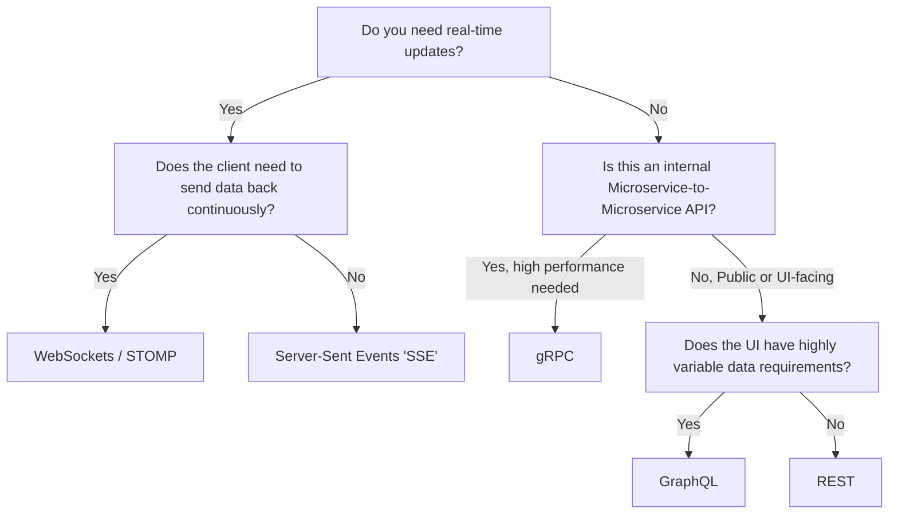

# Alternative API Paradigms in Spring Boot: GraphQL, WebSockets, and SSE

Welcome to this comprehensive deep dive into **Alternative API Paradigms** using Spring Boot. While REST (Representational State Transfer) has been the de facto standard for building web services for over a decade, modern application requirements often stretch its capabilities. 

From over-fetching and under-fetching data in complex UIs, to the need for real-time bidirectional communication, backend engineers must be fluent in multiple API paradigms. In this module, we will explore **GraphQL**, **WebSockets (with STOMP)**, and **Server-Sent Events (SSE)**. 

We will cover everything from schema definition and the infamous N+1 problem in GraphQL, to scaling WebSockets across a distributed cluster using Redis.

---

## 1. Introduction: Beyond REST

Before diving into the code, we must understand *why* we are deviating from REST and *when* to choose which paradigm.

### REST vs. GraphQL vs. gRPC vs. WebSockets

| Feature | REST | GraphQL | gRPC | WebSockets (STOMP) | SSE |
|---------|------|---------|------|--------------------|-----|
| **Architecture** | Resource-oriented | Query-oriented | RPC-oriented | Event-oriented | Event-oriented |
| **Transport** | HTTP/1.1 or HTTP/2 | HTTP/1.1 or HTTP/2 | HTTP/2 exclusively | TCP (via HTTP Upgrade) | HTTP/1.1 or HTTP/2 |
| **Data Format** | JSON / XML | JSON | Protobuf (Binary) | JSON / Text / Binary | Text (Event Stream) |
| **Communication** | Unidirectional (Req/Res) | Unidirectional (Req/Res) | Unidirectional / Streaming | Bidirectional (Full-duplex)| Unidirectional (Server-to-Client) |
| **Over/Under-fetching**| Common problem | Solved (Client specifies) | Solved (Strict contracts)| N/A | N/A |
| **Caching** | Native (HTTP GET) | Difficult (POST heavily used) | Difficult | No | No |
| **Best For** | Public APIs, CRUD | Complex UIs, Mobile Apps | Microservices internal comms | Chat apps, Live Gaming | Live feeds, Tickers, Notifications |

### Decision Flowchart



> [!IMPORTANT]
> **Interview Tip**: Never say "GraphQL is better than REST" in an interview. Senior engineers know that every technology is a tradeoff. GraphQL solves over-fetching but introduces complex caching and N+1 query challenges. REST is simpler to cache and scale but can lead to chatty network calls. Context is everything.

---

## 2. Spring for GraphQL

Spring for GraphQL is the official integration between Spring Boot and GraphQL Java. It provides a familiar, annotation-based programming model (similar to Spring MVC) for building GraphQL applications.

### 2.1 Dependencies and Setup

To get started, you need to include the `spring-boot-starter-graphql` and a web starter (either MVC or WebFlux).

```xml
<dependencies>
    <!-- Spring Boot Web for HTTP transport -->
    <dependency>
        <groupId>org.springframework.boot</groupId>
        <artifactId>spring-boot-starter-web</artifactId>
    </dependency>
    
    <!-- Spring Boot GraphQL -->
    <dependency>
        <groupId>org.springframework.boot</groupId>
        <artifactId>spring-boot-starter-graphql</artifactId>
    </dependency>
    
    <!-- Database dependencies for our examples -->
    <dependency>
        <groupId>org.springframework.boot</groupId>
        <artifactId>spring-boot-starter-data-jpa</artifactId>
    </dependency>
    <dependency>
        <groupId>com.h2database</groupId>
        <artifactId>h2</artifactId>
        <scope>runtime</scope>
    </dependency>
</dependencies>
```

### 2.2 GraphQL Schema Definition (`.graphqls`)

GraphQL is **strongly typed**. Everything begins with the schema. By default, Spring looks for schema files ending in `.graphqls` or `.gqls` in the `src/main/resources/graphql` directory.

Let's model a classic `Author` and `Book` relationship.

**`src/main/resources/graphql/schema.graphqls`**
```graphql
# The Query type defines the entry points for READ operations
type Query {
    # Fetch a single author by ID
    authorById(id: ID!): Author
    
    # Fetch all authors
    allAuthors: [Author!]!
    
    # Fetch a book by ID
    bookById(id: ID!): Book
}

# The Mutation type defines the entry points for WRITE operations
type Mutation {
    # Create a new author
    createAuthor(name: String!): Author!
    
    # Add a book to an author
    addBook(authorId: ID!, title: String!, pageCount: Int): Book!
}

# Domain Types
type Author {
    id: ID!
    name: String!
    # An author can have multiple books
    books: [Book!]!
}

type Book {
    id: ID!
    title: String!
    pageCount: Int
    # Every book belongs to an author
    author: Author!
}
```

> [!NOTE]
> The `!` signifies that the field is **non-nullable**. If `!` is omitted, the field can return `null`. `[Author!]!` means the list itself cannot be null, and it cannot contain null elements.

### 2.3 Domain Objects & Repositories

Let's define the JPA entities to back our schema.

```java
package com.example.graphql.domain;

import jakarta.persistence.*;
import java.util.ArrayList;
import java.util.List;

@Entity
public class Author {
    
    @Id
    @GeneratedValue(strategy = GenerationType.IDENTITY)
    private Long id;
    
    private String name;
    
    @OneToMany(mappedBy = "author", cascade = CascadeType.ALL, fetch = FetchType.LAZY)
    private List<Book> books = new ArrayList<>();

    // Constructors, Getters, and Setters omitted for brevity
    public Author() {}
    
    public Author(String name) {
        this.name = name;
    }
    
    public Long getId() { return id; }
    public String getName() { return name; }
    public List<Book> getBooks() { return books; }
}

@Entity
public class Book {
    
    @Id
    @GeneratedValue(strategy = GenerationType.IDENTITY)
    private Long id;
    
    private String title;
    private Integer pageCount;
    
    @ManyToOne(fetch = FetchType.LAZY)
    @JoinColumn(name = "author_id")
    private Author author;

    // Constructors, Getters, Setters omitted
    public Book() {}
    
    public Book(String title, Integer pageCount, Author author) {
        this.title = title;
        this.pageCount = pageCount;
        this.author = author;
    }
}
```

And the standard Spring Data Repositories:

```java
package com.example.graphql.repository;

import com.example.graphql.domain.Author;
import com.example.graphql.domain.Book;
import org.springframework.data.jpa.repository.JpaRepository;
import java.util.List;

public interface AuthorRepository extends JpaRepository<Author, Long> {
}

public interface BookRepository extends JpaRepository<Book, Long> {
    List<Book> findByAuthorIdIn(List<Long> authorIds);
}
```

### 2.4 Controllers: `@Controller`, `@QueryMapping`, and `@MutationMapping`

Spring for GraphQL uses the `@Controller` annotation. Instead of `@GetMapping` or `@PostMapping`, we use `@QueryMapping` and `@MutationMapping`.

```java
package com.example.graphql.controller;

import com.example.graphql.domain.Author;
import com.example.graphql.domain.Book;
import com.example.graphql.repository.AuthorRepository;
import com.example.graphql.repository.BookRepository;
import org.springframework.graphql.data.method.annotation.Argument;
import org.springframework.graphql.data.method.annotation.MutationMapping;
import org.springframework.graphql.data.method.annotation.QueryMapping;
import org.springframework.graphql.data.method.annotation.SchemaMapping;
import org.springframework.stereotype.Controller;
import java.util.List;

@Controller
public class LibraryController {

    private final AuthorRepository authorRepository;
    private final BookRepository bookRepository;

    public LibraryController(AuthorRepository authorRepository, BookRepository bookRepository) {
        this.authorRepository = authorRepository;
        this.bookRepository = bookRepository;
    }

    // Matches the Query 'allAuthors' in the schema
    @QueryMapping
    public List<Author> allAuthors() {
        return authorRepository.findAll();
    }

    // Matches the Query 'authorById' in the schema
    // @Argument is used to extract arguments from the GraphQL query
    @QueryMapping
    public Author authorById(@Argument Long id) {
        return authorRepository.findById(id)
                .orElseThrow(() -> new IllegalArgumentException("Author not found"));
    }

    // Matches the Mutation 'createAuthor'
    @MutationMapping
    public Author createAuthor(@Argument String name) {
        return authorRepository.save(new Author(name));
    }
}
```

#### Understanding `@SchemaMapping` and DataFetchers

In GraphQL, you don't just fetch top-level objects. When a client requests an `Author`, they might also request their `Book`s. 

If we rely on JPA Lazy Loading natively inside the GraphQL engine, we hit a problem: The Hibernate Session might be closed by the time the GraphQL engine tries to fetch `books`, OR we generate an N+1 query problem.

To explicitly tell Spring how to fetch the `books` field for an `Author`, we use `@SchemaMapping`.

```java
    // This tells Spring: "When resolving the 'books' field on the 'Author' type, use this method"
    @SchemaMapping(typeName = "Author", field = "books")
    public List<Book> getBooksForAuthor(Author author) {
        System.out.println("Fetching books for author: " + author.getName());
        return author.getBooks(); // This triggers Lazy Loading (and N+1)
    }
```
*Note: If the Java method name matches the schema field name (e.g., `books(Author author)`), you can simply use `@SchemaMapping` without specifying the field, or use `@SchemaMapping(typeName="Author")`.*

### 2.5 🔍 Deep Dive: The N+1 Problem in GraphQL

This is the most critical concept to understand for a backend interview regarding GraphQL. 

**The Scenario:**
A client sends the following GraphQL query:
```graphql
query {
  allAuthors {
    name
    books {
      title
    }
  }
}
```

**What the Server Does (The N+1 Traps):**
1. Spring executes `allAuthors()`. (1 SQL Query to fetch N authors).
2. The GraphQL engine looks at the results. Let's say there are 100 authors.
3. For **each** of the 100 authors, the GraphQL engine needs to resolve the `books` field.
4. It calls `getBooksForAuthor(Author author)` 100 separate times!
5. This results in **100 additional SQL Queries**. 

Total Queries = 1 (to fetch authors) + N (to fetch books per author). **Total: 101 queries.**
This will completely destroy your database performance in production.

### 2.6 Solving N+1 with `@BatchMapping` and `DataLoader`

To solve this, GraphQL relies on a pattern called `DataLoader`. A DataLoader batches multiple requests for keys into a single bulk fetch request. 

Spring Boot makes this incredibly easy with the `@BatchMapping` annotation.

Instead of writing a `@SchemaMapping` that fetches books for a *single* author, we write a `@BatchMapping` that takes a *List* of authors, and returns a Map grouping the books by author.

```java
    import org.springframework.graphql.data.method.annotation.BatchMapping;
    import java.util.Map;
    import java.util.stream.Collectors;

    /**
     * Solves the N+1 problem.
     * Spring will gather all Authors needed for the current execution tree,
     * wait a few milliseconds, and pass them ALL into this method as a List.
     */
    @BatchMapping(typeName = "Author", field = "books")
    public Map<Author, List<Book>> books(List<Author> authors) {
        System.out.println("Fetching books in BATCH for " + authors.size() + " authors");
        
        // Extract IDs
        List<Long> authorIds = authors.stream().map(Author::getId).toList();
        
        // 1 SINGLE SQL QUERY!
        // SELECT * FROM book WHERE author_id IN (id1, id2, ..., idN)
        List<Book> allBooks = bookRepository.findByAuthorIdIn(authorIds);
        
        // Group the books back to their respective authors
        return allBooks.stream()
                .collect(Collectors.groupingBy(Book::getAuthor));
    }
```

**Result:**
Total SQL Queries = 1 (fetch authors) + 1 (fetch all books for those authors using `IN` clause). **Total: 2 queries**, regardless of how many authors there are.

> [!TIP]
> **Performance Optimization**: Always use `@BatchMapping` or manual `DataLoader` registrations for any relationship fields in GraphQL. Never allow N+1 queries to reach production.

### 2.7 Exception Handling in Spring GraphQL

In REST, we map exceptions to HTTP status codes (e.g., 404, 500) using `@ExceptionHandler`. 
In GraphQL, the HTTP status code is almost always `200 OK`, even if there's an error! Errors are returned in a dedicated `errors` array in the JSON response.

To handle exceptions gracefully, implement a `DataFetcherExceptionResolver`.

```java
package com.example.graphql.exception;

import graphql.GraphQLError;
import graphql.GraphqlErrorBuilder;
import graphql.schema.DataFetchingEnvironment;
import org.springframework.graphql.execution.DataFetcherExceptionResolverAdapter;
import org.springframework.graphql.execution.ErrorType;
import org.springframework.stereotype.Component;

@Component
public class CustomExceptionResolver extends DataFetcherExceptionResolverAdapter {

    @Override
    protected GraphQLError resolveToSingleError(Throwable ex, DataFetchingEnvironment env) {
        
        if (ex instanceof IllegalArgumentException) {
            return GraphqlErrorBuilder.newError(env)
                    .message("Client Error: " + ex.getMessage())
                    .errorType(ErrorType.BAD_REQUEST)
                    .path(env.getExecutionStepInfo().getPath())
                    .location(env.getField().getSourceLocation())
                    .build();
        }

        // Return generic error for server crashes to hide implementation details
        return GraphqlErrorBuilder.newError(env)
                .message("Internal Server Error occurred.")
                .errorType(ErrorType.INTERNAL_ERROR)
                .path(env.getExecutionStepInfo().getPath())
                .location(env.getField().getSourceLocation())
                .build();
    }
}
```

### 2.8 Securing GraphQL Endpoints

Because GraphQL operates over a single endpoint (usually `POST /graphql`), URL-based security (e.g., `requestMatchers("/api/admin/**").hasRole("ADMIN")`) is largely useless.

You must secure GraphQL at the **method level** using Spring Security's `@PreAuthorize`.

```java
import org.springframework.security.access.prepost.PreAuthorize;

@Controller
public class SecuredLibraryController {

    @QueryMapping
    @PreAuthorize("hasRole('USER')")
    public List<Author> allAuthors() { ... }

    @MutationMapping
    @PreAuthorize("hasRole('ADMIN')")
    public Author createAuthor(@Argument String name) { ... }
}
```
Spring for GraphQL automatically propagates the `SecurityContext` from the HTTP request into the GraphQL execution thread.

---

## 3. WebSockets & STOMP

While GraphQL is excellent for complex data querying, it is still request-response based. If you need a chat application, live collaborative document editing, or a live stock ticker, you need **Bidirectional Full-Duplex** communication.

### 3.1 HTTP vs WebSockets

- **HTTP**: The client opens a connection, sends a request, the server responds, and the connection is (usually) closed or returned to a pool. The server *cannot* initiate a message to the client.
- **WebSockets**: The client sends an HTTP "Upgrade" request. If the server agrees, the connection switches from HTTP to the WebSocket protocol (ws:// or wss://). The TCP connection stays open permanently. Both the client and server can push messages to each other at any time with extremely low overhead.

### 3.2 Raw WebSockets vs STOMP

Raw WebSockets just send strings or byte arrays. There is no routing, no concept of "topics", and no concept of "users". It's just a raw pipe.

**STOMP (Simple Text Oriented Messaging Protocol)** acts like HTTP for WebSockets. It introduces frames with commands (CONNECT, SEND, SUBSCRIBE, MESSAGE) and headers. It allows Spring to route messages to specific controllers using URLs!

### 3.3 Spring WebSocket Configuration

Let's build a chat application using STOMP over WebSockets.

```java
package com.example.websocket.config;

import org.springframework.context.annotation.Configuration;
import org.springframework.messaging.simp.config.MessageBrokerRegistry;
import org.springframework.web.socket.config.annotation.EnableWebSocketMessageBroker;
import org.springframework.web.socket.config.annotation.StompEndpointRegistry;
import org.springframework.web.socket.config.annotation.WebSocketMessageBrokerConfigurer;

@Configuration
@EnableWebSocketMessageBroker
public class WebSocketConfig implements WebSocketMessageBrokerConfigurer {

    @Override
    public void registerStompEndpoints(StompEndpointRegistry registry) {
        // The endpoint clients will connect to using SockJS/WebSockets
        registry.addEndpoint("/ws-chat")
                .setAllowedOriginPatterns("*")
                .withSockJS(); // Fallback for browsers that don't support WS
    }

    @Override
    public void configureMessageBroker(MessageBrokerRegistry registry) {
        // Prefix for messages sent FROM server TO client
        registry.enableSimpleBroker("/topic", "/queue");
        
        // Prefix for messages sent FROM client TO server (handled by @MessageMapping)
        registry.setApplicationDestinationPrefixes("/app");
        
        // Prefix used for sending messages to specific users
        registry.setUserDestinationPrefix("/user");
    }
}
```

### 3.4 `@MessageMapping` and `@SendTo`

When a client sends a message to `/app/chat`, it routes to a method annotated with `@MessageMapping("/chat")`.

```java
package com.example.websocket.controller;

import org.springframework.messaging.handler.annotation.MessageMapping;
import org.springframework.messaging.handler.annotation.Payload;
import org.springframework.messaging.handler.annotation.SendTo;
import org.springframework.stereotype.Controller;

@Controller
public class ChatController {

    // Client sends to: /app/chat.sendMessage
    @MessageMapping("/chat.sendMessage")
    // Server broadcasts to: /topic/public
    @SendTo("/topic/public")
    public ChatMessage sendMessage(@Payload ChatMessage chatMessage) {
        // You can process the message, save to DB, filter profanity, etc.
        return chatMessage;
    }

    // Client sends to: /app/chat.addUser
    @MessageMapping("/chat.addUser")
    @SendTo("/topic/public")
    public ChatMessage addUser(@Payload ChatMessage chatMessage, 
                               org.springframework.messaging.simp.SimpMessageHeaderAccessor headerAccessor) {
        // Add username in web socket session
        headerAccessor.getSessionAttributes().put("username", chatMessage.getSender());
        return chatMessage;
    }
}
```
*Note: `ChatMessage` is a simple POJO with `type`, `content`, and `sender` fields.*

### 3.5 Programmatic Sending: `SimpMessagingTemplate`

What if the server needs to push a message independently of a client request? (e.g., A background job finishes, or a REST API call triggers a notification). You use `SimpMessagingTemplate`.

```java
package com.example.websocket.service;

import org.springframework.messaging.simp.SimpMessagingTemplate;
import org.springframework.stereotype.Service;

@Service
public class NotificationService {

    private final SimpMessagingTemplate messagingTemplate;

    public NotificationService(SimpMessagingTemplate messagingTemplate) {
        this.messagingTemplate = messagingTemplate;
    }

    public void broadcastSystemAlert(String alert) {
        // Broadcasts to all clients subscribed to /topic/alerts
        messagingTemplate.convertAndSend("/topic/alerts", alert);
    }

    public void sendDirectMessage(String username, String message) {
        // Sends to a specific user. Spring resolves this to /user/{username}/queue/messages
        messagingTemplate.convertAndSendToUser(username, "/queue/messages", message);
    }
}
```

### 3.6 Securing WebSockets (`ChannelInterceptor`)

Standard Spring Security intercepts HTTP requests. Since WebSockets start as HTTP, you can authenticate the initial handshake. 
However, if you are passing JWT tokens, you often pass them in the STOMP `CONNECT` frame headers. You must intercept the STOMP messages.

```java
package com.example.websocket.config;

import org.springframework.context.annotation.Configuration;
import org.springframework.messaging.Message;
import org.springframework.messaging.MessageChannel;
import org.springframework.messaging.simp.config.ChannelRegistration;
import org.springframework.messaging.simp.stomp.StompCommand;
import org.springframework.messaging.simp.stomp.StompHeaderAccessor;
import org.springframework.messaging.support.ChannelInterceptor;
import org.springframework.messaging.support.MessageHeaderAccessor;
import org.springframework.security.authentication.UsernamePasswordAuthenticationToken;
import org.springframework.security.core.context.SecurityContextHolder;
import org.springframework.web.socket.config.annotation.WebSocketMessageBrokerConfigurer;

@Configuration
public class WebSocketSecurityConfig implements WebSocketMessageBrokerConfigurer {

    // Assume a JwtService exists
    private final JwtService jwtService;

    public WebSocketSecurityConfig(JwtService jwtService) {
        this.jwtService = jwtService;
    }

    @Override
    public void configureClientInboundChannel(ChannelRegistration registration) {
        registration.interceptors(new ChannelInterceptor() {
            @Override
            public Message<?> preSend(Message<?> message, MessageChannel channel) {
                StompHeaderAccessor accessor = 
                        MessageHeaderAccessor.getAccessor(message, StompHeaderAccessor.class);

                // If it's a connection attempt
                if (StompCommand.CONNECT.equals(accessor.getCommand())) {
                    String authHeader = accessor.getFirstNativeHeader("Authorization");
                    if (authHeader != null && authHeader.startsWith("Bearer ")) {
                        String token = authHeader.substring(7);
                        String username = jwtService.extractUsername(token);
                        
                        if (jwtService.isTokenValid(token)) {
                            UsernamePasswordAuthenticationToken auth = 
                                    new UsernamePasswordAuthenticationToken(username, null, null);
                            // Setting user allows SimpMessagingTemplate to use convertAndSendToUser
                            accessor.setUser(auth);
                        }
                    }
                }
                return message;
            }
        });
    }
}
```

### 3.7 🔍 Deep Dive: Scaling WebSockets (The Multi-Instance Problem)

> [!WARNING]
> **Massive Interview Trap**: WebSockets are **stateful**. The TCP connection is tied to a specific physical server instance. 

Imagine you have two instances of your chat app: Instance A and Instance B.
- User Alice connects to Instance A.
- User Bob connects to Instance B.
- Alice sends a message to Bob via `/topic/public`.
- Instance A processes the message and broadcasts it to everyone connected to Instance A. 
- **Bob never receives the message because Bob is on Instance B!**

**The Solution: An External Message Broker (Redis Pub/Sub or RabbitMQ)**

Instead of using `enableSimpleBroker()` (which stores subscriptions in local JVM memory), we configure Spring to use a full external broker. 

When Instance A receives a message, it forwards it to Redis Pub/Sub. All instances (A and B) subscribe to Redis. Redis broadcasts the message back down to Instance B, which then pushes it to Bob.

**Using an External Stomp Broker (e.g., RabbitMQ):**
```java
    @Override
    public void configureMessageBroker(MessageBrokerRegistry registry) {
        registry.setApplicationDestinationPrefixes("/app");
        
        // Discard enableSimpleBroker, use enableStompBrokerRelay
        registry.enableStompBrokerRelay("/topic", "/queue")
                .setRelayHost("rabbitmq-server.internal")
                .setRelayPort(61613)
                .setClientLogin("guest")
                .setClientPasscode("guest");
    }
```
*(Alternatively, for Redis, you map the `SimpMessagingTemplate` to publish into a `RedisMessageListenerContainer`.)*

---

## 4. Server-Sent Events (SSE)

What if you just want to stream live stock prices to the UI? The UI doesn't need to send complex messages back. WebSockets are overkill.

**Server-Sent Events (SSE)** is an HTTP standard that allows the server to push a stream of events to the client over a single HTTP connection. It is unidirectional.

### 4.1 SSE in Spring MVC (`SseEmitter`)

In standard Spring MVC (which uses blocking servlet threads), you can return an `SseEmitter`. 

> [!IMPORTANT]
> Because Spring MVC maps one thread per request, keeping an SSE connection open means a Tomcat thread is tied up permanently. You must execute the pushing of data on a separate thread pool, otherwise you will quickly exhaust Tomcat's max thread limit (default 200).

```java
package com.example.sse.controller;

import org.springframework.web.bind.annotation.GetMapping;
import org.springframework.web.bind.annotation.RestController;
import org.springframework.web.servlet.mvc.method.annotation.SseEmitter;
import java.io.IOException;
import java.util.concurrent.ExecutorService;
import java.util.concurrent.Executors;

@RestController
public class StockTickerController {

    private final ExecutorService executor = Executors.newCachedThreadPool();

    @GetMapping("/api/stocks/stream")
    public SseEmitter streamStocks() {
        // Timeout of 0 means infinite
        SseEmitter emitter = new SseEmitter(0L);

        executor.execute(() -> {
            try {
                for (int i = 0; i < 100; i++) {
                    // Send an event
                    emitter.send(SseEmitter.event()
                            .name("stock-update")
                            .id(String.valueOf(i))
                            .data("AAPL: $" + (150 + Math.random() * 10)));
                    
                    Thread.sleep(1000); // Wait 1 second between ticks
                }
                emitter.complete(); // Close connection gracefully
            } catch (Exception ex) {
                emitter.completeWithError(ex);
            }
        });

        return emitter;
    }
}
```

### 4.2 SSE in Spring WebFlux (`Flux`)

SSE shines in Reactive Spring (WebFlux) because Reactive systems don't tie up threads per connection. Thousands of concurrent SSE connections can be handled by a handful of Netty threads.

```java
package com.example.sse.controller;

import org.springframework.http.codec.ServerSentEvent;
import org.springframework.web.bind.annotation.GetMapping;
import org.springframework.web.bind.annotation.RestController;
import reactor.core.publisher.Flux;
import java.time.Duration;

@RestController
public class ReactiveStockController {

    @GetMapping(value = "/api/reactive-stocks", produces = "text/event-stream")
    public Flux<ServerSentEvent<String>> streamReactiveStocks() {
        return Flux.interval(Duration.ofSeconds(1))
                .map(sequence -> ServerSentEvent.<String>builder()
                        .id(String.valueOf(sequence))
                        .event("stock-tick")
                        .data("TSLA: $" + (200 + Math.random() * 5))
                        .build());
    }
}
```

---

## 5. ⚠️ Interview Traps & Gotchas

### Trap 1: The GraphQL N+1 Problem (Massive Trap)
* **The Question:** "We migrated to GraphQL and our database CPU is at 100%. What happened?"
* **The Answer:** Explain the N+1 problem inherent in GraphQL resolvers/data fetchers. Detail how for every parent entity fetched, the child resolver is invoked. State that the solution is to batch these requests using `DataLoader` or Spring's `@BatchMapping`, which groups keys and fetches them in a single `IN` query.

### Trap 2: WebSocket Connection Drops and Heartbeats
* **The Concept:** TCP connections can suffer from "half-open" states where a router or load balancer silently drops the connection, but the server and client don't know it. 
* **The Solution:** Always configure STOMP heartbeats. STOMP natively supports heartbeats. 
  ```java
  registry.enableSimpleBroker("/topic")
          .setTaskScheduler(heartbeatTaskScheduler)
          .setHeartbeatValue(new long[]{10000, 10000}); // 10s ping, 10s pong
  ```

### Trap 3: Sticky Sessions vs External Brokers
* **The Question:** "How do you scale a WebSocket application horizontally?"
* **The Answer:** State clearly that WebSockets are stateful. Load balancers MUST be configured with sticky sessions (IP hash) so a client reconnects to the same server if disconnected. However, to route messages *between* servers, you absolutely must use an external broker (Redis Pub/Sub, RabbitMQ, Kafka) so that a message pushed to Server A is relayed to Server B.

### Trap 4: When NOT to use GraphQL
* **The Concept:** GraphQL operates entirely over POST requests. Because the URL never changes (`POST /graphql`), standard HTTP caching (CDNs, Varnish) does not work out of the box. If you are building a highly read-heavy public API (like an e-commerce product catalog) that relies heavily on CDN edge caching, REST is vastly superior. (Note: Persisted Queries in GraphQL can alleviate this, but it adds complexity).

### Trap 5: SSE Browser Connection Limits
* **The Concept:** Under HTTP/1.1, browsers traditionally limit the number of active connections to a single domain to **six (6)**. If a user opens 7 tabs of your SSE-powered dashboard, the 7th tab will freeze indefinitely.
* **The Solution:** Use HTTP/2 (which multiplexes over a single TCP connection, removing the limit) or use WebSockets, which generally have much higher browser limits per domain (often ~200+).

---

## 6. 📝 Summary & Key Takeaways

1. **GraphQL** empowers clients to fetch exactly what they need, eliminating over-fetching. Spring for GraphQL uses `@QueryMapping`, `@MutationMapping`, and `@SchemaMapping`.
2. **N+1 is the enemy of GraphQL**. Always use `@BatchMapping` (which utilizes DataLoader) for entity relationships to ensure optimal database querying.
3. **WebSockets** provide persistent, full-duplex TCP connections for real-time bidirectional communication.
4. **STOMP** provides a higher-level routing framework over WebSockets, allowing Spring to map endpoints just like MVC.
5. **Horizontal Scaling of WebSockets** requires an external message broker (like Redis or RabbitMQ) because WebSocket connections are stateful and tied to specific JVM instances.
6. **Server-Sent Events (SSE)** is a simpler, unidirectional (server-to-client) alternative to WebSockets over standard HTTP. It is highly optimized in Spring WebFlux.

---

## 7. ❓ Practice Questions

1. Write a GraphQL schema for a `Movie` and `Review` relationship, and implement the Spring Controller using `@BatchMapping` to resolve reviews without N+1.
2. How does the `SecurityContext` flow into a WebSocket STOMP message handler, given that the initial HTTP handshake happens before the STOMP `CONNECT` frame?
3. Design a scalable architecture diagram for a chat application expecting 1,000,000 concurrent WebSocket connections. Where do the Load Balancers, Application instances, and Redis cluster fit in?
4. What happens if you use `SseEmitter` in Spring MVC (blocking) for 50,000 concurrent users? Why is WebFlux better suited for this?
